# HireFlow Navigation & Architecture Audit (NAV_AUDIT.md)

**Date**: 2026-10-15  
**Auditor**: Principal Front-End Architect & UX Engineer  
**Stage**: Stage 1 Architecture Audit (Read-Only)  
**Repository**: `hireflow` (Vite + React 19 + TypeScript + Tailwind CSS v4)

---

## 1. Technology Stack Detection

| Component | Detected Technology | Version & Details |
| :--- | :--- | :--- |
| **Framework** | React 19 + React DOM 19 | `19.3.0` |
| **Build Tool & Bundler** | Vite | `8.3.0` (`@vitejs/plugin-react` 6.1.1) |
| **Router** | React Router DOM | `7.18.4` (BrowserRouter, Routes, Route, Navigate) |
| **Language** | TypeScript | `~6.0.2` (`tsconfig.json` strict mode) |
| **Styling Approach** | Tailwind CSS v4 + Scoped Design Systems | `@tailwindcss/vite` 4.3.3, `@theme` in `src/index.css`, `[data-theme="career-dark"]` |
| **Icon Library** | Lucide React | `^1.47.0` |
| **State Management** | Zustand | `5.0.15` (`src/store/useStore.ts`, `tailorStore.ts`, `useTalentLensStore.ts`) |
| **Test Runner** | Vitest | `5.0.3` |

### Role Gating Mechanism
The platform defines 5 user roles in `src/types/index.ts`:
- `BHR_MANAGER` (Business HR Manager)
- `HR_RECRUITER` (HR Recruiter)
- `INTERVIEWER` (Technical Interviewer)
- `CANDIDATE` (Job Applicant / Tech Talent)
- `PLATFORM_ADMIN` (System Admin)

**Gating Implementation**:
- Roles are evaluated via `ProtectedRoute.tsx` (`evaluateRouteGuard`).
- When unauthenticated, redirect to `/login` with `state: { from: location }`.
- When role-mismatched, redirect to the role's root dashboard (`/company/dashboard`, `/interviewer/dashboard`, `/candidate/dashboard`, `/admin/dashboard`).
- `BHR_MANAGER` and `HR_RECRUITER` share the `/company/*` route prefix.

---

## 2. Full Route Inventory

| Path | Component | Layout Used | Role Access | Notes |
| :--- | :--- | :--- | :--- | :--- |
| `/` | `LandingPage` | None (PublicNavbar) | All (Public) | Hero landing page, feature highlights |
| `/login` | `LoginPage` | None (Standalone) | Public | Auth entry (no sidebar allowed) |
| `/register` | `RegisterPage` | None (Standalone) | Public | Onboarding registration (no sidebar) |
| `/company/:id` | `PublicCompanyProfile` | None | Public | Public view of company branding & open jobs |
| `/demo` | `MatchingDemo` | None (PublicNavbar) | Public | Interactive company-candidate matcher |
| `/demo/company/:companySlug` | `CompanyRolesPage` | None | Public | Deep interactive roles & requirements view |
| `/portal` | `CandidatePortal` | None | Public / Candidate | Public-facing candidate application hub |
| `/tools` | `ToolsHubPage` | None (PublicNavbar + PageNav) | All | Decision Suite central directory (8 tools) |
| `/tools/resume-checker` | `ResumeChecker` | None (PublicNavbar + custom) | All | ATS Resume Roaster with invariant audits |
| `/tools/jd-compare` | `CompareJDsPage` | None (PageNav) | All | Side-by-side JD comparison tool |
| `/tools/tailor` | `TailorResumePage` | None (DarkTailorHeader) | All | Resume Tailor Engine with A4 live preview |
| `/tools/reach-out` | `ReachOutPage` | None (Inline banner) | All | Executive cold outreach copy generator |
| `/tools/build-briefs` | `BuildBriefsPage` | None (PageNav) | All | Executive candidate briefs builder |
| `/tools/career-path` | `CareerPathHub` | None (CareerPathBackButton) | All | Career Trajectory landing page & matrix |
| `/tools/career-path/dream-job-roadmap` | `DreamJobRoadmapPage` | None (CareerPathSimulator) | All | Milestone career roadmap generator |
| `/tools/career-path/company-levels` | `CompanyLevelsPage` | None (CareerPathSimulator) | All | Engineering leveling & CTC benchmarks |
| `/tools/career-path/promotion-simulator` | Redirect | — | All | Redirects to `.../dream-job-roadmap` |
| `/tools/career-path/company-ladder` | Redirect | — | All | Redirects to `.../company-levels` |
| `/tools/career-path/simulator` | Redirect | — | All | Redirects to `.../dream-job-roadmap` |
| `/tools/career-path/explorer` | Redirect | — | All | Redirects to `.../company-levels` |
| `/tools/talent-lens` | `TalentLens` | None (Custom header) | All | Recruiter POV simulation tool |
| `/tools/credential-engine` | `CredentialOpportunityEnginePage` | None (PageNav) | All | 102 verified certs, hackathons & fellowships |
| `/tools/credentials` | Redirect | — | All | Redirects to `.../credential-engine` |
| `/tools/opportunity-engine` | Redirect | — | All | Redirects to `.../credential-engine` |
| `/dev/careers-data` | `CareersDataExplorer` | None | All / Dev | Developer taxonomy & stats inspector |
| `/company/dashboard` | `CompanyDashboard` | `AppShell` (Sidebar + TopHeader) | BHR_MANAGER, HR_RECRUITER | Metric cards, active requisitions, pipeline |
| `/company/jobs` | `CompanyJobs` | `AppShell` | BHR_MANAGER, HR_RECRUITER | Requisition directory & status filters |
| `/company/jobs/new` | `CreateJob` | `AppShell` | BHR_MANAGER, HR_RECRUITER | 4-step job posting wizard |
| `/company/jobs/:id` | `CompanyJobDetail` | `AppShell` | BHR_MANAGER, HR_RECRUITER | Role view, candidate stages, interviewers |
| `/company/jobs/:id/edit` | `EditJob` | `AppShell` | BHR_MANAGER, HR_RECRUITER | Requisition editor |
| `/company/candidates` | `CompanyCandidates` | `AppShell` | BHR_MANAGER, HR_RECRUITER | Applicant tracking table with filters |
| `/company/candidates/:candidateId` | `CandidateDetail` | `AppShell` | BHR_MANAGER, HR_RECRUITER | Applicant scorecard, resume, stage action |
| `/company/candidates/:candidateId/intelligence` | `CandidateIntelligence` | `AppShell` | BHR_MANAGER, HR_RECRUITER | Deep AI candidate assessment breakdown |
| `/company/interviewers` | `CompanyInterviewers` | `AppShell` | BHR_MANAGER, HR_RECRUITER | Interviewer load, assignments, pass rate |
| `/company/analytics` | `CompanyAnalytics` | `AppShell` | BHR_MANAGER, HR_RECRUITER | Time-to-hire, funnel metrics, diversity |
| `/company/team` | `CompanyTeam` | `AppShell` | BHR_MANAGER | Hiring managers & recruiter permissions |
| `/company/offers` | `CompanyOffers` | `AppShell` | BHR_MANAGER, HR_RECRUITER | Compensation, approval pipeline, letters |
| `/company/settings` | `CompanySettings` | `AppShell` | BHR_MANAGER | Company profile, domains, ATS sync |
| `/company/notifications` | `NotificationsPage` | `AppShell` | BHR_MANAGER, HR_RECRUITER | Recruiter alerts & notifications |
| `/interviewer/dashboard` | `InterviewerDashboard` | `AppShell` | INTERVIEWER | Today's rounds, upcoming sessions |
| `/interviewer/interviews` | `InterviewerInterviews` | `AppShell` | INTERVIEWER | Past & future candidate evaluations |
| `/interviewer/interviews/:id` | `InterviewDetail` | `AppShell` | INTERVIEWER | Scorecard submission & feedback rubric |
| `/interviewer/profile` | `InterviewerProfile` | `AppShell` | INTERVIEWER | Tech competencies, availability slots |
| `/interviewer/notifications` | `NotificationsPage` | `AppShell` | INTERVIEWER | Interview assignment alerts |
| `/candidate/dashboard` | `CandidateDashboard` | `AppShell` | CANDIDATE | Application statuses, next rounds |
| `/candidate/jobs` | `CandidateJobs` | `AppShell` | CANDIDATE | Job search, company match rating |
| `/candidate/jobs/:id` | `PublicJobDetail` | `AppShell` | CANDIDATE | Detailed JD, required skills, 1-click apply |
| `/candidate/applications` | `CandidateApplications` | `AppShell` | CANDIDATE | Submitted applications & current stages |
| `/candidate/applications/:id` | `CandidateApplicationDetail` | `AppShell` | CANDIDATE | Stage progression timeline, feedback |
| `/candidate/interviews` | `CandidateInterviews` | `AppShell` | CANDIDATE | Scheduled interview rounds & links |
| `/candidate/resume` | `CandidateResume` | `AppShell` | CANDIDATE | Stored resume, parsed skills, AI match |
| `/candidate/company-match` | `CompanyMatch` | `AppShell` | CANDIDATE | Culture, tech stack, and CTC fit score |
| `/candidate/profile` | `CandidateProfilePage` | `AppShell` | CANDIDATE | Personal info, experience, preferences |
| `/candidate/notifications` | `NotificationsPage` | `AppShell` | CANDIDATE | Status change alerts, interview invites |
| `/admin/dashboard` | `AdminDashboard` | `AppShell` | PLATFORM_ADMIN | Platform overview, tenant counts |
| `/admin/companies` | `AdminCompanies` | `AppShell` | PLATFORM_ADMIN | Tenant management & approval |
| `/admin/users` | `AdminUsers` | `AppShell` | PLATFORM_ADMIN | Global user roles & permission flags |
| `/admin/audit` | `AdminAuditLog` | `AppShell` | PLATFORM_ADMIN | Security events, login audit trail |
| `/admin/settings` | `AdminSettings` | `AppShell` | PLATFORM_ADMIN | Global AI engine keys, rate limits |
| `/admin/notifications` | `NotificationsPage` | `AppShell` | PLATFORM_ADMIN | Platform alerts & error logs |
| `*` | Catch-All Navigate | — | All | Redirects to `/` |

---

## 3. Existing Section & Subsection Tree

```mermaid
graph TD
  Root["HireFlow Platform"] --> Public["Public Area"]
  Root --> DecisionSuite["Decision Suite & Candidate Tools"]
  Root --> CompanyRole["Company Portal (BHR & Recruiter)"]
  Root --> InterviewerRole["Interviewer Portal"]
  Root --> CandidateRole["Candidate Workspace"]
  Root --> AdminRole["Platform Administration"]

  DecisionSuite --> Hub["Tools Hub (/tools)"]
  DecisionSuite --> A["Group A: Applications & Outreach"]
  A --> T1["ATS Resume Roaster (/tools/resume-checker)"]
  A --> T2["Resume Tailor Engine (/tools/tailor)"]
  A --> T3["Executive Outreach (/tools/reach-out)"]

  DecisionSuite --> B["Group B: Career & Role Intelligence"]
  B --> T4["Compare Job Descriptions (/tools/jd-compare)"]
  B --> T5["Executive Briefs Builder (/tools/build-briefs)"]
  B --> T6["TalentLens Recruiter Simulator (/tools/talent-lens)"]

  DecisionSuite --> C["Group C: Pathways & Credentials"]
  C --> T7["Career Trajectory Hub (/tools/career-path)"]
  T7 --> T7a["Dream Job Roadmap (/tools/career-path/dream-job-roadmap)"]
  T7 --> T7b["Company Levels Matrix (/tools/career-path/company-levels)"]
  C --> T8["Credential & Opportunity Engine (/tools/credential-engine)"]
  C --> T9["Careers Data Explorer (/dev/careers-data)"]

  CompanyRole --> CDash["Dashboard (/company/dashboard)"]
  CompanyRole --> CJobs["Jobs Hub (/company/jobs)"]
  CJobs --> CJobNew["Create Job (/company/jobs/new)"]
  CJobs --> CJobDet["Job Detail (/company/jobs/:id)"]
  CompanyRole --> CCand["Candidates (/company/candidates)"]
  CCand --> CCandDet["Candidate Detail (/company/candidates/:id)"]
  CCand --> CCandIntel["AI Intelligence (/company/candidates/:id/intelligence)"]
  CompanyRole --> CTeam["Team & Interviewers"]
  CTeam --> CInterv["Interviewers (/company/interviewers)"]
  CTeam --> CCompTeam["Company Team (/company/team)"]
  CompanyRole --> COffers["Offers Pipeline (/company/offers)"]
  CompanyRole --> CAnalytics["Analytics (/company/analytics)"]
  CompanyRole --> CSettings["Settings (/company/settings)"]

  CandidateRole --> CandDash["Home (/candidate/dashboard)"]
  CandidateRole --> CandJobs["Find Jobs (/candidate/jobs)"]
  CandidateRole --> CandApps["My Applications (/candidate/applications)"]
  CandidateRole --> CandInterv["Interviews (/candidate/interviews)"]
  CandidateRole --> CandResume["Resume & AI Match (/candidate/resume)"]
  CandidateRole --> CandMatch["Company Match (/candidate/company-match)"]
  CandidateRole --> CandProf["Profile (/candidate/profile)"]

  InterviewerRole --> IntDash["Dashboard (/interviewer/dashboard)"]
  InterviewerRole --> IntList["My Interviews (/interviewer/interviews)"]
  InterviewerRole --> IntProf["Interviewer Profile (/interviewer/profile)"]

  AdminRole --> AdmDash["Dashboard (/admin/dashboard)"]
  AdminRole --> AdmComp["Companies (/admin/companies)"]
  AdminRole --> AdmUsers["Users (/admin/users)"]
  AdminRole --> AdmAudit["Audit Log (/admin/audit)"]
  AdminRole --> AdmSettings["Settings (/admin/settings)"]
```

---

## 4. Current Header, Back, and Home Button Behavior

| Page | Header Present? | Back Button Target | Home Button Target | Issues & Overlaps |
| :--- | :--- | :--- | :--- | :--- |
| `ToolsHubPage` | `PublicNavbar` (fixed 68px) + `PageNav` (absolute top-6 left-6) | `window.history.length > 2 ? -1 : /tools` | `/` | **Severe Visual Overlap**: `PageNav` floating pill collides directly with `PublicNavbar` logo/nav area. |
| `ResumeChecker` | `PublicNavbar` + inline button | Custom: if `engineResult` calls `handleTryAnotherJob()`, else `/tools` | None | Inconsistent with `PageNav`; lacks Home link; lacks breadcrumbs. |
| `CompareJDsPage` | `PageNav` | `result ? setResult(null) : -1` | `/` | Floating `PageNav` sits at `top-6 left-6`, has no persistent context of where in the suite user is. |
| `TailorResumePage` | `DarkTailorHeader` | Link to `/tools` | None | Entirely bespoke header; no link back to user dashboard or Home. |
| `ReachOutPage` | Bespoke sticky banner | Link to `/tools/career-path` labeled `"Tools Hub"` | None | **Broken Navigation Bug**: Link text says "Tools Hub" but href is `/tools/career-path`! Also has dead link to `/tools/tracker`. |
| `BuildBriefsPage` | `PageNav` | `navigate(-1)` | `/` | Floating pill over form layout. |
| `CareerPathHub` | `CareerPathBackButton` | `/` (isHub variant) | `/` | Has separate dark navbar; distinct from standard `PageNav` style. |
| `DreamJobRoadmapPage` | `CareerPathBackButton` | `/tools/career-path` | `/` | Features custom breadcrumb `HireFlow > Career Trajectory > Dream Job Roadmap`. |
| `CompanyLevelsPage` | `CareerPathBackButton` | `/tools/career-path` | `/` | Same as above. |
| `TalentLens` | Custom inline header | `<Link to="/">← Go back to Home</Link>` | `/` | No back history, only jumps to root `/`. |
| `CredentialOpportunityEnginePage` | `PageNav` | `-1` or fallback `/tools` | `/` | Floating pill; modal detail view covers page. |
| Authenticated Role Pages (`/company`, `/candidate`, etc.) | `TopHeader` (greeting, search, notifications, profile dropdown) | History -1 / +1 chevrons in header | Dashboard | Uses `AppShell` with old static `Sidebar`. Tools are largely inaccessible except via Candidate menu link. |

---

## 5. Existing Navigation Components Summary

1. **`AppShell.tsx`** (`src/components/layout/AppShell.tsx`):
   - Wraps only role-protected routes (`/company`, `/interviewer`, `/candidate`, `/admin`).
   - Uses hard-coded 260px expanded / 72px collapsed desktop sidebar.
   - 280px mobile slide-in drawer.
2. **`Sidebar.tsx`** (`src/components/layout/Sidebar.tsx`):
   - Hard-coded static dictionary: `NAV_ITEMS: Record<UserRole, NavItem[]>`.
   - Cannot be extended without modifying the file. Does not support hierarchical subsections or tool pages.
3. **`TopHeader.tsx`** (`src/components/layout/TopHeader.tsx`):
   - 68px sticky header with greeting, search input, notification dropdown, and user profile avatar dropdown.
4. **`PublicNavbar.tsx`** (`src/components/layout/PublicNavbar.tsx`):
   - Fixed top navbar for unauthenticated / landing views. Shows TalentLens badge, Decision Suite, ATS Roaster, Career Trajectory, and Sign In / Register buttons.
5. **`PageNav.tsx`** (`src/components/common/PageNav.tsx`):
   - Absolute floating button pair (`Back` and `Home`) with black press effect (`active:bg-[#0A0A0A]`).
   - Floats at `top-6 left-6 z-40`, causing element overlap when mounted on pages that also have headers.
6. **`CareerPathBackButton.tsx`** (`src/components/career-path/CareerPathBackButton.tsx`):
   - 44px touch target bar with Back button, Home icon, breadcrumb, and India Market badge.
7. **`DarkTailorHeader.tsx`** (`src/features/suite/tailor/components/DarkTailorHeader.tsx`):
   - Dedicated sticky header with export actions (Docx, PDF, TXT, JSON, MD) and back chevron.
8. **`LocalhostNavigator.tsx`** (`src/components/common/LocalhostNavigator.tsx`):
   - Floating debug launcher for rapid local routing.

---

## 6. Dead Routes, Orphan Links & Inconsistencies

1. **`/tools/tracker`**: Referenced in `ReachOutPage.tsx:170` (`<Link to="/tools/tracker">Log in Application Tracker</Link>`), but route does NOT exist in `App.tsx`.
2. **`/jobs/:id`**: Referenced in `CandidateJobs.tsx:168` (`<Link to={'/jobs/${job.id}'}>`), but route does NOT exist in `App.tsx` (the actual route is `/candidate/jobs/:id`). Navigating here hits the catch-all `*` and redirects to `/`.
3. **Mismatched Link Target**: In `ReachOutPage.tsx:155`, `<Link to="/tools/career-path">Tools Hub</Link>` displays "Tools Hub" but navigates to Career Path Hub instead of `/tools`.
4. **Deprecated / Alias Routes in `App.tsx`**:
   - `/tools/career-path/promotion-simulator` -> redirects to `/tools/career-path/dream-job-roadmap`
   - `/tools/career-path/company-ladder` -> redirects to `/tools/career-path/company-levels`
   - `/tools/career-path/simulator` -> redirects to `/tools/career-path/dream-job-roadmap`
   - `/tools/career-path/explorer` -> redirects to `/tools/career-path/company-levels`
   - `/tools/credentials` -> redirects to `/tools/credential-engine`
   - `/tools/opportunity-engine` -> redirects to `/tools/credential-engine`
   - `/admin/analytics` -> redirects to `/admin/dashboard`
   - `/admin/ai` -> redirects to `/admin/settings`

---

## 7. Scroll-Position Behavior on Route Change

- **Current State**: There is **no global scroll-to-top handler** anywhere in `App.tsx` or `BrowserRouter`.
- **Observed Glitch**: When a user scrolls down on `/tools` and clicks any tool card, the new page opens at the previous vertical scroll offset instead of starting cleanly at `top = 0`.
- **Target Fix in Stage 5**: A global `ScrollToTop` router listener that resets `window.scrollTo({ top: 0, left: 0, behavior: 'instant' })` and focuses the main page header on every route transition.

---

## 8. Ranked List of Current Navigation Pain Points

| Rank | Pain Point | Severity | Architectural Root Cause |
| :---: | :--- | :---: | :--- |
| **1** | **Fragmented Navigation Shells** | **Critical** | Role routes use `AppShell` with a sidebar that lacks tools; tool pages have NO sidebar and use 5 different ad-hoc header styles (`PublicNavbar`, `PageNav`, `DarkTailorHeader`, `CareerPathBackButton`, custom inline). |
| **2** | **Inability to Reach Tools from Role Dashboards** | **High** | A recruiter, interviewer, or candidate inside their dashboard cannot directly switch to ATS Roaster, Credential Engine, or Tailor without manually typing the URL or returning to Home. |
| **3** | **Header & Floating Button Collisions** | **High** | `PageNav` renders as `absolute top-6 left-6 z-40`, colliding with `PublicNavbar` or custom headers, obscuring logo titles or action buttons. |
| **4** | **Hard-Coded Static Navigation Tree** | **High** | Adding a new tool, role page, or section requires modifying `Sidebar.tsx`, `App.tsx`, `AppShell.tsx`, and hub index pages manually with high regression risk. |
| **5** | **Scroll Position Retention on Route Change** | **Medium** | Navigating between routes retains previous vertical scroll position, disorienting the user. |
| **6** | **Dead / Broken Links in Content** | **Medium** | Unrouted paths like `/tools/tracker` and `/jobs/:id` cause silent redirects to `/`. |
| **7** | **Inconsistent Back Button Semantics** | **Medium** | Some Back buttons call `navigate(-1)` (history back), while others jump hardcoded to `/tools` or `/`, creating unpredictable UX. |
