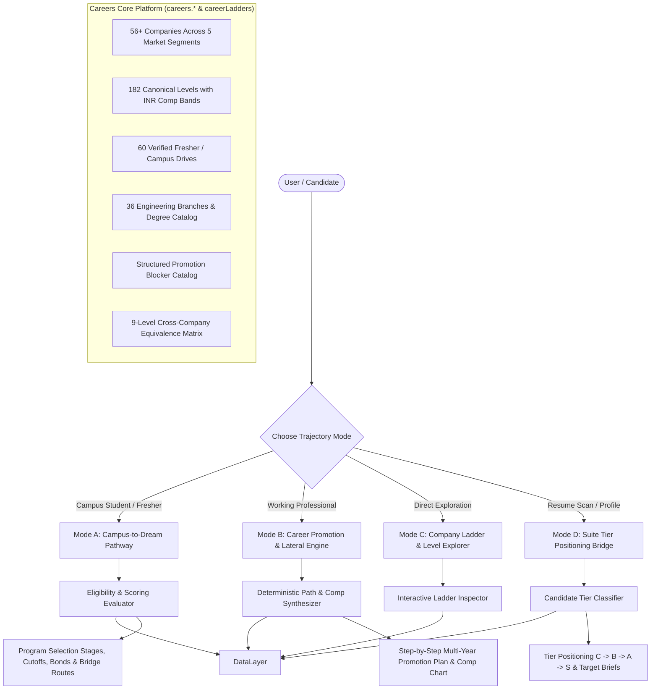

# HireFlow Career Trajectory Engine: Complete Contextual Map & Architectural Blueprint

> **System Version**: 2.5.0 (India Market Edition)  
> **Currency Unit**: Indian Rupee (INR ₹ / LPA)  
> **Simulation Base Year**: 2026–2027 Placement & Promotion Season  
> **Primary Purpose**: Complete contextual brief and rewiring manual detailing every model, engine, component, data pipeline, and calculation powering Career Trajectory in HireFlow.

---

## Table of Contents
1. [Executive Overview & Value Proposition](#1-executive-overview--value-proposition)
2. [Complete Directory & File Architecture Map](#2-complete-directory--file-architecture-map)
3. [The Three Trajectory Operating Modes](#3-the-three-trajectory-operating-modes)
   - [Mode A: Campus-to-Dream Placement Pathway (Students & Freshers)](#mode-a-campus-to-dream-placement-pathway-students--freshers)
   - [Mode B: Professional Promotion & Lateral Switch Simulator](#mode-b-professional-promotion--lateral-switch-simulator)
   - [Mode C: Company Ladder & Level Explorer](#mode-c-company-ladder--level-explorer)
   - [Mode D: HireFlow Suite Tier Positioning Bridge](#mode-d-hireflow-suite-tier-positioning-bridge)
4. [Master Data Pipelines & Input-to-System Mechanics](#4-master-data-pipelines--input-to-system-mechanics)
   - [Dual Data Sources: careers-core vs. careerLadders](#dual-data-sources-careers-core-vs-careerladders)
   - [How Data Enters and Flow Through the System](#how-data-enters-and-flow-through-the-system)
5. [Complete Data Schemas & Type System](#5-complete-data-schemas--type-system)
   - [5.1 PlatformCompany & CompanyLadder](#51-platformcompany--companyladder)
   - [5.2 CareerLevel & Level Compensation Bands](#52-careerlevel--level-compensation-bands)
   - [5.3 FresherProgram & Selection Funnel](#53-fresherprogram--selection-funnel)
   - [5.4 Cross-Company Equivalence Matrix](#54-cross-company-equivalence-matrix)
   - [5.5 Structured Promotion Blockers](#55-structured-promotion-blockers)
6. [Algorithmic Engines & Mathematical Formulas](#6-algorithmic-engines--mathematical-formulas)
   - [6.1 Deterministic Path Traversal Algorithm](#61-deterministic-path-traversal-algorithm)
   - [6.2 Cross-Tier Down-Leveling & Lateral Discount Rules](#62-cross-tier-down-leveling--lateral-discount-rules)
   - [6.3 Compensation Modeling & Split Multipliers](#63-compensation-modeling--split-multipliers)
   - [6.4 Performance Acceleration & Duration Adjustments](#64-performance-acceleration--duration-adjustments)
   - [6.5 Student Eligibility & Gap Diagnostics](#65-student-eligibility--gap-diagnostics)
7. [UI Component Tree & State Management](#7-ui-component-tree--state-management)
8. [Rewiring & Customization Guide](#8-rewiring--customization-guide)
   - [How to Add a New Company & Ladder](#how-to-add-a-new-company--ladder)
   - [How to Update Salary & Equity Bands](#how-to-update-salary--equity-bands)
   - [How to Add or Modify OA Test Question Syllabi](#how-to-add-or-modify-oa-test-question-syllabi)
   - [How to Add Custom What-If Simulator Levers](#how-to-add-custom-what-if-simulator-levers)
9. [Test Suite & Integrity Gates](#9-test-suite--integrity-gates)

---

## 1. Executive Overview & Value Proposition

The **Career Trajectory Platform** is a deterministic, client-side intelligence engine that charts career progressions for both **engineering students (Campus-to-Dream)** and **working professionals (Lateral / Promotion Simulator)** across 56 leading Indian employers.

Unlike generic career sites that provide vague or US-centric advice, HireFlow models the strict realities of the Indian tech ecosystem:
1. **Tier-1 vs. Tier-3 College Reality**: Models on-campus placement tiers (Super-Dream, Dream, Mass/Differential), eligibility cutoffs (CGPA, active backlogs, gap years), circuit vs. non-circuit branch restrictions, and off-campus contest pathways.
2. **Deterministic Promotion Cadences**: Real review cycles (annual vs. bi-annual), calibration committee layers (manager -> director -> cross-functional promo panel), and level-specific stall rates (e.g., 75% stall rate at Senior to Staff).
3. **Transparent INR Compensation Modeling**: Detailed splits between Base Salary, Target Performance Bonus, Joining/Sign-on Bonuses, and ESOPs / RSUs (Stocks) with standard 4-year vesting schedules.
4. **Structured Blocker Diagnostics**: Real obstacles that prevent engineers from leveling up (system design depth, scope ownership, cross-team influence, visibility gaps).



---

## 2. Complete Directory & File Architecture Map

The Career Trajectory subsystem spans the following distinct directories:

```
src/
├── careers-core/                          # Unified single-source-of-truth platform
│   ├── index.ts                           # Public typed API: careers.* & schema exports
│   ├── api/
│   │   └── index.ts                       # Synchronous careers.* accessor methods
│   ├── schema/
│   │   ├── types.ts                       # Canonical schemas (PlatformCompany, PlatformLevel, etc.)
│   │   └── validators.ts                  # Runtime schema integrity guards
│   ├── data/
│   │   ├── manifest.json                  # Dataset metadata and version tracking
│   │   ├── companies.ts                   # 56 platform company records
│   │   ├── levels.ts                      # 182 canonical levels with salary bands
│   │   ├── fresherPrograms.ts             # 60 campus drives with OA test specs
│   │   ├── branches.ts                    # 36 AICTE/UGC engineering branches
│   │   ├── equivalence.ts                 # 9-tier equivalence level definitions
│   │   ├── competencies.ts                # Engineering skill rubrics by level
│   │   └── roles.ts                       # Role definitions per track
│   ├── derive/
│   │   └── derivedViews.ts                # Eligibility evaluator & branch matrix generator
│   ├── registry/
│   │   └── aliasRegistry.ts               # Fuzzy alias resolution for company names and branches
│   ├── react/
│   │   ├── CareersContext.tsx             # React Context provider & consumer hooks
│   │   └── DataBadge.tsx                  # UI badge displaying verification provenance
│   ├── legacy/
│   │   └── adapters.ts                    # Backwards-compatibility bridge for older components
│   └── dev/
│       └── CareersDataExplorer.tsx        # Internal developer debugging and auditing UI (/dev/careers-data)
│
├── data/careerLadders/                    # Domain Ladders & Bridge Synthesizers
│   ├── index.ts                           # Ladder aggregators & helper getters
│   ├── types.ts                           # Engine types: CareerLevel, StructuredBlocker, CompDataPoint
│   ├── equivalenceMap.ts                  # Equivalence levels (L3_ENTRY to L8_DISTINGUISHED)
│   ├── blockerCatalog.ts                  # Pre-compiled blocker records by level & track
│   ├── degreesAndBranches.ts              # Branch family mappings & circuit classifications
│   ├── hiringRoutesCatalog.ts             # Direct, contest, hackathon, and referral pathways
│   ├── synthesizer.ts                     # Multi-hop bridge generator (e.g., Service -> Unicorn)
│   └── companies/                         # Deep ladder records split by segment
│       ├── bigTechIndia.ts                # Google, Microsoft, Amazon, Uber, Meta
│       ├── bigTechIndiaMore.ts            # Apple, Atlassian, Adobe, Salesforce
│       ├── indianProductUnicorns.ts       # Flipkart, Swiggy, Zomato, Razorpay, CRED
│       ├── indianProductUnicornsMore.ts   # Meesho, PhonePe, Zepto, Zerodha, Groww
│       ├── gccFinance.ts                  # Goldman Sachs, Morgan Stanley, JP Morgan
│       ├── gccFinanceMore.ts              # DE Shaw, Citadel, BNY, Wells Fargo
│       ├── itServicesIndia.ts             # TCS, Infosys, Wipro, HCL
│       ├── itServicesIndiaMore.ts         # Cognizant, LTIMindtree, Tech Mahindra, Accenture
│       └── coreEngineering.ts             # Tata Motors, L&T, Bosch, Qualcomm, Texas Instruments
│
├── lib/
│   ├── careerEngine.ts                    # Core Path & Promotion Engine (1,016 lines)
│   └── academicCalendar.ts                # Indian university semester & graduation calculator
│
├── features/career-path/                  # User Interface & Interaction Layer
│   ├── CareerPathSimulator.tsx            # Main parent page & state orchestrator (747 lines)
│   ├── resolveTargetJob.ts                # Cross-tool target job sync utility
│   ├── whatIfSimulator.ts                 # Real-time parameter tweaking engine
│   └── components/
│       ├── StudentPlacementPathway.tsx    # Mode A: Student campus roadmap & cutoffs
│       ├── ProfessionalPromotionResult.tsx# Mode B: Multi-step promotion timeline
│       ├── LadderLevelExplorer.tsx        # Mode C: Interactive company ladder visualizer
│       ├── PromotionBlockersChecklist.tsx # Interactive blocker self-audit checklist
│       └── CompensationTrajectoryChart.tsx# Recharts INR comp progression visualization
│
├── features/suite/integration/
│   └── trajectory.ts                      # Resume scan to career tier positioning (Tier C -> B -> A -> S)
│
├── pages/tools/career-path/
│   ├── CareerPathHub.tsx                  # Public landing hub (/tools/career-path)
│   ├── DreamJobRoadmapPage.tsx            # Route wrapper for Mode A / Mode B (/tools/career-path/dream-job-roadmap)
│   └── CompanyLevelsPage.tsx              # Route wrapper for Mode C (/tools/career-path/company-levels)
│
├── components/career-path/
│   ├── CareerPathBackButton.tsx           # Standardized back button navigation
│   ├── Dropdown.tsx                       # High-contrast accessible dropdown selector
│   └── BranchCombobox.tsx                 # Autocomplete branch search component
│
└── tests/
    ├── trajectory/scenarios.test.ts       # End-to-end multi-step trajectory scenarios
    ├── briefs/scaffold.test.ts            # Integration with bridge briefs
    ├── unit/careerEngine.test.ts          # Promotion math & duration tests
    └── careers/validatePlatformData.test.ts# Schema integrity checks for all 182 levels
```

---

## 3. The Three Trajectory Operating Modes

### Mode A: Campus-to-Dream Placement Pathway (Students & Freshers)

Designed specifically for Indian engineering students preparing for on-campus and off-campus placements.

#### Candidate Inputs:
- **College Tier**:
  - `Tier 1`: IITs, NITs, BITS, IIITs (Top Day-1 recruiters, Super-Dream drives).
  - `Tier 2`: Premier state universities, VIT, MIT Manipal, Thapar, RVCE (Product & high-growth GCC intake).
  - `Tier 3`: Regional affiliated colleges (Mass recruiters, differential hiring tracks, off-campus contest focus).
- **Degree & Branch**:
  - B.Tech, M.Tech, MCA, Dual Degree across Software, Electronics, Electrical, Mechanical, Civil, Chemical, etc.
- **Current Academic Standing**:
  - Graduation Year & Semester (calculated via [`src/lib/academicCalendar.ts`](file:///c:/Users/yadav/.gemini/antigravity-ide/scratch/hireflow/src/lib/academicCalendar.ts)).
  - B.Tech CGPA (10-point scale).
  - 10th & 12th Class percentages.
  - Active and dead backlog history.
  - Academic gap years (pre-college or during college).
- **Target Company & Role**: Desired dream organization (e.g., Google India, Microsoft, Flipkart, D. E. Shaw).

#### Engine Outputs:
1. **Direct Eligibility Status**: Evaluates the candidate against official criteria (`ELIGIBLE`, `CONDITIONAL`, or `INELIGIBLE`) with precise diagnostic violation pills.
2. **Selection Process Roadmap**: Full stage-by-stage hiring funnel:
   - **Round 1 (Online Assessment / OA)**: Platform (HackerEarth, Mettl, HackerRank), test duration in minutes, topic distribution (DSA, Aptitude, Core CS), passing cutoff criteria, and elimination rules.
   - **Round 2 (Technical Interview 1)**: Core data structures, algorithms, live coding, and Big-O optimization.
   - **Round 3 (Technical Interview 2 / LLD)**: Object-oriented programming, schema design, database query optimization, system boundaries.
   - **Round 4 (Managerial / Techno-Behavioral)**: Project deep dive, situational judgment, CS fundamental defense.
   - **Round 5 (HR / Leadership Fit)**: Cultural alignment, communication, relocation readiness.
3. **Training & Service Agreements**:
   - Mandatory service bonds (duration in months, exit penalty in INR).
   - Internship stipend vs. full-time converted CTC.
4. **Bridge Pathway (For Tier-3 / Service Route Students)**:
   - If direct Tier-1 entry is blocked due to campus gatekeeping or branch restrictions, the engine automatically synthesizes an actionable **Bridge Route**:
     - *Phase 1*: Enter Tier-1 IT Services (TCS Digital, Infosys SP) or Tier-2 Product startup.
     - *Phase 2*: 18–24 months of production engineering, open-source portfolio development, and distributed systems mastery.
     - *Phase 3*: Lateral switch to Target Dream Company bypassing campus restrictions.

---

### Mode B: Professional Promotion & Lateral Switch Simulator

Designed for working software engineers to evaluate intra-company promotions or strategic lateral company switches.

#### Candidate Inputs:
- **Current Node**: Company (e.g., Amazon India) and Level (e.g., SDE-2 / L5).
- **Target Node**: Company (e.g., Google India) and Level (e.g., Staff SWE / L6).
- **Current Total CTC**: Actual compensation in LPA (INR).
- **Experience**: Total career experience in years & time spent in current level.
- **Performance Rating Bracket**:
  - `CONSISTENTLY_EXCEEDS`: Top 5–10% talent, fast-track promo cycles (0.75x duration multiplier).
  - `EXCEEDS`: Strong consistent performer, typical timeline (1.00x duration multiplier).
  - `MEETS`: Standard performance, upper bound duration (1.30x duration multiplier).

#### Engine Outputs:
1. **Multi-Step Progression Plan**:
   - Classifies the trajectory as an **Internal Promotion**, **Lateral Switch**, **Downlevel Switch** (common when transitioning from IT Services to Big Tech), or **Multi-Hop Trajectory**.
2. **Timeline Forecasts**:
   - Minimum, likely, and maximum years to reach the target level.
3. **Promotion Process Governance**:
   - Review cycle cadence (annual, semi-annual, quarterly) and calendar window.
   - Required evidence artifacts (Design Docs, RFCs, Postmortems, Mentorship logs, Business Impact metrics).
   - Review calibration committee layers (manager -> director -> cross-functional promo panel).
4. **Compensation Trajectory (INR ₹)**:
   - Forecasted base, bonus, and stock grants across each year of the journey.
   - Percentage compensation jump on promotion or company switch.
5. **Promotion Blockers & Stall Rates**:
   - Level stall rates (e.g., 75% stall rate at Senior L5 -> Staff L6).
   - Pre-loaded obstacle checklist with action plans.

---

### Mode C: Company Ladder & Level Explorer

An interactive reference catalog enabling users to inspect and compare engineering ladders side-by-side across companies.

- **Level-by-Level Breakdown**: From Entry (L3) to Fellow/Distinguished (L8).
- **Normalized Industry Equivalence**: Side-by-side mapping of equivalent ranks across Big Tech, Unicorns, GCCs, and IT Services.
- **Detailed Competency Expectations**: Scope, Impact, and Influence definitions per level.
- **Compensation Bands**: Real-world INR base salary and total compensation percentiles.

---

### Mode D: HireFlow Suite Tier Positioning Bridge

Located in [`src/features/suite/integration/trajectory.ts`](file:///c:/Users/yadav/.gemini/antigravity-ide/scratch/hireflow/src/features/suite/integration/trajectory.ts), this engine connects candidate resumes to the Career Trajectory system:

- Evaluates uploaded resume competencies against market tiers:
  - **Tier C**: Early Career & IT Services (TCS, Infosys, Wipro).
  - **Tier B**: Mid-Market & Growth Tech (Freshworks, Zoho, Thoughtworks).
  - **Tier A**: High-Scale Unicorns (Razorpay, Swiggy, CRED, PhonePe).
  - **Tier S**: Elite Product & Quant (Google, Meta, Uber, Tower Research, Graviton).
- Computes **Readiness Score (0-100)** toward the next tier.
- Maps specific **Tier Gaps** to practical **Build Briefs** (e.g., Distributed Rate Limiter, Financial Ledger).

---

## 4. Master Data Pipelines & Input-to-System Mechanics

### Dual Data Sources: careers-core vs. careerLadders

HireFlow maintains two complementary data representations:

1. **`src/careers-core/` (Unified Platform API)**:
   - Designed for high-speed synchronous querying across all tools.
   - Provides `careers.companies`, `careers.levels`, `careers.fresherPrograms`, `careers.branches`, and `careers.eligibility`.
   - Normalizes data through runtime schema validators (`validators.ts`) and alias registries (`aliasRegistry.ts`).

2. **`src/data/careerLadders/` (Deep Simulation Domain)**:
   - Contains segmented, company-specific TypeScript files (`bigTechIndia.ts`, `gccFinance.ts`, `indianProductUnicorns.ts`, etc.).
   - Contains deep domain models including calibration committees, nominator roles, review cadences, structured blockers, and multi-hop synthesizers.

### How Data Enters and Flows Through the System

```
[Raw Industry Data & Placement Portals]
                 │
                 ▼
[src/data/careerLadders/companies/*.ts]  &  [src/careers-core/data/*.ts]
                 │
                 ├────────────────────────────────────────┐
                 ▼                                        ▼
      [careerEngine.ts]                       [careers.api.index.ts]
 (Promotion Path Traversal,              (Single Public Synchronous API,
 Comp Calculations, What-If Sim)          Eligibility Evaluator, Aliases)
                 │                                        │
                 └───────────────────┬────────────────────┘
                                     │
                                     ▼
                      [CareerPathSimulator.tsx]
                     (Parent State Orchestrator)
                                     │
        ┌────────────────────────────┼────────────────────────────┐
        ▼                            ▼                            ▼
[StudentPlacementPathway]  [ProfessionalPromotionResult]  [LadderLevelExplorer]
 (Selection Funnel, OA)    (Timeline, Steps, Comp Chart)   (Side-by-Side Ranks)
```

---

## 5. Complete Data Schemas & Type System

### 5.1 PlatformCompany & CompanyLadder

```typescript
// Defined in src/careers-core/schema/types.ts
export interface PlatformCompany {
  id: string;                                // Canonical slug (e.g., 'google-india')
  name: string;                              // Display name (e.g., 'Google India')
  aliases: string[];                         // Resolution aliases ['google', 'alphabet']
  marketSegment: 
    | 'Big Tech India'
    | 'Indian Product'
    | 'GCC / Finance'
    | 'IT Services Tier 1'
    | 'High-Growth Tech / Unicorn';
  marketTier: 'Tier S' | 'Tier A' | 'Tier B' | 'Tier C';
  headquarters: string | null;
  indiaOffices: string[];
  tracks: ('SWE' | 'DATA' | 'CLOUD' | 'CYBER' | 'MGMT')[];
  provenance: EntityProvenance;
}
```

### 5.2 CareerLevel & Level Compensation Bands

```typescript
// Defined in src/data/careerLadders/types.ts
export interface CareerLevel {
  id: string;                                // e.g., 'google-l5'
  companyId: string;                         // 'google'
  levelCode: string;                         // 'L5'
  title: string;                             // 'Senior Software Engineer'
  track: CareerTrack;                        // 'SWE'
  rank: number;                              // 0 = Entry, 1 = Mid, 2 = Senior, 3 = Staff, etc.
  equivalenceLevelId: string;                // 'L5_SENIOR'
  yearsExperienceRange: {
    min: number;
    max: number | null;
  };
  compensationINR: {
    baseSalaryLPA: { min: number; max: number };
    totalCompLPA: { min: number; max: number };
    typicalStockBonusSplit: string;          // e.g., '50% Base / 15% Bonus / 35% Stock'
    joiningBonusTypicalLPA?: number;
  };
  requirements: {
    scope: string;                           // Domain / System ownership boundary
    impact: string;                          // Measurable business or engineering outcomes
    influence: string;                       // Mentorship and cross-team leverage
    evidenceArtifacts: string[];             // Required documentation for promo packet
  };
  promotionProcess: {
    cadence: 'Quarterly' | 'Bi-Annual' | 'Annual';
    cadenceMonths: number[];                 // e.g., [4, 10] for April & October cycles
    nominator: string;                       // e.g., 'Self or Direct Manager'
    decider: string;                         // e.g., 'Engineering Promotion Committee'
    calibrationLayers: number;               // Number of governance review steps
    typicalTimeToNextYears: {
      min: number;
      likely: number;
      max: number;
    };
    selfNominationAllowed: boolean;
  };
  typicalBlockers: StructuredBlocker[];
  stallRatePercent: number;                  // Historical percentage of engineers who stay at this level
}
```

### 5.3 FresherProgram & Selection Funnel

```typescript
// Defined in src/careers-core/schema/types.ts
export interface FresherProgram {
  id: string;                                // 'google-swe-campus'
  companyId: string;                         // 'google'
  programName: string;                       // 'University Graduate SWE'
  roleTitle: string;                         // 'Software Engineer L3'
  campusCategory: 'super-dream' | 'dream' | 'differential' | 'mass' | 'lateral-entry';
  eligibility: {
    degrees: string[];                       // ['B.Tech', 'M.Tech', 'Dual Degree']
    branchFamilies: string[];                // ['software', 'electronics-electrical']
    allowedBranches: string[];               // ['CSE', 'IT', 'ECE', 'EE']
    minimumCgpa: number;                     // 7.5
    tenthPercentageMin?: number;
    twelfthPercentageMin?: number;
    maxActiveBacklogs: number;               // 0
    maxBacklogsHistory: number;              // 0
    maxGapYears: number;                     // 1
  };
  selectionProcess: {
    roundsCount: number;
    stages: {
      order: number;
      name: string;                          // 'Online Coding Assessment'
      platform?: string;                     // 'HackerEarth'
      durationMinutes: number;
      topics: string[];                      // ['Data Structures', 'Dynamic Programming', 'Graph Theory']
      passingCriteria: string;               // '2 / 2 problems fully passing test cases'
      eliminationType: 'eliminatory' | 'cumulative';
    }[];
  };
  compensation: {
    baseLPA: number;
    totalCtcLPA: number;
    currency: 'INR';
    stipendDuringInternshipINR?: number;     // e.g., 125000 / month
    joiningBonusINR?: number;
  };
  trainingAndBond: {
    hasBond: boolean;
    bondDurationMonths?: number;
    bondPenaltyINR?: number;
    probationDurationMonths: number;
    initialPostingLocations: string[];
  };
}
```

### 5.4 Cross-Company Equivalence Matrix

| Equivalence ID | Industry Standard Label | Typical YoE | Amazon | Google | Microsoft | TCS |
|---|---|---|---|---|---|---|
| `L3_ENTRY` | Associate / Software Engineer | 0–2 yrs | SDE-1 (L4) | SWE-2 (L3) | SDE (L59/L60) | Ninja / Digital |
| `L4_MID` | Software Engineer II (Mid) | 2–5 yrs | SDE-2 (L5) | SWE-3 (L4) | SDE-2 (L61/L62) | Prime / Innovator |
| `L5_SENIOR` | Senior Software Engineer | 5–8 yrs | Senior SDE (L6) | Senior SWE (L5) | Senior SDE (L63/L64) | Tech Lead / ITA |
| `L6_STAFF` | Staff Engineer / Tech Lead | 8–12 yrs | Principal (L7) | Staff SWE (L6) | Principal (L65/L66) | Associate Architect |
| `L7_PRINCIPAL`| Senior Staff / Principal Eng | 12–16 yrs | Senior Principal (L8)| Senior Staff (L7) | Partner (L67/L68) | Enterprise Architect |
| `L8_DISTINGUISHED`| Distinguished Engineer / Fellow| 16+ yrs | Distinguished (L10)| Dist. Eng (L8) | Technical Fellow | Fellow / CTO Office |

---

## 6. Algorithmic Engines & Mathematical Formulas

### 6.1 Deterministic Path Traversal Algorithm

Located in [`src/lib/careerEngine.ts`](file:///c:/Users/yadav/.gemini/antigravity-ide/scratch/hireflow/src/lib/careerEngine.ts), `resolvePath()` resolves transitions deterministically:

1. **Intra-Company Ladder Progression**:
   - If `source.companyId === target.companyId`:
     - Collects all intermediate levels ordered by `rank`.
     - Synthesizes `INTERNAL_PROMO` steps with level-specific requirements and blockers.
2. **Cross-Company Transition**:
   - Maps `sourceLevel` to canonical `EquivalenceOrder`.
   - Computes target entry level based on external hiring discounts.
   - Generates a `LATERAL_SWITCH` step followed by subsequent `INTERNAL_PROMO` steps.
3. **Cumulative Compensation Projection**:
   - Projects salary progression year-over-year:
     $$\text{TotalComp}_{year} = \text{Base}_{year} + \text{Bonus}_{year} + \text{Stock}_{year}$$
   - Adjusts for annual increment cycles (typically 8–12% in India product firms).

### 6.2 Cross-Tier Down-Leveling & Lateral Discount Rules

When transitioning between different industry segments, external hiring panels routinely discount titles:

| Transition Source | Transition Target | Down-Leveling Adjustment | Rationale |
|---|---|---|---|
| **IT Services Tier 1** | **Big Tech India** | **-1 to -2 Levels** | "Tech Lead" in services typically maps to SDE-2 (L4) in Big Tech due to system design and coding bars. |
| **IT Services Tier 1** | **Product Unicorn** | **-1 Level** | Title deflation on transition to product-first engineering. |
| **Product Unicorn** | **Big Tech India** | **0 (Parity) or -1 Level** | Senior SWE at high-scale unicorn usually enters as SDE-2 or Senior depending on distributed scale depth. |
| **Big Tech India** | **Big Tech India** | **0 (Parity)** | Peer equivalence respected across FAANG tier. |
| **GCC / Finance** | **Product Unicorn** | **0 (Parity)** | Direct mapping with base-heavy to equity-heavy rebalancing. |

### 6.3 Compensation Modeling & Split Multipliers

Indian tech compensation structures vary significantly by tier. HireFlow models exact splits:

- **Big Tech (Tier S)**:
  - Base: `45% – 55%`
  - Target Bonus: `15% – 20%`
  - Stock / RSUs (US Dollar denominated): `30% – 40%`
- **Product Unicorns (Tier A)**:
  - Base: `60% – 75%`
  - Performance Bonus: `10% – 15%`
  - ESOPs: `15% – 25%`
- **IT Services (Tier C)**:
  - Base: `80% – 85%`
  - Variable Pay: `15% – 20%`
  - Stocks: `0%` (except senior executive band)

### 6.4 Performance Acceleration & Duration Adjustments

The duration of each promotion step is adjusted by candidate performance bracket:

$$\text{StepDuration} = \text{TypicalYears} \times \text{Multiplier}$$

- `CONSISTENTLY_EXCEEDS`: $\text{Multiplier} = 0.75\text{x}$ (Fast-track)
- `EXCEEDS`: $\text{Multiplier} = 1.00\text{x}$ (On-cycle standard)
- `MEETS`: $\text{Multiplier} = 1.30\text{x}$ (Extended cycle)

### 6.5 Student Eligibility & Gap Diagnostics

Located in [`src/careers-core/derive/derivedViews.ts`](file:///c:/Users/yadav/.gemini/antigravity-ide/scratch/hireflow/src/careers-core/derive/derivedViews.ts), `evaluateEligibility()` enforces 6 sequential checks:

1. **Degree Check**: Checks if candidate degree matches `eligibility.degrees`.
2. **Branch Family Check**: Evaluates branch classification (`software`, `electronics-electrical`, `mechanical`, `civil`).
3. **CGPA Cutoff**: Compares candidate CGPA against minimum (e.g. 7.5 or 8.0).
4. **10th & 12th Percentage**: Validates high-school cutoffs (standard 60% or 70% in Indian campus recruitment).
5. **Backlog Rules**: Rejects if active backlogs exceed `maxActiveBacklogs` (typically 0 allowed).
6. **Academic Gap Years**: Rejects if total educational gap years exceed `maxGapYears` (typically $\le 1$).

---

## 7. UI Component Tree & State Management

The Career Trajectory UI is completely responsive, theme-aware (dark mode calibrated), and accessible:

```
[App.tsx]
   └── Route: /tools/career-path (CareerPathHub)
   └── Route: /tools/career-path/dream-job-roadmap (DreamJobRoadmapPage)
   └── Route: /tools/career-path/company-levels (CompanyLevelsPage)
         │
         ▼
   [CareerPathSimulator.tsx]  <-- State Container (mode, source, target, comp, branch)
         │
         ├── [CareerPathBackButton]   (Navigates back to Tools Hub or Portal)
         │
         ├── Mode Tabs: ['simulator' | 'explorer']
         │
         ├── Sub-mode Selector: ['student' | 'fresher-programs' | 'professional']
         │
         ├── Mode A Render:
         │     └── [StudentPlacementPathway.tsx]
         │           ├── College Tier & Branch Combobox
         │           ├── Eligibility Status Cards (Eligible / Conditional / Ineligible)
         │           ├── Selection Funnel Stages (OA -> Tech 1 -> Tech 2 -> HR)
         │           └── Bridge Route Recommendations
         │
         ├── Mode B Render:
         │     ├── [ProfessionalPromotionResult.tsx]
         │     │     ├── Step-by-Step Promotion Timeline
         │     │     ├── Promotion Governance (Nominator, Decider, Calibration)
         │     │     └── Required Evidence Artifacts
         │     ├── [CompensationTrajectoryChart.tsx] (Recharts Base / Bonus / Stock)
         │     └── [PromotionBlockersChecklist.tsx] (Interactive Self-Audit)
         │
         └── Mode C Render:
               └── [LadderLevelExplorer.tsx]
                     ├── Company Selector & Level Ladder
                     ├── Equivalence Matrix Inspector
                     └── Competency Rubric Card (Scope, Impact, Influence)
```

---

## 8. Rewiring & Customization Guide

### How to Add a New Company & Ladder

1. Open [`src/data/careerLadders/companies/`](file:///c:/Users/yadav/.gemini/antigravity-ide/scratch/hireflow/src/data/careerLadders/companies/) and pick the appropriate segment file (or create a new one).
2. Author the company ladder conforming to `CompanyLadder`:
   ```typescript
   export const newCompanyLadder: CompanyLadder = {
     companyId: 'acme-corp',
     companyName: 'Acme Corporation India',
     marketSegment: 'Indian Product',
     marketTier: 'Tier A',
     verifiedDate: '2026-10-26',
     levels: [
       {
         id: 'acme-l1',
         companyId: 'acme-corp',
         levelCode: 'L1',
         title: 'Software Engineer I',
         track: 'SWE',
         rank: 0,
         equivalenceLevelId: 'L3_ENTRY',
         yearsExperienceRange: { min: 0, max: 2 },
         compensationINR: {
           baseSalaryLPA: { min: 14, max: 18 },
           totalCompLPA: { min: 16, max: 22 },
           typicalStockBonusSplit: '75% Base / 10% Bonus / 15% ESOP',
         },
         requirements: {
           scope: 'Owns individual features and bug fixes within microservice boundaries.',
           impact: 'High-quality code delivery with unit test coverage > 85%.',
           influence: 'Participates in code reviews and sprint retrospectives.',
           evidenceArtifacts: ['Merged PR links', 'Unit test coverage metrics'],
         },
         promotionProcess: {
           cadence: 'Bi-Annual',
           cadenceMonths: [4, 10],
           nominator: 'Direct Engineering Manager',
           decider: 'Engineering Calibration Committee',
           calibrationLayers: 2,
           typicalTimeToNextYears: { min: 1.5, likely: 2.5, max: 4 },
           selfNominationAllowed: true,
         },
         typicalBlockers: [],
         stallRatePercent: 15,
       },
     ],
   };
   ```
3. Register the ladder in [`src/data/careerLadders/index.ts`](file:///c:/Users/yadav/.gemini/antigravity-ide/scratch/hireflow/src/data/careerLadders/index.ts) in `ALL_COMPANY_LADDERS`.
4. Register company metadata in [`src/careers-core/data/companies.ts`](file:///c:/Users/yadav/.gemini/antigravity-ide/scratch/hireflow/src/careers-core/data/companies.ts).

### How to Update Salary & Equity Bands

- Open the corresponding company ladder file in `src/data/careerLadders/companies/`.
- Locate the specific level and modify `compensationINR`:
  ```typescript
  compensationINR: {
    baseSalaryLPA: { min: 28, max: 36 },
    totalCompLPA: { min: 42, max: 58 },
    typicalStockBonusSplit: '50% Base / 15% Bonus / 35% RSUs',
    joiningBonusTypicalLPA: 5,
  }
  ```
- All trajectory comp calculations and charts will automatically reflect the updated numbers on next render.

### How to Add or Modify OA Test Question Syllabi

1. Open [`src/careers-core/data/fresherPrograms.ts`](file:///c:/Users/yadav/.gemini/antigravity-ide/scratch/hireflow/src/careers-core/data/fresherPrograms.ts).
2. Locate the company program and expand `selectionProcess.stages`:
   ```typescript
   {
     order: 1,
     name: 'Online Coding Assessment (OA)',
     platform: 'HackerEarth',
     durationMinutes: 90,
     topics: [
       'Binary Tree Traversals (BFS / DFS)',
       'Dynamic Programming (0/1 Knapsack & LCS)',
       'Graph Shortest Path (Dijkstra / Bellman-Ford)',
       'SQL Complex Joins & Window Functions',
     ],
     passingCriteria: '2 of 2 coding problems fully passing test cases + 80% on CS Fundamentals MCQs',
     eliminationType: 'eliminatory',
   }
   ```

### How to Add Custom What-If Simulator Levers

1. In [`src/features/career-path/whatIfSimulator.ts`](file:///c:/Users/yadav/.gemini/antigravity-ide/scratch/hireflow/src/features/career-path/whatIfSimulator.ts), define new scenario modifiers (e.g., Higher Education / Masters degree, Remote Location Discount, Accelerated Startup Equity Vesting).
2. In [`CareerPathSimulator.tsx`](file:///c:/Users/yadav/.gemini/antigravity-ide/scratch/hireflow/src/features/career-path/CareerPathSimulator.tsx), add the interactive UI toggle or slider.
3. Hook the state into `synthesizeWhatIfTrajectory()` to dynamically recalculate the promotion roadmap.

---

## 9. Test Suite & Integrity Gates

All modifications to Career Trajectory must pass the following continuous integration commands:

```bash
# 1. Typecheck the entire repository
npm run typecheck

# 2. Run unit and integration tests for Career Trajectory
npx vitest run tests/trajectory/scenarios.test.ts
npx vitest run src/lib/__tests__/careerEngine.test.ts
npx vitest run src/features/career-path/__tests__/resolveTargetJob.test.ts
npx vitest run src/__tests__/careers/validatePlatformData.test.ts

# 3. Verify zero external network egress (offline integrity)
npx vitest run tests/privacy-telemetry.test.ts

# 4. Verify production bundle compilation
npm run build
```
