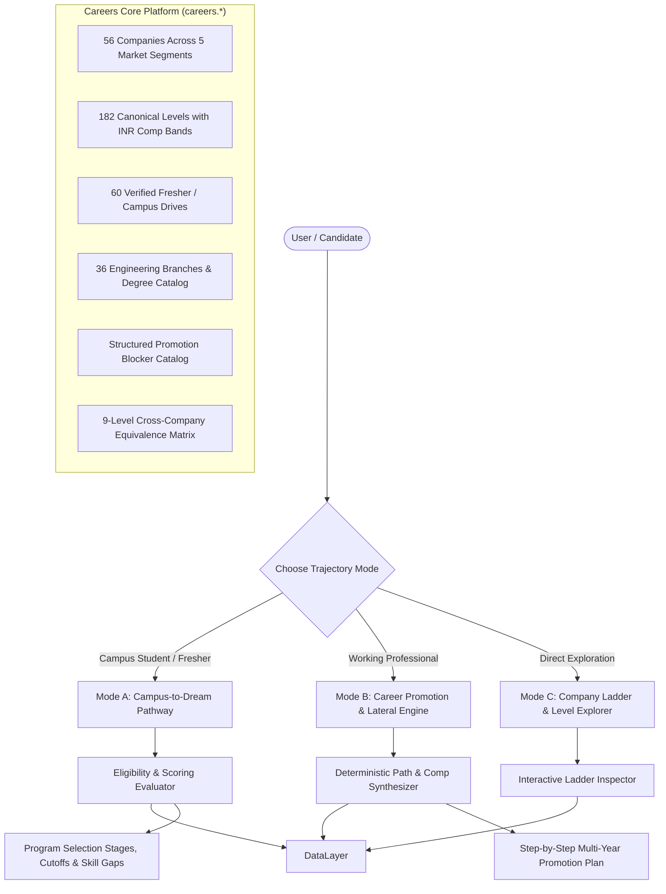

# HireFlow Career Trajectory Engine: Complete Contextual Map & Architectural Blueprint

> **System Version**: 2.4.0 (India Market Edition)  
> **Currency Unit**: Indian Rupee (INR ₹ / LPA)  
> **Simulation Base Year**: 2026–2027 Placement Season  
> **Target Audience**: Engineers, Architects & Product Designers improvising or extending the Career Trajectory system.

---

## 1. Executive Summary & Core Value Proposition

The **Career Trajectory Platform** is a deterministic, client-side intelligence engine that charts career progressions for both **engineering students (Campus-to-Dream)** and **working professionals (Lateral / Promotion Simulator)** across 56 leading Indian companies.

Unlike generic career tools that provide vague generic advice, this system models:
1. **Real-world Indian hiring realities**: Tier-1 vs. Tier-3 college hiring patterns, branch restrictions (circuit vs. non-circuit), mandatory service agreements / bonds, and actual online assessment (OA) test structures.
2. **Deterministic Promotion Cadences**: Real review cycles, calibration layers, nominator/decider hierarchies, and promotion stall rates.
3. **Transparent INR Compensation Modeling**: Granular splits between Base Salary, Target Bonus, and ESOPs / RSUs (Stocks) with vesting schedules across all levels.
4. **Structured Blocker Diagnostics**: Real obstacles that prevent engineers from leveling up (organizational headroom, cross-functional influence, system design depth, visibility gaps).



---

## 2. System Architecture & File Structure

The Career Trajectory codebase is structured into four cohesive layers:

```
src/
├── careers-core/                          # Unified single-source-of-truth platform
│   ├── index.ts                           # Public typed API: careers.* & hooks
│   ├── types.ts                           # Canonical schemas: Company, Level, FresherProgram
│   ├── data/
│   │   ├── companies.ts                   # 56 company records with tiers & segments
│   │   ├── careerLadders.ts               # 182 canonical level definitions
│   │   ├── fresherPrograms.ts             # 60 verified campus recruitment drives
│   │   ├── branches.ts                    # 36 AICTE/UGC engineering branches
│   │   └── equivalenceLevels.ts           # L3_ENTRY through L8_DISTINGUISHED
│   └── hooks/                             # React reactive hooks (useCompanies, etc.)
│
├── lib/
│   ├── careerEngine.ts                    # Core Path & Promotion Engine
│   └── academicCalendar.ts                # Indian university semester & graduation calculator
│
├── data/careerLadders/                    # Domain Ladders & Bridge Synthesizers
│   ├── types.ts                           # Engine types: CareerLevel, StructuredBlocker, CompDataPoint
│   ├── equivalenceMap.ts                  # Industry equivalence orders and labels
│   ├── blockerCatalog.ts                  # Obstacles preventing promotions at each level
│   ├── degreesAndBranches.ts              # Branch family mappings & circuit classifications
│   ├── hiringRoutesCatalog.ts             # Direct, contest, hackathon, and referral pathways
│   ├── synthesizer.ts                     # Multi-hop bridge generator (e.g., Service -> Unicorn)
│   └── companies/                         # Deep ladder records split by segment
│       ├── bigTechIndia.ts                # Google, Microsoft, Amazon, Uber, Meta
│       ├── bigTechIndiaMore.ts            # Apple, Atlassian, Adobe, Salesforce
│       ├── indianProductUnicorns.ts       # Flipkart, Swiggy, Zomato, Razorpay, CRED
│       ├── indianProductUnicornsMore.ts   # Meesho, PhonePe, Zepto, Zerodha, Groww
│       ├── gccFinance.ts                  # Goldman Sachs, Morgan Stanley, JP Morgan
│       ├── gccFinanceMore.ts              # DE Shaw, Citadel, BNY, Wells Fargo
│       ├── itServicesIndia.ts             # TCS, Infosys, Wipro, HCL
│       ├── itServicesIndiaMore.ts         # Cognizant, LTIMindtree, Tech Mahindra, Accenture
│       └── coreEngineering.ts             # Tata Motors, L&T, Bosch, Qualcomm, Texas Instruments
│
└── features/career-path/                  # User Interface & Interaction Layer
    ├── CareerPathSimulator.tsx            # Main parent page & state orchestrator
    ├── resolveTargetJob.ts                # Cross-tool target job sync utility
    ├── whatIfSimulator.ts                 # Real-time parameter tweaking engine
    └── components/
        ├── StudentPlacementPathway.tsx    # Mode A: Student campus roadmap & cutoffs
        ├── ProfessionalPromotionResult.tsx# Mode B: Multi-step promotion timeline
        ├── LadderLevelExplorer.tsx        # Mode C: Interactive company ladder visualizer
        ├── PromotionBlockersChecklist.tsx # Interactive blocker self-audit checklist
        └── CompensationTrajectoryChart.tsx# Recharts INR comp progression visualization
```

---

## 3. The 3 Trajectory Modes Explained

### Mode A: Campus-to-Dream Placement Pathway (Students & Freshers)

Designed specifically for Indian university students targeting on-campus and off-campus placements.

#### Candidate Inputs:
- **College Tier**: Tier 1 (IIT / NIT / BITS / IIIT), Tier 2 (Top State Universities, VIT, MIT, Thapar), Tier 3 (Local Affiliated Colleges).
- **Degree & Branch**: B.Tech, M.Tech, MCA, BCA, B.Sc across Software, Electronics, Mechanical, Civil, Data Science, etc.
- **Current Academic Year**: 1st Year (Discovery), 2nd Year (Core CS Prep), 3rd Year (Internship Crunch), 4th Year (Full-Time Placement).
- **Academic Standing**: CGPA (10-point scale), 10th & 12th percentages, active or historical backlogs, academic gap years.
- **Target Company & Role**: Desired dream organization (e.g., Google, Flipkart, Goldman Sachs).

#### Engine Outputs:
1. **Direct Eligibility Status**: Evaluates the candidate against the company's verified criteria (`ELIGIBLE`, `CONDITIONAL`, or `INELIGIBLE`) with specific rule violation diagnostics.
2. **Selection Process Roadmap**: Complete step-by-step interview funnel:
   - **Round 1 (Online Assessment)**: Platform (HackerEarth, Mettl, HackerRank), test duration, question breakdown (DSA, Aptitude, CS Fundamentals), and negative marking rules.
   - **Round 2 (Technical Interview 1)**: Core data structures, algorithms, live coding, and complexity analysis.
   - **Round 3 (Technical Interview 2 / Low-Level Design)**: Object-oriented design, schema design, database queries, API design.
   - **Round 4 (Managerial / Techno-Behavioral)**: Project deep dive, culture fit, situational judgment.
   - **Round 5 (HR / Leadership)**: Communication, location preferences, salary negotiation.
3. **Service Agreements & Training**:
   - Mandatory service bonds (duration in months, exit penalty in INR).
   - Training stipend vs. full-time converted CTC.
4. **Bridge Pathway (For Tier-3 / Service Route Students)**:
   - If direct Tier-1 entry is unreachable due to campus recruitment barriers, the engine automatically synthesizes a **Bridge Route**:
     - *Phase 1*: Enter Tier-1 IT Services (TCS Digital, Infosys SP) or Tier-2 Product firm.
     - *Phase 2*: 18–24 months of production engineering, open-source contributions, and system design mastery.
     - *Phase 3*: Lateral switch to Target Dream Company bypassing campus gatekeeping.

---

### Mode B: Working Professional Simulator (Promotions & Lateral Jumps)

Designed for working software engineers to evaluate intra-company promotions or strategic lateral jumps.

#### Candidate Inputs:
- **Current Company & Current Level**: e.g., Amazon SDE-2 (L5).
- **Target Company & Target Level**: e.g., Google Senior SWE (L5) or Staff SWE (L6).
- **Current Total CTC**: Actual compensation in LPA (INR).
- **Total Years of Experience (YoE)** & **Time in Current Level**.
- **Performance Rating Bracket**:
  - `CONSISTENTLY_EXCEEDS`: Top 5–10% talent, fast-track promo cycles.
  - `EXCEEDS`: Strong consistent performer, typical timeline.
  - `MEETS`: Standard performance, upper bound duration.

#### Engine Outputs:
1. **Multi-Step Progression Plan**:
   - Determines whether the jump is an **Internal Promotion**, **Lateral Switch**, **Downlevel Switch** (common when moving from IT Services / Mid-tier product to Tier-1 Big Tech), or **Multi-Hop Trajectory**.
2. **Timeline Projections**:
   - Minimum, likely, and maximum years to reach the target level.
3. **Promotion Process Governance**:
   - Review cycle cadence (annual, semi-annual, quarterly).
   - Review calibration committee layers (manager, director, VP, cross-functional committee).
   - Required evidence artifacts (Design Docs, RFCs, Postmortems, Mentorship logs, Business Impact metrics).
4. **Compensation Delta (INR ₹)**:
   - Forecasted base, bonus, and stock grants across each year of the journey.
   - Percentage compensation jump on promotion or company switch.
5. **Promotion Blockers & Stall Rates**:
   - Probability of reaching the target level.
   - Level stall rates (e.g., 75% stall rate at Senior L5 -> Staff L6).

---

### Mode C: Company Ladder & Level Explorer

An interactive reference catalog enabling users to compare engineering ladders side-by-side across companies.

- **Level-by-Level Breakdown**: From Entry (L3) to Fellow/Distinguished (L8).
- **Normalized Industry Equivalence**: Side-by-side mapping of equivalent ranks across Big Tech, Unicorns, GCCs, and IT Services.
- **Detailed Competency Expectations**: Scope, Impact, and Influence definitions per level.

---

## 4. Master Data Schemas

### 4.1 Company Schema (`src/careers-core/types.ts`)

```typescript
export interface Company {
  id: string;                                // Canonical slug (e.g., 'google-india')
  name: string;                              // Display name (e.g., 'Google India')
  aliases: string[];                         // Resolution aliases ['google', 'alphabet']
  marketSegment: 
    | 'Big Tech India'
    | 'Indian Product'
    | 'GCC / Finance'
    | 'IT Services Tier 1'
    | 'High-Growth Tech / Unicorn';
  marketTier: 'Tier S' | 'Tier A' | 'Tier B' | 'Tier C';
  headquarters: string;
  indiaOffices: string[];
  tracks: ('SWE' | 'DATA' | 'CLOUD' | 'CYBER' | 'MGMT')[];
  provenance: {
    source: string;
    lastVerifiedDate: string;
    confidenceScore: number;
  };
}
```

### 4.2 Career Level Schema (`src/data/careerLadders/types.ts`)

```typescript
export interface CareerLevel {
  id: string;                                // e.g., 'google-l5'
  companyId: string;                         // 'google'
  levelCode: string;                         // 'L5'
  title: string;                             // 'Senior Software Engineer'
  track: CareerTrack;                        // 'SWE'
  rank: number;                              // 0 = Entry, 1 = Mid, 2 = Senior, 3 = Staff, etc.
  equivalenceLevelId: string;                // 'L5_SENIOR'
  yearsExperienceRange: {
    min: number;
    max: number | null;
  };
  compensationINR: {
    baseSalaryLPA: { min: number; max: number };
    totalCompLPA: { min: number; max: number };
    typicalStockBonusSplit: string;          // e.g., '50% Base / 15% Bonus / 35% Stock'
    joiningBonusTypicalLPA?: number;
  };
  requirements: {
    scope: string;                           // Domain / System ownership boundary
    impact: string;                          // Measurable business or engineering outcomes
    influence: string;                       // Mentorship and cross-team leverage
    evidenceArtifacts: string[];             // Required documentation for promo packet
  };
  promotionProcess: {
    cadence: 'Quarterly' | 'Bi-Annual' | 'Annual';
    cadenceMonths: number[];                 // e.g., [4, 10] for April & October cycles
    nominator: string;                       // e.g., 'Self or Direct Manager'
    decider: string;                         // e.g., 'Engineering Promotion Committee'
    calibrationLayers: number;               // Number of governance review steps
    typicalTimeToNextYears: {
      min: number;
      likely: number;
      max: number;
    };
    selfNominationAllowed: boolean;
  };
  typicalBlockers: StructuredBlocker[];
  stallRatePercent: number;                  // Historical percentage of engineers who stay at this level
}
```

### 4.3 Fresher / Campus Program Schema (`src/careers-core/types.ts`)

```typescript
export interface FresherProgram {
  id: string;                                // 'google-swe-campus'
  companyId: string;                         // 'google'
  programName: string;                       // 'University Graduate SWE'
  roleTitle: string;                         // 'Software Engineer L3'
  campusCategory: 'super-dream' | 'dream' | 'differential' | 'mass' | 'lateral-entry';
  eligibility: {
    degrees: string[];                       // ['B.Tech', 'M.Tech', 'Dual Degree']
    branchFamilies: string[];                // ['software', 'electronics-electrical']
    allowedBranches: string[];               // ['CSE', 'IT', 'ECE', 'EE']
    minimumCgpa: number;                     // 7.5
    tenthPercentageMin?: number;
    twelfthPercentageMin?: number;
    maxActiveBacklogs: number;               // 0
    maxBacklogsHistory: number;              // 0
    maxGapYears: number;                     // 1
  };
  selectionProcess: {
    roundsCount: number;
    stages: {
      order: number;
      name: string;                          // 'Online Coding Assessment'
      platform?: string;                     // 'HackerEarth'
      durationMinutes: number;
      topics: string[];                      // ['Data Structures', 'Dynamic Programming', 'Graph Theory']
      passingCriteria: string;               // '2 / 2 problems fully passing test cases'
      eliminationType: 'eliminatory' | 'cumulative';
    }[];
  };
  compensation: {
    baseLPA: number;
    totalCtcLPA: number;
    currency: 'INR';
    stipendDuringInternshipINR?: number;     // e.g., 125000 / month
    joiningBonusINR?: number;
  };
  trainingAndBond: {
    hasBond: boolean;
    bondDurationMonths?: number;
    bondPenaltyINR?: number;
    probationDurationMonths: number;
    initialPostingLocations: string[];
  };
  hiringSeasons: {
    season: 'Autumn (Aug-Nov)' | 'Spring (Jan-Apr)' | 'Off-Campus (Year-round)';
    typicalDriveMonths: string[];
  }[];
}
```

---

## 5. Promotion & Transition Engine Algorithms

### 5.1 Deterministic Promotion Path Resolution (`careerEngine.ts:resolvePromotionPlan`)

```
Algorithm: resolvePromotionPlan(sourceNode, targetNode, options)
----------------------------------------------------------------
1. VALIDATE: Ensure sourceNode and targetNode exist in canonical ladder registries.
2. SAME LEVEL CHECK:
   IF sourceNode == targetNode THEN
      RETURN status: 'SAME_LEVEL'
   END IF

3. GRAPH EXPLORATION:
   IF sourceNode.companyId == targetNode.companyId THEN
      // Intra-Company Ladder Progression
      steps = TraverseInternalLadder(sourceNode.level, targetNode.level)
   ELSE
      // Cross-Company Transition
      // Step A: Determine equivalence of source level in industry matrix
      sourceEquiv = EquivalenceMap.get(sourceNode.levelCode)
      targetEquiv = EquivalenceMap.get(targetNode.levelCode)

      // Step B: Calculate external hiring discount / down-level penalty
      // Moving from IT Services to Big Tech typically incurs a 1-level downlevel
      effectiveEntryLevel = CalculateLateralEntryLevel(sourceNode, targetNode)

      // Step C: Build lateral switch step
      lateralStep = BuildLateralSwitchStep(sourceNode.level, effectiveEntryLevel)
      
      // Step D: Build subsequent internal promo steps to target level
      internalSteps = TraverseInternalLadder(effectiveEntryLevel, targetNode.level)
      
      steps = [lateralStep, ...internalSteps]
   END IF

4. TIMELINE & COMPENSATION SYNTHESIS:
   FOR EACH step IN steps:
      duration = AdjustDurationByPerformance(step.durationYears, options.performanceBracket)
      cumulativeTime += duration
      stepComp = ProjectCompDataPoints(step, cumulativeTime, options.currentAnnualCTC)
   END FOR

5. PROBABILITY & STALL CALCULATION:
   cumulativeProbability = Product(1 - step.stallRatePercent / 100)
   
6. RETURN PromotionPlan object with complete step-by-step roadmap.
```

### 5.2 Performance-Adjusted Duration Matrix

| Performance Bracket | Duration Adjustment Factor | Cycle Acceleration |
| :--- | :--- | :--- |
| `CONSISTENTLY_EXCEEDS` | `0.75x` (Minimum Duration) | Eligible for off-cycle promotions where allowed |
| `EXCEEDS` | `1.00x` (Likely Duration) | Standard on-cycle progression |
| `MEETS` | `1.30x` (Maximum Duration) | Upper bound, requires multiple consistent cycles |

### 5.3 Compensation Jump Multiplier Engine

When switching companies laterally, compensation jumps in the Indian tech market are synthesized according to market tier transitions:

| From Segment | To Segment | Typical Lateral Jump % |
| :--- | :--- | :--- |
| **IT Services Tier 1** | **Indian Product Unicorn** | `70% – 120%` (Substantial reset to product band) |
| **IT Services Tier 1** | **Big Tech India** | `100% – 180%` (Often accompanied by down-level) |
| **Indian Product Unicorn**| **Big Tech India** | `30% – 50%` (Primarily driven by RSUs) |
| **Big Tech India** | **Big Tech India** (Peer) | `25% – 40%` (Parity hire + sign-on bonus) |
| **GCC / Finance** | **High-Frequency Trading** | `50% – 100%` (Large performance bonus pool) |

---

## 6. Complete Data Registry

### 6.1 Company Segments & Count Summary (56 Total)

| Segment | Companies Included | Typical CTC Range (Entry -> Staff) |
| :--- | :--- | :--- |
| **Big Tech India** (10) | Google, Microsoft, Amazon, Meta, Apple, Uber, Atlassian, Adobe, Salesforce, Netflix | ₹18 LPA – ₹1.8 Cr+ |
| **Indian Product Unicorns** (16) | Flipkart, Swiggy, Zomato, Razorpay, CRED, Meesho, PhonePe, Zepto, Zerodha, Groww, InMobi, Udaan, Postman, BrowserStack, Urban Company, Nykaa | ₹14 LPA – ₹1.2 Cr+ |
| **GCC & Global Finance** (12) | Goldman Sachs, Morgan Stanley, JP Morgan Chase, DE Shaw, Citadel, BNY, Wells Fargo, Barclays, Deutsche Bank, Fidelity, BlackRock, UBS | ₹15 LPA – ₹1.5 Cr+ |
| **Indian IT Services Tier 1** (10) | TCS, Infosys, Wipro, HCLTech, Cognizant, LTIMindtree, Tech Mahindra, Accenture India, Capgemini India, Persistent Systems | ₹3.6 LPA – ₹45 LPA |
| **Core Engineering & Auto** (8) | Qualcomm India, Texas Instruments, Nvidia India, Intel India, Bosch India, Tata Motors, L&T Technology Services, Maruti Suzuki | ₹6 LPA – ₹90 LPA |

### 6.2 Cross-Company Equivalence Ranks

| Equivalence ID | Industry Standard Label | Typical YoE | Amazon | Google | Microsoft | TCS |
| :--- | :--- | :--- | :--- | :--- | :--- | :--- |
| `L3_ENTRY` | Associate / Software Engineer | 0–2 yrs | SDE-1 (L4) | SWE-2 (L3) | SDE (L59/L60) | Ninja / Digital |
| `L4_MID` | Software Engineer II (Mid) | 2–5 yrs | SDE-2 (L5) | SWE-3 (L4) | SDE-2 (L61/L62) | Prime / Innovator |
| `L5_SENIOR` | Senior Software Engineer | 5–8 yrs | Senior SDE (L6) | Senior SWE (L5) | Senior SDE (L63/L64) | Tech Lead / ITA |
| `L6_STAFF` | Staff Engineer / Tech Lead | 8–12 yrs | Principal (L7) | Staff SWE (L6) | Principal (L65/L66) | Associate Architect |
| `L7_PRINCIPAL`| Senior Staff / Principal Eng | 12–16 yrs | Senior Principal (L8)| Senior Staff (L7) | Partner (L67/L68) | Enterprise Architect |
| `L8_DISTINGUISHED`| Distinguished Engineer / Fellow| 16+ yrs | Distinguished (L10)| Dist. Eng (L8) | Technical Fellow | Fellow / CTO Office |

---

## 7. Design System & UI Contrast Specifications

To prevent invisible text and ensure high-gloss visual aesthetics in dark mode:

### 7.1 Color Tokens & Contrast Hierarchy

| Token Name | Hex Code | Purpose & Usage |
| :--- | :--- | :--- |
| **Pure White** | `#ffffff` | Primary card headers, major metrics, numerical values |
| **Silver Muted** | `#a0a0a0` | Secondary labels, descriptions, metadata titles |
| **Volt Neon** | `#e6ff00` | Active highlights, step numbers, cadences, primary CTAs |
| **Deep Surface** | `#0a0a0a` / `#141414` | Card inner containers and nested pill box backgrounds |
| **Charcoal Border** | `#262626` / `#333333` | Crisp structural borders separating nested stages |

### 7.2 Iridescent Shiny Edge Effect

Implemented via CSS pseudo-element gradient overlays on `.shiny-edge-card`:
```css
.shiny-edge-card {
  position: relative;
  background-clip: padding-box;
}
.shiny-edge-card::before {
  content: "";
  position: absolute;
  inset: -1px;
  border-radius: inherit;
  padding: 1px;
  background: linear-gradient(
    135deg,
    rgba(230, 255, 0, 0.45) 0%,
    rgba(0, 240, 255, 0.35) 30%,
    rgba(168, 85, 247, 0.35) 70%,
    rgba(230, 255, 0, 0.45) 100%
  );
  -webkit-mask: linear-gradient(#fff 0 0) content-box, linear-gradient(#fff 0 0);
  -webkit-mask-composite: xor;
  mask-composite: exclude;
  pointer-events: none;
}
```

---

## 8. Step-by-Step Guide to Extending & Improvising

### 8.1 Adding a New Company & Ladder

1. Open `src/data/careerLadders/companies/<segment>.ts`.
2. Add the company record adhering to `CompanyLadder`:
   ```typescript
   export const newCompanyLadder: CompanyLadder = {
     companyId: 'new-company',
     companyName: 'New Company India',
     marketSegment: 'Indian Product',
     marketTier: 'Tier A',
     verifiedDate: '2026-10-24',
     levels: [
       {
         id: 'new-company-l1',
         companyId: 'new-company',
         levelCode: 'E1',
         title: 'Software Engineer',
         track: 'SWE',
         rank: 0,
         equivalenceLevelId: 'L3_ENTRY',
         yearsExperienceRange: { min: 0, max: 2 },
         compensationINR: {
           baseSalaryLPA: { min: 14, max: 18 },
           totalCompLPA: { min: 18, max: 24 },
           typicalStockBonusSplit: '70% Base / 10% Bonus / 20% ESOP',
         },
         requirements: {
           scope: 'Executes defined tickets within service boundaries.',
           impact: 'Clean code delivery and test automation.',
           influence: 'Active participation in code reviews.',
           evidenceArtifacts: ['PR links', 'Test coverage reports'],
         },
         promotionProcess: {
           cadence: 'Bi-Annual',
           cadenceMonths: [4, 10],
           nominator: 'Engineering Manager',
           decider: 'Department Calibration Panel',
           calibrationLayers: 2,
           typicalTimeToNextYears: { min: 1.5, likely: 2.5, max: 4 },
           selfNominationAllowed: true,
         },
         typicalBlockers: [],
         stallRatePercent: 15,
       },
     ],
   };
   ```
3. Register the new ladder in `src/data/careerLadders/index.ts` in `ALL_COMPANY_LADDERS`.
4. Register the company in `src/careers-core/data/companies.ts`.

### 8.2 Adding Online Assessment (OA) Test Question Banks

To enrich the student test experience:
1. Open `src/careers-core/data/fresherPrograms.ts`.
2. Expand the `selectionProcess.stages` object with exact test syllabi:
   ```typescript
   stages: [
     {
       order: 1,
       name: 'Online Coding Assessment (OA)',
       platform: 'HackerEarth',
       durationMinutes: 90,
       topics: [
         'Binary Tree Traversals (BFS / DFS)',
         'Dynamic Programming (Knapsack & Subsequences)',
         'Graph Shortest Paths (Dijkstra)',
         'SQL Multi-Table Joins & Window Functions'
       ],
       passingCriteria: 'Minimum 85% score across 3 coding problems + 10 MCQs',
       eliminationType: 'eliminatory'
     }
   ]
   ```

### 8.3 Enhancing the What-If Simulator

To add new levers (e.g., Higher Education / Masters degree boost, Remote work discount, Startup equity liquidation scenarios):
1. Extend `whatIfSimulator.ts` with the new scenario parameters.
2. In `CareerPathSimulator.tsx`, expose the interactive slider or toggle in the sidebar.
3. Call `synthesizeWhatIfTrajectory()` to recompute the roadmap live without reloading.

---

## 9. Verification & Quality Gates

Every modification to the Career Trajectory system must pass:
1. **Type Safety**: `npx tsc --noEmit` (0 errors).
2. **Deterministic Test Suite**: `npx vitest run` (839 tests across 126 test files).
3. **Data Provenance Gate**: `npx vitest run src/data/__tests__/validateData.test.ts` (verifies all 182 levels, CTC sanity, and campus eligibility rules).
4. **Zero-Egress Security**: Zero external network telemetry calls. All calculations execute 100% locally on the client.
