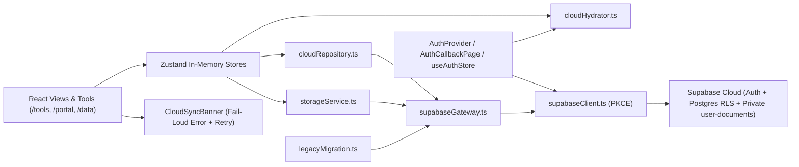

# HireFlow Cloud-First Architecture

HireFlow runs as a **cloud-first career workspace** powered by Supabase Auth (Google OAuth PKCE), Supabase Postgres with database-enforced Row Level Security (RLS), and Supabase Private Storage (`user-documents`), while keeping Guest interactive evaluation purely in transient session memory.

---

## 1. Core Design Principles

1. **Single Authoritative Identity Owner**: Authenticated user identity comes strictly from `session.user.id` (Supabase Auth UUID). Fake Google choosers, hardcoded `'Mohit'` identity fallbacks, and production local/demo bypasses are eliminated.
2. **Zero Durable Browser User Persistence**: Application records (resumes, text snapshots, ATS audits, job descriptions, watchlist targets, roadmap progress, cover letters, outreach drafts, salary records, portfolio items) are **never** saved into browser `localStorage`, `sessionStorage`, or IndexedDB.
3. **Fail-Loud Cloud Writes with Explicit Retry**: When signed in, persistence flows through `cloudRepository` and `storageService` directly to Supabase. Failures immediately surface in `CloudSyncBanner` via `useCloudSyncStore` with an explicit **Retry** callback — never silently writing stale local backups.
4. **Strict Module Import Boundaries**: `@supabase/supabase-js` and `supabaseClient.ts` are strictly confined inside `src/features/auth/` and `src/sync/` (verified by `src/__guarantees__/importBoundaries.test.ts`).

---

## 2. Layer Diagram

---

## 3. Component Responsibilities

| Module | Path | Responsibility |
|---|---|---|
| **Env Validator** | `src/lib/supabase/env.ts` | Validates `VITE_SUPABASE_URL` (HTTPS or localhost), `VITE_SUPABASE_ANON_KEY`, blocks accidental `service_role` JWTs, resolves `/auth/callback`. |
| **PKCE Client** | `src/features/auth/supabaseClient.ts` | Lazily creates typed Supabase client (`flowType: 'pkce'`, `persistSession: true`, `autoRefreshToken: true`). Confined to `src/features/auth/` and `src/sync/`. |
| **Auth Lifecycle** | `src/features/auth/useAuthStore.ts`, `AuthProvider.tsx`, `AuthCallbackPage.tsx` | Manages Google OAuth sign-in (`prompt: 'select_account'`), PKCE callback verification, session expiration recovery, complete memory reset on sign-out / account switch, and SW cache purge (`CLEAR_USER_CACHES`). |
| **Supabase Gateway** | `src/sync/supabaseGateway.ts` | Sole non-auth caller of `supabaseClient.ts`. Exposes typed CRUD & Storage operations plus `_setCloudGatewayForTesting()` for isolated deterministic tests. |
| **Cloud Repository** | `src/lib/cloud/cloudRepository.ts` | Authoritative Postgres read/write boundary enforcing `assertSessionOwnership(userId)`, in-memory snapshot cache, fail-loud errors, and `eraseAllUserCloudData()`. |
| **Cloud Hydrator** | `src/lib/cloud/cloudHydrator.ts` | `hydrateUserFromCloud(userId)` populates all domain/projection stores on login/reload; `resetAllUserMemoryStores()` wipes all stores + snapshot cache on logout or account switch. |
| **Private Storage** | `src/lib/cloud/storageService.ts` | Validates files (`<= 5 MB`, magic bytes + Phase 10.6 DOCX archive zip-bomb checks), enforces `${userId}/${docKind}/${docId}/${safeName}` paths, rolls back orphan blobs if Postgres metadata fails, and generates signed download URLs only (zero `getPublicUrl`). |
| **Legacy Importer** | `src/lib/cloud/legacyMigration.ts` | Temporary, user-initiated importer on `/data` that previews pre-cloud `hireflow` browser keys read-only, uploads in parent->child order with deduplicated SHA-256 `legacy_import_receipts`, preserves source data on failure, and clears migrated keys only after confirmed Postgres receipt. |

---

## 4. Browser Storage Residency Policy

Only two harmless categories may use browser storage cleanly:
1. **Non-PII UI Preferences**: `hireflow:v4:design`, `hireflow:v4:theme-mode` (`localStorage`), and `hf_seen_cinematic` (`sessionStorage`).
2. **Supabase Auth PKCE Session**: Standard `sb-*-auth-token` PKCE state managed internally by `@supabase/supabase-js` for cross-refresh session persistence, paired with transient `hireflow:returnTo` during the OAuth callback hop.
