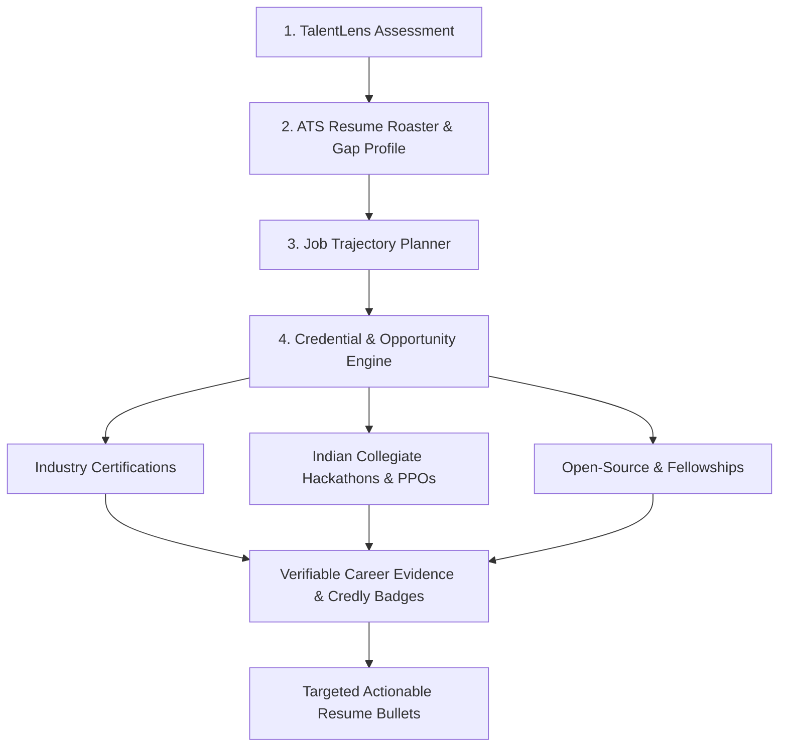

# Verifiable Career Evidence Engine Architecture

## Architectural Positioning
Inside HireFlow, the **Credential & Opportunity Engine** functions as the bridge between candidate diagnostics and tangible career outcomes:

---

## Data Schema & Strict Invariants
1. **Zero Fabrication**: Every opportunity record is backed by an active, canonical, publicly resolvable URL.
2. **Indian Localization**: Real INR prices (`₹`) alongside USD context, with verified student financial aid waiver pathways.
3. **Structured Schemas**: 35+ strictly typed attributes per opportunity (rank, eligibility, prep time, syllabus, resume presentation formula, skills demonstrated, confidence).
4. **Resilient Local Persistence**: Candidate opportunity plans (`30_day`, `90_day`, `interested`, `in_progress`, `completed`) persist in `localStorage` under isolated namespaced keys.
