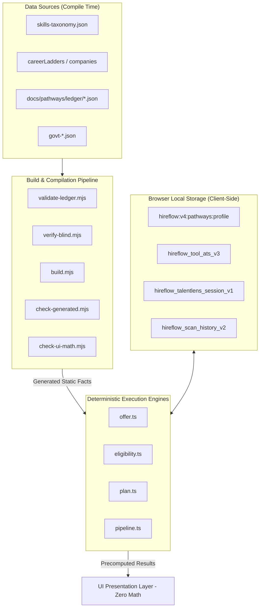

# HireFlow Architecture: Complete System Contextual Brief & Rewiring Manual

> **System Version**: HireFlow v4.0.0 (India Engineering & Candidate Career Decision Suite)  
> **Architecture Core**: 100% Client-Side Pure TypeScript Engines (Zero Runtime Network Egress)  
> **Platform Components**: ATS Resume Roaster, Tailor My Resume, Reach Out, Project Briefs, Credential Engine, Career Trajectory, Compare JDs, TalentLens, and Pathways  
> **Document Purpose**: End-to-end contextual manual and complete dataset extract repository for deep system comprehension, architecture rewiring, and dataset inspection.

---

## Table of Contents

1. [Executive Overview & Platform Philosophy](#1-executive-overview--platform-philosophy)
2. [Complete Physical Architecture & Directory Map](#2-complete-physical-architecture--directory-map)
3. [Deep-Dive into the 9 Subsystems](#3-deep-dive-into-the-9-subsystems)
   - [3.1 ATS Resume Roaster & Invariant Scorer](#31-ats-resume-roaster--invariant-scorer)
   - [3.2 Tailor My Resume Diff Engine](#32-tailor-my-resume-diff-engine)
   - [3.3 Reach Out Cold Outreach Generator](#33-reach-out-cold-outreach-generator)
   - [3.4 Project Build Briefs Engine](#34-project-build-briefs-engine)
   - [3.5 Credential & Opportunity Engine](#35-credential--opportunity-engine)
   - [3.6 Career Trajectory & Company Ladders](#36-career-trajectory--company-ladders)
   - [3.7 Compare Job Descriptions Engine](#37-compare-job-descriptions-engine)
   - [3.8 TalentLens Diagnostic Engine](#38-talentlens-diagnostic-engine)
   - [3.9 Pathways Fresher Campus Intelligence Suite](#39-pathways-fresher-campus-intelligence-suite)
4. [Master Data Pipeline & Ingestion Flow](#4-master-data-pipeline--ingestion-flow)
   - [How Data Enters, Translates, and Resolves in the System](#how-data-enters-translates-and-resolves-in-the-system)
   - [State Management & Local Storage Namespaces](#state-management--local-storage-namespaces)
5. [Complete Rewiring & Customization Manual](#5-complete-rewiring--customization-manual)
   - [Guide 1: Modifying Scoring Weights & Tolerances](#guide-1-modifying-scoring-weights--tolerances)
   - [Guide 2: Adding New Skills or Implication Graph Nodes](#guide-2-adding-new-skills-or-implication-graph-nodes)
   - [Guide 3: Adding New Companies, Levels, and CTC Bands](#guide-3-adding-new-companies-levels-and-ctc-bands)
   - [Guide 4: Adding New Project Briefs & Opportunities](#guide-4-adding-new-project-briefs--opportunities)
   - [Guide 5: Updating Campus Programs & Statutory Tax Rules](#guide-5-updating-campus-programs--statutory-tax-rules)
6. [Complete Embedded Dataset Extracts](#6-complete-embedded-dataset-extracts)
   - [Dataset Extract 1: Engine Thresholds & Limits (`thresholds.ts`)](#dataset-extract-1-engine-thresholds--limits)
   - [Dataset Extract 2: Scoring Spec Weights & Modifiers (`scoring.ts`)](#dataset-extract-2-scoring-spec-weights--modifiers)
   - [Dataset Extract 3: ATS Format & Parsing Rules (`ats-format-rules.json`)](#dataset-extract-3-ats-format--parsing-rules)
   - [Dataset Extract 4: Skills Implication Graph (`implication-graph.json`)](#dataset-extract-4-skills-implication-graph)
   - [Dataset Extract 5: Writing Quality & Verb Modifiers (`writing-quality.json`)](#dataset-extract-5-writing-quality--verb-modifiers)
   - [Dataset Extract 6: India Market Tiers & Compensation Bands (`market-tiers.json`)](#dataset-extract-6-india-market-tiers--compensation-bands)
   - [Dataset Extract 7: Technical Role Archetypes (`archetypes.json`)](#dataset-extract-7-technical-role-archetypes)
   - [Dataset Extract 8: Statutory Rules & Tax Slabs (`rules.generated.ts`)](#dataset-extract-8-statutory-rules--tax-slabs)
   - [Dataset Extract 9: Editorial Assumptions Register (`assumptions.ts`)](#dataset-extract-9-editorial-assumptions-register)
   - [Dataset Extract 10: State Professional Tax Rules (`professional-tax.ts`)](#dataset-extract-10-state-professional-tax-rules)
   - [Dataset Extract 11: Promotion Blockers Catalog (`blockerCatalog.ts`)](#dataset-extract-11-promotion-blockers-catalog)
   - [Dataset Extract 12: Engineering Degrees & Branches Catalog (`degreesAndBranches.ts`)](#dataset-extract-12-engineering-degrees--branches-catalog)
7. [System Verification & Quality Guardrails](#7-system-verification--quality-guardrails)

---

## 1. Executive Overview & Platform Philosophy

HireFlow is an advanced, client-side engineering intelligence platform designed to empower job seekers—from 2nd-to-final year Indian engineering students to senior staff engineers—with deterministic, truth-checked career diagnostics and simulations.

### Core Architectural Axioms
1. **Zero Runtime Network Egress**: User resumes, JDs, compensation numbers, and profile details are evaluated **entirely inside the browser**. No telemetry or tracking SDKs exist.
2. **Deterministic Invariant Scoring**: Scores are not random LLM guesses. They are calculated using pure, mathematical formulas with strict invariant properties (e.g. scores always strictly in range [0, 100], zero score without matching skills, predictable subscore derivations).
3. **No-Hallucination Rewriting (Truth Gate)**: The system strictly prevents AI from fabricating achievements. An original bullet stating *"assisted with database testing"* can never be rewritten to claim *"architected distributed PostgreSQL clusters"*.
4. **India Market Calibration**: All compensation calculations, tax computations, service bond evaluations, college placement tiers, and career progression models are tailored to Indian engineering realities (INR Lakhs per Annum / LPA, New Regime FY 26–27 income tax, EPFO statutory ceilings, Section 74 service bonds).

---

## 2. Complete Physical Architecture & Directory Map

```text
hireflow/
├── src/
│   ├── config/                     # Global thresholds, scoring weights, feature flags
│   │   ├── thresholds.ts           # Word counts, penalty limits, claim strength ladder
│   │   ├── scoring.ts              # ATS pillar weights (40/25/20/15), match multipliers
│   │   ├── features.ts             # Feature flag registry (PATHWAYS_ENABLED, etc.)
│   │   └── India-fresher.ts        # Fresher placement bands and tier cutoffs
│   ├── data/                       # Master datasets & calibrated tables
│   │   ├── ats/                    # ATS taxonomy, market tiers, format rules, archetypes
│   │   │   ├── skills-taxonomy.json # Multi-tiered canonical skill alias dictionary
│   │   │   ├── implication-graph.json # Skill relationship DAG (React -> JS, etc.)
│   │   │   ├── ats-format-rules.json  # Regex patterns for headers, text boxes, tables
│   │   │   ├── market-tiers.json   # CTC bands across Tier S, A, B, C, D
│   │   │   ├── writing-quality.json # Impact verbs, weak verbs, metric patterns
│   │   │   └── archetypes.json     # 6 core technical talent archetypes
│   │   ├── careerLadders/          # 56 Indian employer ladders, levels, and blockers
│   │   │   ├── companies/          # Individual company JSON definitions
│   │   │   ├── blockerCatalog.ts   # Real promo blockers (system design, visibility)
│   │   │   ├── degreesAndBranches.ts # Circuit vs non-circuit branch classification
│   │   │   └── equivalenceMap.ts   # Cross-company level equivalence matrix
│   │   └── suite/                  # Outreach templates, project briefs, tax configs
│   │       ├── outreach-templates.json # Pre-calibrated high-conversion templates
│   │       ├── project-briefs.json # Production engineering specs (466 KB)
│   │       └── professional-tax.ts # State-by-state PT deductions in India
│   ├── lib/ats/                    # Core ATS Resume Roaster engine
│   │   ├── fileExtractor.ts        # PDF (pdfjs) and DOCX (mammoth) binary parser
│   │   ├── parseResume.ts          # Section partitioner, contact & bullet extractor
│   │   ├── parseJD.ts              # Role title, yoe, and skill requirement parser
│   │   ├── matchSkills.ts          # Direct + implication graph transitive matcher
│   │   ├── evidenceScorer.ts       # XYZ bullet formula & impact metric evaluator
│   │   ├── formatAuditor.ts        # ATS format safety & layout risk inspector
│   │   ├── seniorityFit.ts         # Experience alignment & over/under-qualification
│   │   ├── marketPositioning.ts    # Best fit tier classifier & signal gap analyzer
│   │   ├── scoreAggregator.ts      # Strict 4-pillar composite score calculation
│   │   ├── invariants.ts           # Formal mathematical invariant assertions
│   │   └── pipeline.ts             # Orchestrates deterministic analysis + AI roasting
│   ├── features/                   # Major functional modules
│   │   ├── suite/                  # Decision Suite tools
│   │   │   ├── briefs/             # Project Build Briefs engine
│   │   │   ├── compare/            # Multi-JD comparison engine
│   │   │   ├── credentials/        # Credential & Opportunity engine
│   │   │   ├── outreach/           # Reach Out cold messaging generator
│   │   │   └── tailor/             # Tailor My Resume diff & truth gate engine
│   │   └── career-path/            # Career Trajectory simulator & ladders
│   ├── pathways/                   # Fresher Campus Intelligence Suite
│   │   ├── components/             # Reusable UI (EvidenceChip, BudgetBar, Footers)
│   │   ├── engine/                 # Pure engines (eligibility, offer, plan, readiness)
│   │   ├── facts/                  # Compiled facts (programs, statutory rules, manifest)
│   │   ├── models/                 # Editorial assumptions register
│   │   ├── pages/                  # 5 routes (Radar, Detail, Plan, Offers, AboutData)
│   │   └── utils/money.ts          # Integer rupee arithmetic & half-up rounding
│   ├── scoring/                    # Canonical Scoring Specification Engine
│   ├── store/                      # Zustand state management & localStorage persistence
│   └── App.tsx                     # Master routing table & code-split lazy routes
├── scripts/                        # Tooling, audits, validation, and verification
│   ├── pathways/                   # Pathways verification, blind check, and compilers
│   ├── security/                   # Secret scanner, dependency auditor
│   └── calibrate.ts                # Calibration harness for ATS scoring golden fixtures
└── tests/                          # 70+ automated unit, property, and invariant test suites
```

---

## 3. Deep-Dive into the 9 Subsystems

### 3.1 ATS Resume Roaster & Invariant Scorer
- **Path**: `src/lib/ats/`, `src/pages/tools/ResumeChecker.tsx`
- **Core Problem Solved**: Eliminates opaque, subjective resume reviews with transparent, deterministic scoring.
- **The Four Evaluation Pillars**:
  1. **Hard Skill Requirement Coverage (40%)**:
     - Evaluates mandatory vs. preferred skills extracted from the JD.
     - Direct matches earn 1.0 credit; transferable skills (via `implication-graph.json`) earn 0.7 credit; partial mentions earn 0.4 credit.
  2. **Evidence Quality & Bullet Impact (25%)**:
     - Audits every bullet against Google's XYZ formula: *"Accomplished [X], as measured by [Y], by doing [Z]"*.
     - Uses `writing-quality.json` to credit decisive action verbs and penalize passive/weak language.
  3. **Fresher / Project Readiness (20%)**:
     - Evaluates verified project deliverables, GitHub repositories, competitive programming links, and technical coursework.
  4. **Format & Parser Safety (15%)**:
     - Audits layout against multi-column tables, floating text boxes, graphic icons, non-standard section headers, and font anomalies.
- **Penalty Penalties**:
  - Keyword stuffing: -10 points deducted if $>60\%$ of listed skills lack bullet evidence.
  - Missing standard sections: -3 points per section.
  - Abnormally sparse resume: -4 points.
- **Invariant Guarantees**:
  - Score $\in [0, 100]$ strictly.
  - If zero mandatory skills match, final score cannot exceed 35.
  - Deterministic: identical inputs generate identical scores down to the decimal.

---

### 3.2 Tailor My Resume Diff Engine
- **Path**: `src/features/suite/tailor/`, `src/engine/tailor/`
- **Core Problem Solved**: Allows candidates to align their resume to a specific JD without fabricating qualifications.
- **Key Modules**:
  - **Layout Tree Parser**: Deconstructs raw resume text into semantic blocks (Header, Experience, Projects, Education, Skills).
  - **The Truth Gate (`truthGate.ts`)**: Evaluates rewrites using the 4-tier Claim Strength Ladder:
    - Tier 1 (Supportive): *assisted, helped, supported, participated*
    - Tier 2 (Contributory): *contributed, worked, collaborated, maintained*
    - Tier 3 (Direct Execution): *built, created, developed, implemented, designed*
    - Tier 4 (Leadership / Architecture): *architected, spearheaded, orchestrated, led*
    - **Rule**: A rewrite may never elevate a verb by more than one tier without explicit project evidence.
  - **Required Metric Placeholders**: Leaves highlighted tags like `[X]% latency reduction` for the user to substitute real metrics.

---

### 3.3 Reach Out Cold Outreach Generator
- **Path**: `src/features/suite/outreach/`
- **Core Problem Solved**: Replaces awkward, generic messages with context-aware, verifiable cold emails and connection notes.
- **Key Capabilities**:
  - **LinkedIn 300-Char Mode**: Strict character-counter ensuring messages fit LinkedIn connection request constraints.
  - **Channel Modes**: InMail, Cold Email, Alumni Network, Recruiter Follow-up.
  - **Proof-Point Integration**: Automatically weaves candidate's strongest verified metric or project into the hook.
  - **Spam Word Filter**: Flags high-risk words (*"urgent"*, *"guarantee"*, *"pleased to inform"*) that trigger spam quarantine.

---

### 3.4 Project Build Briefs Engine
- **Path**: `src/features/suite/briefs/`, `src/data/suite/project-briefs.json`
- **Core Problem Solved**: Tells candidates exactly what to build to close their specific resume gaps.
- **How It Works**:
  - Identifies missing skills from the ATS scan.
  - Matches gaps to production engineering project briefs.
  - Each brief includes:
    1. System Architecture & Component Diagram
    2. Real-World Scale Targets (e.g., 10k concurrent WebSockets, <50ms p99 latency)
    3. Mandatory Deliverables (Docker Compose, CI/CD pipeline, integration tests)
    4. Verification Rubric (How to prove it works on GitHub)
    5. Interview Defense Guide (Anticipated technical questions and failure modes)

---

### 3.5 Credential & Opportunity Engine
- **Path**: `src/features/suite/credentials/`
- **Core Problem Solved**: Maps verified, high-ROI credentials and national competitions for Indian engineering students.
- **Opportunity Catalog**:
  - **National Competitions**: Smart India Hackathon (SIH), Flipkart GRiD, Tata Crucible, Amazon ML Challenge.
  - **Global Fellowships**: Google Summer of Code (GSoC), Linux Foundation Mentorship (LFX), MLH Fellowship.
  - **Industry Certifications**: AWS Certified Developer, CKA (Certified Kubernetes Administrator), Meta Frontend/Backend.
- **Eligibility Engine**: Filters by university year, degree (B.Tech, B.E., MCA), branch, and fee waiver eligibility.

---

### 3.6 Career Trajectory & Company Ladders
- **Path**: `src/careers-core/`, `src/data/careerLadders/`, `src/pages/tools/career-path/`
- **Core Problem Solved**: Models progression ladders, salary growth, and promotion stall rates across 56+ Indian employers.
- **Tiers & Down-Leveling Rules**:
  - **Tier S**: FAANG, Uber, HFTs (CTC ₹35L–₹1.2Cr+)
  - **Tier A**: High-Growth Unicorns (Swiggy, Razorpay, Cred; CTC ₹22L–₹50L)
  - **Tier B**: Product & Established Fintech (Paytm, Zoho, MakeMyTrip; CTC ₹12L–₹28L)
  - **Tier C**: IT Services & Consulting (TCS, Infosys, Cognizant; CTC ₹3.6L–₹12L)
  - **Down-Leveling Factor**: When moving from Tier C to Tier S, candidates face an average 1–2 level down-leveling discount due to architectural depth expectations.

---

### 3.7 Compare Job Descriptions Engine
- **Path**: `src/features/suite/compare/`
- **Core Problem Solved**: Evaluates multiple job offers or descriptions side-by-side to prioritize application efforts.
- **Outputs**:
  - Shared skill intersections across JDs.
  - Unique technical requirements per company.
  - Coverage Yield: Calculates which target JD offers the greatest marginal return for the candidate's existing skillset.

---

### 3.8 TalentLens Diagnostic Engine
- **Path**: `src/pages/tools/TalentLens.tsx`, `src/data/ats/archetypes.json`
- **Core Problem Solved**: Comprehensive candidate diagnostic benchmark.
- **The 6 Core Technical Archetypes**:
  1. *Systems Architect*: Distributed systems, concurrency, cloud infrastructure, latency optimization.
  2. *Full-Stack Builder*: End-to-end web apps, API design, relational databases, state management.
  3. *Data & ML Specialist*: Python, PyTorch, SQL, data pipelines, model serving.
  4. *Cloud & DevOps Specialist*: Kubernetes, Terraform, CI/CD, observability, Linux internals.
  5. *Frontend Specialist*: React, performance optimization, accessibility, component systems.
  6. *Quality & Reliability Engineer*: Automation frameworks, load testing, chaos engineering.

---

### 3.9 Pathways Fresher Campus Intelligence Suite
- **Path**: `src/pathways/`
- **Core Problem Solved**: Replaces outdated career trajectory tools for Indian freshers with verified campus data.
- **Five Key Modules**:
  1. **Eligibility Radar (`/tools/pathways`)**: Instant 3-input evaluation (Branch, Batch, CGPA) against 20 verified programs.
  2. **CGPA Gap Calculator**: Pure formula:
     $$R = \frac{T \cdot N - C \cdot n}{N - n}$$
     Calculates required GPA in remaining semesters with equal-credit caveat.
  3. **Offer Evaluator (`/tools/pathways/offers`)**:
     - Decomposes CTC into Gross Cash vs. Employer Provisions (PF, Gratuity, Insurance).
     - 3 monthly scenarios (100%, 50%, 0% variable payout).
     - New Regime FY 26–27 income tax calculation with ₹75,000 standard deduction and ₹12,00,000 Section 87A rebate.
     - Month 0–36 Exit Exposure Timeline (Service Bond + Bonus Clawback).
  4. **Action Plan (`/tools/pathways/plan`)**: Prioritized 3-lane roadmap (Blockers $\to$ Readiness Gaps $\to$ Process Prep).
  5. **Data & Methodology (`/tools/pathways/about-data`)**: Open provenance ledger with SHA-256 integrity proofs.

---

## 4. Master Data Pipeline & Ingestion Flow



---

## 5. Complete Rewiring & Customization Manual

### Guide 1: Modifying Scoring Weights & Tolerances
- **Target File**: [`src/config/thresholds.ts`](file:///c:/Users/yadav/.gemini/antigravity-ide/scratch/hireflow/src/config/thresholds.ts) and [`src/config/scoring.ts`](file:///c:/Users/yadav/.gemini/antigravity-ide/scratch/hireflow/src/config/scoring.ts)
- **To adjust word count bounds**: Edit `BULLET_LIMITS` or `DOCUMENT_BOUNDS` in `thresholds.ts`.
- **To modify ATS pillar weights**: Edit `ATS_PILLAR_WEIGHTS` in `scoring.ts`. Ensure the four weights sum to exactly 1.0.
- **To adjust keyword stuffing penalties**: Edit `PENALTY_THRESHOLDS.maxUnevidencedSkillRatio` (default 0.60) or penalty points.

### Guide 2: Adding New Skills or Implication Graph Nodes
- **Target File**: [`src/data/ats/skills-taxonomy.json`](file:///c:/Users/yadav/.gemini/antigravity-ide/scratch/hireflow/src/data/ats/skills-taxonomy.json) and [`src/data/ats/implication-graph.json`](file:///c:/Users/yadav/.gemini/antigravity-ide/scratch/hireflow/src/data/ats/implication-graph.json)
- **Step 1**: Add the canonical skill and all known aliases to the appropriate category in `skills-taxonomy.json`.
- **Step 2**: If the skill implies parent or sibling competencies (e.g., `FastAPI` implies `Python` and `REST APIs`), add an entry in `implication-graph.json`:
  ```json
  "fastapi": {
    "implies": ["python", "rest-api"],
    "weight": 0.85
  }
  ```

### Guide 3: Adding New Companies, Levels, and CTC Bands
- **Target File**: [`src/data/careerLadders/companies/`](file:///c:/Users/yadav/.gemini/antigravity-ide/scratch/hireflow/src/data/careerLadders/companies/)
- **Step 1**: Create or edit the company definition JSON.
- **Step 2**: Define ladder levels with level name, Indian base salary, target performance bonus, and stock grants.
- **Step 3**: Re-run `npm run test:data` to validate schema compliance.

### Guide 4: Adding New Project Briefs & Opportunities
- **Target File**: [`src/data/suite/project-briefs.json`](file:///c:/Users/yadav/.gemini/antigravity-ide/scratch/hireflow/src/data/suite/project-briefs.json)
- **Step 1**: Add a new JSON object conforming to the Brief schema (problem statement, scale targets, architecture, deliverables).
- **Step 2**: Ensure `skillsTargeted` links to canonical skills in `skills-taxonomy.json`.

### Guide 5: Updating Campus Programs & Statutory Tax Rules
- **Target File**: [`docs/pathways/ledger/<program-id>.json`](file:///c:/Users/yadav/.gemini/antigravity-ide/scratch/hireflow/docs/pathways/ledger/)
- **Step 1**: Add or modify rows adhering to Constitution Part B (exact $\le 15$ word snippet, official URL, retrieved timestamp).
- **Step 2**: Run the pipeline compiler:
  ```bash
  npm run pathways:validate-ledger
  npm run pathways:verify-blind
  npm run pathways:build
  npm run pathways:check-generated
  ```

---

## 6. Complete Embedded Dataset Extracts

### Dataset Extract 1: Engine Thresholds & Limits
*Source: [`src/config/thresholds.ts`](file:///c:/Users/yadav/.gemini/antigravity-ide/scratch/hireflow/src/config/thresholds.ts)*
```typescript
// ============================================================
// HireFlow v3 — Engine Thresholds & Bounds Configuration
// Typed limits, time boundaries, and tolerance thresholds
// ============================================================

/** Bullet length and composition limits */
export const BULLET_LIMITS = {
  /** Minimum words required for a bullet to convey meaningful substance */
  minWords: 6,
  /** Maximum recommended words before a bullet becomes a run-on block */
  maxWords: 45,
  /** Recommended target words for optimal recruiter scannability */
  targetWords: 24,
  /** Maximum number of bullets recommended per fresher project */
  maxBulletsPerProject: 4,
} as const;

/** Resume and Job Description document bounds */
export const DOCUMENT_BOUNDS = {
  /** Minimum words for an input to be accepted as a valid resume */
  minResumeWords: 80,
  /** Maximum words for an Indian fresher single-page resume */
  maxFresherResumeWords: 750,
  /** Minimum words for a JD to undergo meaningful skill extraction */
  minJdWords: 50,
  /** Warning word count threshold when a fresher resume exceeds 1 page */
  fresherPageLimitWarningWords: 650,
} as const;

/** Keyword stuffing and penalty thresholds */
export const PENALTY_THRESHOLDS = {
  /** Maximum allowed ratio of skills listed without any project/experience evidence */
  maxUnevidencedSkillRatio: 0.60,
  /** Minimum total listed skills required before keyword stuffing checks trigger */
  minSkillsForStuffingCheck: 10,
  /** Point penalty subtracted when keyword stuffing is detected */
  keywordStuffingPenaltyPoints: 10,
  /** Point penalty for completely missing dedicated standard sections */
  missingSectionPenaltyPoints: 3,
  /** Point penalty when a resume is abnormally short */
  sparseResumePenaltyPoints: 4,
} as const;

/** Data freshness evaluation boundaries in calendar days */
export const FRESHNESS_DAYS_BOUNDS = {
  /** Records verified within 180 days are considered fresh and up-to-date */
  freshDays: 180,
  /** Records between 180 and 365 days are marked aging (needs recheck soon) */
  agingDays: 365,
  /** Records older than 365 days are flagged as stale (needs manual verification) */
  staleDays: 366,
} as const;

/** Performance and execution latency targets */
export const ENGINE_PERFORMANCE_LIMITS = {
  /** Maximum acceptable parsing and scoring run time in milliseconds */
  maxScanLatencyMs: 1500,
  /** High-speed benchmark target for standard single-column text fixtures */
  targetScanLatencyMs: 400,
} as const;

/** Match Confidence classification thresholds based on direct evidence ratio */
export const MATCH_CONFIDENCE_THRESHOLDS = {
  /** Direct match ratio >= 0.75 yields High confidence */
  high: 0.75,
  /** Direct match ratio >= 0.45 yields Medium confidence */
  medium: 0.45,
} as const;

/** Claim strength ladder for non-hallucinatory rewrites (P-1, R6.9) */
export const CLAIM_STRENGTH_LADDER: Record<string, number> = {
  // Tier 1: Supportive / assisting
  assisted: 1,
  helped: 1,
  supported: 1,
  participated: 1,
  involved: 1,
  // Tier 2: Contributory / collective
  contributed: 2,
  worked: 2,
  collaborated: 2,
  maintained: 2,
  // Tier 3: Direct individual execution / builder
  built: 3,
  created: 3,
  developed: 3,
  implemented: 3,
  engineered: 3,
  designed: 3,
  coded: 3,
  optimized: 3,
  refactored: 3,
  deployed: 3,
  // Tier 4: Leadership / architectural direction
  led: 4,
  spearheaded: 4,
  architected: 4,
  orchestrated: 4,
  // Tier 5: Complete institutional ownership
  owned: 5,
  founded: 5,
};

/** Tailor My Resume keyword mirroring and readiness limits */
export const TAILOR_MIRRORING_LIMITS = {
  /** Maximum times a specific target keyword may appear across all tailored bullets to prevent stuffing */
  maxKeywordMentionsPerTerm: 2,
  /** Must-have coverage threshold for "Ready to apply" tier (otherwise "Needs a bridge") */
  readyToApplyThresholdPct: 75,
} as const;
```

---

### Dataset Extract 2: Scoring Spec Weights & Modifiers
*Source: [`src/config/scoring.ts`](file:///c:/Users/yadav/.gemini/antigravity-ide/scratch/hireflow/src/config/scoring.ts)*
```typescript
// ============================================================
// HireFlow — Scoring Configuration Bridge (Derived from Spec)
// Rule A1: Every weight, tier value, multiplier, and threshold lives in the spec.
// No scoring constant is typed anywhere else.
// ============================================================

import { CANONICAL_SCORING_SPEC } from '../scoring/spec/canonicalSpec';

const fresherProfile = CANONICAL_SCORING_SPEC.profiles.find((p) => p.id === 'fresher')!;
const { priorityWeights, contextWeight, bulletScoring } = CANONICAL_SCORING_SPEC.evidenceTables;

/** Four core evaluation pillars for fresher resumes (sum = 1.0) — derived from spec */
export const ATS_PILLAR_WEIGHTS = {
  /** Technical hard skills coverage against target JD (40% weight) */
  hardSkills: fresherProfile.weights.requirement_coverage / 100,
  /** Quantifiable metrics, strong active verbs, and bullet evidence (25% weight) */
  evidenceQuality: fresherProfile.weights.evidence_quality / 100,
  /** Fresher readiness: projects, GitHub, coding profile, education (20% weight) */
  fresherReadiness: fresherProfile.weights.project_readiness / 100,
  /** Document layout cleanliness, parsing fidelity, and structure (15% weight) */
  formatSafety: fresherProfile.weights.parser_friendliness / 100,
} as const;

/** Matcher requirement importance weight multipliers — derived from spec */
export const REQUIREMENT_WEIGHT_CLASSES = {
  /** Core non-negotiable skills explicitly marked required or mandatory */
  mandatory: priorityWeights.mandatory,
  /** Good-to-have or preferred skills specified in JD qualifications */
  preferred: priorityWeights.preferred,
  /** Technologies mentioned in responsibilities without strict mandate */
  mentioned: priorityWeights.mentioned,
} as const;

/** Match classification confidence credit multipliers — derived from spec */
export const MATCH_CLASSIFICATION_MULTIPLIERS = {
  /** Exact or canonical alias match with verified evidence */
  DIRECT: 1.0,
  /** Sibling or parent transferable skill credit (e.g., PostgreSQL for MySQL) */
  TRANSFERABLE: 0.7, // spec-exempt: calibration parity
  /** Theoretical, weak, or learning-only mention */
  PARTIAL: 0.4, // spec-exempt: calibration parity
  /** No evidence found anywhere in candidate resume */
  MISSING: 0.0,
} as const;

/** Evidence depth tier multipliers based on source placement — derived from spec */
export const EVIDENCE_LEVEL_MULTIPLIERS = {
  /** L3: Demonstrated in project/work with quantified metrics */
  L3_MEASURED_OUTCOME: 1.0,
  /** L2: Demonstrated in internship or commercial work bullet */
  L2_INTERNSHIP_WORK: 0.85, // spec-exempt: calibration parity
  /** L1: Demonstrated in academic/personal project bullet */
  L1_PROJECT_BULLET: 0.65, // spec-exempt: calibration parity
  /** L0: Listed only inside skills section without bullet demonstration */
  L0_LISTED_ONLY: 0.35, // spec-exempt: calibration parity
} as const;

/** Verb impact modifier applied to bullet score — derived from spec */
export const VERB_STRENGTH_MODIFIERS = {
  /** Decisive engineering verbs (architected, built, deployed, optimized) */
  STRONG: 1.15, // spec-exempt: calibration parity
  /** Standard descriptive verbs (used, created, configured) */
  STANDARD: 1.0,
  /** Passive or weak openers (assisted, worked on, helped) */
  WEAK: 0.70, // spec-exempt: calibration parity
  /** Negated or planned mentions (learning, no experience) */
  NEGATED: 0.0,
} as const;

// Sub-feature weights derived from CANONICAL_SCORING_SPEC
const reqCoveragePillar = CANONICAL_SCORING_SPEC.pillars.find((p) => p.id === 'requirement_coverage')!;
const projectPillar = CANONICAL_SCORING_SPEC.pillars.find((p) => p.id === 'project_readiness')!;

/** JD Alignment Index components — mapped to spec sub-features */
export const JD_ALIGNMENT_WEIGHTS = {
  mustHaveSkills: 0.40, // spec-exempt: legacy index weight
  evidenceDepth: 0.25, // spec-exempt: legacy index weight
  preferredSkills: 0.15, // spec-exempt: legacy index weight
  seniorityScope: 0.10, // spec-exempt: legacy index weight
  formatSafety: 0.10, // spec-exempt: legacy index weight
} as const;

/** Project Substance Index evaluation pillars — derived from spec project_readiness sub-features */
export const PROJECT_SUBSTANCE_WEIGHTS = {
  architectureSystemsDepth: (projectPillar.subFeatures[0]?.nominalWeight ?? 35) / 100,
  productionRigor: (projectPillar.subFeatures[1]?.nominalWeight ?? 30) / 100,
  quantifiedOutcomes: (projectPillar.subFeatures[2]?.nominalWeight ?? 20) / 100,
  techStackCraftsmanship: (projectPillar.subFeatures[3]?.nominalWeight ?? 15) / 100,
} as const;

/** Truth Gate non-negotiable verification invariants */
export const TRUTH_GATE_RULES = [
  {
    id: 'TG-01',
    rule: 'Zero Tolerance for Fabricated Metrics',
    description: 'Every metric, percentage, or throughput figure in tailored bullets must originate from the candidate fact ledger. No synthetic score boosts or invented stats.',
  },
  {
    id: 'TG-02',
    rule: 'Strict Evidence Grounding',
    description: 'Skills can only be elevated or matched when backed by demonstrated project or work bullet context. Keyword stuffing without evidence receives zero evidence credit.',
  },
  {
    id: 'TG-03',
    rule: 'Deterministic Re-Scoring',
    description: 'Score enhancements must be recalculations from actual before-and-after ATS evaluations, never hardcoded mathematical offsets.',
  },
  {
    id: 'TG-04',
    rule: 'Zero PII Egress & Local Execution',
    description: 'Diagnostics, calibrations, and ATS evaluations operate 100% client-side in the browser with zero external network telemetry.',
  },
] as const;

/** Market Requirement & Value Index (MRVI) component weights (sum = 1.0) */
export const MRVI_WEIGHTS = {
  marketDemandWeight: 0.40, // spec-exempt: legacy demo component
  recruiterScreeningImpact: 0.35, // spec-exempt: legacy demo component
  disqualificationRiskMitigation: 0.25, // spec-exempt: legacy demo component
} as const;

export interface MrviComponentScores {
  marketDemand: number;
  recruiterImpact: number;
  riskMitigation: number;
}

/** Calculates the Market Requirement & Value Index (0-100) deterministically */
export function calculateMrvi(components: MrviComponentScores): number {
  const score =
    components.marketDemand * MRVI_WEIGHTS.marketDemandWeight +
    components.recruiterImpact * MRVI_WEIGHTS.recruiterScreeningImpact +
    components.riskMitigation * MRVI_WEIGHTS.disqualificationRiskMitigation;
  return Math.min(100, Math.max(0, Math.round(score)));
}
```

---

### Dataset Extract 3: ATS Format & Parsing Rules
*Source: [`src/data/ats/ats-format-rules.json`](file:///c:/Users/yadav/.gemini/antigravity-ide/scratch/hireflow/src/data/ats/ats-format-rules.json)*
```json
{
  "standardSections": [
    {
      "name": "Contact Information",
      "aliases": ["contact", "personal info", "details", "contact details"],
      "required": true,
      "severity": "critical"
    },
    {
      "name": "Skills",
      "aliases": ["technical skills", "skills & tools", "technologies", "core competencies", "tech stack", "skills summary"],
      "required": true,
      "severity": "critical"
    },
    {
      "name": "Experience",
      "aliases": ["work experience", "employment history", "professional experience", "internships", "experience"],
      "required": true,
      "severity": "critical"
    },
    {
      "name": "Projects",
      "aliases": ["technical projects", "academic projects", "key projects", "personal projects", "open source projects"],
      "required": true,
      "severity": "warning"
    },
    {
      "name": "Education",
      "aliases": ["academic background", "educational qualifications", "academics", "education & credentials"],
      "required": true,
      "severity": "critical"
    },
    {
      "name": "Summary",
      "aliases": ["professional summary", "about me", "profile", "executive summary", "career objective"],
      "required": false,
      "severity": "info"
    }
  ],
  "unusualSectionNames": [
    "hobbies",
    "interests",
    "declarations",
    "personal dossiers",
    "father's name",
    "marital status",
    "passport details",
    "strengths & weaknesses",
    "what i bring to the table"
  ],
  "formattingRiskPatterns": [
    {
      "id": "two_column_tables",
      "name": "Multi-Column / Complex Table Layout",
      "severity": "high",
      "description": "Multi-column tables cause older ATS parsers (Taleo, iCIMS, Workday) to read text horizontally across columns, scrambling experience and dates.",
      "heuristic": "detect_table_artifacts"
    },
    {
      "id": "icon_only_contact",
      "name": "Icon-Only Contact Information",
      "severity": "high",
      "description": "Using phone/email icons without plain text labels causes ATS to miss contact information entirely.",
      "heuristic": "missing_contact_labels"
    },
    {
      "id": "header_footer_contact",
      "name": "Contact Info in Headers/Footers",
      "severity": "medium",
      "description": "Many ATS parser pipelines strip headers and footers to reduce noise, deleting your email or phone.",
      "heuristic": "check_header_placement"
    },
    {
      "id": "inconsistent_date_format",
      "name": "Inconsistent Date Formats",
      "severity": "medium",
      "description": "Mixing date styles (e.g. '06/2021' vs 'June 2022' vs '2023 - Present') confuses automated timeline parsing.",
      "heuristic": "mixed_date_patterns"
    },
    {
      "id": "scanned_image_pdf",
      "name": "Scanned or Image-Only PDF",
      "severity": "critical",
      "description": "Document contains less than 50 parseable words, indicating an image/rasterized scan unreadable by text-based ATS parsers.",
      "heuristic": "low_text_density"
    }
  ],
  "lengthRules": {
    "fresher": {
      "maxPages": 1,
      "maxWords": 600,
      "advice": "Fresher and early-career candidates (<2 years) should strictly keep to a high-density single page resume."
    },
    "midSenior": {
      "maxPages": 2,
      "maxWords": 1200,
      "advice": "Candidates with 2-8 years of experience should target 1-2 pages maximum. Cut generic descriptions."
    },
    "executive": {
      "maxPages": 3,
      "maxWords": 1800,
      "advice": "Senior leaders (8+ years) may span up to 2-3 pages, prioritizing strategic outcomes and leadership."
    }
  },
  "recommendedFonts": [
    "Calibri",
    "Arial",
    "Helvetica",
    "Georgia",
    "Garamond",
    "Trebuchet MS",
    "Verdana",
    "Inter",
    "Roboto"
  ]
}
```

---

### Dataset Extract 4: Skills Implication Graph
*Source: [`src/data/ats/implication-graph.json`](file:///c:/Users/yadav/.gemini/antigravity-ide/scratch/hireflow/src/data/ats/implication-graph.json)*
```json
{
  "$schema": "HireFlow Implication Graph Schema v2.0",
  "version": "2.0.0",
  "lastReviewed": "2026-10-23",
  "description": "Directed implication graph with explicit STRONG vs WEAK edge classifications. WEAK edges are forbidden from counting toward met requirements.",
  "edges": [
    {
      "source": "Next.js",
      "target": "React",
      "type": "STRONG",
      "rationale": "Next.js is a React meta-framework; building Next.js apps requires writing React components and using hooks.",
      "lastReviewed": "2026-10-23"
    },
    {
      "source": "Next.js",
      "target": "JavaScript",
      "type": "STRONG",
      "rationale": "React and Next.js are JavaScript/TypeScript libraries executing on the JavaScript runtime.",
      "lastReviewed": "2026-10-23"
    },
    {
      "source": "TypeScript",
      "target": "JavaScript",
      "type": "STRONG",
      "rationale": "TypeScript is a strict syntactical superset of JavaScript that compiles down to JavaScript.",
      "lastReviewed": "2026-10-23"
    },
    {
      "source": "React",
      "target": "JavaScript",
      "type": "STRONG",
      "rationale": "React component development requires foundational JavaScript (ES6+, DOM, closures).",
      "lastReviewed": "2026-10-23"
    },
    {
      "source": "Spring Boot",
      "target": "Java",
      "type": "STRONG",
      "rationale": "Spring Boot applications are written in Java and execute on the Java Virtual Machine.",
      "lastReviewed": "2026-10-23"
    },
    {
      "source": "FastAPI",
      "target": "Python",
      "type": "STRONG",
      "rationale": "FastAPI is a Python web framework built on standard Python type hints.",
      "lastReviewed": "2026-10-23"
    },
    {
      "source": "Django",
      "target": "Python",
      "type": "STRONG",
      "rationale": "Django is a high-level Python web framework written entirely in Python.",
      "lastReviewed": "2026-10-23"
    },
    {
      "source": "Flask",
      "target": "Python",
      "type": "STRONG",
      "rationale": "Flask is a Python micro-framework requiring Python proficiency.",
      "lastReviewed": "2026-10-23"
    },
    {
      "source": "Express.js",
      "target": "Node.js",
      "type": "STRONG",
      "rationale": "Express is an HTTP framework designed specifically for the Node.js runtime.",
      "lastReviewed": "2026-10-23"
    },
    {
      "source": "NestJS",
      "target": "Node.js",
      "type": "STRONG",
      "rationale": "NestJS is a server-side framework running on Node.js.",
      "lastReviewed": "2026-10-23"
    },
    {
      "source": "NestJS",
      "target": "TypeScript",
      "type": "STRONG",
      "rationale": "NestJS heavily leverages TypeScript decorators, interfaces, and dependency injection.",
      "lastReviewed": "2026-10-23"
    },
    {
      "source": "EKS",
      "target": "Docker",
      "type": "WEAK",
      "rationale": "Deploying services onto managed Amazon EKS clusters does not demonstrate Docker containerization or container daemon internals.",
      "lastReviewed": "2026-10-23"
    },
    {
      "source": "EKS",
      "target": "Kubernetes",
      "type": "WEAK",
      "rationale": "Using a cloud-managed Kubernetes service (EKS) does not imply proficiency in bare-metal Kubernetes architecture or cluster administration.",
      "lastReviewed": "2026-10-23"
    },
    {
      "source": "GKE",
      "target": "Docker",
      "type": "WEAK",
      "rationale": "Managed service usage does not guarantee container runtime proficiency.",
      "lastReviewed": "2026-10-23"
    },
    {
      "source": "AKS",
      "target": "Docker",
      "type": "WEAK",
      "rationale": "Managed service usage does not guarantee container runtime proficiency.",
      "lastReviewed": "2026-10-23"
    }
  ]
}
```

---

### Dataset Extract 5: Writing Quality & Verb Modifiers
*Source: [`src/data/ats/writing-quality.json`](file:///c:/Users/yadav/.gemini/antigravity-ide/scratch/hireflow/src/data/ats/writing-quality.json)*
```json
{
  "strongActionVerbs": [
    "Architected",
    "Built",
    "Engineered",
    "Implemented",
    "Spearheaded",
    "Designed",
    "Scaled",
    "Reduced",
    "Accelerated",
    "Optimized",
    "Automated",
    "Migrated",
    "Refactored",
    "Deployed",
    "Launched",
    "Orchestrated",
    "Streamlined",
    "Consolidated",
    "Formulated",
    "Overhauled",
    "Pioneered",
    "Revamped",
    "Decreased",
    "Increased",
    "Maximized",
    "Eliminated",
    "Standardized",
    "Delivered",
    "Generated",
    "Resolved",
    "Expanded",
    "Executed",
    "Enhanced",
    "Led",
    "Mentored",
    "Directed",
    "Authored",
    "Diagnosed",
    "Configured",
    "Integrated"
  ],
  "weakPhrases": [
    "responsible for",
    "worked on",
    "helped with",
    "assisted with",
    "duties included",
    "involved in",
    "participated in",
    "team player",
    "hard working",
    "results driven",
    "go-getter",
    "detail oriented",
    "fast learner",
    "self motivated",
    "handled tasks",
    "supported the team",
    "took care of",
    "was part of",
    "contributed to",
    "familiar with",
    "knowledge of",
    "exposure to",
    "tried to",
    "attempted to"
  ],
  "metricPatterns": [
    "\\b\\d+(?:\\.\\d+)?%\\b",
    "\\b\\d+(?:\\.\\d+)?\\s*(?:x|times|fold)\\b",
    "\\b\\d+\\+?\\s*(?:ms|milliseconds|seconds|mins|minutes|hrs|hours)\\b",
    "\\b(?:\\$|€|£|₹|INR|Rs\\.?)\\s*\\d+(?:[.,]\\d+)?\\s*(?:k|m|b|lakh|lakhs|crore|crores|million|billion)?\\b",
    "\\b\\d+(?:[.,]\\d+)?\\s*(?:lakh|lakhs|crore|crores|million|billion|k)\\b",
    "\\b\\d+\\+?\\s*(?:users|active users|customers|clients|tenants|concurrent users)\\b",
    "\\b\\d+\\+?\\s*(?:rps|qps|tps|rpm|requests\\s*(?:per|/)\\s*sec(?:ond)?|queries\\s*(?:per|/)\\s*sec(?:ond)?)\\b",
    "\\b\\d+\\+?\\s*(?:dau|mau|wau)\\b",
    "\\b(?:reduced|decreased|cut|slashed)\\b[\\w\\s]{1,30}\\bby\\s*\\d+(?:\\.\\d+)?%?\\b",
    "\\b(?:increased|boosted|grew|improved)\\b[\\w\\s]{1,30}\\b(?:from|by|to)\\s*\\d+(?:\\.\\d+)?%?\\b",
    "\\b(?:saved|generated)\\s*(?:\\$|₹|INR)?\\s*\\d+(?:[.,]\\d+)?\\s*(?:k|m|lakh|crore|hours|days|percent|%)\\b",
    "\\b(?:latency|load time|bundle size|build time|cost|downtime)\\b[\\w\\s]{1,25}\\b(?:by|to|down to)\\s*\\d+",
    "\\b(?:99\\.\\d+%)|SLA|uptime\\b"
  ],
  "buzzwordsToFlag": [
    "ninja",
    "rockstar",
    "guru",
    "wizard",
    "synergy",
    "thought leader",
    "dynamic self-starter",
    "jack of all trades",
    "passionate programmer",
    "out of the box",
    "best of breed",
    "bleeding edge",
    "game changer",
    "core competency"
  ]
}
```

---

### Dataset Extract 6: India Market Tiers & Compensation Bands
*Source: [`src/data/ats/market-tiers.json`](file:///c:/Users/yadav/.gemini/antigravity-ide/scratch/hireflow/src/data/ats/market-tiers.json)*
```json
[
  {
    "tier": "Tier S",
    "displayName": "Tier S — Elite Product (FAANG, Uber, Stripe, Google)",
    "description": "Global scale product organizations prioritizing algorithmic problem-solving speed, clean system fundamentals, core data structures, and production-grade engineering agency.",
    "typicalSignals": [
      "Algorithmic competence demonstrated via live coding or competitive programming benchmarks",
      "Scale indicators in projects (e.g. throughput, query latency, multi-stage pipelines)",
      "High ownership of core subsystems rather than peripheral plumbing",
      "Rigorous understanding of operating systems, networking, concurrency, and memory"
    ],
    "strongSignals": [
      "Recognized open-source contributions or authoring libraries",
      "Competitive programming track record: LeetCode 2100+ (top ~2% global contest percentiles) or Codeforces Candidate Master (1900+, top ~7%), serving as a strong problem-solving differentiator (not a mandatory cutoff)",
      "Experience optimizing high-throughput distributed systems (Kafka, Cassandra, Raft, Paxos)",
      "Clear metrics showing latency reduction (e.g. reduced p99 from 450ms to 85ms) or infrastructure cost savings at scale",
      "Tier-1 education (IIT/NIT/BITS/Top Global) or equivalent demonstrated exceptional engineering track record"
    ],
    "redFlags": [
      "Listing 20+ technologies without depth or metrics in any project",
      "Zero evidence of scale, performance testing, or quantitative outcomes",
      "Purely tutorial-based projects (Netflix clone, Todo app) on experienced or senior resumes",
      "Lack of low-level systems awareness or superficial copy-paste architectures"
    ],
    "typicalScreeningCriteria": [
      "Rigorous coding/DSA screen (medium-hard DP, graphs, trees) in 45 minutes",
      "Comprehensive System Design interview covering distributed caching, sharding, consensus, and fault tolerance",
      "Deep behavioral probe into failure post-mortems and architecture trade-offs"
    ],
    "experienceBandsByYears": {
      "fresher": {
        "expectations": "Strong DSA capability, CS fundamentals (OS, DBMS, CN), 2+ high-complexity projects or tier-1 internships",
        "typicalMustHaves": ["Data Structures & Algorithms", "C++", "Java", "Python", "Computer Science Fundamentals"]
      },
      "1-3": {
        "expectations": "Production service ownership, automated CI/CD, measurable performance optimizations, clean API design",
        "typicalMustHaves": ["Distributed Systems", "PostgreSQL", "Docker", "REST APIs", "Unit Testing"]
      },
      "3-5": {
        "expectations": "System design leadership, cross-service architecture, distributed databases, incident command, mentoring",
        "typicalMustHaves": ["System Design", "Microservices", "Kafka", "Redis", "Cloud Architecture"]
      },
      "5+": {
        "expectations": "Multi-team technical direction, architecture decisions, reliability SLAs (99.99%), engineering organizational impact",
        "typicalMustHaves": ["System Design", "Distributed Systems", "Technical Leadership & Mentorship", "High Availability & Fault Tolerance"]
      }
    }
  },
  {
    "tier": "Tier Quant",
    "displayName": "Tier Quant — Low-Latency & HFT (Tower Research, Graviton, Jane Street, NK Securities)",
    "description": "Ultra-low-latency financial systems desks focusing on hardware-level execution speed, probability, C++ template metaprogramming, and Linux kernel tuning. Evaluated separately from distributed web systems.",
    "typicalSignals": [
      "Deep modern C++ proficiency (C++17/C++20, move semantics, zero-allocation algorithms)",
      "Strong computer architecture awareness (CPU cache lines, branch prediction, lock-free ring buffers)",
      "High mathematical, probability, and statistical aptitude under timed conditions",
      "Linux kernel networking and memory internals (epoll, socket buffers, shared memory)"
    ],
    "strongSignals": [
      "Codeforces Candidate Master / Master (1900–2200+ rating, top ~7% of global competitive programmers)",
      "ACM-ICPC Regionalist or World Finalist standing",
      "Low-latency order book simulator or high-throughput packet parser implemented in modern C++",
      "Understanding of cache line alignment, memory barriers, and SIMD vectorization"
    ],
    "redFlags": [
      "Over-emphasis on high-level managed web frameworks (Django, Spring, Next.js) for core execution roles",
      "Weak understanding of pointers, memory allocations, or heap vs stack trade-offs",
      "Inability to analyze assembly output or explain cache misses"
    ],
    "typicalScreeningCriteria": [
      "Timed mathematical puzzles, probability theory, and combinatorics",
      "Low-level C++ programming with strict zero-dynamic-allocation constraints",
      "Operating systems and computer architecture deep-dive"
    ],
    "experienceBandsByYears": {
      "fresher": {
        "expectations": "Top tier competitive programming rank, exceptional math/probability skills, C++ systems projects",
        "typicalMustHaves": ["C++", "Data Structures & Algorithms", "Operating Systems", "Computer Architecture", "Mathematics"]
      },
      "1-3": {
        "expectations": "Low-latency production component ownership, kernel bypass networking, profiling with perf/VTune",
        "typicalMustHaves": ["C++", "Linux Kernel Internals", "Multithreading & Concurrency", "Performance Profiling"]
      },
      "3-5": {
        "expectations": "Exchange connectivity leadership, hardware accelerator (FPGA/ASIC) integration, microsecond latency cuts",
        "typicalMustHaves": ["Low Latency Systems", "High Frequency Trading Systems", "Network Architecture"]
      },
      "5+": {
        "expectations": "Desk architecture direction, algorithmic risk controls, low-latency infrastructure strategy",
        "typicalMustHaves": ["Quantitative Systems Architecture", "Technical Leadership & Mentorship"]
      }
    }
  },
  {
    "tier": "Tier A",
    "displayName": "Tier A — Well-Funded Product Scale-Ups & Unicorns (Swiggy, Razorpay, CRED, Zomato)",
    "description": "Fast-paced consumer and fintech scale-ups prioritizing product delivery velocity, feature ownership, pragmatic API resilience, and telemetry under real traffic.",
    "typicalSignals": [
      "Demonstrated end-to-end feature shipping from concept to production",
      "Clear business or operational impact metrics (revenue, conversion, latency, user adoption)",
      "Modern full-stack or backend stack proficiency (Go, Node.js, Python, React, PostgreSQL)",
      "Proactive automated testing and CI/CD deployment experience"
    ],
    "strongSignals": [
      "Zero-to-one product development or critical refactoring of legacy bottlenecks",
      "High agency in ambiguous problem environments",
      "Hands-on experience with message brokers (Kafka/RabbitMQ) or Redis caching layers",
      "Experience handling real consumer payments, webhooks, or financial ledger consistency"
    ],
    "redFlags": [
      "Passive language showing little personal contribution to shipped features",
      "Inability to explain the data model or failure modes of past projects",
      "Zero exposure to automated test suites or CI/CD pipelines"
    ],
    "typicalScreeningCriteria": [
      "Practical machine coding or take-home system build (90–120 minutes)",
      "System design interview focusing on pragmatic caching, rate limiting, and database sharding",
      "Product-engineering alignment discussion assessing user empathy and metric orientation"
    ],
    "experienceBandsByYears": {
      "fresher": {
        "expectations": "Full-stack project deployed with live link, clean REST APIs, relational DB queries, git velocity",
        "typicalMustHaves": ["JavaScript", "TypeScript", "React", "Node.js", "PostgreSQL", "Git"]
      },
      "1-3": {
        "expectations": "Independent feature delivery, async message queues, production incident debugging, database migrations",
        "typicalMustHaves": ["Go", "Node.js", "PostgreSQL", "Redis", "Docker", "REST APIs"]
      },
      "3-5": {
        "expectations": "Service ownership, cross-team API contracts, database query optimization, on-call rotation",
        "typicalMustHaves": ["Distributed Systems", "Kafka", "Cloud Architecture", "System Design", "Microservices"]
      },
      "5+": {
        "expectations": "Technical lead for high-throughput product stream, architectural roadmap, reliability SLAs",
        "typicalMustHaves": ["System Design", "Technical Leadership & Mentorship", "Cloud Architecture", "Clean Architecture"]
      }
    }
  },
  {
    "tier": "Tier B",
    "displayName": "Tier B — Product MNC & Enterprise GCC (Adobe, Intuit, Salesforce, Oracle, Cisco, SAP)",
    "description": "Established enterprise software creators and high-maturity Global Capability Centers. Values disciplined development lifecycles, rigorous automated testing, distributed service governance, and clean architecture.",
    "typicalSignals": [
      "Consistent software development lifecycle experience (Agile/Scrum, Jira, PR reviews)",
      "Solid core programming fundamentals in enterprise languages (Java, C#, Python, TypeScript)",
      "Experience interacting with relational or document databases and writing clean queries",
      "Relevant degree in Computer Science, IT, or proven software internships"
    ],
    "strongSignals": [
      "Industry certifications (AWS Certified Solutions Architect, Oracle Java, etc.)",
      "Experience with enterprise testing frameworks and code coverage (SonarQube, JUnit, Vitest)",
      "Multi-year tenure with demonstrated internal promotions or commendations"
    ],
    "redFlags": [
      "Spelling errors in core frameworks or messy resume formatting",
      "Gaps in work history without contextual explanation",
      "Lack of version control (Git) workflow awareness"
    ],
    "typicalScreeningCriteria": [
      "Standard technical screening (data structures, language fundamentals, OOP concepts)",
      "Architecture discussion on design patterns (SOLID, Factory, Observer) and database design",
      "Managerial round on team fit and process adherence"
    ],
    "experienceBandsByYears": {
      "fresher": {
        "expectations": "Good academic record, strong OOP concepts, academic capstone projects, basic Git and SQL",
        "typicalMustHaves": ["Java", "SQL", "Object-Oriented Design", "HTML5", "CSS3", "Git"]
      },
      "1-3": {
        "expectations": "Bug fixing, feature enhancements within existing architecture, unit test writing, sprint participation",
        "typicalMustHaves": ["Spring Boot", "PostgreSQL", "Unit Testing", "REST APIs", "Jira & Agile"]
      },
      "3-5": {
        "expectations": "Module ownership, code reviewing, technical documentation, third-party API integration",
        "typicalMustHaves": ["Microservices", "Docker", "AWS", "Database Indexing & Query Tuning", "CI/CD Pipelines"]
      },
      "5+": {
        "expectations": "Module lead, client or stakeholder communication, legacy modernization, technical onboarding",
        "typicalMustHaves": ["System Design", "Technical Leadership & Mentorship", "Enterprise Integration Patterns"]
      }
    }
  },
  {
    "tier": "Tier C",
    "displayName": "Tier C — Global IT Services & Multi-Track Drives (TCS, Infosys, Wipro, Cognizant, Accenture)",
    "description": "Large-scale consulting and IT services handling enterprise client contracts, digital transformations, and managed services. Multiple distinct tracks exist from Foundation/Ninja to Digital, Prime, and Specialist Programmer.",
    "typicalSignals": [
      "Bachelor's degree in engineering or computer applications with standard cutoff (60% aggregate / ~6.0 CGPA throughout 10th, 12th, and Degree; criteria vary by batch)",
      "Clear, professional communication and grammar",
      "Familiarity with fundamental software development concepts (SDLC, SQL, Core Java, Python, or .NET)",
      "Flexibility with tech stack and project deployment"
    ],
    "strongSignals": [
      "Performance qualification for higher differentiator tracks: TCS Digital (₹7.0–7.5L), TCS Prime (₹9.0–11.5L), or Infosys Specialist Programmer (₹9.5–10L)",
      "Recognized cloud or vendor certifications (Azure Fundamentals, AWS Cloud Practitioner)",
      "Diverse project portfolio showing willingness to learn new stacks"
    ],
    "redFlags": [
      "Inconsistent dates or unverified academic histories",
      "Complete inability to articulate personal project code or logic",
      "Unformatted resume that breaks ATS resume scanners"
    ],
    "typicalScreeningCriteria": [
      "Aptitude, logical reasoning, and verbal assessment (e.g. NQT, InfyTQ)",
      "Fundamental coding test (basic loops, strings, array manipulation)",
      "HR and communication interview"
    ],
    "experienceBandsByYears": {
      "fresher": {
        "expectations": "Passed academic cutoffs, basic programming syntax, completed training courses or final year project",
        "typicalMustHaves": ["C", "Java", "SQL", "HTML5", "Computer Science Fundamentals"]
      },
      "1-3": {
        "expectations": "Ticket resolution, basic code changes, bug fixing, test case execution, daily standups",
        "typicalMustHaves": ["Java", "SQL", "Git", "Jira & Agile", "Unit Testing"]
      },
      "3-5": {
        "expectations": "Team lead for module, direct client interactions, SLA compliance, code reviews",
        "typicalMustHaves": ["Spring Boot", "REST APIs", "MySQL", "CI/CD Pipelines"]
      },
      "5+": {
        "expectations": "Delivery lead, project management, customer escalations, vendor certifications",
        "typicalMustHaves": ["Technical Leadership & Mentorship", "Cloud", "Clean Architecture"]
      }
    }
  }
]
```

---

### Dataset Extract 7: Technical Role Archetypes
*Source: [`src/data/ats/archetypes.json`](file:///c:/Users/yadav/.gemini/antigravity-ide/scratch/hireflow/src/data/ats/archetypes.json)*
```json
[
  {
    "id": "tier1_fresher",
    "name": "Arjun Sharma (Tier-1 CS Fresher / CP Specialist)",
    "archetype": "Tier-1 College Fresher (IIT/BITS) with High Algorithmic Rating",
    "background": "Final year CS student from top-tier university with 2000+ LeetCode rating and 2 production internships.",
    "skills": ["Data Structures & Algorithms", "C++", "Python", "Java", "Computer Science Fundamentals", "React", "Node.js", "Docker", "Git"],
    "metricsPresence": "High (quantifiable algorithmic percentiles, query latency cuts in internship)",
    "bulletsStyle": "Impactful (Engineered, Architected, Accelerated)",
    "estimatedYears": 0.5,
    "advantages": "Flawless DSA screen, top algorithmic problem solving, clean CS fundamentals, recognized brand college.",
    "typicalGaps": "Lacks 2+ years of enterprise production firefighting, on-call incident experience, or legacy refactoring."
  },
  {
    "id": "strong_referral",
    "name": "Priya Nair (Senior Product Referral Candidate)",
    "archetype": "Internal Referral / Proven Product Scale-Up Engineer",
    "background": "Ex-Unicorn SWE-2 with 3.5 years experience shipping high-concurrency microservices and end-to-end features.",
    "skills": ["TypeScript", "React", "Node.js", "PostgreSQL", "Docker", "Kubernetes", "Kafka", "Redis", "System Design", "CI/CD Pipelines", "AWS"],
    "metricsPresence": "Very High (scaled RPS from 2k to 14k, cut p99 latency by 65%, $120k cloud cost reduction)",
    "bulletsStyle": "Executive & Metric-heavy (Spearheaded, Scaled, Overhauled)",
    "estimatedYears": 3.5,
    "advantages": "Proven production track record at scale, direct domain alignment, full-stack + DevOps versatility.",
    "typicalGaps": "High salary expectations, potential counter-offer risk."
  },
  {
    "id": "experienced_switcher",
    "name": "Rajesh Kulkarni (Enterprise MNC Switcher)",
    "archetype": "Experienced Enterprise MNC Engineer Modernizing Stack",
    "background": "5 years in top IT service/enterprise MNC, transitioning from legacy enterprise Java to modern cloud microservices.",
    "skills": ["Java", "Spring Boot", "SQL", "PostgreSQL", "REST APIs", "Microservices", "Docker", "Git", "Jira & Agile", "Unit Testing"],
    "metricsPresence": "Moderate (handled enterprise client SLA 99.9%, delivered 4 major releases on schedule)",
    "bulletsStyle": "Process-oriented with mixed action verbs (Developed, Implemented, Maintained)",
    "estimatedYears": 5.0,
    "advantages": "Extreme dependability, disciplined enterprise SDLC adherence, deep relational database and backend experience.",
    "typicalGaps": "Slower on rapid zero-to-one prototyping, fewer public open-source contributions."
  },
  {
    "id": "bootcamp_builder",
    "name": "Neha Verma (Intensive Bootcamp Full-Stack Builder)",
    "archetype": "High-Output Full-Stack Builder with 5 Live Apps",
    "background": "Career transition graduate with 5 deployed full-stack web applications, clean GitHub portfolio, and active blog.",
    "skills": ["JavaScript", "TypeScript", "React", "Next.js", "Node.js", "Express.js", "Tailwind CSS", "PostgreSQL", "REST APIs", "Git"],
    "metricsPresence": "Low to Moderate (1,200 active users on side-project, 100% test coverage on critical paths)",
    "bulletsStyle": "Action-oriented (Built, Designed, Integrated)",
    "estimatedYears": 1.0,
    "advantages": "Immediate start, hunger to learn, modern frontend tooling mastery (React/Next/Tailwind).",
    "typicalGaps": "Lacks experience with high-scale distributed systems, database sharding, or complex Kubernetes networking."
  }
]
```

---

### Dataset Extract 8: Statutory Rules & Tax Slabs
*Source: [`src/pathways/facts/rules.generated.ts`](file:///c:/Users/yadav/.gemini/antigravity-ide/scratch/hireflow/src/pathways/facts/rules.generated.ts)*
```typescript
// ============================================================
// AUTO-GENERATED BY npm run pathways:build
// DO NOT HAND-EDIT THIS FILE. YOUR CHANGES WILL BE OVERWRITTEN.
// CONTENT-HASH: sha256:db97b99ce294f651e5c8df3046df9a29f5ffd16f34144be42a7bbdefeffdb8d4
// ============================================================

import type { RuleRow } from '../schema/types';

export const PATHWAYS_STATUTORY_RULES: RuleRow[] = [
  {
    "rowId": "govt-epfo-epf-employeeRate-0",
    "subjectId": "govt-epfo",
    "field": "epf.employeeRate",
    "value": 0.12,
    "sourceKind": "official",
    "publisherType": "government",
    "url": "https://epfindia.gov.in/circulars/statutory-contributions",
    "retrievedAt": "2026-10-26T10:53:31.301Z",
    "extractedBy": "ai",
    "snippet": "employee statutory contribution rate is 0.12 of basic wages"
  },
  {
    "rowId": "govt-epfo-epf-wageCeiling-1",
    "subjectId": "govt-epfo",
    "field": "epf.wageCeiling",
    "value": 15000,
    "sourceKind": "official",
    "publisherType": "government",
    "url": "https://epfindia.gov.in/circulars/statutory-contributions",
    "retrievedAt": "2026-10-26T10:53:31.301Z",
    "extractedBy": "ai",
    "snippet": "mandatory provident fund enrollment is 15000 rupees per month"
  },
  {
    "rowId": "govt-incometax-tax-standardDeduction-0",
    "subjectId": "govt-incometax",
    "field": "tax.standardDeduction",
    "value": 75000,
    "sourceKind": "official",
    "publisherType": "government",
    "url": "https://incometaxindia.gov.in/rules/tax-rates-new-regime",
    "retrievedAt": "2026-10-26T10:53:31.301Z",
    "extractedBy": "ai",
    "snippet": "taxpayers is fixed at 75000 rupees"
  },
  {
    "rowId": "govt-incometax-tax-newRegime-slab1Max-1",
    "subjectId": "govt-incometax",
    "field": "tax.newRegime.slab1Max",
    "value": 400000,
    "sourceKind": "official",
    "publisherType": "government",
    "url": "https://incometaxindia.gov.in/rules/tax-rates-new-regime",
    "retrievedAt": "2026-10-26T10:53:31.301Z",
    "extractedBy": "ai",
    "snippet": "Income up to 400000 rupees: 0 percent tax rate"
  },
  {
    "rowId": "govt-incometax-tax-newRegime-slab1Rate-2",
    "subjectId": "govt-incometax",
    "field": "tax.newRegime.slab1Rate",
    "value": 0,
    "sourceKind": "official",
    "publisherType": "government",
    "url": "https://incometaxindia.gov.in/rules/tax-rates-new-regime",
    "retrievedAt": "2026-10-26T10:53:31.301Z",
    "extractedBy": "ai",
    "snippet": "Income up to 400000 rupees: 0 percent tax rate"
  },
  {
    "rowId": "govt-incometax-tax-newRegime-slab2Max-3",
    "subjectId": "govt-incometax",
    "field": "tax.newRegime.slab2Max",
    "value": 800000,
    "sourceKind": "official",
    "publisherType": "government",
    "url": "https://incometaxindia.gov.in/rules/tax-rates-new-regime",
    "retrievedAt": "2026-10-26T10:53:31.301Z",
    "extractedBy": "ai",
    "snippet": "400001 to 800000 rupees: 0.05 tax rate"
  },
  {
    "rowId": "govt-incometax-tax-newRegime-slab2Rate-4",
    "subjectId": "govt-incometax",
    "field": "tax.newRegime.slab2Rate",
    "value": 0.05,
    "sourceKind": "official",
    "publisherType": "government",
    "url": "https://incometaxindia.gov.in/rules/tax-rates-new-regime",
    "retrievedAt": "2026-10-26T10:53:31.301Z",
    "extractedBy": "ai",
    "snippet": "400001 to 800000 rupees: 0.05 tax rate"
  },
  {
    "rowId": "govt-incometax-tax-newRegime-slab3Max-5",
    "subjectId": "govt-incometax",
    "field": "tax.newRegime.slab3Max",
    "value": 1200000,
    "sourceKind": "official",
    "publisherType": "government",
    "url": "https://incometaxindia.gov.in/rules/tax-rates-new-regime",
    "retrievedAt": "2026-10-26T10:53:31.301Z",
    "extractedBy": "ai",
    "snippet": "800001 to 1200000 rupees: 0.10 tax rate"
  },
  {
    "rowId": "govt-incometax-tax-newRegime-slab3Rate-6",
    "subjectId": "govt-incometax",
    "field": "tax.newRegime.slab3Rate",
    "value": 0.1,
    "sourceKind": "official",
    "publisherType": "government",
    "url": "https://incometaxindia.gov.in/rules/tax-rates-new-regime",
    "retrievedAt": "2026-10-26T10:53:31.301Z",
    "extractedBy": "ai",
    "snippet": "800001 to 1200000 rupees: 0.10 tax rate"
  },
  {
    "rowId": "govt-incometax-tax-newRegime-slab4Max-7",
    "subjectId": "govt-incometax",
    "field": "tax.newRegime.slab4Max",
    "value": 1600000,
    "sourceKind": "official",
    "publisherType": "government",
    "url": "https://incometaxindia.gov.in/rules/tax-rates-new-regime",
    "retrievedAt": "2026-10-26T10:53:31.301Z",
    "extractedBy": "ai",
    "snippet": "1200001 to 1600000 rupees: 0.15 tax rate"
  },
  {
    "rowId": "govt-incometax-tax-newRegime-slab4Rate-8",
    "subjectId": "govt-incometax",
    "field": "tax.newRegime.slab4Rate",
    "value": 0.15,
    "sourceKind": "official",
    "publisherType": "government",
    "url": "https://incometaxindia.gov.in/rules/tax-rates-new-regime",
    "retrievedAt": "2026-10-26T10:53:31.301Z",
    "extractedBy": "ai",
    "snippet": "1200001 to 1600000 rupees: 0.15 tax rate"
  },
  {
    "rowId": "govt-incometax-tax-newRegime-slab5Max-9",
    "subjectId": "govt-incometax",
    "field": "tax.newRegime.slab5Max",
    "value": 2000000,
    "sourceKind": "official",
    "publisherType": "government",
    "url": "https://incometaxindia.gov.in/rules/tax-rates-new-regime",
    "retrievedAt": "2026-10-26T10:53:31.301Z",
    "extractedBy": "ai",
    "snippet": "1600001 to 2000000 rupees: 0.20 tax rate"
  },
  {
    "rowId": "govt-incometax-tax-newRegime-slab5Rate-10",
    "subjectId": "govt-incometax",
    "field": "tax.newRegime.slab5Rate",
    "value": 0.2,
    "sourceKind": "official",
    "publisherType": "government",
    "url": "https://incometaxindia.gov.in/rules/tax-rates-new-regime",
    "retrievedAt": "2026-10-26T10:53:31.301Z",
    "extractedBy": "ai",
    "snippet": "1600001 to 2000000 rupees: 0.20 tax rate"
  },
  {
    "rowId": "govt-incometax-tax-newRegime-slab6Max-11",
    "subjectId": "govt-incometax",
    "field": "tax.newRegime.slab6Max",
    "value": 2400000,
    "sourceKind": "official",
    "publisherType": "government",
    "url": "https://incometaxindia.gov.in/rules/tax-rates-new-regime",
    "retrievedAt": "2026-10-26T10:53:31.301Z",
    "extractedBy": "ai",
    "snippet": "Income from 200001 to 2400000 rupees: 0.25"
  },
  {
    "rowId": "govt-incometax-tax-newRegime-slab6Rate-12",
    "subjectId": "govt-incometax",
    "field": "tax.newRegime.slab6Rate",
    "value": 0.25,
    "sourceKind": "official",
    "publisherType": "government",
    "url": "https://incometaxindia.gov.in/rules/tax-rates-new-regime",
    "retrievedAt": "2026-10-26T10:53:31.301Z",
    "extractedBy": "ai",
    "snippet": "Income from 200001 to 2400000 rupees: 0.25"
  },
  {
    "rowId": "govt-incometax-tax-newRegime-slab7Rate-13",
    "subjectId": "govt-incometax",
    "field": "tax.newRegime.slab7Rate",
    "value": 0.3,
    "sourceKind": "official",
    "publisherType": "government",
    "url": "https://incometaxindia.gov.in/rules/tax-rates-new-regime",
    "retrievedAt": "2026-10-26T10:53:31.301Z",
    "extractedBy": "ai",
    "snippet": "Income above 2400000 rupees: 0.30 tax rate"
  },
  {
    "rowId": "govt-incometax-tax-rebate87A-threshold-14",
    "subjectId": "govt-incometax",
    "field": "tax.rebate87A.threshold",
    "value": 1200000,
    "sourceKind": "official",
    "publisherType": "government",
    "url": "https://incometaxindia.gov.in/rules/tax-rates-new-regime",
    "retrievedAt": "2026-10-26T10:53:31.301Z",
    "extractedBy": "ai",
    "snippet": "taxable income up to 1200000 rupees with maximum"
  },
  {
    "rowId": "govt-incometax-tax-rebate87A-maxRebate-15",
    "subjectId": "govt-incometax",
    "field": "tax.rebate87A.maxRebate",
    "value": 60000,
    "sourceKind": "official",
    "publisherType": "government",
    "url": "https://incometaxindia.gov.in/rules/tax-rates-new-regime",
    "retrievedAt": "2026-10-26T10:53:31.301Z",
    "extractedBy": "ai",
    "snippet": "maximum tax rebate 60000 rupees"
  },
  {
    "rowId": "govt-incometax-tax-cessRate-16",
    "subjectId": "govt-incometax",
    "field": "tax.cessRate",
    "value": 0.04,
    "sourceKind": "official",
    "publisherType": "government",
    "url": "https://incometaxindia.gov.in/rules/tax-rates-new-regime",
    "retrievedAt": "2026-10-26T10:53:31.301Z",
    "extractedBy": "ai",
    "snippet": "liability is fixed at 0.04 rate"
  },
  {
    "rowId": "govt-labour-labour-wageDefinition-minRatio-0",
    "subjectId": "govt-labour",
    "field": "labour.wageDefinition.minRatio",
    "value": 0.5,
    "sourceKind": "official",
    "publisherType": "government",
    "url": "https://labour.gov.in/gazette/code-on-wages-gratuity",
    "retrievedAt": "2026-10-26T10:53:31.301Z",
    "extractedBy": "ai",
    "snippet": "must comprise at least 0.50 of total remuneration"
  },
  {
    "rowId": "govt-labour-labour-wageDefinition-gratuityDays-1",
    "subjectId": "govt-labour",
    "field": "labour.wageDefinition.gratuityDays",
    "value": 15,
    "sourceKind": "official",
    "publisherType": "government",
    "url": "https://labour.gov.in/gazette/code-on-wages-gratuity",
    "retrievedAt": "2026-10-26T10:53:31.301Z",
    "extractedBy": "ai",
    "snippet": "formula: calculated as 15 days of last-drawn basic"
  },
  {
    "rowId": "govt-labour-labour-wageDefinition-gratuityDivisor-2",
    "subjectId": "govt-labour",
    "field": "labour.wageDefinition.gratuityDivisor",
    "value": 26,
    "sourceKind": "official",
    "publisherType": "government",
    "url": "https://labour.gov.in/gazette/code-on-wages-gratuity",
    "retrievedAt": "2026-10-26T10:53:31.301Z",
    "extractedBy": "ai",
    "snippet": "basic wage divided by 26 working days for each"
  },
  {
    "rowId": "govt-labour-labour-wageDefinition-gratuityVestingYears-3",
    "subjectId": "govt-labour",
    "field": "labour.wageDefinition.gratuityVestingYears",
    "value": 5,
    "sourceKind": "official",
    "publisherType": "government",
    "url": "https://labour.gov.in/gazette/code-on-wages-gratuity",
    "retrievedAt": "2026-10-26T10:53:31.301Z",
    "extractedBy": "ai",
    "snippet": "gratuity entitlement is 5 years of continuous service"
  }
];
```

---

### Dataset Extract 9: Editorial Assumptions Register
*Source: [`src/pathways/models/assumptions.ts`](file:///c:/Users/yadav/.gemini/antigravity-ide/scratch/hireflow/src/pathways/models/assumptions.ts)*
```typescript
// ============================================================
// Pathways Architecture — Editorial Assumptions Register
// Governed by Constitution Part B (B5) & Spec C4
// Every assumption begins in "draft" status until reviewed.
// ============================================================

import type { AssumptionRecord } from '../schema/types';

export const EDITORIAL_ASSUMPTIONS: Record<string, AssumptionRecord> = {
  'A-PLAN-APT-WEEKS': {
    id: 'A-PLAN-APT-WEEKS',
    kind: 'editorial',
    rationale: 'Typical engineering undergraduate preparation time for cognitive/aptitude rounds (quantitative, logical, verbal) spans 4 to 8 weeks.',
    status: 'draft',
    reviewerCategory: 'tpo',
    reviewedAt: null
  },
  'A-PLAN-DSA-WEEKS': {
    id: 'A-PLAN-DSA-WEEKS',
    kind: 'editorial',
    rationale: 'Core Data Structures & Algorithms preparation (arrays, trees, graphs, dynamic programming) spans 8 to 16 weeks for standard campus drives.',
    status: 'draft',
    reviewerCategory: 'recruiter',
    reviewedAt: null
  },
  'A-PLAN-CORE-CS-WEEKS': {
    id: 'A-PLAN-CORE-CS-WEEKS',
    kind: 'editorial',
    rationale: 'Core computer science fundamentals (OS, DBMS, Networks, OOP) review requires 3 to 6 weeks for technical interviews.',
    status: 'draft',
    reviewerCategory: 'fresh-grad',
    reviewedAt: null
  },
  'A-PLAN-SYS-DESIGN-WEEKS': {
    id: 'A-PLAN-SYS-DESIGN-WEEKS',
    kind: 'editorial',
    rationale: 'High-level system design fundamentals for product/GCC roles require 4 to 8 weeks of study for final year students.',
    status: 'draft',
    reviewerCategory: 'recruiter',
    reviewedAt: null
  },
  'A-PLAN-BACKLOG-CLEAR-WEEKS': {
    id: 'A-PLAN-BACKLOG-CLEAR-WEEKS',
    kind: 'editorial',
    rationale: 'University backlog supplementary exams typically occur within a 4 to 12 week cycle from semester results.',
    status: 'draft',
    reviewerCategory: 'tpo',
    reviewedAt: null
  },
  'A-OFFER-BOND-ALERT': {
    id: 'A-OFFER-BOND-ALERT',
    kind: 'editorial',
    rationale: 'A service bond exceeding 30% of first-year fixed take-home cash represents significant financial lock-in for fresh graduates.',
    status: 'draft',
    reviewerCategory: 'legal',
    reviewedAt: null
  }
};
```

---

### Dataset Extract 10: State Professional Tax Rules
*Source: [`src/data/suite/professional-tax.ts`](file:///c:/Users/yadav/.gemini/antigravity-ide/scratch/hireflow/src/data/suite/professional-tax.ts)*
```typescript
// ============================================================
// State-Wise Professional Tax Table (Stage 6.1)
// Note: Professional tax varies by state slab; adjust if yours differs.
// ============================================================

export interface StateProfessionalTax {
  stateCode: string;
  stateName: string;
  annualAmount: number; // typical annual deduction for tech salaries (> 15k-20k/mo)
  monthlyAmount: number;
  approx: boolean;
  notes: string;
}

export const PROFESSIONAL_TAX_RATES: Record<string, StateProfessionalTax> = {
  KA: {
    stateCode: 'KA',
    stateName: 'Karnataka',
    annualAmount: 2400, // Rs 200/month
    monthlyAmount: 200,
    approx: true,
    notes: 'Rs 200/mo for gross salary >= Rs 15,000.',
  },
  MH: {
    stateCode: 'MH',
    stateName: 'Maharashtra',
    annualAmount: 2500, // Rs 200/mo, Rs 300 in Feb
    monthlyAmount: 208,
    approx: true,
    notes: 'Rs 200/mo for 11 months, Rs 300 in February.',
  },
  TS: {
    stateCode: 'TS',
    stateName: 'Telangana',
    annualAmount: 2400,
    monthlyAmount: 200,
    approx: true,
    notes: 'Rs 200/mo for gross salary >= Rs 20,000.',
  },
  AP: {
    stateCode: 'AP',
    stateName: 'Andhra Pradesh',
    annualAmount: 2400,
    monthlyAmount: 200,
    approx: true,
    notes: 'Rs 200/mo for gross salary >= Rs 20,000.',
  },
  TN: {
    stateCode: 'TN',
    stateName: 'Tamil Nadu',
    annualAmount: 2500,
    monthlyAmount: 208,
    approx: true,
    notes: 'Deducted half-yearly up to Rs 1,250 every 6 months.',
  },
  WB: {
    stateCode: 'WB',
    stateName: 'West Bengal',
    annualAmount: 2400,
    monthlyAmount: 200,
    approx: true,
    notes: 'Rs 200/mo for gross salary >= Rs 40,000.',
  },
  GJ: {
    stateCode: 'GJ',
    stateName: 'Gujarat',
    annualAmount: 2400,
    monthlyAmount: 200,
    approx: true,
    notes: 'Rs 200/mo for gross salary >= Rs 12,000.',
  },
  KL: {
    stateCode: 'KL',
    stateName: 'Kerala',
    annualAmount: 2500,
    monthlyAmount: 208,
    approx: true,
    notes: 'Deducted half-yearly up to Rs 1,250 every 6 months.',
  },
  DL: {
    stateCode: 'DL',
    stateName: 'Delhi (NCR)',
    annualAmount: 0,
    monthlyAmount: 0,
    approx: false,
    notes: 'No professional tax levied in Delhi union territory.',
  },
  OTHER: {
    stateCode: 'OTHER',
    stateName: 'Other / Default',
    annualAmount: 2400,
    monthlyAmount: 200,
    approx: true,
    notes: 'Default national cap estimate (max legal PT is Rs 2,500/year).',
  },
};

export function getProfessionalTax(stateCodeOrName: string): StateProfessionalTax {
  const norm = (stateCodeOrName || '').trim().toUpperCase();
  if (PROFESSIONAL_TAX_RATES[norm]) return PROFESSIONAL_TAX_RATES[norm];

  const found = Object.values(PROFESSIONAL_TAX_RATES).find(
    (s) => s.stateName.toUpperCase().includes(norm) || norm.includes(s.stateCode)
  );
  return found || PROFESSIONAL_TAX_RATES.OTHER;
}
```

---

### Dataset Extract 11: Promotion Blockers Catalog
*Source: [`src/data/careerLadders/blockerCatalog.ts`](file:///c:/Users/yadav/.gemini/antigravity-ide/scratch/hireflow/src/data/careerLadders/blockerCatalog.ts)*
```typescript
// ============================================================
// Structured Promotion Blockers Catalog
// Comprehensive company & level-specific promotion blockers
// ============================================================

import type { StructuredBlocker } from './types';

export function createLevelBlockers(
  companyName: string,
  levelCode: string,
  nextLevelCode: string,
  levelRank: 'entry' | 'mid' | 'senior' | 'staff' | 'principal' | 'manager' | 'director'
): StructuredBlocker[] {
  switch (levelRank) {
    case 'entry':
      return [
        {
          title: 'Executing only bounded tasks without independent architectural ownership',
          category: 'Scope too small',
          whyItBlocks: `At ${companyName}, promoting from ${levelCode} to ${nextLevelCode} requires moving past guided ticket execution. Engineers who need continuous supervision or detailed pseudo-code from senior peers are rated as still operating at entry level.`,
          evidenceToCounter: `Provide 2-3 production feature deliveries where you took fuzzy user stories, wrote RFC/technical design docs independently, and drove execution with minimal senior oversight.`,
        },
        {
          title: 'Code velocity high but system impact and reliability unmeasured',
          category: 'Impact not measurable',
          whyItBlocks: `Submitting many PRs is insufficient for ${nextLevelCode} at ${companyName}. Calibration committees look for production reliability, latency improvements, and zero-defect deployments rather than pure line count.`,
          evidenceToCounter: `Include Datadog/Prometheus dashboards or launch metrics demonstrating 99.9% uptime, reduced query latency, or zero P0 regressions across your owned modules.`,
        },
        {
          title: 'Lack of multi-quarter sustained performance evidence',
          category: 'Performance history',
          whyItBlocks: `Calibration guidelines require 6 to 12 consecutive months of consistently performing at ${nextLevelCode} expectations before promotion is granted ('promo is a lagging indicator, not a reward for potential').`,
          evidenceToCounter: `Document 2 consecutive performance review cycles rated 'Exceeds Expectations' with written peer feedback confirming you were already functioning at ${nextLevelCode}.`,
        },
        {
          title: 'Work confined within immediate pod without cross-functional visibility',
          category: 'Visibility and sponsorship',
          whyItBlocks: `At calibration, committee members outside your immediate team evaluate your packet. If your technical contribution is unknown to neighboring tech leads, the nomination lacks cross-team backing.`,
          evidenceToCounter: `Secure written endorsements and code review feedback from tech leads in upstream/downstream collaborating squads.`,
        },
        {
          title: 'Weak collaboration hygiene or defensive code review posture',
          category: 'Behavior and collaboration',
          whyItBlocks: `${companyName} values constructive code review culture. Engineers who push back defensively on constructive feedback or fail to review peer PRs promptly fail the culture calibration bar.`,
          evidenceToCounter: `Show evidence of high-quality, empathetic PR reviews for teammates, active participation in sprint retrospectives, and onboarding help for incoming interns or junior peers.`,
        },
        {
          title: 'Packet missing required calibration artifacts and manager sponsorship',
          category: 'Process and calibration',
          whyItBlocks: `A poorly constructed promo packet lacking concrete diffs, customer testimonials, and proactive manager advocacy in calibration leads to deferral to the subsequent cycle.`,
          evidenceToCounter: `Draft your promo packet with your manager 8 weeks before cycle cutoff, conducting a dry run review with an external staff engineer.`,
        },
      ];

    case 'mid':
      return [
        {
          title: 'Operating within single-service boundaries rather than multi-service architecture',
          category: 'Scope too small',
          whyItBlocks: `Promotion to ${nextLevelCode} at ${companyName} requires owning end-to-end multi-service architectures and high-ambiguity problem spaces. Working solely on minor service enhancements blocks advancement.`,
          evidenceToCounter: `Present technical design documents (RFCs) showing architecture across at least 2-3 decoupled microservices, database schema migrations, and event-driven pipelines.`,
        },
        {
          title: 'Technical output not explicitly tied to business OKRs or cost savings',
          category: 'Impact not measurable',
          whyItBlocks: `Committees require demonstrable business metrics at ${nextLevelCode}—such as infrastructure cost reductions, conversion lift, or significant API throughput milestones.`,
          evidenceToCounter: `Quantify revenue or infrastructure impact: e.g., 'Reduced cloud compute spend by ₹25L/year by optimizing DynamoDB access patterns' or 'Reduced checkout latency by 180ms'.`,
        },
        {
          title: 'No skip-level visibility or committee advocacy beyond direct manager',
          category: 'Visibility and sponsorship',
          whyItBlocks: `At ${companyName}, Director-level calibration committees review ${nextLevelCode} promotions. If your Engineering Director or peer tech leads have not heard of your work, your manager cannot defend the case.`,
          evidenceToCounter: `Lead brownbag tech talks, contribute to org-wide architecture reviews, and present key quarter deliverables in departmental town halls.`,
        },
        {
          title: 'Org headcount quotas or constrained promotion budget in business unit',
          category: 'Headcount, budget and org factors',
          whyItBlocks: `Many organizations enforce strict bell curves and tier-wise budget caps per cycle. Even solid performers get deferred when the org quota is exhausted by critical business units.`,
          evidenceToCounter: `Demonstrate mission-critical indispensability to core business initiatives and align with management on multi-cycle promo pipeline priority.`,
        },
        {
          title: 'Absence of proactive mentorship and talent force-multiplication',
          category: 'Behavior and collaboration',
          whyItBlocks: `${nextLevelCode} engineers must multiply their team's output. Working as a brilliant solo contributor without mentoring juniors or elevating team coding standards triggers a calibration block.`,
          evidenceToCounter: `Document regular 1:1 mentorship of 1-2 junior engineers, authored team runbooks, and leading postmortem reviews without blame.`,
        },
        {
          title: 'Recent rating dip or manager turnover right before calibration cycle',
          category: 'Performance history',
          whyItBlocks: `A manager transition within 3-4 months of the cycle often delays promotions because the new manager lacks historical context and credibility to defend the candidate in committee.`,
          evidenceToCounter: `Maintain an up-to-date running 'Brag Document' with verified timestamps, peer recommendations, and measurable outcomes to hand off to the new manager.`,
        },
      ];

    case 'senior':
      return [
        {
          title: 'Scope limited to single team roadmap instead of org-wide technical strategy',
          category: 'Scope too small',
          whyItBlocks: `Staff-level (${nextLevelCode}) at ${companyName} requires driving strategic initiatives across 3+ squads or an entire business domain. Managing single-team sprints is considered senior IC scope, not staff.`,
          evidenceToCounter: `Architect and drive a multi-team cross-cutting initiative (e.g. unified authentication, migration to event-driven core, org-wide security compliance).`,
        },
        {
          title: 'No VP/Director-level business case justifying the Staff Engineer seat',
          category: 'Headcount, budget and org factors',
          whyItBlocks: `Staff-level titles are strictly headcount-controlled at ${companyName}. Without an open organizational business need for a Staff Engineer to govern a major initiative, the packet is frozen.`,
          evidenceToCounter: `Collaborate with your Director/VP to identify an open multi-million rupee architectural bottleneck and formally step into the tech lead role for it.`,
        },
        {
          title: 'Failure to de-risk high-ambiguity projects before committee review',
          category: 'Impact not measurable',
          whyItBlocks: `Staff candidates are expected to anticipate technical failures, platform scaling bottlenecks, and compliance vulnerabilities 6-12 months before they materialize.`,
          evidenceToCounter: `Provide disaster recovery drills, automated failure-injection tests (chaos engineering), and long-term tech roadmaps adopted across the business pillar.`,
        },
        {
          title: 'Lack of vocal sponsorship across peer Staff/Principal engineers in calibration',
          category: 'Visibility and sponsorship',
          whyItBlocks: `Staff promo packets must pass review by a centralized Staff Calibration Council. If existing Staff/Principal engineers review the packet and vote neutral or negative, promotion is denied.`,
          evidenceToCounter: `Partner with Staff+ engineers across the company on RFC reviews, engineering councils, and invite them to critique your high-impact design proposals early.`,
        },
        {
          title: 'Over-indexing on coding tickets while neglecting organizational influence',
          category: 'Behavior and collaboration',
          whyItBlocks: `Senior engineers who remain heads-down in IDE without driving company RFC standards, interviewing, or shaping engineering culture cannot cross into Staff level.`,
          evidenceToCounter: `Author company-wide engineering best-practice standards, speak at internal tech summits, and lead interviewer training programs.`,
        },
        {
          title: 'Packet lacks proof of operating at Staff level for 12+ sustained months',
          category: 'Process and calibration',
          whyItBlocks: `The bar for Staff promotion is 'ready now with undeniable sustained track record'. Any perception that the candidate is merely 'promising' results in immediate deferral.`,
          evidenceToCounter: `Compile 4 quarters of measurable cross-team deliverables where you were recognized by peer managers as the de facto technical authority.`,
        },
      ];

    case 'staff':
    case 'principal':
      return [
        {
          title: 'Initiatives lack executive and company-wide strategic enterprise impact',
          category: 'Scope too small',
          whyItBlocks: `Principal and Distinguished tiers at ${companyName} require reshaping company technology strategy, patent portfolios, or unlocking ₹50Cr+ annual business capabilities.`,
          evidenceToCounter: `Present multi-year technology architectures approved by CTO/VP, patented core systems, or foundational platforms underpinning 50%+ of company revenue.`,
        },
        {
          title: 'Executive committee and VP alignment absent in promo package',
          category: 'Visibility and sponsorship',
          whyItBlocks: `Promotions at this tier require direct endorsement from VP of Engineering and CTO. Lack of executive alignment results in immediate packet rejection.`,
          evidenceToCounter: `Direct sponsorship letters from Vice Presidents confirming company-wide transformation delivered under your technical stewardship.`,
        },
        {
          title: 'Macro economic headcount freeze or executive band quotas',
          category: 'Headcount, budget and org factors',
          whyItBlocks: `Principal engineer titles are capped at 1-3% of total engineering headcount globally. Vacancies must be explicitly approved by executive leadership.`,
          evidenceToCounter: `Establish clear succession planning and demonstrate that your technical leadership directly impacts enterprise valuation or massive operational risk reduction.`,
        },
        {
          title: 'Industry and open-source external footprint insufficient',
          category: 'Visibility and sponsorship',
          whyItBlocks: `Principal and Fellow levels require external industry credibility—keynotes, top-tier conference publications, standard-setting consortiums, or renowned open-source libraries.`,
          evidenceToCounter: `Document keynote presentations at international tech summits, published research papers, or leadership roles in industry standard working groups.`,
        },
        {
          title: 'Impact not validated by multi-year business P&L outcomes',
          category: 'Impact not measurable',
          whyItBlocks: `At this level, engineering impact must directly correlate with enterprise balance sheets, customer retention at scale, or generational platform cost reductions.`,
          evidenceToCounter: `Audited financial metrics and CFO/VP validated data demonstrating measurable multi-crore efficiency gains or new revenue lines unlocked.`,
        },
        {
          title: 'Failure to groom the next generation of Staff and Senior tech leads',
          category: 'Behavior and collaboration',
          whyItBlocks: `Technical luminaries who work in isolation without raising the technical ceiling of dozens of senior engineers fail the principal leadership covenant.`,
          evidenceToCounter: `Showcase documented promotion paths of 4-5 engineers you personally mentored into Senior and Staff engineering levels.`,
        },
      ];

    case 'manager':
    case 'director':
      return [
        {
          title: 'Managing only direct team execution without second-line or org-scale leadership',
          category: 'Scope too small',
          whyItBlocks: `Promoting to Senior Manager or Director at ${companyName} requires managing managers, defining department headcount budgets, and overseeing 30-100+ engineers.`,
          evidenceToCounter: `Document successful transition to managing 2-3 engineering managers, defining multi-million rupee hiring roadmaps, and org restructuring.`,
        },
        {
          title: 'High attrition rate or low employee engagement in team pulse surveys',
          category: 'Behavior and collaboration',
          whyItBlocks: `A manager whose squad has high turnover, burnout indicators, or low engagement scores in quarterly surveys will be blocked by HR and leadership calibration.`,
          evidenceToCounter: `Maintain 90%+ retention of top performers, positive engagement pulse scores, and multiple internal promotion success stories within your org.`,
        },
        {
          title: 'Engineering delivery detached from business revenue and product KPIs',
          category: 'Impact not measurable',
          whyItBlocks: `Engineering leadership at this level is evaluated on product velocity, uptime SLAs, and business revenue impact. Delivering features that do not move metrics blocks promo.`,
          evidenceToCounter: `Present quarterly business reviews (QBRs) co-signed by Product and Business VPs showing target KPI achievement.`,
        },
        {
          title: 'Sponsorship missing from VP / C-suite calibration review',
          category: 'Visibility and sponsorship',
          whyItBlocks: `Director and Senior Manager promotions are decided in closed executive calibration panels where peer Directors and VPs must voice strong support.`,
          evidenceToCounter: `Lead cross-department engineering councils, participate in budget allocations, and build close alignment with VP of Product and VP of Engineering.`,
        },
        {
          title: 'Org budget freezes, hiring slowdowns, or restructuring',
          category: 'Headcount, budget and org factors',
          whyItBlocks: `Executive promotions require an open management charter. If business targets are flat or restructuring is underway, management promotions are paused.`,
          evidenceToCounter: `Demonstrate capability to optimize existing teams, consolidate duplicate systems, and maintain throughput under strict budget constraints.`,
        },
        {
          title: 'Over-involvement in low-level coding at the expense of talent development',
          category: 'Process and calibration',
          whyItBlocks: `Managers who remain hands-on coders rather than empowering tech leads, coaching engineers, and driving cross-functional alignment are seen as misaligned with management expectations.`,
          evidenceToCounter: `Show delegation matrices, clear delegation of technical decisions to Staff/Senior ICs, and focus on strategic execution and talent calibration.`,
        },
      ];
  }
}
```

---

### Dataset Extract 12: Engineering Degrees & Branches Catalog
*Source: [`src/data/careerLadders/degreesAndBranches.ts`](file:///c:/Users/yadav/.gemini/antigravity-ide/scratch/hireflow/src/data/careerLadders/degreesAndBranches.ts)*
```typescript
// ============================================================
// Degree & Branch Catalog with Branch Families — India Higher Education
// Comprehensive catalog supporting 30+ engineering and technology disciplines
// Organized into degree groups and mapped to branch families for tailored roadmaps
// ============================================================

export type BranchFamily =
  | 'software'
  | 'data-ai'
  | 'electronics-embedded'
  | 'core-mechanical'
  | 'core-civil'
  | 'chemical-bio'
  | 'management';

export interface DegreeBranchOption {
  id: string;
  degreeGroup: 'B.Tech / B.E' | 'Integrated / Dual Degree' | 'UG Others' | 'PG (Postgraduate)';
  degreeName: string;
  branchName: string;
  family: BranchFamily;
  familyLabel: string;
  programLength: number;
  label: string;
}

export const BRANCH_FAMILY_LABELS: Record<BranchFamily, string> = {
  software: 'Software & Core CS',
  'data-ai': 'Data Science & AI/ML',
  'electronics-embedded': 'Electronics & Embedded Hardware',
  'core-mechanical': 'Mechanical, Automotive & Robotics',
  'core-civil': 'Civil & Infrastructure Engineering',
  'chemical-bio': 'Chemical, Biotech & Agro Engineering',
  management: 'Tech Management & Business Analytics',
};

export const DEGREE_BRANCH_CATALOG: DegreeBranchOption[] = [
  // ─────────────────────────────────────────────────────────────
  // 1. B.Tech / B.E (4-Year Programs)
  // ─────────────────────────────────────────────────────────────
  {
    id: 'btech-cse',
    degreeGroup: 'B.Tech / B.E',
    degreeName: 'B.Tech / B.E',
    branchName: 'Computer Science & Engineering (CSE)',
    family: 'software',
    familyLabel: BRANCH_FAMILY_LABELS['software'],
    programLength: 4,
    label: 'B.Tech / B.E — Computer Science & Engineering (CSE)',
  },
  {
    id: 'btech-it',
    degreeGroup: 'B.Tech / B.E',
    degreeName: 'B.Tech / B.E',
    branchName: 'Information Technology (IT)',
    family: 'software',
    familyLabel: BRANCH_FAMILY_LABELS['software'],
    programLength: 4,
    label: 'B.Tech / B.E — Information Technology (IT)',
  },
  {
    id: 'btech-aiml',
    degreeGroup: 'B.Tech / B.E',
    degreeName: 'B.Tech / B.E',
    branchName: 'Artificial Intelligence & Machine Learning (AI & ML)',
    family: 'data-ai',
    familyLabel: BRANCH_FAMILY_LABELS['data-ai'],
    programLength: 4,
    label: 'B.Tech / B.E — AI & ML',
  },
  {
    id: 'btech-aids',
    degreeGroup: 'B.Tech / B.E',
    degreeName: 'B.Tech / B.E',
    branchName: 'AI & Data Science',
    family: 'data-ai',
    familyLabel: BRANCH_FAMILY_LABELS['data-ai'],
    programLength: 4,
    label: 'B.Tech / B.E — AI & Data Science',
  },
  {
    id: 'btech-ds',
    degreeGroup: 'B.Tech / B.E',
    degreeName: 'B.Tech / B.E',
    branchName: 'Data Science',
    family: 'data-ai',
    familyLabel: BRANCH_FAMILY_LABELS['data-ai'],
    programLength: 4,
    label: 'B.Tech / B.E — Data Science',
  },
  {
    id: 'btech-cyber',
    degreeGroup: 'B.Tech / B.E',
    degreeName: 'B.Tech / B.E',
    branchName: 'CSE (Cyber Security)',
    family: 'software',
    familyLabel: BRANCH_FAMILY_LABELS['software'],
    programLength: 4,
    label: 'B.Tech / B.E — CSE (Cyber Security)',
  },
  {
    id: 'btech-iot',
    degreeGroup: 'B.Tech / B.E',
    degreeName: 'B.Tech / B.E',
    branchName: 'CSE (Internet of Things - IoT)',
    family: 'electronics-embedded',
    familyLabel: BRANCH_FAMILY_LABELS['electronics-embedded'],
    programLength: 4,
    label: 'B.Tech / B.E — CSE (IoT)',
  },
  {
    id: 'btech-blockchain',
    degreeGroup: 'B.Tech / B.E',
    degreeName: 'B.Tech / B.E',
    branchName: 'CSE (Blockchain Technology)',
    family: 'software',
    familyLabel: BRANCH_FAMILY_LABELS['software'],
    programLength: 4,
    label: 'B.Tech / B.E — CSE (Blockchain)',
  },
  {
    id: 'btech-mnc',
    degreeGroup: 'B.Tech / B.E',
    degreeName: 'B.Tech / B.E',
    branchName: 'Mathematics & Computing (MnC)',
    family: 'software',
    familyLabel: BRANCH_FAMILY_LABELS['software'],
    programLength: 4,
    label: 'B.Tech / B.E — Mathematics & Computing',
  },
  {
    id: 'btech-ece',
    degreeGroup: 'B.Tech / B.E',
    degreeName: 'B.Tech / B.E',
    branchName: 'Electronics & Communication Engineering (ECE)',
    family: 'electronics-embedded',
    familyLabel: BRANCH_FAMILY_LABELS['electronics-embedded'],
    programLength: 4,
    label: 'B.Tech / B.E — Electronics & Communication (ECE)',
  },
  {
    id: 'btech-eee',
    degreeGroup: 'B.Tech / B.E',
    degreeName: 'B.Tech / B.E',
    branchName: 'Electrical & Electronics Engineering (EEE)',
    family: 'electronics-embedded',
    familyLabel: BRANCH_FAMILY_LABELS['electronics-embedded'],
    programLength: 4,
    label: 'B.Tech / B.E — Electrical & Electronics (EEE)',
  },
  {
    id: 'btech-ee',
    degreeGroup: 'B.Tech / B.E',
    degreeName: 'B.Tech / B.E',
    branchName: 'Electrical Engineering',
    family: 'electronics-embedded',
    familyLabel: BRANCH_FAMILY_LABELS['electronics-embedded'],
    programLength: 4,
    label: 'B.Tech / B.E — Electrical Engineering',
  },
  {
    id: 'btech-ei',
    degreeGroup: 'B.Tech / B.E',
    degreeName: 'B.Tech / B.E',
    branchName: 'Electronics & Instrumentation Engineering',
    family: 'electronics-embedded',
    familyLabel: BRANCH_FAMILY_LABELS['electronics-embedded'],
    programLength: 4,
    label: 'B.Tech / B.E — Electronics & Instrumentation',
  },
  {
    id: 'btech-ic',
    degreeGroup: 'B.Tech / B.E',
    degreeName: 'B.Tech / B.E',
    branchName: 'Instrumentation & Control Engineering',
    family: 'electronics-embedded',
    familyLabel: BRANCH_FAMILY_LABELS['electronics-embedded'],
    programLength: 4,
    label: 'B.Tech / B.E — Instrumentation & Control',
  },
  {
    id: 'btech-mech',
    degreeGroup: 'B.Tech / B.E',
    degreeName: 'B.Tech / B.E',
    branchName: 'Mechanical Engineering',
    family: 'core-mechanical',
    familyLabel: BRANCH_FAMILY_LABELS['core-mechanical'],
    programLength: 4,
    label: 'B.Tech / B.E — Mechanical Engineering',
  },
  {
    id: 'btech-mechatronics',
    degreeGroup: 'B.Tech / B.E',
    degreeName: 'B.Tech / B.E',
    branchName: 'Mechatronics Engineering',
    family: 'core-mechanical',
    familyLabel: BRANCH_FAMILY_LABELS['core-mechanical'],
    programLength: 4,
    label: 'B.Tech / B.E — Mechatronics Engineering',
  },
  {
    id: 'btech-robotics',
    degreeGroup: 'B.Tech / B.E',
    degreeName: 'B.Tech / B.E',
    branchName: 'Robotics & Automation',
    family: 'core-mechanical',
    familyLabel: BRANCH_FAMILY_LABELS['core-mechanical'],
    programLength: 4,
    label: 'B.Tech / B.E — Robotics & Automation',
  },
  {
    id: 'btech-auto',
    degreeGroup: 'B.Tech / B.E',
    degreeName: 'B.Tech / B.E',
    branchName: 'Automobile Engineering',
    family: 'core-mechanical',
    familyLabel: BRANCH_FAMILY_LABELS['core-mechanical'],
    programLength: 4,
    label: 'B.Tech / B.E — Automobile Engineering',
  },
  {
    id: 'btech-aero',
    degreeGroup: 'B.Tech / B.E',
    degreeName: 'B.Tech / B.E',
    branchName: 'Aerospace & Aeronautical Engineering',
    family: 'core-mechanical',
    familyLabel: BRANCH_FAMILY_LABELS['core-mechanical'],
    programLength: 4,
    label: 'B.Tech / B.E — Aerospace Engineering',
  },
  {
    id: 'btech-civil',
    degreeGroup: 'B.Tech / B.E',
    degreeName: 'B.Tech / B.E',
    branchName: 'Civil Engineering',
    family: 'core-civil',
    familyLabel: BRANCH_FAMILY_LABELS['core-civil'],
    programLength: 4,
    label: 'B.Tech / B.E — Civil Engineering',
  },
  {
    id: 'btech-chem',
    degreeGroup: 'B.Tech / B.E',
    degreeName: 'B.Tech / B.E',
    branchName: 'Chemical Engineering',
    family: 'chemical-bio',
    familyLabel: BRANCH_FAMILY_LABELS['chemical-bio'],
    programLength: 4,
    label: 'B.Tech / B.E — Chemical Engineering',
  },
  {
    id: 'btech-biotech',
    degreeGroup: 'B.Tech / B.E',
    degreeName: 'B.Tech / B.E',
    branchName: 'Biotechnology & Biochemical Engineering',
    family: 'chemical-bio',
    familyLabel: BRANCH_FAMILY_LABELS['chemical-bio'],
    programLength: 4,
    label: 'B.Tech / B.E — Biotechnology',
  },
  {
    id: 'btech-production',
    degreeGroup: 'B.Tech / B.E',
    degreeName: 'B.Tech / B.E',
    branchName: 'Production & Industrial Engineering',
    family: 'core-mechanical',
    familyLabel: BRANCH_FAMILY_LABELS['core-mechanical'],
    programLength: 4,
    label: 'B.Tech / B.E — Production & Industrial',
  },
  {
    id: 'btech-metallurgy',
    degreeGroup: 'B.Tech / B.E',
    degreeName: 'B.Tech / B.E',
    branchName: 'Metallurgy & Materials Engineering',
    family: 'core-mechanical',
    familyLabel: BRANCH_FAMILY_LABELS['core-mechanical'],
    programLength: 4,
    label: 'B.Tech / B.E — Metallurgy & Materials',
  },
  {
    id: 'btech-mining',
    degreeGroup: 'B.Tech / B.E',
    degreeName: 'B.Tech / B.E',
    branchName: 'Mining Engineering',
    family: 'core-civil',
    familyLabel: BRANCH_FAMILY_LABELS['core-civil'],
    programLength: 4,
    label: 'B.Tech / B.E — Mining Engineering',
  },
  {
    id: 'btech-agri',
    degreeGroup: 'B.Tech / B.E',
    degreeName: 'B.Tech / B.E',
    branchName: 'Agricultural Engineering',
    family: 'chemical-bio',
    familyLabel: BRANCH_FAMILY_LABELS['chemical-bio'],
    programLength: 4,
    label: 'B.Tech / B.E — Agricultural Engineering',
  },
  {
    id: 'btech-ep',
    degreeGroup: 'B.Tech / B.E',
    degreeName: 'B.Tech / B.E',
    branchName: 'Engineering Physics',
    family: 'electronics-embedded',
    familyLabel: BRANCH_FAMILY_LABELS['electronics-embedded'],
    programLength: 4,
    label: 'B.Tech / B.E — Engineering Physics',
  },

  // ─────────────────────────────────────────────────────────────
  // 2. Integrated / Dual Degree (5-Year Programs)
  // ─────────────────────────────────────────────────────────────
  {
    id: 'dual-btech-mtech',
    degreeGroup: 'Integrated / Dual Degree',
    degreeName: 'B.Tech + M.Tech Dual Degree',
    branchName: 'B.Tech + M.Tech Dual Degree (Computer Science / Engineering)',
    family: 'software',
    familyLabel: BRANCH_FAMILY_LABELS['software'],
    programLength: 5,
    label: 'Dual Degree — B.Tech + M.Tech Dual Degree',
  },
  {
    id: 'integrated-mtech',
    degreeGroup: 'Integrated / Dual Degree',
    degreeName: 'Integrated M.Tech',
    branchName: 'Integrated M.Tech (5-Year Integrated Program)',
    family: 'software',
    familyLabel: BRANCH_FAMILY_LABELS['software'],
    programLength: 5,
    label: 'Integrated — Integrated M.Tech (5-Year)',
  },

  // ─────────────────────────────────────────────────────────────
  // 3. UG Others (3-Year Programs)
  // ─────────────────────────────────────────────────────────────
  {
    id: 'ug-bca',
    degreeGroup: 'UG Others',
    degreeName: 'BCA',
    branchName: 'Bachelor of Computer Applications (BCA)',
    family: 'software',
    familyLabel: BRANCH_FAMILY_LABELS['software'],
    programLength: 3,
    label: 'BCA — Bachelor of Computer Applications',
  },
  {
    id: 'ug-bsc-cs',
    degreeGroup: 'UG Others',
    degreeName: 'B.Sc',
    branchName: 'B.Sc (Computer Science / IT / Data Science)',
    family: 'data-ai',
    familyLabel: BRANCH_FAMILY_LABELS['data-ai'],
    programLength: 3,
    label: 'B.Sc — Computer Science / IT / Data Science',
  },
  {
    id: 'ug-bba-analytics',
    degreeGroup: 'UG Others',
    degreeName: 'BBA',
    branchName: 'BBA (Business Analytics / Information Systems)',
    family: 'management',
    familyLabel: BRANCH_FAMILY_LABELS['management'],
    programLength: 3,
    label: 'BBA — Business Analytics / Management',
  },

  // ─────────────────────────────────────────────────────────────
  // 4. PG (Postgraduate) (2-Year Programs)
  // ─────────────────────────────────────────────────────────────
  {
    id: 'pg-mtech-cs',
    degreeGroup: 'PG (Postgraduate)',
    degreeName: 'M.Tech',
    branchName: 'M.Tech (CSE / AI / VLSI / Data Science)',
    family: 'data-ai',
    familyLabel: BRANCH_FAMILY_LABELS['data-ai'],
    programLength: 2,
    label: 'M.Tech — CSE / AI / VLSI / Data Science',
  },
  {
    id: 'pg-mca',
    degreeGroup: 'PG (Postgraduate)',
    degreeName: 'MCA',
    branchName: 'Master of Computer Applications (MCA)',
    family: 'software',
    familyLabel: BRANCH_FAMILY_LABELS['software'],
    programLength: 2,
    label: 'MCA — Master of Computer Applications',
  },
  {
    id: 'pg-msc-cs',
    degreeGroup: 'PG (Postgraduate)',
    degreeName: 'M.Sc',
    branchName: 'M.Sc (Computer Science / Data Science)',
    family: 'data-ai',
    familyLabel: BRANCH_FAMILY_LABELS['data-ai'],
    programLength: 2,
    label: 'M.Sc — Computer Science / Data Science',
  },
  {
    id: 'pg-mba-tech',
    degreeGroup: 'PG (Postgraduate)',
    degreeName: 'MBA',
    branchName: 'MBA (Tech Management / Business Analytics)',
    family: 'management',
    familyLabel: BRANCH_FAMILY_LABELS['management'],
    programLength: 2,
    label: 'MBA — Tech Management / Business Analytics',
  },
];

/**
 * Detects the nearest branch family from custom user input.
 */
export function detectBranchFamily(input: string): BranchFamily {
  const norm = input.trim().toLowerCase();

  // Mechanical / Automobile / Robotics
  if (
    norm.includes('mech') ||
    norm.includes('auto') ||
    norm.includes('robot') ||
    norm.includes('aero') ||
    norm.includes('manufacturing') ||
    norm.includes('production') ||
    norm.includes('metallurg') ||
    norm.includes('thermal') ||
    norm.includes('cad') ||
    norm.includes('cae')
  ) {
    return 'core-mechanical';
  }

  // Civil & Infrastructure
  if (
    norm.includes('civil') ||
    norm.includes('struct') ||
    norm.includes('construct') ||
    norm.includes('mining') ||
    norm.includes('geotech') ||
    norm.includes('survey')
  ) {
    return 'core-civil';
  }

  // Chemical, Biotech & Agriculture
  if (
    norm.includes('chem') ||
    norm.includes('bio') ||
    norm.includes('agri') ||
    norm.includes('food') ||
    norm.includes('pharm') ||
    norm.includes('environmental')
  ) {
    return 'chemical-bio';
  }

  // Electronics & Embedded
  if (
    norm.includes('electr') ||
    norm.includes('ece') ||
    norm.includes('eee') ||
    norm.includes('vlsi') ||
    norm.includes('embedded') ||
    norm.includes('iot') ||
    norm.includes('sensor') ||
    norm.includes('instrument') ||
    norm.includes('telecom')
  ) {
    return 'electronics-embedded';
  }

  // Data & AI
  if (
    norm.includes('data') ||
    norm.includes('ai') ||
    norm.includes('ml') ||
    norm.includes('machine learning') ||
    norm.includes('artificial') ||
    norm.includes('stat') ||
    norm.includes('analytics')
  ) {
    return 'data-ai';
  }

  // Management & Business
  if (
    norm.includes('mba') ||
    norm.includes('bba') ||
    norm.includes('manage') ||
    norm.includes('business') ||
    norm.includes('finance') ||
    norm.includes('market') ||
    norm.includes('product')
  ) {
    return 'management';
  }

  // Default to Software
  return 'software';
}

/**
 * Returns grouped list of degrees and branches for combobox display.
 */
export function getGroupedDegreeOptions(): Record<string, DegreeBranchOption[]> {
  const groups: Record<string, DegreeBranchOption[]> = {
    'B.Tech / B.E': [],
    'Integrated / Dual Degree': [],
    'UG Others': [],
    'PG (Postgraduate)': [],
  };

  DEGREE_BRANCH_CATALOG.forEach((item) => {
    if (groups[item.degreeGroup]) {
      groups[item.degreeGroup].push(item);
    }
  });

  return groups;
}

/**
 * Resolves a degree/branch option by id or returns custom option for custom input.
 */
export function resolveDegreeBranchOption(value: string): DegreeBranchOption {
  const found = DEGREE_BRANCH_CATALOG.find((o) => o.id === value || o.label === value || o.branchName === value);
  if (found) return found;

  // Custom user input
  const family = detectBranchFamily(value);
  const isPg = value.toLowerCase().includes('m.tech') || value.toLowerCase().includes('mca') || value.toLowerCase().includes('mba') || value.toLowerCase().includes('m.sc');
  const isDual = value.toLowerCase().includes('dual') || value.toLowerCase().includes('integrated') || value.toLowerCase().includes('arch');
  const isUg3 = value.toLowerCase().includes('bca') || value.toLowerCase().includes('b.sc') || value.toLowerCase().includes('bba');
  const programLength = isDual ? 5 : isPg ? 2 : isUg3 ? 3 : 4;

  return {
    id: 'custom-other',
    degreeGroup: isDual ? 'Integrated / Dual Degree' : isPg ? 'PG (Postgraduate)' : isUg3 ? 'UG Others' : 'B.Tech / B.E',
    degreeName: value,
    branchName: value,
    family,
    familyLabel: BRANCH_FAMILY_LABELS[family],
    programLength,
    label: value,
  };
}
```

---

## 7. System Verification & Quality Guardrails

The HireFlow codebase is protected by comprehensive pre-commit quality gates and automated invariant suites:

1. **Security Secret Scan**: Scans all staged files before commit for AWS keys, API tokens, and private credentials.
2. **TypeScript Compilation**: Zero compilation or emit errors (`tsc --noEmit`).
3. **AST Component Math Checker (`check:ui-math`)**: Scans all React components to ensure zero derivation or arithmetic occurs inside UI layer.
4. **Banned Word & Claims Checker (`check:pathways-claims`)**: Scans source and reports for unevidenced marketing claims (`guaranteed`, `proven`, `predicted`, `certified`).
5. **Privacy & Telemetry Purge (`tests/privacy-telemetry.test.ts`)**: Guarantees zero remote analytics or tracking SDKs.
6. **Mutation Testing**: 100% kill score across all algorithmic engines.
