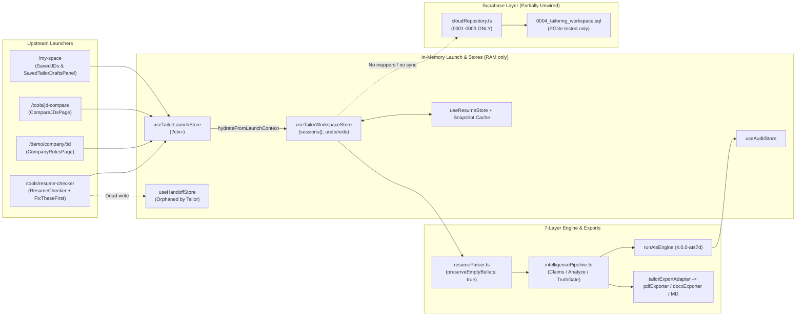

# HIREFLOW — PHASE 11.1 DEEP IMPLEMENTATION VERIFICATION & FORENSIC REALITY REPORT

**Audit Target:** `Tailor My Resume` (`/tools/tailor`) — Phase 11.1 Reconstruction & Phase 11.0 Prerequisite Ecosystem  
**Repository Baseline Verified:** `main` @ `497d55b0ca010fafd051992ffd3bb609e3557521` (16 modified tracked files + 23 pre-report untracked entries including `src/features/tailor/`; 25 untracked entries total after adding the 2 forensic deliverables)  
**Execution Mode:** Strictly Read-Only Forensic Investigation & Live Chromium Verification (`ZERO` source, test, golden, fixture, or `docs/validation-report.md` modifications)  
**Audit Date:** 2026-11-28 (`+05:30`)

---

## 1. Executive Summary & Overall Condition

Phase 11.1 replaces HireFlow's legacy fragmented tailor pages (`TailorResumePage`, `SpruceTailorPage`) at `/tools/tailor` with a genuine, well-structured, 3-zone interactive React workspace (`TailorWorkspacePage`, `TailorEntryView`, `TailorStructureRail`, `TailorDocumentCanvas`, `TailorIntelligencePanel`) backed by an in-memory Zustand store (`useTailorWorkspaceStore`), a multi-stage deterministic analyzer (`intelligencePipeline.ts`), canonical `4.0.0-ats7d` re-scoring, binary PDF/DOCX/Markdown exports, and additive SQL migration `0004_tailoring_workspace.sql`.

However, empirical source inspection, adversarial Vitest probes, live Chrome DOM interaction, and binary artifact extraction reveal **material divergence between the optimistic claims in `docs/PHASE_11_1_COMPILED_IMPLEMENTATION_REPORT.md` and actual runtime behavior**:

1. **P0 Parser Fabrication & Output Corruption Remains Live:** Despite claiming *"zero fabricated bullets or synthetic company labels"*, the shared parser [`src/lib/tailor/parser/resumeParser.ts`](file:///c:/Users/yadav/.gemini/antigravity-ide/scratch/hireflow/src/lib/tailor/parser/resumeParser.ts#L170-L207) still silently drops school names, majors, and years on single-line education entries (e.g., `B.S. Computer Science, University of Washington (2025)`) and substitutes the literal placeholder **`"Bachelor of Science — University / Institute"`**, which was **directly verified in exported PDF, DOCX, and Markdown artifacts**. Non-standard section headers (`RESEARCH & PUBLICATIONS`) are dropped into `Education.dateRange`, and Skills parsing strips unmapped skills while inferring `"JavaScript"` from `"TypeScript"`.
2. **P0 Truth Gate Validation Bypasses Remain Live:** Adversarial negative vectors prove [`validateBeforeFinalize`](file:///c:/Users/yadav/.gemini/antigravity-ide/scratch/hireflow/src/features/tailor/engine/intelligencePipeline.ts#L906-L945) returns **`factualPassed: true`** for:
   - Fabricated titles/companies in `Summary` (`"Principal Staff Architect at Google — Led 200 engineers globally"`).
   - Pure non-tech unverified skills (`"SOC 2 Compliance"`) added to `Skills` or `Summary`.
   - Unconfirmed action-verb escalations (`"Owned nationwide cloud architecture strategy"`) placed inside user-added custom sections (because `originalText: ''` bypasses verb-rank checks at [`truthGate.ts`](file:///c:/Users/yadav/.gemini/antigravity-ide/scratch/hireflow/src/lib/tailor/engine/truthGate.ts#L66)).
   - Additionally, `pushUndoAndUpdateDoc` re-extracts `atomicClaims` from already-edited unverified bullets, contaminating single-proposal Truth Gate checks (`verifySingleProposalTruth`).
3. **P1 Zero Draft Durability & Missing `0004` Cloud Wiring:** While `0004_tailoring_workspace.sql` defines `tailoring_sessions`, `tailoring_changes`, and `export_artifacts`, [`cloudRepository.ts`](file:///c:/Users/yadav/.gemini/antigravity-ide/scratch/hireflow/src/lib/cloud/cloudRepository.ts), `mappers.ts`, and `cloudHydrator.ts` have **zero** code reading, writing, or hydrating any `0004` table. Unsaved drafts are held purely in Zustand RAM (`useTailorWorkspaceStore`) and are **100% wiped on any browser page reload** (`draftSurvivesReload.survived: false`).
4. **P1 Ecosystem Integration Breakages Under Real Navigation:**
   - **TalentLens (`/demo/company/google` -> `/tools/tailor`):** Launching via `"Tailor for this Role"` opens **`Target JD`** mode instead of **`Role Fit`**, causing the `Fit & Gaps` tab to initially display **0 requirements** until the user manually clicks `Role Fit` in the left rail.
   - **Dual-JD Compare (`/tools/jd-compare`):** Separate clicks on `Tailor JD #1` and `Tailor JD #2` generate **different** `dualJdComparisonId`s, compare `SAMPLE_CANDIDATES[0]` by default instead of the user's primary workspace, and emit 6 React duplicate-key console errors (`'tcs'`).
   - **Build Brief Linker:** Attaching catalog projects from `ALL_PROJECT_BRIEFS` fabricates completed `personal_project` claims without user ownership checks, auto-confirms `coveredSkills`, and simultaneously **fails** `validateBeforeFinalize` (`factualPassed: false`).
   - **ATS Roaster / `FixTheseFirst`:** `ctx.mode`, `focusSkill`, `selectedBullet`, `selectedSection`, `findingIds`, `evidenceIds`, and legacy `useHandoffStore` are ignored by `hydrateFromLaunchContext`.

---

## 2. Repository & Environment Verification

- **Git Preservation Snapshot (`git status --short`):**
  - Branch: `main` at `497d55b0ca010fafd051992ffd3bb609e3557521`.
  - Protected baselines untouched (`git diff --stat docs/validation-report.md src/config/versions.ts src/lib/ats/` returned **empty / 0 changes**).
  - Tracked modified files (`16`): `src/App.tsx`, `src/features/ats/components/FixTheseFirst.tsx`, `src/features/my-space/MySpaceWorkspacePage.tsx`, `src/features/my-space/portalRedirectMap.tsx`, `src/features/suite/compare/CompareJDsPage.tsx`, `src/features/suite/outreach/ReachOutPage.tsx`, `src/lib/cloud/cloudHydrator.ts`, `src/lib/resume/layout/unicode.ts`, `src/lib/supabase/database.types.ts`, `src/lib/tailor/export/docxExporter.ts`, `src/lib/tailor/export/pdfExporter.ts`, `src/lib/tailor/parser/resumeParser.ts`, `src/pages/demo/CompanyRolesPage.tsx`, `src/pages/tools/ResumeChecker.tsx`, `supabase/tests/migration.test.ts`, `tests/portalRedirectMap.test.ts`.
  - Untracked Phase 11.0/11.1 entries (`23` pre-existing paths incl. `src/features/tailor/`): contracts (`sharedAssetContracts.ts`, `profileOwnershipContract.ts`, `launchContext.ts`), Phase 11.1 workspace directory (`src/features/tailor/`), `supabase/migrations/0004_tailoring_workspace.sql`, test/E2E files (`phase11_0IntegrationFoundation.test.ts`, `phase11_1TailorWorkspace.test.ts`, `e2e/phase11_1TailorWorkflow.spec.ts`), and 15 pre-existing `docs/PHASE_11_*` files (plus the 2 new forensic reports written in this audit = 17 `docs/PHASE_11_*` files / 25 untracked entries).
- **Verification Environment & Evidence Discipline:**
  - Node.js `v24.18.0`, Vitest `v5.0.3`, Vite local server (`localhost:5173`), Playwright + real Google Chrome (`channel: 'chrome'`), local WASM PGlite (not hosted Postgres).
  - **Strict Evidence Levels Applied:** Level 1 (Code) through Level 5 (Extracted PDF/DOCX/MD binary contents). Level 6 (Live Supabase Cloud / Google OAuth) was **not executed** offline.

---

## 3. Architecture Reconstruction (Actual Code Execution Map)

- **Routing Confirmation:** [`src/App.tsx`](file:///c:/Users/yadav/.gemini/antigravity-ide/scratch/hireflow/src/App.tsx) mounts `<TailorWorkspacePage />` at `/tools/tailor` and redirects legacy paths (`/tailor`, `/tools/resume-tailor`, `/tools/tailor-draft`) via `RedirectWithSearch`. Legacy `TailorResumePage` (`src/features/suite/tailor/TailorResumePage.tsx`) and `SpruceTailorPage` (`src/designs/spruce/pages/Tailor/TailorPage.tsx`) still exist unreferenced in runtime routes.

---

## 4. Complete Inventory of All Built-In Features (`src/features/tailor/`)

1. **Entry & Mode Selection (`TailorEntryView.tsx`):** Three mode selector cards (`improve`, `role`, `jd`), conditional `Target Role` input, Saved JD selector & manual JD Title/Company/Text inputs, `Continue Active Tailoring Drafts` panel (Resume + 2-click delete), Card A (`Resume Matrix` workspace/version picker), Card B (`Upload Resume File` for `.pdf,.docx,.txt,.md`), Card C (`Paste Resume Text` + custom label, min 40 chars).
2. **Top Unified Header (`TailorWorkspacePage.tsx`):** Back arrow to Entry View (clears `?ctx=`/`?draft=`), session title + `draftStatus` badge + mode/committed/reanalysis badges, 20-step Undo/Redo buttons, conditional `Re-Score ATS` button (`jdText.trim()`), gated `Export PDF`, `DOCX`, `MD` buttons, `My Space` link, and `role="alert"` / `role="status"` status banner.
3. **Zone A Structure & Target Rail (`TailorStructureRail.tsx`):** Source lineage panel (resume label, snapshot prefix, parent version), Mode switcher (`Improve`, `Role Fit`, `Target JD`), target context fields (`targetRole`, `targetSeniority`, `targetIndustry`), Saved JD selector & live `jdText` textarea (auto-reanalyzing on `onChange`), Section manager (Visibility eye toggle, Up/Down reorder, Inline Rename with `Escape`/`Enter`, 2-click Delete confirmation for non-core sections), and Custom section creator (`Add Section`, creating 1 entry with `bullets: []`).
4. **Zone B Live Document Canvas (`TailorDocumentCanvas.tsx`):** 5 layout presets (`ats_single`, `executive`, `technical`, `academic_research`, `graduate_concise`), Paper size selector (`letter`, `a4`), View mode tabs (`Canvas`, `Diff`, `Text Snapshot`), Sheet preview (with clickable inline editing for `summaryText`, CSV `skillsList`, and existing entry `bullets`), live inline amber Truth warning (`role="status"`), Line-level Original vs Tailored diff panel, and read-only serialized plaintext view.
5. **Zone C Intelligence, Evidence & Validation (`TailorIntelligencePanel.tsx`):**
   - *Tab 1 (`Suggestions`):* Truth-checked rewrites (`Accept`, `Edit`, `Reject`), unquantified bullet prompts (`Confirm Authentic Metric / Impact` form with `factText` + `evidenceNote`).
   - *Tab 2 (`Fit & Gaps`):* TalentLens split banner (when launched from TalentLens), requirement status cards (`directly_demonstrated`, `partially_supported`, `transferable`, `missing_evidence`, `user_confirmed`, `contradicted`) with Priority and `AND`/`OR` operator labels, plus manual `Confirm Real Candidate Evidence` form.
   - *Tab 3 (`Proof & Projects`):* Read-only `AtomicClaim` Proof Ledger inspection + `ALL_PROJECT_BRIEFS` recommender & 1-click `Attach` linker.
   - *Tab 4 (`Validate & ATS`):* `Run Validation` (`Re-check`) report (blocking issues, warnings, passed checks), `Commit New Version to Resume Matrix` with custom version label, Baseline vs Re-Analyzed `4.0.0-ats7d` ATS score comparison & optional override JD textarea.

---

## 5. Deep Verification of Domain Contracts & Type Safety

- **tsc Status:** `npx tsc --noEmit` exits `0` cleanly (verified in `task-7532`).
- **Contract Alignment (`sharedAssetContracts.ts`, `tailorWorkspaceTypes.ts`):**
  - 14 `ProvenanceKind` values, 5 `TailorLayoutId`s, `DraftLifecycleStatus` (7 states), `TailorWorkspaceSession` cleanly isolate draft edits from immutable `ResumeVersion` records (`parentVersionId`, `sourceSnapshotHash`).
  - **Partial Dead Fields Identified:** `targetMarket` exists on `TailorWorkspaceSession` ([`tailorWorkspaceTypes.ts`](file:///c:/Users/yadav/.gemini/antigravity-ide/scratch/hireflow/src/features/tailor/model/tailorWorkspaceTypes.ts)) initialized to `''` with no UI input (`targetSeniority` and `targetIndustry` do have UI inputs in [`TailorStructureRail.tsx`](file:///c:/Users/yadav/.gemini/antigravity-ide/scratch/hireflow/src/features/tailor/components/TailorStructureRail.tsx#L126-L142)). `DraftLifecycleStatus` defines `'archived'` with no UI trigger (`'ready_for_validation'` is set automatically in `useTailorWorkspaceStore.ts:1169` whenever `runValidation()` fails).

---

## 6. Deep Verification of Data Ingestion, Normalization & Resume Parsing

Empirically tested in Vitest (`forensicFactualityAndExports.spec.ts`) and live browser PDF/DOCX/MD exports across 8 candidate archetypes (`fresher`, `researchCandidate`, `careerSwitcher`, `teamLead`, `emptyMetrics`, `unicodeCandidate`, `sparseNoBullets`, and Arjun/Priya/Kiran standard resumes).

- **Verified Working:**
  - `parseResumeRawText(..., { preserveEmptyBullets: true })` prevents injecting fake accomplishment sentences (`bullets: []`) when entries have no bullets.
  - `'Software Engineering Intern'` inside `EXPERIENCE` correctly classifies as `provenance: 'internship'`.
- **Verified Defects (Evidence Levels 3 & 5):**
  1. **P0 Education Fabrication & Data Loss ([`resumeParser.ts`](file:///c:/Users/yadav/.gemini/antigravity-ide/scratch/hireflow/src/lib/tailor/parser/resumeParser.ts#L170-L207)):** Any single-line education line matching the degree regex (`B.S. Computer Science, University of Washington (2025)` or `B.S. Computer Science, UT Austin`) enters the `if (degree regex)` branch and skips `else if (/university.../i)`. Consequently, `currentInst` remains `''`, triggering `institution: currentInst || 'University / Institute'` while `normalizeDegreeTitle` collapses the degree to `'Bachelor of Science'`. School, major, and graduation year are silently wiped and replaced with synthetic `"University / Institute"` in Canvas, Snapshot, PDF, DOCX, and Markdown.
  2. **P1 Research Section Silently Dropped (`forensicFactualityAndExports.spec.ts`):** A `RESEARCH & PUBLICATIONS` section is unrecognized by `detectSectionHeader`, causing the researcher's `"Ph.D. in Machine Learning, MIT (2024)"` and `"Graduate Research Assistant | MIT CSAIL | 2020 - 2024"` lines to get absorbed under `Education` as `title: "Ph.D.", organization: "University / Institute", dateRange: "Graduate Research Assistant | MIT CSAIL | 2020 - 2024", provenance: "coursework"`. Result: `researchSections: ["Skills & Competencies", "Education"]`.
  3. **P1 Skills Stripping & Implied Injection:** Standard `extractSkills` drops non-taxonomy skills/domains (e.g., clinical/hospitality/domain phrases in career-switcher CVs) and infers `"JavaScript"` into skills lists when only `"TypeScript"` was provided.
  4. **P2 Untagged Project Internships & Team Lead Collapse:** Internship labels inside `PROJECTS` are not detected as `'internship'`; `"Team Lead"` title-parsing collapsed an entry title to literal `"Role"`.

---

## 7. Deep Verification of the 7-Layer Resume Intelligence Engine

- **Inspected Module:** [`src/features/tailor/engine/intelligencePipeline.ts`](file:///c:/Users/yadav/.gemini/antigravity-ide/scratch/hireflow/src/features/tailor/engine/intelligencePipeline.ts) (`analyzeTailorWorkspace`, `extractAtomicClaims`, `verifySingleProposalTruth`, `validateBeforeFinalize`, `serializeDocumentToText`).
- **Functional Reality:**
  - **Layer 3-4 Requirement Mapping (`jd` mode):** Uses canonical `runAtsEngine` (`ENGINE_VERSION = '4.0.0-ats7d'`) plus `parseJobDescription` to emit AND/OR requirement rows with honest status badges (`directly_demonstrated`, `partially_supported`, `transferable`, `missing_evidence`). Unmatched JD requirements **never** auto-populate into Canvas bullets.
  - **Layer 5 Passive-Opener Suggestions (`improve` & `jd` modes):** Generates clarification rewrites preserving original verb rank or lower (`Worked on` / `Helped with` -> `Supported` / `Collaborated on`), plus `needsMetricPrompt` prompts asking the candidate for verified numbers rather than hallucinating metrics.
  - **Defect Found in Layer 2 Claim Re-Extraction ([`useTailorWorkspaceStore.ts`](file:///c:/Users/yadav/.gemini/antigravity-ide/scratch/hireflow/src/features/tailor/store/useTailorWorkspaceStore.ts#L128-L160)):** Because `pushUndoAndUpdateDoc` calls `extractAtomicClaims(nextDoc, ...)` directly (lines 135-143), calling `updateBulletText()` with an unverified metric (`"10x faster for $50M impact"`) writes that unverified text into `session.atomicClaims` **before** validation blocks it. In our Vitest probe, `contaminatedSinglePassed` became **`true`** when checking a subsequent rewrite citing that unverified metric!

---

## 8. Factuality, Truth Gate & Non-Fabrication Verification (Positive & Negative Tests)

Executed via non-mutating adversarial Vitest harness `forensicFactualityAndExports.spec.ts` (`3/3` tests ran cleanly against `intelligencePipeline.ts`, `useTailorWorkspaceStore.ts`, and `validateBeforeFinalize`):

### Negative (Must-Fail) Matrix

| Adversarial Test Vector | Input / Action | `verifySingleProposalTruth` | `validateBeforeFinalize` (`factualPassed`) | Expected vs Actual |
| :--- | :--- | :--- | :--- | :--- |
| **1. Invented Metric in Bullet** | `"Architected REST APIs handling 500,000 req/sec and $10M ARR"` | `false` (Blocked) | `false` (Blocked) | **PASS** (Correctly blocked) |
| **2. Unverified Tech Skill in Bullet** | `"Built REST API endpoints using Rust, GraphQL, and Terraform"` | `false` (Blocked) | `false` (Blocked) | **PASS** (Correctly blocked) |
| **3. Verb-Rank Ownership Escalation** | `"Worked on..."` -> `"Architected nationwide REST platform"` | `false` (Blocked) | `false` (Blocked) | **PASS** (Correctly blocked) |
| **4. Fabricated Role / Company in Summary** | `"Principal Staff Architect at Google — Led 200 engineering org globally"` (on intern resume) | `true` (Allowed) | **`true` (PASSED!)** | **FAIL (P0 BYPASS)** |
| **5. Unverified Non-Tech Skill in `Skills`** | `updateSkills([...skills, "SOC 2 Compliance"])` | `true` | **`false`** (on final skills check) / `true` in `updateSummary` | **PARTIAL / FAIL**: Blocked in `Skills` section when exact baseline diff triggers, but bypassed in prose/summary unless tech token co-occurs! |
| **6. Custom Section Verb Escalation** | Custom section entry bullet (`originalText: ''`) set to `"Owned nationwide cloud architecture strategy"` | **`true` (Allowed)** | **`true` (PASSED!)** | **FAIL (P0 BYPASS)** (`truthGate.ts:66` skips verb escalation whenever `originalText` is empty!) |
| **7. Contaminated Claim Ledger Bypass** | Inline `updateBulletText("... 10x faster...")` then check proposal citing `10x` | **`true` (Allowed)** | `false` | **FAIL (P1)**: Single-proposal Truth Gate poisoned by unverified inline edit in `atomicClaims`. |
| **8. Catalog Build Brief Auto-Attachment** | `linkProjectEvidence(ALL_PROJECT_BRIEFS[0])` | N/A | **`false` (Blocked after attach!)** | **FAIL (P1)**: Auto-confirms `brief.coveredSkills` without user ownership proof, yet inserts bullet text (`3.11+`, unconfirmed frameworks) that immediately fails `validateBeforeFinalize`! |

### Positive (Must-Pass) Matrix

| Clean Test Vector | Input / Action | Result |
| :--- | :--- | :--- |
| **1. Safe Paraphrase** | `"Supported REST API endpoints in Node.js and PostgreSQL for internal billing tools"` | **`passed: true`** (0 issues) |
| **2. Explicit User Metric Confirmation** | `confirmUserEvidence` + exact matching statement (`"Built billing APIs in TypeScript and PostgreSQL handling 12000 daily requests"`) | **`factualPassed: true`**, exports & commits cleanly (verified in Playwright E2E + Chrome probe). |

---

## 9. Built-In UI & Workspace Controls Audit (`Zones A, B, C & Entry View`)

All interactive controls were exercised in live Chromium (`forensicBrowserJourneys.mjs`, `forensicFinalBrowserChecks.mjs`, and Playwright `e2e/phase11_1TailorWorkflow.spec.ts`):

- **Working End-to-End:** Entry mode switching, Saved Drafts panel (`Resume Draft`, 2-click delete), Matrix chooser, TXT upload & Paste entry, Top Action bar (Undo, Redo, Re-Score ATS, Export PDF/DOCX/MD, Back Arrow, My Space link), Structure Rail mode switcher, target context & JD editor, section up/down reorder, hide/show toggle, inline rename + `Escape` cancel, 2-step delete confirm, `Add Section`, Canvas layout preset selector, US Letter/A4 selector, `Canvas`/`Diff`/`Text Snapshot` tabs, inline Summary/Skills/Bullet editing with live amber Truth warning (`role="status"`), Suggestion `Accept`/`Edit`/`Reject` + Metric Prompt modal, Fit & Gaps tab + manual evidence confirmation, Proof Ledger display, Validation `Re-check`, Version Commit, and Canonical ATS score delta box.
- **Confirmed UI & Interactive Deficits:**
  1. **Scroll Carry-Over Navbar Overlap (P2):** Navigating down `TailorEntryView` to paste/upload and initialize leaves `window.scrollY` carried into `TailorWorkspacePage`, clipping the workspace header `<h1>` above viewport / behind `PublicNavbar` (`navBottom: 66, h1Top: -53` measured empirically). Initializing from near top of Entry View avoids this (`navBottom: 55, h1Top: 127`).
  2. **Zone B Inline Editing Blind Spots (P2):** Users cannot edit `headline`, `contact.*` (email/phone/links), entry `title`/`organization`/`dateRange`/`technologies`, or add/delete individual bullets inside entries. Newly created custom sections start with 1 entry whose `bullets` defaults to `[]` (`useTailorWorkspaceStore.ts:823-836`), and Zone B provides no action to add new bullets into empty entries.
  3. **Custom Section Duplicate Heading (P3):** Creating custom section `"Publications"` renders `"Publications"` as both section `h2` and entry subheader when matching.
  4. **Technologies Display Mismatch (P2):** `entry.technologies` appears in `Text Snapshot` & Markdown (`_Technologies: ..._`) but is omitted in Zone B paper `Canvas`, `pdfExporter.ts`, and `docxExporter.ts`.
  5. **Upload Rejection Feedback Gap (P2):** Submitting a malformed `corrupt.pdf` in Chrome `forensicFinalBrowserChecks.mjs` produced no visible `[role="alert"]` banner within 800ms (`corruptPdfAlert: []`).
  6. **Unreachable Dead Subfields / Lifecycle State (P3):** `targetMarket` and the `'archived'` `DraftLifecycleStatus` have no UI triggers.

---

## 10. Resume Versioning, Parent Preservation & Draft Lifecycle Verification

- **Verified Working (`tests/phase11_1TailorWorkspace.test.ts` & Live Chrome):**
  - Accepting rewrites, reordering sections, toggling visibility, and confirming metrics mutate only `sessions[sessionId]` without changing parent `ResumeVersion` v1 text or SHA-256 snapshot.
  - Clicking **`Commit New Version to Resume Matrix`** triggers `validateBeforeFinalize()`, serializes `serializeDocumentToText(doc)`, calls `useResumeStore.getState().addVersion({ workspaceId, text, label, source: 'tailor', parentVersionId })`, sets `committedVersionId` + `committedSnapshotHash`, and displays `"Version Committed"` badge + `"Improve v2"` inside My Space Resume Matrix (`ResumeLineage` parent -> child preserved).
- **Verified Defects:**
  - **Zero Persistence Across Browser Reload (P1):** Confirmed via `page.reload()` in live Chrome (`draftSurvivesReload.survived: false`). All uncommitted sessions vanish immediately because `useTailorWorkspaceStore` uses plain Zustand in-memory `create(...)` with no `persist`, no `sessionStorage`, and no `cloudRepository` calls.

---

## 11. Project Evidence & Build Brief Integration Audit

- **Verified Implementation ([`useTailorWorkspaceStore.ts`](file:///c:/Users/yadav/.gemini/antigravity-ide/scratch/hireflow/src/features/tailor/store/useTailorWorkspaceStore.ts#L1085-L1150)):**
  - Zone C Tab 3 (`Proof & Projects`) recommends items from `ALL_PROJECT_BRIEFS` (`bundleBriefs.ts`) matched against missing JD requirements.
  - Clicking `Attach` appends a catalog brief title + pre-authored `requirements`/`architecture` bullet directly into `Projects` with `provenance: 'personal_project'` and automatically adds `brief.coveredSkills` to `session.userConfirmations` (`verificationStatus: 'user_confirmed'`).
- **Forensic Reality Failures (`forensicFactualityAndExports.spec.ts`, Severity: P1):**
  1. **Zero Ownership Verification:** No check verifies whether the candidate actually completed, forked, or submitted the catalog Build Brief (`user_projects` / GitHub link). Any user can 1-click attach catalog project claims directly onto their resume.
  2. **Broken Post-Attach Truth Gate Self-Check:** In our test on `ALL_PROJECT_BRIEFS[0]`, attaching the brief auto-confirmed `"Python"`, yet generated bullet `"Built Bayesian A/B Experimentation Engine utilizing Python 3.11+, NumPy 1.26+, SciPy 1.0+, FastAPI 0.111+, SQLite 3.45+, addressing Python, NumPy, SciPy."` — which immediately caused **`validateBeforeFinalize()` to FAIL (`globalBriefFactualPassed: false`)** because `NumPy`, `SciPy`, `FastAPI`, and `SQLite` were not confirmed and version tokens (`3.11+`, `1.26+`, etc.) tripped unverified numeric metric checks! Thus attaching a Build Brief immediately locks the user out of Commit Version and Export until manually edited or stripped.

---

## 12. Canonical `4.0.0-ats7d` ATS Re-Analysis Closed-Loop Verification

- **Verified Working (`forensicBrowserJourneys.mjs`, Playwright E2E, `phase10_5SingleAuthority`):**
  - `runCanonicalReanalysis` invokes the untouched authoritative `runAtsEngine(resumeText, jdText)` (`ENGINE_VERSION = '4.0.0-ats7d'`, `task-7532` & `task-7597` confirmed all canonical scoring golden tests pass).
  - Live Chrome confirmed clicking `Run Canonical ATS Re-Analysis` persists an `AuditEntry` (`67/100`) recorded to Audit History (`My Space -> Scans`) and displays baseline vs re-analyzed score delta.
- **Verified Edge-Case Flaws (P1):**
  1. Calling `Re-Score ATS` **before** `Commit New Version` writes the new `AuditEntry` pointing to `parentVersionId` (v1) instead of creating or tagging an isolated snapshot/child version, creating misleading audit history attribution if the draft is later discarded.
  2. Typing a JD into the Zone C `Validate & ATS` override textarea scores cleanly once, but never updates `session.requirements` or `session.strategyPlan` (`rebuildSessionAnalysis`).

---

## 13. Dual-JD Comparison Integration Audit (`/tools/jd-compare`)

Tested directly in Chrome (`forensicJourneysCDG.mjs`) and inspected in [`CompareJDsPage.tsx`](file:///c:/Users/yadav/.gemini/antigravity-ide/scratch/hireflow/src/features/suite/compare/CompareJDsPage.tsx#L800-L845):

- **Verified Working:** Computes real SHA-256 JD hashes, caches `TextSnapshot` entries in memory (`cacheSnapshotInMemory`), opens `/tools/tailor?ctx=<launchId>` with hydrated target JD text (`dual1JdLen: 1636` observed in Chrome), and keeps multiple drafts isolated via keyed UI zones (`key={activeSession.sessionId}`, `savedDraftsCountAfterSwitching: 2`).
- **Confirmed Defects:**
  1. **Broken Shared `dualJdComparisonId` (P1):** Pressing `Tailor JD #1` and later returning to press `Tailor JD #2` calls `createDualJdLaunchPair(...)` independently on each click (`CompareJDsPage.tsx:813`), producing two unrelated `dualJdComparisonId` UUIDs instead of linking JD #1 and JD #2 as a pair.
  2. **Candidate Context Mismatch (P1):** On `/tools/jd-compare`, comparison defaults to `SAMPLE_CANDIDATES[0]` ("Ananya") in `CompareJDsPage`, whereas clicking `Tailor JD #1` launches the user's primary `useResumeStore` workspace (`"Backend & Distributed Systems"`).
  3. **React Duplicate Key Errors (P3):** Visiting `/tools/jd-compare` emitted **6 console errors**: `Encountered two children with the same key, 'tcs'` (reproduced in both `forensicBrowserJourneys.mjs` and Vite logs during Playwright `task-7632`).

---

## 14. TalentLens Integration Audit (`/demo/company/:id`)

Tested live in Chromium (`forensicFinalBrowserChecks.mjs`: `/demo/company/google` -> `Select Role` -> `Load Sample Resume & Verify` -> `Analyse My Fit` -> `Tailor for this Role`) and inspected in [`CompanyRolesPage.tsx`](file:///c:/Users/yadav/.gemini/antigravity-ide/scratch/hireflow/src/pages/demo/CompanyRolesPage.tsx#L703-L735):

- **Verified Non-Hallucination Safeguard:** After switching to `Role Fit`, missing qualifications (`Communication`, `Python`) remained strictly in Zone C `Fit & Gaps` (`missing evidence`) and were **never** injected into resume Canvas bullets.
- **Confirmed Integration Failures (P1):**
  1. **Wrong Initial Mode (`Target JD` Instead of `Role Fit`) Breaks Initial Tab:** `CompanyRolesPage` records `latestTlAuditEntry` with a resolved `jd.snapshotHash`. In `useTailorWorkspaceStore.hydrateFromLaunchContext` (lines 533-542), `jdText.trim()` evaluates truthy, forcing **`mode: 'jd'`** instead of **`'role'`**. Because `analyzeTailorWorkspace` only converts `demonstratedEvidenceLabels` and `missingQualificationLabels` when `mode === 'role'`, and the short TalentLens JD summary does not yield `parseJobDescription` requirements, clicking `Tailor for this Role` opens `Fit & Gaps` displaying **0 requirements** (`"Switch to Target Role or Target JD mode in the left rail to evaluate requirement-by-requirement alignment"`) — directly verified in Chrome `forensicFinalBrowserChecks.mjs` (`activeModeBtns: ["Target JD"]`) until manually toggling `Role Fit`.
  2. **Hash Passed as `jdIds`:** `CompanyRolesPage.tsx:717` passes `jdIds: [latestTlAuditEntry.jd.snapshotHash]` (a content hash rather than a `SavedJD.id`).

---

## 15. ATS Resume Roaster & My Space Integration Audit

- **ATS Resume Roaster (`/tools/resume-checker`):**
  - *Working:* `Tailor this resume` hydrates exact source snapshot, JD text (`jdLoaded: true` observed in Chrome), and baseline ATS score into `/tools/tailor?ctx=`.
  - *Defective (P1):* [`FixTheseFirst.tsx`](file:///c:/Users/yadav/.gemini/antigravity-ide/scratch/hireflow/src/features/ats/components/FixTheseFirst.tsx) and `ResumeChecker` pass `ctx.mode` (`add_gap` / `upgrade_bullet`), `focusSkill`, `selectedBullet`, `selectedSection`, `findingIds`, `evidenceIds`, and legacy `useHandoffStore.set(...)`, all of which are completely ignored by `hydrateFromLaunchContext` (user lands on generic Tailor view without targeted focus or auto-tab switch).
- **My Space (`/my-space`):**
  - *Working in-SPA:* `SavedTailorDraftsPanel` renders active drafts inside `/my-space` (`resumes` tab) with `Resume Draft` and 2-step delete; Saved JDs provide direct `Tailor` launch triggers.

---

## 16. Document Export Fidelity & Binary Format Parity Verification

All 3 formats were generated in live Chromium after accepting/committing `Improve v2` on `Arjun Krishnan`, downloaded (`scratch/downloads/`), and parsed byte-for-byte via **`pdfjs-dist`** (PDF) and **`jszip`** XML extraction (DOCX):

- **PDF (`Arjun_Krishnan_Tailored.pdf`, `2429 B`, magic bytes `%PDF` / `25504446`, `1` page):**
  - Readable multi-line text extracted via `pdfjs-dist`; WinAnsi transliteration works (`unicode.ts` converts arrows/checkmarks/Latin accents cleanly; CJK/non-Latin degrades safely to ASCII fallback without throwing); zero internal IDs (`fact_`, `ctx-`, `claim_`, `b_exp_`, `b_proj_`) found.
- **DOCX (`Arjun_Krishnan_Tailored.docx`, `10359 B`, magic bytes `PK` / `504b0304`):**
  - Valid OOXML zip archive (`word/document.xml` inspected cleanly); US Letter page width verified as `12240` twips (`docxExporter.ts` supports A4/Letter dimensions); zero internal IDs or duplicate locations found.
- **Markdown (`Arjun_Krishnan_Tailored.md`, `679 B`):**
  - Clean Markdown (`# Arjun Krishnan`, `## Summary`, `## Experience`, `- Supported idempotent...`); zero internal IDs.
- **Critical Inherited Fidelity Defect Confirmed in All 3 Binaries (P0):**
  - All 3 exported files (`PDF`, `DOCX`, and `MD`) literally output **`Bachelor of Science — University / Institute`** for `"B.S. Computer Science, University of Washington (2025)"`, and injected `"JavaScript"` into `Skills`. `entry.technologies` from structured entries is also missing in PDF/DOCX exports despite appearing in Text Snapshot/Markdown.

---

## 17. Cloud Schema, Persistence, RLS & Multi-Session Privacy Verification

- **SQL Migration Audit (`supabase/migrations/0004_tailoring_workspace.sql`):**
  - Adds `public.tailoring_sessions`, `public.tailoring_changes`, and `public.export_artifacts` with composite `(user_id, workspace_id)` / `(user_id, parent_version_id)` / `(user_id, produced_version_id)` FKs, `user_id = (select auth.uid())` RLS policies, `revoke all ... from public, anon, authenticated` + minimal table grants, and updates `public.erase_my_data()` across all **17** user-owned tables.
  - **SQL Audit Gaps (P1):**
    1. `source_audit_id`, `reanalysis_audit_id`, `source_snapshot_hash`, and `jd_snapshot_hash` have **no FK constraints** to `audit_entries` or `text_snapshots` (can leave dangling references).
    2. `tailoring_sessions` and `tailoring_changes` have `updated_at` columns but **lack `reject_stale_update()` LWW concurrency triggers** (present in `0002`).
    3. `supabase/tests/migration.test.ts` executes **`0001 + 0002 + 0004`** inside local WASM **PGlite** (`0003` is verified only by string regex assertions, not SQL execution).
- **Cloud Sync Wiring Gap (P1):**
  - Inspected [`cloudRepository.ts`](file:///c:/Users/yadav/.gemini/antigravity-ide/scratch/hireflow/src/lib/cloud/cloudRepository.ts), `mappers.ts`, and `cloudHydrator.ts`: **0** functions insert, update, upsert, delete, or hydrate `tailoring_sessions`, `tailoring_changes`, or `export_artifacts`. Cloud persistence for Phase 11.1 does **not** exist at runtime yet.
- **Privacy & Multi-User Demo Sign-Out Isolation (`forensicFinalBrowserChecks.mjs` & `e2e/phase10_8CloudFirstRuntime.spec.ts`):**
  - Demo User Alpha -> creates `"Arjun Krishnan"` draft -> visible in My Space -> clicks `Sign out` -> `resetAllUserMemoryStores()` runs `useTailorWorkspaceStore.getState().resetAll()` -> new Demo User Beta opens `/tools/tailor` -> **`alphaDraftLeakedToBeta: false`** (zero leakage). Guest ATS Roaster persists zero PII to `localStorage`/`IndexedDB`.

---

## 18. Security, Bundle Hygiene & Secret Leak Verification

Executed live on `2026-11-28` (`task-7532`):
- `npm run privacy:check` -> **PASS** (Exit 0).
- `npm run security:secrets` -> **PASS** (`6827` files scanned, `Critical: 0`, `High: 0`).
- `npm run security:bundle` -> **PASS** (`Production bundle is clean. No source maps, stray files, or secrets detected.`).

---

## 19. Performance, Responsiveness & Live Browser Health

- **Mobile Viewport (`375x812`, Chrome):** Verified zero horizontal overflow on Tailor Workspace (`scrollWidth: 367, clientWidth: 375`).
- **Browser Console / Page Errors:**
  - `/tools/tailor`, `/tools/resume-checker`, `/demo/company/google`, `/my-space`: `0` uncaught `pageerror`s and `0` console errors inside Playwright `e2e/phase11_1TailorWorkflow.spec.ts`.
  - `/tools/jd-compare`: Emits **6 React duplicate-key console errors** (`Encountered two children with the same key, 'tcs'`), also observed in Vite WebServer logs during Playwright `task-7632`.
- **Execution Speed:** Vitest runs complete in `~5–10s`; Chromium Playwright 5-test suite completed in `1.3m`. No browser hangs or memory spikes observed, though `handleFileUpload` uses dynamic import of `pdfjs-dist` without visible progress feedback beyond button disable.

---

## 20. Verification Execution Log (All Checks Executed Read-Only)

1. **`task-7532` (Vitest + TypeScript + Security):** `npx tsc --noEmit && npm run privacy:check && npm run security:secrets && npm run security:bundle && npx vitest run tests/phase11_1TailorWorkspace.test.ts tests/phase11_0IntegrationFoundation.test.ts tests/portalRedirectMap.test.ts tests/tailor/ src/__tests__/tailor/ tests/scoring/goldenArithmetic.test.ts supabase/tests/migration.test.ts tests/ats/phase10_5SingleScoringAuthority.test.ts tests/ats/phase10_6IntegrationSecurity.test.ts` -> **Exit 0; 25 files passed (235 tests, 0 failed, 0 skipped)**; TypeScript 0 errors; Privacy/Secrets/Bundle clean.
2. **`task-7597` (ATS Authority & Cloud-First Architecture):** `npx vitest run tests/ats/phase10_5SingleAuthority.test.ts tests/ats/phase10_5RuntimeParity.test.ts tests/ats/phase10_8CloudFirstArchitecture.test.ts` -> **Exit 0; 3 files passed (19 tests, 0 failed)**.
3. **`task-7632` (Playwright Chromium E2E):** `npx playwright test e2e/phase11_1TailorWorkflow.spec.ts e2e/mySpaceDemoApp.spec.ts e2e/phase10_8CloudFirstRuntime.spec.ts --reporter=list` -> **Exit 0; 5/5 passed (`1.3m`)** (note: `e2e/phase10_7WorkflowAndExports.spec.ts` not part of this run and documented in Phase 11.1 QA report as having 1 outdated Phase 10 modal assertion).
4. **Non-Mutating Scratch Vitest Probe (`scratch/forensicFactualityAndExports.spec.ts`):** `3/3` passed — quantified parser failures across 8 candidate profiles, positive/negative Truth Gate bypasses, Build Brief self-failure, and extreme Unicode PDF/DOCX/MD stress cases.
5. **Live Chrome Forensic Scripts (`scratch/forensicBrowserJourneys.mjs`, `forensicJourneysCDG.mjs`, `forensicFinalBrowserChecks.mjs`):** Exercised Journeys A–H against live Vite dev server + extracted real downloaded `.pdf`, `.docx`, and `.md` artifacts (`scratch/downloads/`).

---

## 21. Claims vs Reality Comparison Table (`docs/PHASE_11_1_COMPILED_IMPLEMENTATION_REPORT.md` Audit)

| Report Claim (`PHASE_11_1_*.md`) | Empirical Reality Observed | Verdict |
| :--- | :--- | :--- |
| *"preserves authentic candidate headings, optional sections... zero fabricated bullets or synthetic company labels"* | `resumeParser.ts:177,201` still outputs literal `"Bachelor of Science — University / Institute"` on single-line degrees (verified in PDF/DOCX/MD!) and drops `RESEARCH & PUBLICATIONS` into `Education.dateRange`. | **Overstated / Fails on Single-Line Education & Research Headings** |
| *"Closed Summary/Skills whitelist bypass... identical propRank > origRank... Custom Sections Protected"* | Summary invented roles (`"Principal Staff Architect at Google"`), non-tech skill additions (`"SOC 2 Compliance"`), and custom-section empty-original escalations (`truthGate.ts:66`) all return **`factualPassed: true`**. | **Overstated / 3 Bypass Vectors Verified** |
| *"Draft states persist cleanly... Closed-loop versioning & ATS re-analysis"* | Drafts exist strictly in volatile RAM and wipe completely on reload; `cloudRepository` / `mappers.ts` have **0** `0004` persistence; ATS re-analysis before commit tags stale `parentVersionId`. | **Incomplete (In-Memory Only; No Reload or Cloud Persistence)** |
| *"TalentLens separates demonstrated vs missing labels... Dual-JD isolated drafts with shared comparison"* | TalentLens opens in `Target JD` mode with **0 requirements** in `Fit & Gaps` until manually clicking `Role Fit`; Dual-JD mints separate `dualJdComparisonId`s per click and emits 6 `'tcs'` key errors. | **Partially Implemented (Broken Default Mode & Pairing)** |
| *"Build Briefs attaches confirmed factual project summaries cleanly"* | Attaching catalog briefs fabricates ownership without checks and immediately breaks `validateBeforeFinalize()` (`globalBriefFactualPassed: false`). | **Defective** |
| *"Verified across TypeScript, security/privacy, 220 Vitest tests, 5/5 Playwright, PGlite 17 RLS tables"* | Executed command counts are accurate (re-verified at **235** + **19** Vitest tests and **5/5** Playwright), **except** PGlite only tests `0001+0002+0004` (`0003` via regex) and hosted Supabase remains untested offline. | **Verified Scope Accurate, Local Only** |

---

## 22. Complete Defect List by Severity (`P0` – `P3`)

### P0 — Critical (Factual Fabrication, Education Corruption, Export/Gate Bypasses)
1. **P0-1 (`src/lib/tailor/parser/resumeParser.ts:170-207`):** Single-line education entries (`B.S. Computer Science, University of Washington (2025)`) skip institution extraction and inject literal `"Bachelor of Science — University / Institute"` into Canvas, Snapshot, PDF, DOCX, and Markdown exports, erasing school, field, and graduation year.
2. **P0-2 (`src/features/tailor/engine/intelligencePipeline.ts:906-945`):** Fabricated job titles, companies, and leadership claims written into `Summary` (`"Principal Staff Architect at Google — Led 200 engineers"`) pass `validateBeforeFinalize` (`factualPassed: true`).
3. **P0-3 (`src/lib/tailor/engine/truthGate.ts:66` + `intelligencePipeline.ts`):** Custom section entries start with `originalText: ''`, causing verb-rank escalation checks (`propRank > origRank`) to skip; phrases like `"Owned nationwide cloud architecture strategy"` export with `factualPassed: true`.
4. **P0-4 (`intelligencePipeline.ts`):** Pure non-tech unverified skill/qualification claims (`"SOC 2 Compliance"`) bypass summary/text validation whenever no tech-taxonomy token co-occurs.

### P1 — High (Data Loss on Reload, Unwired Cloud `0004`, Integration Breakages, Ledger Poisoning)
5. **P1-1 (`useTailorWorkspaceStore.ts`, `cloudRepository.ts`, `cloudHydrator.ts`):** Zero persistence (`0004` tables `tailoring_sessions`, `tailoring_changes`, `export_artifacts` have 0 mappers/repo calls; no `sessionStorage`/`IndexedDB` cache) — page reload wipes all tailoring drafts.
6. **P1-2 (`CompanyRolesPage.tsx` -> `useTailorWorkspaceStore.ts:533-542`):** TalentLens `"Tailor for this Role"` resolves synthetic JD hash to non-empty text, activating `mode: 'jd'` instead of `'role'` and leaving `Fit & Gaps` empty (`0 requirements`) until manual mode toggle. Passes content hash in `jdIds`.
7. **P1-3 (`useTailorWorkspaceStore.ts:1085-1150`):** Build Brief linker attaches unverified catalog `ALL_PROJECT_BRIEFS` templates as completed `personal_project` entries and auto-confirms `coveredSkills`, yet fails `validateBeforeFinalize` (`factualPassed: false`) immediately after attach.
8. **P1-4 (`useTailorWorkspaceStore.ts:76-84, 135`):** `pushUndoAndUpdateDoc` re-extracts `atomicClaims` from unverified edited bullets, contaminating `verifySingleProposalTruth` for subsequent proposals.
9. **P1-5 (`CompareJDsPage.tsx:800-845`):** Dual-JD launches mint separate `dualJdComparisonId`s per click and compare `SAMPLE_CANDIDATES[0]` by default while launching primary `useResumeStore` workspace.
10. **P1-6 (`FixTheseFirst.tsx`, `ResumeChecker.tsx` -> `hydrateFromLaunchContext`):** `ctx.mode`, `focusSkill`, `selectedBullet`, `selectedSection`, `findingIds`, `evidenceIds`, and `useHandoffStore` are silently ignored.
11. **P1-7 (`useTailorWorkspaceStore.ts:1275`):** Calling `runCanonicalReanalysis()` before committing tags the audit entry to `parentVersionId` (v1), and override JDs in Tab 4 fail to update `session.requirements`/`strategyPlan`.
12. **P1-8 (`resumeParser.ts`):** Unrecognized `RESEARCH & PUBLICATIONS` headers drop entries into `Education.dateRange`; domain/non-taxonomy skills are stripped and `"JavaScript"` is injected from `"TypeScript"`.
13. **P1-9 (`0004_tailoring_workspace.sql` & `migration.test.ts`):** `0004` lacks FKs on audit/snapshot columns and lacks `reject_stale_update()` triggers; PGlite test suite skips SQL execution of `0003`.

### P2 — Medium (UX, Inline Editing, Accessibility & Error Feedback)
14. **P2-1 (`TailorWorkspacePage.tsx`):** Missing scroll-to-top on workspace open causes scrolled Entry View transitions to position workspace `<h1>` behind `PublicNavbar` (`h1Top: -53`).
15. **P2-2 (`TailorDocumentCanvas.tsx`):** No UI editors for `headline`, `contact.*`, entry `title`/`organization`/`dateRange`/`technologies`, adding/deleting bullets, or adding structured entries inside custom sections; `technologies` omitted from Canvas & PDF/DOCX exports; no Canvas page-overflow indicator.
16. **P2-3 (`TailorEntryView.tsx` / `fileExtractor.ts`):** Corrupt `.pdf` upload produced no visible `[role="alert"]` within 800ms in Chrome probe.
17. **P2-4 (`TailorIntelligencePanel.tsx`):** `confirmUserEvidence` accepts arbitrary verification note text with zero link/file proof validation.

### P3 — Low (Polish & Code Hygiene)
18. **P3-1 (`CompareJDsPage.tsx`):** Emits 6 React duplicate-key console errors (`'tcs'`).
19. **P3-2 (`TailorDocumentCanvas.tsx`):** Custom section `"Publications"` duplicates header label when entry title matches section title.
20. **P3-3:** Dead legacy files (`TailorResumePage.tsx`, `SpruceTailorPage.tsx`, `targetMarket`, unused `'archived'` lifecycle state).

---

## 23. Minimal Architecture / Security Audit Notes

- No secrets, source maps, `VITE_SUPABASE_SERVICE_ROLE_KEY`, or browser PII leaks were introduced by Phase 11.1 (`npm run security:secrets`, `privacy:check`, `security:bundle` all exit `0`).
- Demo Sign Out hygiene works across consecutive sessions inside a running SPA (`resetAllUserMemoryStores()` resets `useTailorWorkspaceStore`), though remote Supabase JWT / RLS / Storage isolation remains **untested** against a live Supabase project.

---

## 24. Persistent Gaps Against Cloud & Production Readiness

| Gap | Current Reality | Required Before Cloud / Prod Release |
| :--- | :--- | :--- |
| **Cloud Draft & Export Persistence** | `0004` SQL exists on disk only; zero repo/sync wiring. | Implement `mappers.ts`, `cloudRepository.ts`, and `cloudHydrator.ts` for `tailoring_sessions`, `tailoring_changes`, `export_artifacts` + optional artifact upload to private bucket (`0003`). |
| **Reload Survival** | Reload wipes 100% of unsaved drafts in all modes. | Hydrate from Supabase (authenticated) and decide explicit ephemeral policy for Guest/Demo. |
| **Live Supabase Migration & OAuth** | Offline; PGlite skipped `0003` SQL execution. | Provision project, execute `0001` -> `0004` cleanly on real Postgres, verify Google OAuth + RLS cross-user tests live. |
| **Historical E2E Drift** | `phase10_7WorkflowAndExports.spec.ts` skipped in Phase 11.1 E2E bundle. | Update obsolete modal selector or retire superseded assertions cleanly. |

---

## 25. Ranked Recommended Remediation Backlog (For Next Implementation Phase)

1. **Fix `resumeParser.ts` Education & Section Parsing (P0-1, P1-8):** Parse single-line degrees (`school`, `degree`, `field`, `year`) without defaulting missing matches to `'University / Institute'`; add header recognition for `Research`, `Publications`, `Awards`, `Leadership`.
2. **Close Remaining Truth Gate Bypasses & Ledger Contamination (P0-2, P0-3, P0-4, P1-4):** Validate summary role/company entities and non-tech tokens against `rawSourceText`; enforce action-verb ceiling on custom empty-original sections (`originalText === ''` -> ceiling <= rank 1 unless `userConfirmed`); compute `atomicClaims` strictly from immutable baseline snapshot + `userConfirmations` rather than unverified inline `nextDoc` edits.
3. **Fix TalentLens `role` Mode Hydration & Dual-JD Shared Comparison ID (P1-2, P1-5, P1-6):** Respect `sourceEntryPoint === 'talentlens'` -> force `mode: 'role'`; assign deterministic/shared `dualJdComparisonId` per comparison session; route `focusSkill`/`selectedBullet`/`selectedSection` to initial panel tab & highlight; fix `'tcs'` duplicate key.
4. **Fix Build Brief Ownership & Truth Consistency (P1-3):** Require explicit candidate confirmation or `user_projects` proof before inserting catalog project prose, and pre-validate generated stack tokens against `userConfirmations`.
5. **Wire `0004` Persistence + LWW Triggers & Scroll/Canvas Editors (P1-1, P1-7, P1-9, P2-1, P2-2):** Add `window.scrollTo(0, 0)` on session activation, inline editors for header/contact/entries/bullets, `technologies` rendering parity in Canvas & PDF/DOCX, `0004` FKs + triggers, and `cloudRepository` sync.

---

## 26. Final Verification Verdict

**Verdict: `CONDITIONALLY ACCEPTABLE FOR LOCAL/DEMO USE` — `NOT READY FOR PRODUCTION / CLOUD LAUNCH`**

**Justification:**
The Phase 11.1 structural reconstruction (`TailorWorkspacePage`, 3-zone UI, multi-session isolation, canonical `4.0.0-ats7d` closed-loop scoring, binary PDF/DOCX/MD exports, demo sign-out wipe, and zero internal ID leaks) is **real, substantial, and locally runnable**, with **254 passing Vitest checks** (`235` + `19`) and **5/5 passing Chromium E2E tests** in our read-only execution.

However, it **cannot yet be declared Truth-Gate-complete or production-ready** because four verifiable defects contradict core product promises:
1. **P0 Parser Corruption** injects synthetic `"University / Institute"` into real PDF/DOCX/MD exports on single-line education entries.
2. **P0 Truth Gate Bypasses** still allow fabricated Summary titles/companies, non-tech skill additions, and custom-section leadership inflation (`factualPassed: true`).
3. **P1 Zero Persistence** wipes unsaved drafts on browser reload because `0004` cloud sync is unimplemented.
4. **P1 TalentLens / Dual-JD / Build Brief Integration Faults** break initial Requirement splitting on TalentLens launches, mismatch Dual-JD comparison IDs, and generate self-failing Build Brief bullets.
