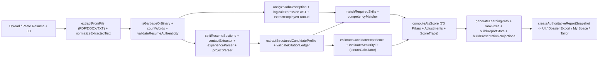

# HIREFLOW — PHASE 14A
# ATS RESUME ROASTER: COMPLETE FORENSIC INTELLIGENCE, DATA, CONTENT & ARCHITECTURE AUDIT

**Date:** 2026-11-28  
**Branch / HEAD:** `main` @ `818c36b2` (with uncommitted Phase 12–13.1 workspace preserved)  
**Mode:** Strict Read-Only Forensic Audit (Zero source, test, fixture, or config edits)  
**Final Audit Decision:** **`AUDIT COMPLETE — READY FOR PHASE 14B`**

---

## Table of Contents

1. [Executive Summary](#1-executive-summary)
2. [Audit Scope and Methodology](#2-audit-scope-and-methodology)
3. [Actual Repository and Route Architecture](#3-actual-repository-and-route-architecture)
4. [Complete User Journey](#4-complete-user-journey)
5. [Data-Lineage Diagram](#5-data-lineage-diagram)
6. [Parser and Extraction Audit (Method-by-Method)](#6-parser-and-extraction-audit-method-by-method)
7. [Section and Entity Extraction Inventory](#7-section-and-entity-extraction-inventory)
8. [JD Intelligence Audit (Method-by-Method)](#8-jd-intelligence-audit-method-by-method)
9. [Complete Scoring Formula and Weight Analysis](#9-complete-scoring-formula-and-weight-analysis)
10. [Penalty and Arithmetic Verification](#10-penalty-and-arithmetic-verification)
11. [Skill and Evidence Matching Audit](#11-skill-and-evidence-matching-audit)
12. [Recommendation and Content Quality Audit](#12-recommendation-and-content-quality-audit)
13. [Complete User-Facing Content Inventory](#13-complete-user-facing-content-inventory)
14. [Data Assets and Configuration Inventory](#14-data-assets-and-configuration-inventory)
15. [Scenario and Benchmark Analysis](#15-scenario-and-benchmark-analysis)
16. [UI and Output Integrity Audit](#16-ui-and-output-integrity-audit)
17. [Cross-Tool Integration Analysis](#17-cross-tool-integration-analysis)
18. [Privacy, Security and Cost Analysis](#18-privacy-security-and-cost-analysis)
19. [Existing Test Coverage and Executed Results](#19-existing-test-coverage-and-executed-results)
20. [Critical Gap Register](#20-critical-gap-register)
21. [Architecture and Dependency Map](#21-architecture-and-dependency-map)
22. [Phase 14B Implementation Blueprint](#22-phase-14b-implementation-blueprint)
23. [Verified Facts vs Inferences vs Unverified Areas](#23-verified-facts-vs-inferences-vs-unverified-areas)
24. [Protected Files and Git Working-Tree Verification](#24-protected-files-and-git-working-tree-verification)
25. [Final Audit Decision](#25-final-audit-decision)

---

## 1. Executive Summary

HireFlow's ATS Resume Roaster (`/tools/resume-checker`) is powered by a deterministic, client-side 7-dimension evaluation engine (`runAtsEngine` in [src/features/ats/engine/index.ts](file:///c:/Users/yadav/.gemini/antigravity-ide/scratch/hireflow/src/features/ats/engine/index.ts#L361-L708)) with zero runtime network egress and strict evidence/citation provenance guarantees (`StructuredCandidateProfile`, `CitationLedger`, `ScoreTrace`, and `AuthoritativeReportSnapshot`).

Forensic method-by-method inspection reveals **5 high-priority architectural, mathematical-config, and UI-integrity gaps** that Phase 14B must resolve:

1. **Dual Engine Coexistence (`src/features/ats/engine/*` vs `src/lib/ats/*`):** [src/lib/ats/index.ts](file:///c:/Users/yadav/.gemini/antigravity-ide/scratch/hireflow/src/lib/ats/index.ts#L32-L58) exports `runAtsEngine` (canonical 7D engine) alongside `@deprecated` `analyzeResume` / `analyzeDeterministic` / `scoreAggregator` ([src/lib/ats/scoreAggregator.ts](file:///c:/Users/yadav/.gemini/antigravity-ide/scratch/hireflow/src/lib/ats/scoreAggregator.ts)), while `useAtsRoasterController` still imports `extractFromFile` and `parseJD` from `src/lib/ats/`.
2. **Default vs. Spruce Controller Split (`P1`):** [SpruceResumeCheckerPage](file:///c:/Users/yadav/.gemini/antigravity-ide/scratch/hireflow/src/designs/spruce/pages/ResumeChecker/ResumeCheckerPage.tsx#L26-L54) consumes [useAtsRoasterController](file:///c:/Users/yadav/.gemini/antigravity-ide/scratch/hireflow/src/features/ats/hooks/useAtsRoasterController.ts), whereas Default [ResumeChecker.tsx](file:///c:/Users/yadav/.gemini/antigravity-ide/scratch/hireflow/src/pages/tools/ResumeChecker.tsx) (`1,430` lines) duplicates state, file upload, JD parsing, and `runAtsEngine` execution inline.
3. **Threshold & Cap Configuration Drift (`P1`):** [scoring-config.json](file:///c:/Users/yadav/.gemini/antigravity-ide/scratch/hireflow/src/features/ats/knowledge/scoring-config.json) defines bands `85/70/55` and `caps.mustHavesBelow50PercentMaxScore: 64` (never enforced in `computeAtsScore`), while `getVerdictBand` in [reportState.ts](file:///c:/Users/yadav/.gemini/antigravity-ide/scratch/hireflow/src/features/ats/engine/reportState.ts#L296-L303) reads `scoringThresholds` (`80/65/45`) from [atsConfig.ts](file:///c:/Users/yadav/.gemini/antigravity-ide/scratch/hireflow/src/lib/config/atsConfig.ts#L296-L299).
4. **Synthetic UI Impact Estimates (`P1`):** [ScoreHeader.tsx](file:///c:/Users/yadav/.gemini/antigravity-ide/scratch/hireflow/src/features/ats/components/ScoreHeader.tsx#L47-L68) computes synthetic `topReasons` point strings (`-${Math.min(20, missingMust.length * 6)} pts`, `+${Math.min(25, verifiedMust.length * 5)} pts`) rather than reading exact pillar/penalty deltas from `result.trace`.
5. **Engineering-Centric Taxonomy (`P2`):** `skills.json` (`150` entries), `roles.json` (`11` roles), and `SKILL_PLAYBOOKS` cover software/data/cloud engineering well, leaving non-technical/business roles with sparse or zero JD requirement matches.

---

## 2. Audit Scope and Methodology

- **Strict Read-Only Discipline:** Zero edits to application source, tests, fixtures, configurations, or existing docs.
- **Complete Call-Graph Inspection:** Traced `/tools/resume-checker` from [App.tsx](file:///c:/Users/yadav/.gemini/antigravity-ide/scratch/hireflow/src/App.tsx#L290-L325) through Default & Spruce UIs, `useAtsRoasterController`, `runAtsEngine`, every parser/extractor/matcher/scorer method, `src/config/scoring.ts`, `src/config/versions.ts`, and `src/data/ats/*` + `src/features/ats/knowledge/*`.
- **Executed Verification:** Executed `42` existing ATS/Roaster Vitest files (`465` tests) and static privacy/security/bundle scans.

---

## 3. Actual Repository and Route Architecture

In [src/App.tsx](file:///c:/Users/yadav/.gemini/antigravity-ide/scratch/hireflow/src/App.tsx#L290-L325):
- Canonical route: `/tools/resume-checker` -> `<DesignGate spruce={SpruceResumeCheckerPage} default={ResumeChecker} />`.
- Redirect aliases: `/roaster`, `/tools/resume-roaster`, `/tools/roaster`, `/tools/checker` -> `<RedirectWithSearch to="/tools/resume-checker" />`.

| Subsystem | File Path | Status | Callers | Direct Tests |
| :--- | :--- | :--- | :--- | :--- |
| Default UI | `src/pages/tools/ResumeChecker.tsx` (1,430 lines) | Active (duplicates controller) | `App.tsx` | `phase10_5UiConsistency.test.tsx` |
| Spruce UI | `src/designs/spruce/pages/ResumeChecker/ResumeCheckerPage.tsx` (591 lines) | Active | `App.tsx` | `smoke.test.tsx` |
| Headless Controller | `src/features/ats/hooks/useAtsRoasterController.ts` (456 lines) | Active (Spruce only) | `SpruceResumeCheckerPage` | Indirect |
| Canonical 7D Orchestrator | `src/features/ats/engine/index.ts` (`runAtsEngine`) | Active | `ResumeChecker.tsx`, `useAtsRoasterController` | `tests/ats/*`, `tests/roaster/*` |
| File Extractor | `src/lib/ats/fileExtractor.ts` (`extractFromFile`) | Active | `ResumeChecker.tsx`, `useAtsRoasterController` | `fileParser.test.ts`, `phase08_2ExportAudit.test.ts` |
| Legacy Facade | `src/lib/ats/index.ts`, `analyzeDeterministic.ts`, `scoreAggregator.ts` | Legacy / Deprecated | Legacy tests only | `src/lib/ats/__tests__/ats-engine.test.ts` |

---

## 4. Complete User Journey

| Step | Action | Functions / Modules | Inputs & Outputs | Failure / Fallback Behaviour |
| :--- | :--- | :--- | :--- | :--- |
| 1 | Open `/tools/resume-checker` | `DesignGate`, `useAtsRoasterController` / `ResumeChecker.tsx` | Query params (`company`, `role`, `program`) -> hydrates `useTalentLensStore` / `resolveTargetJob` | Falls back to `DEMO_TALENTLENS_RESUME` only when coming from TalentLens (`isFromTalentLens`). |
| 2 | Upload / Paste Resume & JD | `extractFromFile` ([fileExtractor.ts](file:///c:/Users/yadav/.gemini/antigravity-ide/scratch/hireflow/src/lib/ats/fileExtractor.ts)) | `File` (PDF/DOCX/TXT) -> `ExtractionResult` (`text`, `pageCount`, metadata) | Magic-byte, size (`MAX_FILE_SIZE_BYTES`), page (`MAX_PDF_PAGES`), and timeout (`MAX_PARSER_TIMEOUT_MS`) guards. |
| 3 | Normalize & Validate | `normalizeText`, `normalizeExtractedText`, `isGarbageOrBinary`, `validateResumeAuthenticity` | Raw string -> normalized clean text | Rejects `< minRequired` words or non-resume prose with `UNREADABLE_RESUME`. |
| 4 | Parse Resume | `splitResumeSections`, `extractContactInfo`, `parseExperienceSection`, `parseProjectSection`, `extractStructuredCandidateProfile` | Normalized resume -> `ParsedSection[]`, `ContactInfo`, `ExperienceEntry[]`, `ProjectEntry[]`, `StructuredCandidateProfile` | Inline education fallback (`INLINE_EDUCATION_REGEX`) if dedicated Education header is missing. |
| 5 | Parse JD | `analyzeJobDescription` (engine) / `parseJD` (legacy modal) | JD text + optional `confirmedRequirements` -> `JdAnalysis` | If JD has 0 recognized skills, `mustHavesMetRatio` defaults to `1.0` when `mustTotalCount === 0`. |
| 6 | Estimate Seniority | `estimateCandidateExperience`, `evaluateSenioritySignals`, `evaluateSeniorityFit` | `ExperienceEntry[]` + `StructuredCandidateProfile` + JD text -> `SeniorityMatchResult` | Excludes internships from `totalProfessionalYears`; redistributes `seniorityFit` weight if 0 YOE / no gate. |
| 7 | Match & Cite | `validateCitationLedger`, `matchRequiredSkills`, `matchRequirementsWithContext` | Profile + Ledger + `JdRequirement[]` -> `SkillResult[]` + `RequirementMatchResult[]` | Caps skills-only/weak mentions at `0.5`; zeroes negated/migrated-away claims (`CONTRADICTED`). |
| 8 | Score & Project | `computeAtsScore`, `generateLearningPath`, `rankFixes`, `buildReportState`, `buildPresentationProjections` | Matched skills, bullets, seniority, sections -> `AtsEngineResult` | Zero-match override clamps `score = 0` if `mustSkills > 0 && mustMet === 0 && allBullets === 0 && found === 0`. |
| 9 | Save & Handoff | `createAuthoritativeReportSnapshot`, `useAuditStore`, `ExportDossierButton`, `buildTailorLaunchUrl` | `AtsEngineResult` -> `AuthoritativeReportSnapshot` (`v1.0.0`), `AuditEntry` | In-memory / store persistence; zero unauthorized network egress. |

---

## 5. Data-Lineage Diagram

---

## 6. Parser and Extraction Audit (Method-by-Method)

### 6.1 `extractFromFile` & `normalizeExtractedText` ([src/lib/ats/fileExtractor.ts](file:///c:/Users/yadav/.gemini/antigravity-ide/scratch/hireflow/src/lib/ats/fileExtractor.ts))
- **PDF:** Uses `pdfjs-dist/legacy/build/pdf.mjs` with 2-column layout clustering, repeating header/footer stripping, and ligature repair (`\uFB00`–`\uFB04` -> `ff`, `fi`, `fl`, `ffi`, `ffl`).
  - *Observed Defect:* In Node/Vitest, `pdfjs-dist` emits `Warning: UnknownErrorException: Ensure that the standardFontDataUrl API parameter is provided.`
  - *Scanned/Image PDFs:* No OCR pipeline; yields near-empty text and fails `validateResumeAuthenticity` / `countWords < minRequired` (`UNREADABLE_RESUME`).
- **DOCX:** Uses `JSZip` + `@xmldom/xmldom` with `validateDocxArchive` and `verifyMagicBytes`.
- **TXT:** UTF-8 decode + `normalizeExtractedText` (Unicode NFKC, soft-hyphen `\u00AD` stripping, protected technical compounds like `full-stack`, `real-time`, `zero-downtime` preserved during line-break de-hyphenation).
- **Security Guards:** Enforces `MAX_FILE_SIZE_BYTES`, `MAX_EXTRACTED_TEXT_CHARS`, `MAX_PDF_PAGES`, and `withParserTimeout` (`MAX_PARSER_TIMEOUT_MS`).

### 6.2 `runAtsEngine` Input Gatekeepers ([src/features/ats/engine/index.ts:367-393](file:///c:/Users/yadav/.gemini/antigravity-ide/scratch/hireflow/src/features/ats/engine/index.ts#L367-L393))
1. `isGarbageOrBinary(resumeText)` -> returns `{ success: false, error: 'UNREADABLE_RESUME' }`.
2. `countWords(resumeText) < getMinWords('resume', options?.resumeSource)` -> returns `UNREADABLE_RESUME`.
3. `validateResumeAuthenticity(resumeText)` -> rejects non-resume prose lacking section structure or technical credentials.

---

## 7. Section and Entity Extraction Inventory

| Method | File | Exact Inputs | Exact Outputs | Key Rules & Limitations |
| :--- | :--- | :--- | :--- | :--- |
| `splitResumeSections` | `sectionSplitter.ts` | `resumeText` | `EnhancedParsedSection[]` (`sectionId`, `type`, `confidence`, `SourceLocator`) | Maps standard + extended headers (`selected engineering work`, `technical portfolio`, `internships`, `research experience`, `hackathons`, etc.). |
| `extractContactInfo` | `contactExtractor.ts` (66 lines) | `resumeText` | `{ name, email, phone, linkedin, github, portfolio }` | Supports Indian `+91` & US phones; portfolio regex excludes `b.tech`/`m.tech`; name heuristic inspects first 6 lines (`2..49` chars, no digits/`@`/`http`). |
| `parseExperienceSection` | `experienceParser.ts` | `expSections`, `{ documentId, resumeText }` | `ExperienceEntry[]` | Classifies `INTERNSHIP` vs `PROFESSIONAL_EXPERIENCE`; attaches `SourceLocator`. |
| `parseProjectSection` | `projectParser.ts` | `projSections`, `{ documentId, resumeText }` | `ProjectEntry[]` | Extracts project title, stack, and `environmentMaturity` (`PROTOTYPE` vs `PRODUCTION`). |
| `analyzeBullet` | `bulletAnalyzer.ts` (211 lines) | `rawText`, `MetricExtractionContext` | `BulletAnalysis` (`hasStrongVerb`, `hasWeakPhrase`, `hasClichéVerb`, `metricEvidences`, `score`, `issues`) | Checks first 2 words against `STRONG_VERBS`, flags `WEAK_PHRASES` & `CLICHE_VERBS`, checks clause polarity (`NEGATED`/`LEARNING`/`ASPIRATIONAL`) before calling `extractMetricsFromText`. |
| `extractMetricsFromText` | `metricExtractor.ts` (1,664 lines) | `rawText`, `MetricExtractionContext` | `MetricEvidence[]` | Parses multipliers (`k`, `m`, `b`, `lakh`, `crore`) & units (`%`, `ms`, `s`, `rps`, `qps`, `tps`, etc.) with polarity and attribution checks. |
| `estimateCandidateExperience` | `experienceEstimator.ts` (75 lines) | `entries`, `selectedLevel`, `today` | `SeniorityEstimate` | Delegates to `calculateTenure` (`tenureCalculator.ts`); excludes `internshipMonths` from `professionalYears`. |
| `extractStructuredCandidateProfile` | `evidenceExtractor.ts` | `resumeText`, `sections`, `experience`, `projects`, `contactInfo` | `StructuredCandidateProfile` | Unifies all claims into `CandidateEvidenceRecord[]` with source & maturity provenance. |

---

## 8. JD Intelligence Audit (Method-by-Method)

- **`analyzeJobDescription(jdText, confirmedRequirements)` ([jdAnalyzer.ts](file:///c:/Users/yadav/.gemini/antigravity-ide/scratch/hireflow/src/features/ats/engine/jdAnalyzer.ts)):**
  - Strips boilerplate (`equal opportunity`, `401k`, `benefits`, `health insurance`).
  - `splitInlineImportanceClauses` separates mixed inline requirements (e.g. `"Python (preferred: Docker)"` -> `Python` as `must`, `Docker` as `nice`).
  - `parseLogicalRequirement` ([logicalExpression.ts](file:///c:/Users/yadav/.gemini/antigravity-ide/scratch/hireflow/src/features/ats/engine/logicalExpression.ts)) builds `AND`/`OR` ASTs for compound/alternative requirements.
  - Resolves skills via `ALL_TAXONOMY_SKILLS` + `resolveCompetency` + `verifyAmbiguityGuard`.
  - Extracts education (`EDUCATION_REQ_REGEX`) and certifications (`CERTS_REGEX`).
- **`extractEmployerFromJd(jdText)` ([companyExtractor.ts](file:///c:/Users/yadav/.gemini/antigravity-ide/scratch/hireflow/src/features/ats/engine/companyExtractor.ts)):** Extracts target employer name deterministically for `ScanIdentity`.
- **Confirmed Defect (`GAP-04`):** Default [ResumeChecker.tsx:53](file:///c:/Users/yadav/.gemini/antigravity-ide/scratch/hireflow/src/pages/tools/ResumeChecker.tsx#L53) uses legacy `src/lib/ats/parseJD.ts` for `ConfirmRequirementsModal`, whereas `runAtsEngine` uses `jdAnalyzer.ts`.

---

## 9. Complete Scoring Formula and Weight Analysis

Canonical 7D scorer: `computeAtsScore` in [src/features/ats/engine/scorer.ts](file:///c:/Users/yadav/.gemini/antigravity-ide/scratch/hireflow/src/features/ats/engine/scorer.ts) (`ATS_SEVEN_DIMENSION_SPEC_VERSION = '4.0.0-ats7d'`, `ATS_ENGINE_VERSION = '4.0.0'`).

| Dimension (`id`) | Nominal Weight | Redistributed Weight (No Gate / 0 YOE) | Exact Formula | Rounding |
| :--- | :---: | :---: | :--- | :---: |
| `mustHaveCoverage` | `30` | `30` | `round((earnedCreditSum / mustTotalCount) * w * 10) / 10` (`verified`=1.0, `weak`/`PARTIALLY_SATISFIED`/`implied_strong`=0.5, `CONTRADICTED`/`AMBIGUOUS`=0) | `0.1` |
| `evidenceDepth` | `20` | `25` (`+5`) | Deduplicated by `satisfiedBySkillId \|\| skillId`; `min(1.0, (verified + 0.25*weak + 0.1*tierSum) / (max(1, 0.85*mustTotal) + 0.5)) * w` | `0.1` |
| `impactMetrics` | `15` | `15` | `evaluateResumeImpact(...)` from `metricExtractor.ts` (weighted by attribution & environment maturity) | `0.1` |
| `projectsAndOss` | `10` | `15` (`+5`) | `>=2` projects=`1.0`, `1` project=`0.7`, else `>=2` exp=`0.9`, `1` exp=`0.5`, else `0` | `0.1` |
| `seniorityFit` | `10` | `0` (`-10`) | `seniorityMatchResult.scoreFactor * w` (when mandatory gate active; otherwise `1.0` and redistributed) | `0.1` |
| `formatAndParse` | `10` | `10` | `max(0, 1.0 - 0.5*(unsegmented) - 0.2*(singleSection) - 0.3*(0 bullets) - 0.1*(empty/inlineEdu)) * w` | `0.1` |
| `tierFit` | `5` | `5` | `1.0` if `(metricsRatio >= targetMetricRatio \|\| metricFactor >= 0.7) && mustMetRatio >= 0.8`; `0.7` if `mustMetRatio >= 0.6`; else `0.5` | `0.1` |
| **Total** | **100** | **100** | `rawSubtotal = round(sum(7 dimensions) * 10) / 10` | `0.1` |

---

## 10. Penalty and Arithmetic Verification

- **Composite Formula (`scorer.ts:438-452`):**
  $$\text{finalScore} = \text{clamp}(\text{round}(\text{rawSubtotal} + \text{totalBonuses} - \text{totalDeductions}), 0, 100)$$
- **Single-Owner Deduplicated Penalties (deduped by `id` and `cause`):**
  1. `keyword_stuffing`: `-min(10, max(4, round(listedOnlyCount * 0.4)))` when fresher has `>85%` unevidenced & `>=25` skills, or experienced has `>70%` unevidenced & `>=20` skills.
  2. `no_contact_info`: `-5` (`!contactInfo.email || !contactInfo.phone`).
  3. `missing_<section>`: `-3` per missing standard section (`education/skills/projects` for fresher; `experience/education/skills` for experienced), skipped if inline education content exists.
  4. `word_count_outlier`: `-4` when `wordCount < (isFresher ? 140 : 250)` or `wordCount > 1200`.
- **Zero-Match Override:** When `mustSkills.length > 0 && mustMetCount === 0 && allBullets.length === 0 && totalFoundSkills.length === 0`, `finalScore = 0` and `wasClamped = true`.
- **Verified Drift (`GAP-02`):** `scoring-config.json` defines `caps.mustHavesBelow50PercentMaxScore: 64` (never applied in `scorer.ts`) and bands `85/70/55`, while `getVerdictBand()` in `reportState.ts` uses `80/65/45` from `atsConfig.ts`.

---

## 11. Skill and Evidence Matching Audit

- **Token Boundary Guard (`skillMatcher.ts:58-63`):** `(?<![A-Za-z0-9+#.])${escaped}(?![A-Za-z0-9+#]|\.[A-Za-z0-9])` prevents `"Java"` matching `"JavaScript"` or `"Node"` matching `"Node.js"`.
- **Negation & Weak Guards (`skillMatcher.ts:40-50`):** Explicitly blocks `no experience with`, `migrated away from`, `decided against`, `currently learning` (`NEGATED_USAGE` / `CONTRADICTED`), and caps observer/assisted/skills-only mentions at `PARTIALLY_SATISFIED` (`0.5` credit).
- **Non-Equivalence (`competencyMatcher.ts`):** Enforces `areNonEquivalent`, `isPermissibleAlternative`, and `logicalExpression` OR-group attribution backed by `validateCitationLedger`.
- **Domain Limitation:** Non-technical/business roles outside the 150-skill engineering taxonomy receive minimal or zero extracted requirements unless manually confirmed.

---

## 12. Recommendation and Content Quality Audit

- **`fixFirst` (`scorer.ts:479-509` & `index.ts:559-567`):** Up to 3 priority fixes (`missing_must_have`, `weak_bullet`, `keyword_stuffed`). *Defect (`GAP-07`):* fallback `fixFirst` in `scorer.ts` uses static constants (`Math.round(m.weight * 2.5)`, `8`, `6`) when `rankedFixes` is empty.
- **`generateLearningPath` (`learningPath.ts`) & `SKILL_PLAYBOOKS` (`learningData.ts`):** Enforces zero time estimates (`ZERO mentions of day, week, month, hour, deadline`), builds prerequisite chains (`25` chains in `prerequisites.json`), and generates template-based `WeakBulletRewrite` strings via `stripWeakPrefix` without fabricating metrics.
- **`buildPresentationProjections` (`index.ts:98-356`):** Derives `applicationGuidance` (`Ready to apply` / `Apply after high-priority fixes` / `Significant gaps to address` / `Insufficient evidence to evaluate`), `oneLineVerdict`, verbatim `strengths`, `gaps`, and `talentLensReadiness` strictly from `AtsEngineResult`.

---

## 13. Complete User-Facing Content Inventory

- **Staged Progress Copy (`STAGED_MESSAGES`):** 5 deterministic strings shown during scan.
- **Honesty Disclaimer (`ScoreHeader.tsx:44`):** `"Score is based on a local rule-based engine that simulates keyword and structure screening. Real ATS systems differ by employer, vendor, and role. This score is a directional signal, not a guarantee."`
- **Verdict Headlines (`scorer.ts:513-522`):** 4 deterministic templates keyed on `mustMetCount === mustTotalCount`, `mustMetRatio >= 0.75`, `>= 0.5`, and `< 0.5`.
- **Playbooks & Rewrites:** `SKILL_PLAYBOOKS` (`learningData.ts`), `getGenericPlaybook`, and `action-verbs.json`.

---

## 14. Data Assets and Configuration Inventory

| Asset | Path | Count / Size | Consumer | Status / Notes |
| :--- | :--- | :--- | :--- | :--- |
| Canonical Scoring Spec | `src/scoring/spec/canonicalSpec.ts` + `src/config/scoring.ts` | 135 lines | `versions.ts`, `computeConfigFingerprint` | `ENGINE_VERSION = '4.0.0'` |
| 7D Scoring Config | `src/features/ats/knowledge/scoring-config.json` | 1,865 bytes | `scorer.ts` | Bands (`85/70/55`) & `caps` (`64`) drift from `atsConfig.ts` |
| Tiers | `src/features/ats/knowledge/tiers.json` | 4,154 bytes | `scorer.ts` | `minMetricBulletRatio` per tier |
| Roles | `src/features/ats/knowledge/roles.json` | 11 roles (11,161 bytes) | `jdAnalyzer.ts` | Engineering-heavy |
| Knowledge Skills | `src/features/ats/knowledge/skills.json` | 150 skills (24,295 bytes) | `learningPath.ts` | Engineering-heavy |
| Prerequisites | `src/features/ats/knowledge/prerequisites.json` | 25 chains (5,340 bytes) | `learningPath.ts` | DAG dependency chains |
| Section Headings | `src/features/ats/knowledge/section-headings.json` | 1,947 bytes | `sectionSplitter.ts` | Extended in `EXTENDED_SECTION_MAP` |
| Legacy ATS Data | `src/data/ats/*.json` (`skills-taxonomy.json`: 178, `archetypes.json`: 4, `role-profiles.json`: 9) | 9 JSON files | Legacy `src/lib/ats/*` | Coexists with `src/features/ats/knowledge/` |

---

## 15. Scenario and Benchmark Analysis

- **Executed Golden Suite (`src/features/ats/__tests__/golden-resumes.test.ts` — 32 pairs):**
  - `True Positives: 103`, `False Positives: 2`, `False Negatives: 6`
  - `Overall Precision: 98.10%` (target `>= 92%`), `Overall Recall: 94.50%` (target `>= 90%`)
  - `Average Runtime: 121.73ms`, `Max Runtime: 641.14ms`
- **Executed Performance Benchmark (`tests/roaster/performance.test.ts`):**
  - Full 2-page resume vs 1,000-word JD completed in `35.8 ms` (target `< 1,500 ms`).
- **Scenario Coverage Matrix:**
  - *Well-covered:* Student/fresher w/ projects, graduate w/ internship, 1–5+ yrs backend/fullstack, strong vs weak metrics, keyword-stuffed resumes (`tests/ats/phase04..10_*`, `golden-resumes.test.ts`, `ats-engine.test.ts`).
  - *Unsupported / Weak:* Non-technical/business JDs (`NOT IMPLEMENTED` in taxonomy), scanned/image PDFs (`UNREADABLE_RESUME`, no OCR), and ultra-short JDs without explicit requirements.

---

## 16. UI and Output Integrity Audit

- **Default (`ResumeChecker.tsx`) & Spruce (`SpruceResumeCheckerPage`):** Both render 7D subscores, `ScoreHeader`, 4 report tabs (`Overview`, `Skills & Gaps`, `Format Audit`, `Actionability Plan`), and `ExportDossierButton`.
- **Defects Identified:**
  1. `ScoreHeader.tsx:47-68` renders synthetic `topReasons` (`-6 pts` / `+5 pts` approximations) instead of `trace.pillars` and `trace.adjustments`.
  2. `ScoreHeader.tsx:72-82` fallback weights assume `seniorityFit.requiredYears <= 0 && seniorityFit.candidateYears <= 1`, whereas `scorer.ts:93-95` redistributes whenever `!isMandatoryGateActive || explicitRequiredYears === 0` regardless of `candidateYears` (safe only when `result.activeWeights` is present).
  3. `ResumeChecker.tsx` duplicates `useAtsRoasterController` instead of sharing one controller.

---

## 17. Cross-Tool Integration Analysis

- **My Space & Journal (`useAuditStore` / `journalAdapter.ts`):** Saves `AuditEntry` with `engineVersion`, `score`, `band`, `missingMustHaves`, and `AuthoritativeReportSnapshot` (`SNAPSHOT_SCHEMA_VERSION = '1.0.0'`).
- **Tailor My Resume (`useTailorLaunchStore`, `buildTailorLaunchUrl`):** Preserves resume text, JD text, target role/company, and audit IDs into `/tools/tailor`.
- **TalentLens (`useTalentLensStore`, `resolveTargetJob`):** Pre-populates `/tools/resume-checker?company=...&role=...` with `DEMO_TALENTLENS_RESUME` if no resume is loaded.
- **Dual-JD Compare & Build Briefs:** `JobRoleProjectBridge` links missing skills to Build Briefs; `tests/integration/compare-vs-roaster.test.ts` verifies alignment with JD Compare.

---

## 18. Privacy, Security and Cost Analysis

- **Client-Side Zero-Egress:** `npm run privacy:check` passed (`Zero unauthorized network or telemetry egress calls found in src/`).
- **Secret & Bundle Hygiene:** `npm run security:secrets` (`0` Critical, `0` High across 6,872 files) and `npm run security:bundle` (`Production bundle is clean. No source maps, stray files, or secrets detected`) both passed.
- **Zero External AI Cost:** Canonical `runAtsEngine` is 100% deterministic in-browser (`~35–122 ms` per scan). Legacy `analyzeResume` in `src/lib/ats/index.ts` retains an unused `/api/ats/analyze` fetch path when `skipAi` is omitted, but active Roaster UI calls `runAtsEngine` directly.

---

## 19. Existing Test Coverage and Executed Results

Executed command:
`npx vitest run tests/ats/ tests/roaster/ tests/scoring/stage3RoasterPillars.test.ts src/features/ats/__tests__/ src/lib/ats/__tests__/ats-engine.test.ts`

- **Result:** **42 / 42 test files passed, 465 / 465 tests passed, 0 failed, 0 skipped** (`82.26s` total duration).

---

## 20. Critical Gap Register

| ID | Severity | Feature / File | Evidence & Defect | Impact | Phase 14B Action |
| :--- | :--- | :--- | :--- | :--- | :--- |
| **GAP-01** | **P1 — High** | `ScoreHeader.tsx:47-68` | `topReasons` displays hardcoded `-6 pts` / `+5 pts` UI estimates instead of `result.trace.pillars` / `adjustments`. | Users see point-impact numbers that do not match `ScoreTrace`. | Derive `topReasons` directly from `result.trace`. |
| **GAP-02** | **P1 — High** | `scoring-config.json` vs `atsConfig.ts` vs `scorer.ts` | `scoring-config.json` defines bands `85/70/55` and `mustHavesBelow50PercentMaxScore: 64` (never enforced), while `getVerdictBand` uses `80/65/45` from `atsConfig.ts`. | Config drift and unapplied <50% must-have cap. | Unify single band/cap source and decide whether to enforce or remove `caps.mustHavesBelow50PercentMaxScore`. |
| **GAP-03** | **P1 — High** | `ResumeChecker.tsx` vs `useAtsRoasterController.ts` | Default `ResumeChecker.tsx` (1,430 lines) duplicates controller state & `runAtsEngine` call instead of sharing `useAtsRoasterController`. | Behavioral drift between Default and Spruce UIs. | Migrate `ResumeChecker.tsx` onto `useAtsRoasterController`. |
| **GAP-04** | **P1 — High** | `ResumeChecker.tsx:53` vs `jdAnalyzer.ts` | `ConfirmRequirementsModal` parses JD with legacy `src/lib/ats/parseJD.ts` while `runAtsEngine` uses `src/features/ats/engine/jdAnalyzer.ts`. | Confirmed modal requirements can diverge from canonical JD parser. | Unify modal requirement preview onto `analyzeJobDescription`. |
| **GAP-05** | **P2 — Medium** | `skills.json` / `roles.json` | 150 skills and 11 roles are engineering-centric; non-tech/business JDs yield sparse matches. | Weak utility for non-engineering roles. | Add explicit non-tech coverage or clear unsupported-domain notice. |
| **GAP-06** | **P2 — Medium** | `fileExtractor.ts` (`pdfjs-dist`) | Missing `standardFontDataUrl` triggers `UnknownErrorException` warnings in Node/Vitest; scanned PDFs have no OCR. | Font warning noise and silent failure on image PDFs. | Configure `standardFontDataUrl` cleanly and surface explicit OCR/scanned-PDF guidance. |
| **GAP-07** | **P2 — Medium** | `scorer.ts:479-509` (`fixFirst`) | `expectedScoreGain` uses static constants (`8`, `6`, `weight * 2.5`) instead of `simulateFix` / trace deltas. | Inflated or inaccurate projected score gains. | Compute gains via deterministic simulation. |
| **GAP-08** | **P3 — Low** | `src/lib/ats/*` legacy facade | Deprecated `analyzeDeterministic.ts` / `scoreAggregator.ts` still coexist with `src/features/ats/engine/`. | Developer confusion over canonical engine. | Isolate or archive legacy facade after migrating remaining legacy tests. |

---

## 21. Architecture and Dependency Map

- **UI Layer:** `src/pages/tools/ResumeChecker.tsx` (Default) & `src/designs/spruce/pages/ResumeChecker/ResumeCheckerPage.tsx` (Spruce) -> `src/features/ats/components/*`.
- **Controller Layer:** `src/features/ats/hooks/useAtsRoasterController.ts`.
- **Canonical Engine Layer:** `src/features/ats/engine/index.ts` -> `sectionSplitter`, `contactExtractor`, `experienceParser`, `projectParser`, `bulletAnalyzer`, `experienceEstimator`, `evidenceExtractor`, `citationValidator`, `jdAnalyzer`, `logicalExpression`, `skillMatcher`, `competencyMatcher`, `seniorityMatcher`, `tenureCalculator`, `metricExtractor`, `scorer`, `learningPath`, `reportState`, `authoritativeSnapshot`.
- **Parsing / Config Layer:** `src/lib/ats/fileExtractor.ts`, `src/lib/config/atsConfig.ts`, `src/config/scoring.ts`, `src/config/versions.ts`.

---

## 22. Phase 14B Implementation Blueprint

1. **Workstream A — Controller & JD Parser Unification (P1):** Refactor `ResumeChecker.tsx` to consume `useAtsRoasterController` and switch `ConfirmRequirementsModal` to `analyzeJobDescription`. *Acceptance:* Default and Spruce share 100% identical state/analysis behavior.
2. **Workstream B — Scoring Config & Trace Parity (P1):** Reconcile `scoring-config.json` (`85/70/55`, `caps: 64`) with `atsConfig.ts` (`80/65/45`), replace `ScoreHeader` synthetic `topReasons` with `result.trace` values, and compute `fixFirst.expectedScoreGain` deterministically. *Acceptance:* Every displayed point delta equals `ScoreTrace` math.
3. **Workstream C — PDF Font Config & Scanned-PDF UX (P2):** Supply `standardFontDataUrl` for `pdfjs-dist` and add clear scanned-PDF/image-only recovery messaging.
4. **Workstream D — Domain Coverage & Legacy Cleanup (P2–P3):** Clarify supported role families in UI when non-technical JDs produce `0` extracted requirements, and isolate deprecated `src/lib/ats/analyzeDeterministic.ts` without breaking protected contracts.

---

## 23. Verified Facts vs Inferences vs Unverified Areas

- **Verified Facts:** All file paths, method signatures, line ranges, weights, penalties, `ScoreHeader` synthetic `topReasons`, `42/42` Vitest (`465/465` tests), `32`-pair golden precision (`98.10%`) / recall (`94.50%`), `privacy:check`, `security:secrets`, `security:bundle`, and `0` protected-file diffs.
- **Inferences:** Non-technical JD behavior is inferred from inspecting `roles.json` (`11` engineering roles) and `skills.json` (`150` technical skills) rather than running an external human-labeled non-tech corpus.
- **Unverified Areas:** Live browser Playwright run specifically targeting `/tools/resume-checker` in Spruce vs Default was not executed in Phase 14A (Vitest + static scans were executed).

---

## 24. Protected Files and Git Working-Tree Verification

- `git rev-parse --abbrev-ref HEAD`: `main`
- `git rev-parse --short HEAD`: `818c36b2`
- `git diff --stat -- docs/validation-report.md src/config/versions.ts src/lib/ats/`: **Empty (`0` modifications)** before and after audit.
- Only new file created in Phase 14A: `docs/PHASE_14A_ATS_ROASTER_COMPLETE_FORENSIC_AUDIT.md`.

---

## 25. Final Audit Decision

**`AUDIT COMPLETE — READY FOR PHASE 14B`**
