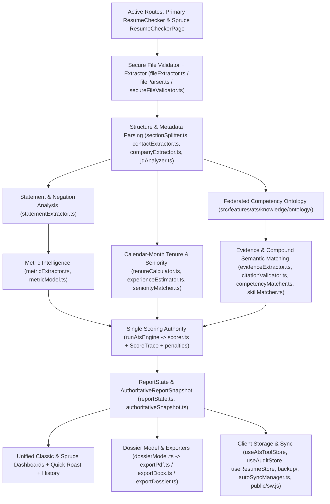

# HireFlow ATS — Current Authoritative System Architecture (Post-Phase 10.7)

**Status:** Current Authoritative Architecture Reference (Phases 02–10.7)  
**Supersedes:** [ENGINE_ARCHITECTURE_AUDIT.md](./ENGINE_ARCHITECTURE_AUDIT.md) (Historical Phase 01 Audit)

---

## 1. End-to-End Runtime Data Flow

HireFlow evaluates resumes deterministically on the client using a single scoring authority (`runAtsEngine()`, scoring specification `4.0.0-ats7d`), producing a unified `ReportState`, `AuthoritativeReportSnapshot` (`'1.0.0'`), `AuditEntry` journal record, and binary/Markdown dossier exports.

---

## 2. Subsystem & Module Classification Inventory

Classification taxonomy:
- **Active and authoritative:** Core production path executed for real users and authoritative outputs.
- **Active presentation adapter:** Active UI controller, component, or theme shell consuming authoritative engine/snapshot models.
- **Compatibility-only:** Retained strictly for legacy test callers, historical snapshot migration, or backward-compatible exports; NOT invoked for live ATS scoring authority.
- **Deprecated:** Superseded modules scheduled for retirement; retained without live scoring authority.
- **Unused:** Unreferenced helpers or dead exports left non-blocking.
- **Development-only:** Vite dev middleware, CLI validators, and offline fixture/golden maintenance utilities.

### 2.1 Parsing, Structure & JD Logic
| Module / Subsystem | Classification | Role & Grounding Notes |
| :--- | :--- | :--- |
| [src/lib/secureFileValidator.ts](file:///c:/Users/yadav/.gemini/antigravity-ide/scratch/hireflow/src/lib/secureFileValidator.ts) | **Active and authoritative** | Shared `5 MB` upload bound, magic-byte & binary `.txt`/`.json` guards, full ZIP `validateDocxArchive()` (traversal beyond 4 KB, stream-measured decompression bombs, macros/OLE/XXE, `.rels` URI hygiene), `withParserTimeout()` |
| [src/lib/ats/fileExtractor.ts](file:///c:/Users/yadav/.gemini/antigravity-ide/scratch/hireflow/src/lib/ats/fileExtractor.ts) | **Active and authoritative** | Primary UI PDF (`pdfjs-dist`), DOCX (`validateDocxArchive` + `JSZip`/`DOMParser`), JSON, and TXT extractor |
| [src/features/ats/fileParser.ts](file:///c:/Users/yadav/.gemini/antigravity-ide/scratch/hireflow/src/features/ats/fileParser.ts) | **Compatibility-only** | Secondary `parseResumeFile` / `mammoth` DOCX parser path; wired with `validateDocxArchive()` and shared size/timeout guards |
| [src/features/ats/engine/sectionSplitter.ts](file:///c:/Users/yadav/.gemini/antigravity-ide/scratch/hireflow/src/features/ats/engine/sectionSplitter.ts) | **Active and authoritative** | Deterministic single-column, multi-column, table, inline, duplicate, and bilingual section segmentation with source offsets |
| [src/features/ats/engine/contactExtractor.ts](file:///c:/Users/yadav/.gemini/antigravity-ide/scratch/hireflow/src/features/ats/engine/contactExtractor.ts) | **Active and authoritative** | Extracts candidate name, email, phone, and links from resume text (never substitutes session profile name) |
| [src/features/ats/engine/companyExtractor.ts](file:///c:/Users/yadav/.gemini/antigravity-ide/scratch/hireflow/src/features/ats/engine/companyExtractor.ts) | **Active and authoritative** | Unstructured & structured employer entity extraction from JDs without blind fallback hallucination |
| [src/features/ats/engine/jdAnalyzer.ts](file:///c:/Users/yadav/.gemini/antigravity-ide/scratch/hireflow/src/features/ats/engine/jdAnalyzer.ts) | **Active and authoritative** | Deterministic JD requirement extraction + compound boolean (`AND`/`OR`) expression normalization via `logicalExpression.ts` |
| [src/features/ats/engine/logicalExpression.ts](file:///c:/Users/yadav/.gemini/antigravity-ide/scratch/hireflow/src/features/ats/engine/logicalExpression.ts) | **Active and authoritative** | Recursive boolean AST parser/evaluator for compound requirements |
| [src/features/ats/engine/experienceParser.ts](file:///c:/Users/yadav/.gemini/antigravity-ide/scratch/hireflow/src/features/ats/engine/experienceParser.ts) & [projectParser.ts](file:///c:/Users/yadav/.gemini/antigravity-ide/scratch/hireflow/src/features/ats/engine/projectParser.ts) | **Active and authoritative** | Structured experience/internship and personal/OSS project parsing with section context tagging |
| [src/features/ats/engine/scanIdentity.ts](file:///c:/Users/yadav/.gemini/antigravity-ide/scratch/hireflow/src/features/ats/engine/scanIdentity.ts) & [sourceLocator.ts](file:///c:/Users/yadav/.gemini/antigravity-ide/scratch/hireflow/src/features/ats/engine/sourceLocator.ts) | **Active and authoritative** | Authoritative candidate/employer/role identity resolution and exact document character/line locators |
| [src/lib/ats/parseJD.ts](file:///c:/Users/yadav/.gemini/antigravity-ide/scratch/hireflow/src/lib/ats/parseJD.ts) & [parseResume.ts](file:///c:/Users/yadav/.gemini/antigravity-ide/scratch/hireflow/src/lib/ats/parseResume.ts) | **Deprecated** | Pre-engine legacy parsers retained only for `ConfirmRequirementsModal` modal preview and legacy test suites |

### 2.2 Competency Ontology & Knowledge Federation
| Module / Subsystem | Classification | Role & Grounding Notes |
| :--- | :--- | :--- |
| [src/features/ats/knowledge/ontology/](file:///c:/Users/yadav/.gemini/antigravity-ide/scratch/hireflow/src/features/ats/knowledge/ontology/index.ts) | **Active and authoritative** | Federated competency taxonomy (`competencies.ts`, `index.ts`, `types.ts`, `coverageAnalyzer.ts`, `validator.ts`) enforcing unambiguous canonical IDs & alias precedence |
| `src/features/ats/knowledge/taxonomy/*.ts` | **Active and authoritative** | Federated domain packs (`softwareLanguages.ts`, `backendFrameworks.ts`, `frontendWeb.ts`, `databasesData.ts`, etc.) synchronized into ontology & TalentLens |
| [src/features/ats/engine/bm25.ts](file:///c:/Users/yadav/.gemini/antigravity-ide/scratch/hireflow/src/features/ats/engine/bm25.ts) | **Active and authoritative** | Token & lexical weighting support inside ATS engine |

### 2.3 Evidence, Citations, Metrics, Seniority & Scoring Authority
| Module / Subsystem | Classification | Role & Grounding Notes |
| :--- | :--- | :--- |
| [src/features/ats/engine/statementExtractor.ts](file:///c:/Users/yadav/.gemini/antigravity-ide/scratch/hireflow/src/features/ats/engine/statementExtractor.ts) | **Active and authoritative** | Clause-level polarity, explicit negation, aspirational/learning filtering, and candidate contribution classification |
| [src/features/ats/engine/evidenceExtractor.ts](file:///c:/Users/yadav/.gemini/antigravity-ide/scratch/hireflow/src/features/ats/engine/evidenceExtractor.ts) & [evidenceModel.ts](file:///c:/Users/yadav/.gemini/antigravity-ide/scratch/hireflow/src/features/ats/engine/evidenceModel.ts) | **Active and authoritative** | Context-aware evidence spans separating `PROFESSIONAL_EXPERIENCE`, `INTERNSHIP`, and `PERSONAL_PROJECT` |
| [src/features/ats/engine/citationModel.ts](file:///c:/Users/yadav/.gemini/antigravity-ide/scratch/hireflow/src/features/ats/engine/citationModel.ts) & [citationValidator.ts](file:///c:/Users/yadav/.gemini/antigravity-ide/scratch/hireflow/src/features/ats/engine/citationValidator.ts) | **Active and authoritative** | Enforces orthogonal verification vs `ClaimSupportStatus` and exact substring provenance |
| [src/features/ats/engine/competencyMatcher.ts](file:///c:/Users/yadav/.gemini/antigravity-ide/scratch/hireflow/src/features/ats/engine/competencyMatcher.ts) & [skillMatcher.ts](file:///c:/Users/yadav/.gemini/antigravity-ide/scratch/hireflow/src/features/ats/engine/skillMatcher.ts) | **Active and authoritative** | Compound OR-group resolution (`alternativeEvaluations`), direct vs semantic non-equivalent matching, and negation precedence |
| [src/features/ats/engine/metricExtractor.ts](file:///c:/Users/yadav/.gemini/antigravity-ide/scratch/hireflow/src/features/ats/engine/metricExtractor.ts) & [metricModel.ts](file:///c:/Users/yadav/.gemini/antigravity-ide/scratch/hireflow/src/features/ats/engine/metricModel.ts) | **Active and authoritative** | Deterministic extraction of baseline-to-result, rate, scale, Indian/international currency & suffix metrics with polarity, attribution & deduplication |
| [src/features/ats/engine/tenureCalculator.ts](file:///c:/Users/yadav/.gemini/antigravity-ide/scratch/hireflow/src/features/ats/engine/tenureCalculator.ts), [experienceEstimator.ts](file:///c:/Users/yadav/.gemini/antigravity-ide/scratch/hireflow/src/features/ats/engine/experienceEstimator.ts), [senioritySignals.ts](file:///c:/Users/yadav/.gemini/antigravity-ide/scratch/hireflow/src/features/ats/engine/senioritySignals.ts), [seniorityMatcher.ts](file:///c:/Users/yadav/.gemini/antigravity-ide/scratch/hireflow/src/features/ats/engine/seniorityMatcher.ts) | **Active and authoritative** | Exact calendar-month union tenure, internship exclusion from FTE YOE, uncertainty handling, and level gate calibration |
| [src/features/ats/engine/index.ts](file:///c:/Users/yadav/.gemini/antigravity-ide/scratch/hireflow/src/features/ats/engine/index.ts) & [scorer.ts](file:///c:/Users/yadav/.gemini/antigravity-ide/scratch/hireflow/src/features/ats/engine/scorer.ts) | **Active and authoritative** | Single `4.0.0-ats7d` scoring authority (`runAtsEngine()`); 7 dimensions, dynamic missing-input weight redistribution, `ScoreTrace`, single-counted penalty subtraction, and derived `quickRoast` |
| [src/features/ats/engine/reportState.ts](file:///c:/Users/yadav/.gemini/antigravity-ide/scratch/hireflow/src/features/ats/engine/reportState.ts) & [authoritativeSnapshot.ts](file:///c:/Users/yadav/.gemini/antigravity-ide/scratch/hireflow/src/features/ats/engine/authoritativeSnapshot.ts) | **Active and authoritative** | Normalized versioned `ReportState` (`2.0.0`) & `AuthoritativeReportSnapshot` (`1.0.0`) shared across UI, history, and exports |
| [src/lib/ats/canonicalAnalysis.ts](file:///c:/Users/yadav/.gemini/antigravity-ide/scratch/hireflow/src/lib/ats/canonicalAnalysis.ts), [analyzeDeterministic.ts](file:///c:/Users/yadav/.gemini/antigravity-ide/scratch/hireflow/src/lib/ats/analyzeDeterministic.ts), [evidenceScorer.ts](file:///c:/Users/yadav/.gemini/antigravity-ide/scratch/hireflow/src/lib/ats/evidenceScorer.ts), [matchSkills.ts](file:///c:/Users/yadav/.gemini/antigravity-ide/scratch/hireflow/src/lib/ats/matchSkills.ts), [scoreAggregator.ts](file:///c:/Users/yadav/.gemini/antigravity-ide/scratch/hireflow/src/lib/ats/scoreAggregator.ts), [pipeline.ts](file:///c:/Users/yadav/.gemini/antigravity-ide/scratch/hireflow/src/lib/ats/pipeline.ts) | **Deprecated / Compatibility-only** | Retired from live ATS UI scoring in Phase 10.5 (`runAtsEngine` no longer runs `analyzeCanonical`); kept solely for backward-compatible library exports & legacy `canonicalConsistency` unit tests |
| `src/lib/ats/index.ts` (`analyzeResume()`) | **Compatibility-only** | Re-exports `runAtsEngine`; legacy `analyzeResume()` no longer forwards client `apiKey` to `/api/ats/analyze` |

### 2.4 Presentation, Export, Persistence, Auth & PWA
| Module / Subsystem | Classification | Role & Grounding Notes |
| :--- | :--- | :--- |
| [src/pages/tools/ResumeChecker.tsx](file:///c:/Users/yadav/.gemini/antigravity-ide/scratch/hireflow/src/pages/tools/ResumeChecker.tsx) | **Active presentation adapter** | Primary ATS Roaster UI; drives `runAtsEngine()`, `ConfirmRequirementsModal`, `QuickSummaryCard`, `FixTheseFirst`, 4 report tabs, `useAuditStore`, `useAtsToolStore`, `ExportDossierButton` |
| [src/designs/spruce/pages/ResumeChecker/ResumeCheckerPage.tsx](file:///c:/Users/yadav/.gemini/antigravity-ide/scratch/hireflow/src/designs/spruce/pages/ResumeChecker/ResumeCheckerPage.tsx) & [useAtsRoasterController.ts](file:///c:/Users/yadav/.gemini/antigravity-ide/scratch/hireflow/src/features/ats/hooks/useAtsRoasterController.ts) | **Active presentation adapter** | Spruce ATS UI consuming `runAtsEngine()`, `useAuditStore`, and `ExportDossierButton` with equivalent scoring/citation/clear semantics |
| [src/features/ats/journalAdapter.ts](file:///c:/Users/yadav/.gemini/antigravity-ide/scratch/hireflow/src/features/ats/journalAdapter.ts) | **Active and authoritative** | Converts `AtsEngineResult` to Candidate OS `RecordAuditInput` + anchored `detectTargetRoleTitle()` |
| [src/features/dossier/dossierModel.ts](file:///c:/Users/yadav/.gemini/antigravity-ide/scratch/hireflow/src/features/dossier/dossierModel.ts), [exportDossier.ts](file:///c:/Users/yadav/.gemini/antigravity-ide/scratch/hireflow/src/features/dossier/exportDossier.ts), [exportPdf.ts](file:///c:/Users/yadav/.gemini/antigravity-ide/scratch/hireflow/src/features/dossier/exportPdf.ts), [exportDocx.ts](file:///c:/Users/yadav/.gemini/antigravity-ide/scratch/hireflow/src/features/dossier/exportDocx.ts) | **Active and authoritative** | Single dossier projection rendering equivalent Markdown, `pdfmake` PDF, and `docx` Word OOXML exports from `AuthoritativeReportSnapshot` |
| [src/store/useStore.ts](file:///c:/Users/yadav/.gemini/antigravity-ide/scratch/hireflow/src/store/useStore.ts), [useAuthStore.ts](file:///c:/Users/yadav/.gemini/antigravity-ide/scratch/hireflow/src/features/auth/useAuthStore.ts), [supabaseClient.ts](file:///c:/Users/yadav/.gemini/antigravity-ide/scratch/hireflow/src/features/auth/supabaseClient.ts) | **Active and authoritative** | Auth state (PKCE Supabase + production-gated demo mode) and complete user-scoped `logout()`/`signOut()` cleanup (`kvClear`, `resetAtsTool`, timer cancel, SW purge) |
| [src/store/tools/atsStore.ts](file:///c:/Users/yadav/.gemini/antigravity-ide/scratch/hireflow/src/store/tools/atsStore.ts), [useAuditStore.ts](file:///c:/Users/yadav/.gemini/antigravity-ide/scratch/hireflow/src/features/journal/useAuditStore.ts), [useResumeStore.ts](file:///c:/Users/yadav/.gemini/antigravity-ide/scratch/hireflow/src/features/resumes/useResumeStore.ts) | **Active and authoritative** | Client persistence stores (`localStorage` + `hireflow-v5-kv` IndexedDB snapshots), all registered in `backupRegistry` (unencrypted checksummed storage) |
| [src/lib/backup/](file:///c:/Users/yadav/.gemini/antigravity-ide/scratch/hireflow/src/lib/backup/index.ts), [src/lib/sync/autoSyncManager.ts](file:///c:/Users/yadav/.gemini/antigravity-ide/scratch/hireflow/src/lib/sync/autoSyncManager.ts), [src/pages/data/YourDataPage.tsx](file:///c:/Users/yadav/.gemini/antigravity-ide/scratch/hireflow/src/pages/data/YourDataPage.tsx) | **Active and authoritative** | Checksummed backup/restore (blocks invalid/tampered & mismatched `sourceUserId` imports), monotonic epoch `autoSyncManager`, full local+IDB erasure |
| [src/lib/supabase/client.ts](file:///c:/Users/yadav/.gemini/antigravity-ide/scratch/hireflow/src/lib/supabase/client.ts) | **Deprecated** | Legacy disabled portal client (`isSupabaseConfigured = false`); Candidate OS uses `src/features/auth/supabaseClient.ts` + `src/sync/supabaseTransport.ts` |
| [public/sw.js](file:///c:/Users/yadav/.gemini/antigravity-ide/scratch/hireflow/public/sw.js), [public/theme-init.js](file:///c:/Users/yadav/.gemini/antigravity-ide/scratch/hireflow/public/theme-init.js), [public/_headers](file:///c:/Users/yadav/.gemini/antigravity-ide/scratch/hireflow/public/_headers) | **Active and authoritative** | Build-hashed Service Worker (`credentials: 'include'`, `Set-Cookie`, `Vary`, `/api/`, `/auth/`, HTML excluded from runtime cache), external CSP-safe theme bootstrap, canonical security headers |
| [vite.config.ts](file:///c:/Users/yadav/.gemini/antigravity-ide/scratch/hireflow/vite.config.ts) (`atsApiPlugin`, `cspBuildPlugin`, `pwaBuildPlugin`) | **Development-only / Build-time** | Hardened dev-only `/api/ats/analyze` middleware + production CSP deduplicator + SHA-256 SW version stamper |
