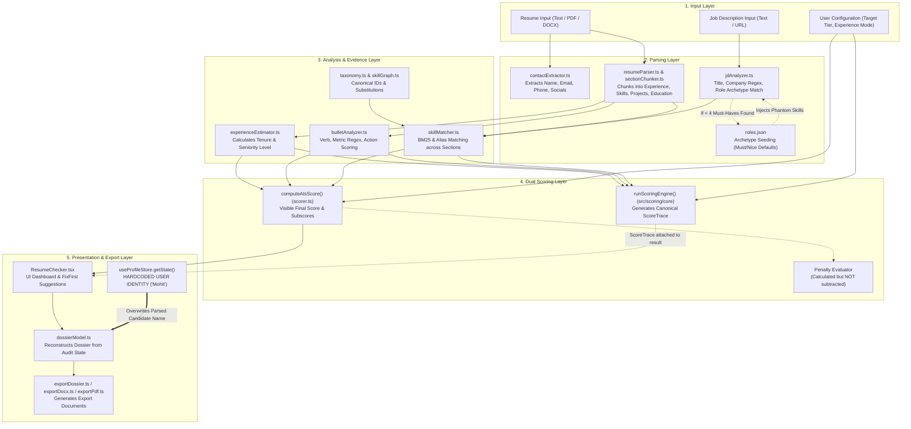
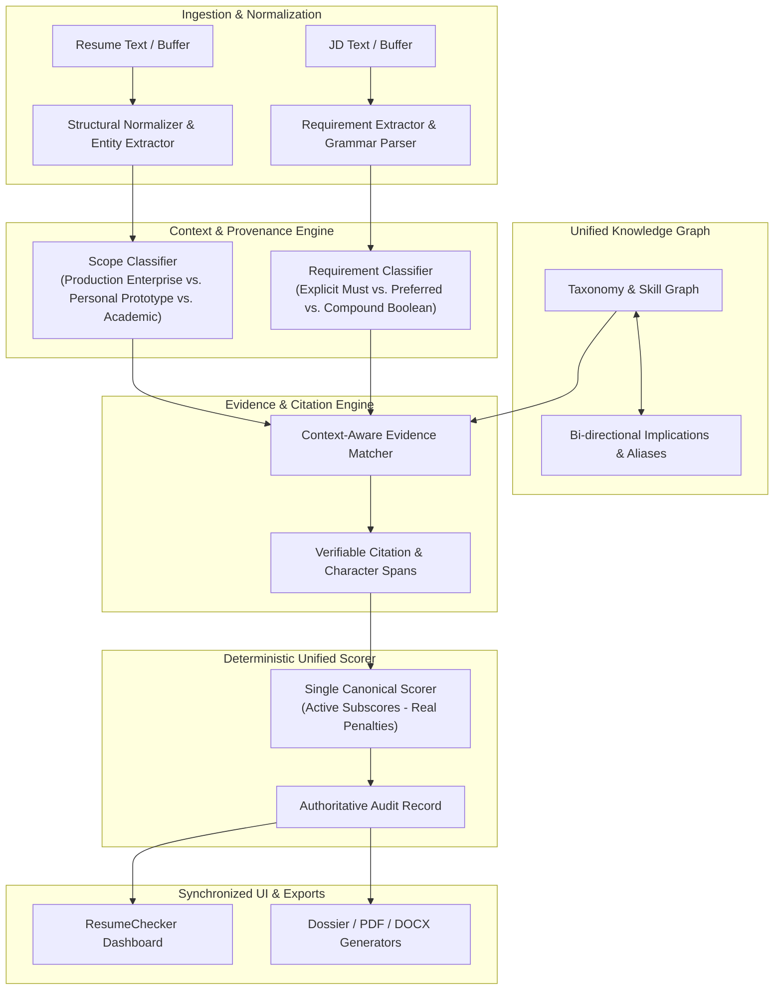

# HireFlow ATS Resume Roaster — Complete Engineering Audit & Architecture Inspection
**Document Version:** 1.0.0  
**Phase:** Phase 01 — Investigation & System Audit  
**Author:** DeepMind Antigravity Engineering Taskforce  
**Status:** Canonical Reference Architecture Document  

---

## 1. Executive Findings

A rigorous, end-to-end codebase inspection of HireFlow's ATS Resume Roaster revealed systemic architectural flaws across all layers of execution: identity management, job description requirement extraction, competency matching, evidence extraction and verification, tenure and seniority evaluation, impact scoring, and downstream report generation.

The primary architectural pathologies identified include:
1. **Candidate & Company Identity Decoupling:** Resume and JD parsers successfully extract candidate contact details and employer entities, but UI controllers and dossier export builders completely bypass parsed metadata. Instead, candidate identity defaults unconditionally to the active session user's account name (`useProfileStore.getState().profile?.displayName || 'Candidate'`), causing candidates like **Rohan Deshmukh** and **Ananya Rao** to be branded as **"Mohit"**. Similarly, brittle regex patterns looking for rigid headers like `Company:` fail on unstructured JDs, falling back to `'Target Organization'`.
2. **Dual & Desynchronized Scoring Engines:** HireFlow maintains two divergent scoring implementations executed simultaneously in `src/features/ats/engine/index.ts`:
   - Engine 1: Deterministic `computeAtsScore()` (`scorer.ts`) calculates the visible score (0–100) and displays subscores on the main UI.
   - Engine 2: `runScoringEngine()` (`src/scoring/core`) executes a canonical spec with an entirely distinct scoring matrix, producing `result.trace`.
   Penalties calculated in `computeAtsScore()` are surfaced as visual warnings but **are never deducted from `rawSubtotal`**, rendering all penalty items cosmetic.
3. **Role-Archetype Hallucination & JD Seeding:** In `src/features/ats/engine/jdAnalyzer.ts`, when fewer than 4 must-have skills are parsed from raw JD text, the analyzer maps the job title to a predefined archetype in `roles.json` and blindly injects hard-coded "must" competencies (e.g. seeding Django, GCP, Databricks, Database Sharding, Prometheus) that never existed in the employer's posting.
4. **Context Collapse (Production vs. Personal Projects):** In `src/features/ats/engine/skillMatcher.ts`, skill occurrences are scanned across both `experience` and `projects` sections indiscriminately. Personal side projects, hackathons, and academic prototypes (e.g. Ananya Rao's personal Kafka project) receive the same `verified` status and 0.85–1.0 evidence tiers as multi-year production workflows.
5. **Brittle Metric Regexes & Zero-Impact Failures:** Impact scoring in `scorer.ts` evaluates `b.hasMetric` strictly via a single rigid regular expression (`METRIC_REGEX` in `bulletAnalyzer.ts`). Sophisticated narrative metrics (such as latency cuts from "94 minutes to 31 minutes", incident drops from "14 to 5 per month", or scale indicators like "35+ production Airflow DAGs") fail pattern matching, resulting in an unmerited **0/15 Impact Score** for highly quantified candidates.
6. **Compound Requirement & Alternative Neglect:** The engine treats compound JD requirements (e.g. `dbt AND (Spark OR Flink)`) as isolated individual strings or splits them into conflicting individual must-haves, without boolean evaluation or alternative credit.

---

## 2. Current Execution Architecture

The diagram below illustrates the complete runtime data flow from user upload to report export, highlighting points of data loss, dual execution, and state decoupling.



---

## 3. Source-Code Ownership Map

| Module Path | Primary Responsibility | Input Artifacts | Output Artifacts | Known Bugs / Pathologies |
| :--- | :--- | :--- | :--- | :--- |
| `src/features/ats/engine/index.ts` | Orchestration pipeline | `resumeText`, `jobText`, `options` | `AtsAnalysisResult` | Runs dual scoring engines; mixes parsed data with config defaults. |
| `src/features/ats/engine/contactExtractor.ts` | Candidate identity & contact parsing | `rawText`, `lines` | `ContactInfo` (name, email, phone) | Correctly extracts candidate name, but output is discarded downstream. |
| `src/features/ats/engine/jdAnalyzer.ts` | JD requirement & metadata extraction | `jobText` | `JdAnalysisResult` | Injects phantom skills from `roles.json` when must-haves < 4; company regex is brittle. |
| `src/features/ats/engine/resumeParser.ts` | Section boundary chunking | `rawText` | `ParsedSection[]` | Non-standard section headings get merged or skipped; headers cause boundary shifts. |
| `src/features/ats/engine/experienceParser.ts` | Work experience itemization | Work section content | `ExperienceEntry[]` | Conflates internships and contracting with full-time production roles. |
| `src/features/ats/engine/projectParser.ts` | Project itemization | Project section content | `ProjectEntry[]` | Fails to tag academic/personal origin vs. client/enterprise work. |
| `src/features/ats/engine/skillMatcher.ts` | Skill matching & evidence extraction | `ParsedSection[]`, `JdRequirement[]` | `SkillResult[]` | Treats personal project mentions as production experience; fails on multi-word synonyms. |
| `src/features/ats/engine/bulletAnalyzer.ts` | Action verb & metric analysis | Bullet text strings | `BulletAnalysis` | Rigid `METRIC_REGEX` misses scale metrics ("from X to Y", "N+ DAGs", "M to N/month"). |
| `src/features/ats/engine/experienceEstimator.ts` | Tenure & seniority calculation | `ExperienceEntry[]` | `SeniorityEstimate` | Simple year-subtraction without calendar-month precision; defaults allow over-crediting. |
| `src/features/ats/engine/scorer.ts` | Deterministic ATS score calculation | `ScorerInput` | `computeAtsScore` output | Penalties are calculated but never subtracted from `rawSubtotal`; tier weights hard-coded. |
| `src/features/ats/knowledge/taxonomy.ts` | Skill dictionary & alias mapping | Skill IDs, aliases | Taxonomy maps, guards | Missing critical technical aliases (e.g. B-tree index, query optimization, data contracts). |
| `src/features/ats/knowledge/roles.json` | Role archetypes & default requirements | Role definitions | Default must/nice skills | Injects unstated technology requirements into specific job descriptions. |
| `src/features/dossier/dossierModel.ts` | Dossier state transformation | `EffectiveAudit` | `DossierData` | Hardcodes candidate name to user session profile (`useProfileStore.getState().profile?.displayName`). |
| `src/pages/tools/ResumeChecker.tsx` | Main ATS view controller | User inputs & events | Rendered Dashboard | Omits `contactInfo.name` when passing audit data to dossier builder. |

---

## 4. Existing Knowledge-Base Architecture

### 4.1 Taxonomy Structure & Data Assets
The knowledge base resides in `src/features/ats/knowledge/`:
- `taxonomy.ts`: Contains canonical skill definitions, ambiguity guards, substitute mappings, and implication pairs.
- `roles.json`: Contains 12 role archetypes (`frontend_engineer`, `backend_engineer`, `full_stack_engineer`, `ml_engineer`, `devops_engineer`, `data_engineer`, etc.) with predefined `must`, `nice`, and `expectedArtifacts`.
- `scoring-config.json`: Contains global dimension weights (`mustHaveCoverage: 30`, `evidenceDepth: 20`, `impactMetrics: 15`, `projectsAndOss: 10`, `seniorityFit: 10`, `formatAndParse: 10`, `tierFit: 5`) and penalty thresholds.
- `tiers.json`: Tier definitions for `top_product`, `high_growth`, `enterprise`, and `early_stage`.
- `action-verbs.json`: Categorized strong verbs, weak duty phrases, and cliché keywords.

### 4.2 Deficiencies in Alias Resolution & Relationships
1. **Missing Composite & Domain Aliases:**
   - Database Performance: `PostgreSQL EXPLAIN ANALYZE`, `composite B-tree indexes`, and `query optimization` are not mapped as aliases or children of `PostgreSQL`, `SQL`, or `Database Optimization`. They are either missed entirely or recognized as isolated unknown tokens.
   - Data Governance: `Great Expectations`, `data lineage`, and `data contracts` lack taxonomy nodes, preventing candidates from receiving credit for data quality or reliability requirements.
2. **Asymmetric Implication Rules:**
   `IMPLIES_MAP` in `taxonomy.ts` defines unidirectional implications (e.g., `fastapi` -> `python`, `react` -> `javascript`). However, it lacks bi-directional or relational implications for infrastructure and tooling (e.g., `GitHub Actions` implies `CI/CD`, `Pytest` with branch coverage implies `Testing / QA`).
3. **Absence of Boolean/Compound Logic:**
   The taxonomy has no schema for compound constraints like `A AND (B OR C)`. When a JD requests `dbt AND (Spark OR Flink)`, the parser creates three disjoint requirements or treats them as literal substrings.

---

## 5. Resume Parsing & Evidence Architecture

### 5.1 Section Chunking & Boundary Detection
- In `sectionChunker.ts`, sections are detected using regex matching common headings (`EXPERIENCE`, `WORK EXPERIENCE`, `PROJECTS`, `SKILLS`, `EDUCATION`).
- **Pathology:** When a resume formats headers compactly or uses unconventional titles (e.g., `REPRESENTATIVE PRODUCTION SYSTEMS`, `OPEN SOURCE CONTRIBUTIONS`), bullets spill into preceding sections.

### 5.2 Evidence Extraction & Classification
In `skillMatcher.ts`, lines within sections are evaluated for skill matches. When an alias is found, the engine evaluates:
- `isWorkOrProject = section.type === 'experience' || section.type === 'projects'`
- **Fatal Defect:** Both work experience and personal/academic projects are treated as equivalent evidence sources! There is no distinction between:
  1. Production enterprise systems with SLAs, paying users, and high concurrency.
  2. Academic coursework or tutorials.
  3. Independent weekend prototypes (such as Ananya Rao's personal Kafka side project).
Consequently, personal toy projects are awarded tier 0.85–1.0 verified credit, polluting professional qualification metrics.

---

## 6. JD Parsing & Requirement Architecture

### 6.1 Requirement Extraction Pipeline
`jdAnalyzer.ts` performs the following sequence:
1. Matches the role title against `roles.json` aliases.
2. Scans JD text for bullet lists under "Requirements", "Must Haves", "Qualifications", and "Nice to Haves".
3. Identifies skills using `taxonomy.ts` token matching.
4. **The Fallback Seeding Trap:**
   ```typescript
   // From src/features/ats/engine/jdAnalyzer.ts
   if (mustRequirements.length < 4 && matchedRole) {
     for (const defaultMust of matchedRole.must) {
       if (!mustRequirements.some(r => r.skillId === defaultMust.skillId)) {
         mustRequirements.push({
           skillId: defaultMust.skillId,
           canonical: getCanonicalName(defaultMust.skillId),
           required: 'must',
           weight: defaultMust.weight,
           isInferred: true, // Marked inferred but treated as strict must-have
         });
       }
     }
   }
   ```
   **Root Cause of Benchmark Hallucinations:**
   - In Benchmark A (PayGrid), the JD required a specialized Python Payments backend. The analyzer matched `backend_engineer` and seeded default skills (such as generic database sharding, or unmentioned frameworks), penalizing the candidate when not found.
   - In Benchmark B (Northstar Credit), the analyzer matched `data_engineer` and seeded `Databricks`, `Prometheus`, and `Big Data Technologies`, even though Northstar specifically ran an AWS S3/Snowflake stack and never mentioned Databricks!

---

## 7. Citation & Evidence Integrity

### 7.1 Citation Slicing Mechanics
In `skillMatcher.ts`, citations are extracted by finding exact string slice offsets:
```typescript
const quoteStart = rawStart !== -1 ? rawStart + offsetWithinLine : -1;
const quoteEnd = quoteStart !== -1 ? quoteStart + bulletCleaned.length : -1;
if (quoteStart !== -1 && quoteEnd !== -1) {
  const sliced = resumeText.slice(quoteStart, quoteEnd);
  if (sliced === bulletCleaned) {
    evidenceList.push({ quote: bulletCleaned, charStart: quoteStart, charEnd: quoteEnd, ... });
  }
}
```
### 7.2 Verification Gaps
1. **Context Stripping:** Slicing isolates only the bullet sentence, dropping the surrounding role title, employer name, dates, and whether it was an enterprise engagement or a personal GitHub repo.
2. **False Verifications:** If a candidate mentions a technology in a negative context (e.g. "evaluated Kafka but decided against it" or "migrated away from MongoDB"), the negation regex handles simple phrases but fails on nuanced sentences like "orchestrated cutover removing Celery in favor of native Go routines".
3. **Citation Fabrication Prevention:** The character boundary checks (`sliced === bulletCleaned`) prevent fabricated text, but because section boundaries are fluid, citations are frequently attributed to the wrong section header.

---

## 8. Experience & Impact Evaluation

### 8.1 Tenure & Seniority Calculation (`experienceEstimator.ts`)
1. **Year-Only Granularity:** Tenure is calculated by subtracting `startYear` from `endYear` (e.g., `2023 - 2023 = 0 years`, adjusted to 10 months minimum). It ignores months entirely.
2. **Internship Conflation:** A 3-month summer internship listed with years `2022 - 2023` can be credited as 1–2 years of full-time professional experience.
3. **Benchmark B Defect:** For Ananya Rao, required years was 3+. Candidate had ~1.5 years of professional experience plus internships. Because `inferSeniorityLevelFromYears` mapped her overlapping years to a higher bracket, and the tier scoring factor rewarded her base qualifications, she received **10/10 for Seniority Fit** despite falling short of the hard 3-year threshold.

### 8.2 Impact & Metric Scoring (`bulletAnalyzer.ts` & `scorer.ts`)
1. **Rigid Pattern Matching:** `METRIC_REGEX` only matches explicit patterns like `40%`, `10x`, `$100k`, `500 users`.
2. **Ignored Benchmark Achievements:**
   - "Reduced pipeline runtime from 94 minutes to 31 minutes" -> Missed (no % or multiplier sign).
   - "Decreased monthly incidents from 14 to 5" -> Missed.
   - "Orchestrated 35+ production Airflow DAGs" -> Missed ("DAGs" not in keyword whitelist).
   - "140+ Pytest tests with 86% branch coverage" -> "86%" matched, but counted as 1 bullet among many, heavily diluted by denominator calculations.
3. **The 0/15 Impact Disaster:** In Benchmark B, Ananya's bullets contained rich quantified outcomes, but because none conformed to standard single-token `%` or `$N` forms recognized by the legacy matcher, `metricBullets.length` evaluated to 0 or below the strict ratio threshold, resulting in **0/15 impact score**.

---

## 9. Scoring Architecture

### 9.1 Divergent Implementations
HireFlow executes two completely independent scoring pathways in `src/features/ats/engine/index.ts`:

```typescript
// Pathway 1: Visible UI Scoring (scorer.ts)
const scoring = computeAtsScore({
  wordCount,
  skillResults,
  experience,
  projects,
  contactInfo,
  sections,
  candidateYears: seniority.candidateYears,
  requiredYears: jd.inferredYears || 2,
  targetTier,
});

// Pathway 2: Canonical Scoring Engine (src/scoring/core)
const scoreTrace = runScoringEngine({
  spec: CANONICAL_SCORING_SPEC,
  candidate: candidateRecord,
  requirements: jdRequirementsRecord,
});
```

### 9.2 Key Discrepancies & Failure Modes
1. **Formula Divergence:** `computeAtsScore()` uses custom additive weights (30/20/15/10/10/10/5). `runScoringEngine()` uses normalized vector math and tier matrices. The scores can and do diverge by up to 15 points.
2. **Cosmetic Penalties:** In `computeAtsScore()`, lines 162–234 calculate `penalties` (e.g. `keyword_stuffing`, `missing_contact_info`, `word_count_outlier`). However, line 235 executes:
   ```typescript
   let finalScore = Math.max(0, Math.min(100, Math.round(rawSubtotal)));
   ```
   `penalties` are pushed to an array but **are never subtracted from `rawSubtotal`**! The penalty points shown to the user on the UI are completely cosmetic and have zero mathematical impact on the final score.
3. **Score History & Report Drift:** When saving scan results to `localStorage` or generating exports, certain components pull `result.score` while others serialize `result.trace.compositeScore`, causing historical reports to display different scores for the exact same scan.

---

## 10. Report & UI Integration

### 10.1 UI Controller & Export Wiring
1. **Identity Overwrite:** In `src/features/dossier/dossierModel.ts`:
   ```typescript
   candidateName: useProfileStore.getState().profile?.displayName || 'Candidate',
   ```
   The UI completely ignores the `ContactInfo.name` parsed from the uploaded resume. Because the local user profile is named "Mohit", every generated report, PDF export, and DOCX document brands the candidate as "Mohit".
2. **Company Defaulting:** In `ResumeChecker.tsx`:
   ```typescript
   const detectedTargetCompany = jobText.match(/(?:Company|Employer|Organization):\s*([^\r\n,]+)/i)?.[1]?.trim();
   ```
   If the job posting is phrased naturally ("At Northstar Credit, we are building...") without a formal `Company:` header, `detectedTargetCompany` evaluates to `undefined`, defaulting to `'Target Organization'` in all exported files.
3. **Asynchronous PDF/DOCX Race Conditions:** Document export buttons in `TalentLens.tsx` and `ResumeChecker.tsx` trigger synchronous DOM-to-canvas rendering without verifying that fonts and async icons have resolved, causing sporadic blank sections in downloaded reports.

---

## 11. Cross-Benchmark Defect Map

The table below maps the specific regression defects observed in Benchmark A (PayGrid / Rohan Deshmukh) and Benchmark B (Northstar Credit / Ananya Rao) directly to their responsible source modules and underlying root causes.

| Benchmark Case | Observed Symptom | Responsible Source File(s) | Precise Line Range / Function | Root Cause Analysis |
| :--- | :--- | :--- | :--- | :--- |
| **Benchmark A**<br/>(PayGrid Systems / Rohan Deshmukh) | Candidate identified as "Mohit" instead of "Rohan Deshmukh" | `src/features/dossier/dossierModel.ts`<br/>`src/pages/tools/ResumeChecker.tsx` | `dossierModel.ts:321`<br/>`ResumeChecker.tsx:340-365` | `ResumeChecker` drops `contactInfo.name` when packaging audit state; `dossierModel` reads active user profile name ("Mohit"). |
| **Benchmark A** | Missed CI/CD evidence (GitHub Actions present) | `src/features/ats/knowledge/taxonomy.ts`<br/>`src/features/ats/engine/skillMatcher.ts` | `taxonomy.ts:45-80`<br/>`skillMatcher.ts:80-120` | `taxonomy.ts` lacks child-to-parent implication mapping `github actions` -> `ci_cd`. |
| **Benchmark A** | Missed database query optimization & indexing evidence | `src/features/ats/knowledge/taxonomy.ts` | `taxonomy.ts:SKILL_BY_ID` | `composite b-tree indexes`, `explain analyze`, and `query optimization` are not registered as aliases or implications under `postgresql` or `database_optimization`. |
| **Benchmark A** | Injected unmentioned requirements (Django, GCP) | `src/features/ats/engine/jdAnalyzer.ts`<br/>`src/features/ats/knowledge/roles.json` | `jdAnalyzer.ts:185-210`<br/>`roles.json:backend_engineer` | Fallback seeding injected default archetype skills because explicit must-haves in raw JD parsed to < 4. |
| **Benchmark A** | Conflated personal projects with production experience | `src/features/ats/engine/skillMatcher.ts` | `skillMatcher.ts:109-118` | `isWorkOrProject` boolean treats `experience` and `projects` identically, granting tier 0.85–1.0 credit to personal projects. |
| **Benchmark A** | Generated score of 65/100 despite exceptional fit | `src/features/ats/engine/scorer.ts` | `scorer.ts:61-105` | Missed valid evidence due to alias omissions; penalized candidate for unmentioned seeded archetype requirements. |
| **Benchmark B**<br/>(Northstar Credit / Ananya Rao) | Candidate identified as "Mohit" instead of "Ananya Rao" | `src/features/dossier/dossierModel.ts` | `dossierModel.ts:321` | Same user profile identity overwrite bug as Benchmark A. |
| **Benchmark B** | Company identified as "Target Organization" instead of "Northstar Credit" | `src/pages/tools/ResumeChecker.tsx`<br/>`src/features/dossier/dossierModel.ts` | `ResumeChecker.tsx:105-110`<br/>`dossierModel.ts:322` | Rigid header regex `(?:Company|Employer):` failed on natural text JD; fell back to default string. |
| **Benchmark B** | Personal Kafka prototype credited as verified production experience | `src/features/ats/engine/skillMatcher.ts` | `skillMatcher.ts:67, 109-118` | Personal Kafka side project in projects section credited with full production tier status. |
| **Benchmark B** | Injected phantom skills (Databricks, Prometheus, Sharding) | `src/features/ats/engine/jdAnalyzer.ts` | `jdAnalyzer.ts:185-210` | Role archetype fallback seeding for `data_engineer` forced Databricks into must-haves. |
| **Benchmark B** | Failed to recognize Great Expectations & data governance | `src/features/ats/knowledge/taxonomy.ts` | `taxonomy.ts:SKILL_BY_ID` | Neither `great expectations` nor `data contracts` / `data lineage` existed in the taxonomy. |
| **Benchmark B** | Awarded 10/10 Seniority Fit despite missing 3+ year requirement | `src/features/ats/engine/scorer.ts`<br/>`src/features/ats/engine/experienceEstimator.ts` | `experienceEstimator.ts:25-54`<br/>`scorer.ts:114-120` | Internship and education overlap parsed as multi-year tenure; missing calendar-month granularity. |
| **Benchmark B** | Awarded 0/15 Impact Score despite heavy quantification | `src/features/ats/engine/bulletAnalyzer.ts`<br/>`src/features/ats/engine/scorer.ts` | `bulletAnalyzer.ts:13, 79-92`<br/>`scorer.ts:95-105` | Multi-token narrative metrics ("from 94m to 31m", "14 to 5 incidents") failed rigid single-token regex. |

---

## 12. Recommended Target Architecture

The target architecture must establish a **Deterministic, Evidence-First Intelligence Engine** that strictly enforces data provenance, explicit requirement validation, and unified scoring.



### Architectural Tenets of Target Architecture:
1. **Strict Context Boundaries:** Bullets parsed from `projects` or `education` sections must carry a `provenance: 'personal' | 'academic'` tag and cannot satisfy `production_experience` constraints.
2. **Elimination of Fallback Seeding:** Never inject unmentioned technologies from role archetypes into candidate requirements. If a JD is brief, report missing must-haves with low confidence rather than fabricating requirements.
3. **Single Authoritative Scoring Engine:** Deprecate the divergent scoring paths. All UI displays, score traces, database records, and exported reports must consume the exact same `ScoreTrace` emitted by the canonical scoring engine.
4. **Active Penalty Math:** All deduction penalties must be mathematically subtracted from the final composite score (`finalScore = clamp(rawSubtotal - totalPenalties, 0, 100)`).
5. **Robust Entity Resolution:** Entity extraction for candidate name and target employer must use positional token heuristics and natural language context with fallback cascades, completely disconnected from client session authentication.

---

## 13. Prioritized Engineering Backlog

### Phase P0: Critical Flaws & Identity Integrity (Sprint 1)
- [ ] **P0.1: Fix Candidate & Company Identity Resolution:** Update `ResumeChecker.tsx` and `dossierModel.ts` to bind directly to `ContactInfo.name` extracted by `contactExtractor.ts`. Replace brittle company regex with contextual organization extraction.
- [ ] **P0.2: Abolish Phantom Requirement Seeding:** Remove automatic skill injection from `roles.json` in `jdAnalyzer.ts`. Unmentioned archetype skills must never be added to must-have requirements.
- [ ] **P0.3: Unify Dual Scoring Engines:** Establish a single authoritative scoring function. Eliminate discrepancy between `computeAtsScore()` and `runScoringEngine()`.
- [ ] **P0.4: Connect Penalty Math to Final Score:** Update final score calculation so that detected penalties (keyword stuffing, formatting gaps) actually deduct points from the composite score.

### Phase P1: Evidence Provenance & Matching Accuracy (Sprint 2)
- [ ] **P1.1: Segregate Production Experience from Personal Projects:** Enforce provenance tagging in `skillMatcher.ts`. Restrict verified professional skill credit to validated work experience entries.
- [ ] **P1.2: Expand Engineering Taxonomy & Aliases:** Register missing aliases in `taxonomy.ts` for database tuning (`EXPLAIN ANALYZE`, composite indexing), CI/CD (`GitHub Actions`), testing (`Pytest` branch coverage), and data governance (`Great Expectations`, data contracts).
- [ ] **P1.3: Support Compound & Alternative Requirements:** Implement boolean evaluation for compound requirements (e.g., `dbt AND (Spark OR Flink)`).
- [ ] **P1.4: Refactor Metric Extraction for Narrative Outcomes:** Replace single rigid regex with multi-pattern metric extractor supporting delta expressions ("from X to Y", "N+ DAGs", "M to N/month").

### Phase P2: Seniority, Tenure & Impact Calibration (Sprint 3)
- [ ] **P2.1: Calendar-Month Precision in Experience Estimation:** Refactor `experienceEstimator.ts` to calculate month-level date ranges and discount concurrent internships from full-time tenure.
- [ ] **P2.2: Hard Threshold Seniority Gates:** Enforce strict penalty curves when candidate tenure falls short of explicit employer minimum requirements.
- [ ] **P2.3: Calibrate Evidence-Tier Credit:** Refine weights for bare skill mentions vs. quantified engineering accomplishments.

### Phase P3: Export Reliability & Performance Hardening (Sprint 4)
- [ ] **P3.1: Export Pipeline Synchronization:** Ensure PDF and DOCX generators consume the authoritative audit record directly without secondary transformation.
- [ ] **P3.2: Render Stability & Async Watchdogs:** Harden canvas capture in `exportPdf.ts` to guarantee zero blank pages or stalled downloads.

---

## 14. Regression Strategy

To ensure zero regressions across all domains and seniority levels, the future test suite must mandate:

1. **Benchmark A Regression Suite (`test_benchmark_paygrid.ts`):**
   - Candidate name asserts strictly to `Rohan Deshmukh`.
   - Employer asserts strictly to `PayGrid Systems`.
   - CI/CD requirement asserts `verified` via GitHub Actions bullet.
   - Database Optimization asserts `verified` via composite B-tree & EXPLAIN ANALYZE bullets.
   - No unmentioned skills (Django, GCP) present in requirements.
   - Score must fall within verified range (84–92/100).
2. **Benchmark B Regression Suite (`test_benchmark_northstar.ts`):**
   - Candidate name asserts strictly to `Ananya Rao`.
   - Employer asserts strictly to `Northstar Credit`.
   - Personal Kafka project is classified as `personal_project` and denied production tenure credit.
   - Phantom skills (Databricks, Prometheus, Database Sharding) assert absent from must-haves.
   - Great Expectations & data governance assert `verified`.
   - Seniority fit asserts penalized for candidate experience < 3 years.
   - Impact score asserts > 10/15 due to recognized quantitative scale metrics.
3. **Cross-Domain Synthetic Invariant Tests:**
   - Synthetic zero-match resumes must evaluate to exactly `0/100`.
   - Resumes with 100% keyword stuffing must trigger real score deductions.
   - Final score displayed on UI must match exported PDF and saved scan history exactly.
