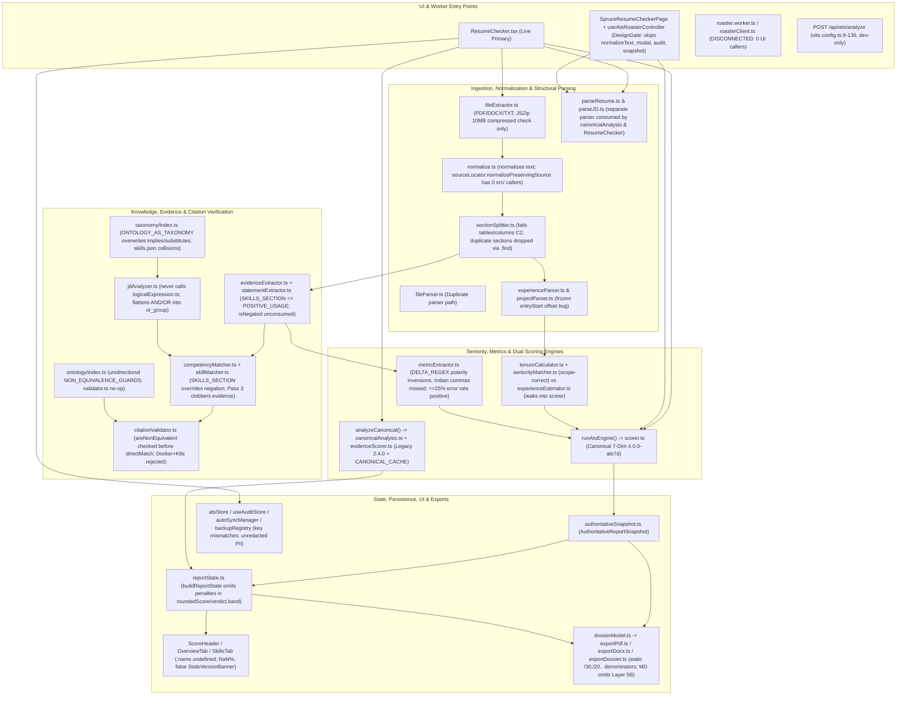

# HIREFLOW ATS — PHASE 10.1 COMPLETE ENGINE ARCHITECTURE DISCOVERY, PARALLEL AUDIT & REQUIREMENTS TRACEABILITY

**Audit Date:** 2026-11-25  
**Repository:** `hireflow` (`HEAD`: `5412214ee8fc0f7580fd5830776dba40fddc39ef`, Branch: `main`)  
**Scope:** Strictly read-only source-code-grounded architecture discovery and verification across Phases 01–09 (zero source/test/fixture edits; this document is the sole Phase 10.1 artifact).  
**Audit Topology:** 5 parallel read-only investigation workers (`runtime-arch`, `resume-jd-intel`, `knowledge-ev`, `metrics-scoring`, `export-persist`) + 1 independent adversarial verifier (`verifier`).

---

## Executive Verdict

**Engine Readiness:** **NOT READY FOR PRODUCTION CERTIFICATION — CONDITIONAL / SPLIT-BRAIN ARCHITECTURE**  
**Verifier Sign-Off:** `READY FOR PHASE 10.1 SYNTHESIS WITH REQUIRED ACTION ITEMS`

The Phase 02–09 series built strong deterministic subsystems (`authoritativeSnapshot.ts`, `seniorityMatcher.ts`, `tenureCalculator.ts`, `metricExtractor.ts`, `citationValidator.ts`, `competencyMatcher.ts`, `exportPdf.ts`, `exportDocx.ts`) and all 12 Phase 02–09 regression suites under `tests/ats/` pass (`12/12` files, `191/191` tests). However, **the complete end-to-end architecture still exhibits critical split-brain paths, contract drift, silent data overrides, and unretired legacy code**:

1. **Dual Scoring Engines Remain Live:** `runAtsEngine()` (`src/features/ats/engine/scorer.ts`) powers the 7-dimension authoritative assessment, while `analyzeCanonical()` (`src/features/ats/engine/index.ts:344`) still runs `canonicalSpec.ts` (`'2.4.0'`) + `evidenceScorer.ts` + `Date.now()` / `CANONICAL_CACHE` and feeds Quick Roast and top-bar guidance in `ResumeChecker.tsx:793-807, 889-912`.
2. **Ontology Federation Silently Wipes Graph Metadata:** `ONTOLOGY_AS_TAXONOMY` omits `implies` and `substitutes` and sits last in `TAXONOMY_REGISTRY` (`src/features/ats/knowledge/taxonomy/index.ts:23-50`), overwriting shared core IDs (e.g., `python`, `fastapi`, `rest_apis`) in `SKILL_BY_ID`.
3. **Matching & Citation Self-Sabotage:** `competencyMatcher.ts:73-79` allows `SKILLS_SECTION` (`POSITIVE_USAGE`) to override `EXPERIENCE` negation (`CONTRADICTED` -> `PARTIALLY_SATISFIED`); `skillMatcher.ts:356-406` Pass 3 mutates `found`/`status`/`proficiency` without reconciling `evidence` and downgrades `IMPLIES_MAP` matches; `citationValidator.ts:210-242` checks `areNonEquivalent` across co-occurring skills *before* `directMatch`, rejecting valid `Docker` + `Kubernetes` bullets as `UNSUPPORTED_CLAIM`.
4. **Compound JD & Section-Splitting Regressions (Confirmed Live Test Failures):** `jdAnalyzer.ts:128-145` never calls `logicalExpression.ts` and collapses compound lines (`"dbt AND (Spark OR Flink)"`) into a single `or_group` (`property_invariants.test.ts` `C1` fails); `sectionSplitter.ts` fails multi-column/table layout (`C2` fails), splits on `"Technologies"` / uppercase employers, and drops duplicate sections via `.find()`.
5. **Seniority Split-Brain & Metric Runtime Gaps:** `scorer.ts:75,82,239,462,530,592` and `index.ts:317` leak `experienceEstimator.candidateYears` (`PROFESSIONAL`-only) instead of `seniorityMatchResult.demonstratedYears`, award 10 free `seniorityFit` points on `0 YOE` JDs when `candidateYears > 1`, and never wire `isNegated` from `statementExtractor.ts` into `bulletAnalyzer.ts:77` / `scorer.ts:128-154`.
6. **UI, Export & Security Blind Spots:** `ScoreHeader.tsx:68-71` permanently triggers `"Scoring Spec Updated"` (`'4.0.0-ats7d'` vs `'2.4.0'`); `OverviewTab.tsx:120-122` computes `0 / 0 = NaN%` on fresher weight redistribution; `ResumeChecker.tsx` leaks stale `latestAuditEntry` across re-scans; `exportPdf.ts`, `exportDocx.ts`, and `exportDossier.ts` hardcode static Layer 1 denominators (`/30, /20, /15, ...`); and `vite.config.ts:179` injects a conflicting `<meta>` CSP that blocks the inline theme script and Supabase `connect-src` in `dist/`.

---

## A. Complete System Architecture

### A.1 End-to-End Pipeline & Divergent Execution Paths

### A.2 Key Runtime Entry Points Observed
- **Primary Live Flow (`ResumeChecker.tsx`):** Reads files via `fileExtractor.ts`, normalizes via `normalize.ts`, parses JD preview via `parseJD.ts`, executes `runAtsEngine()` (`src/features/ats/engine/index.ts`) **and** `analyzeCanonical()` (`src/features/ats/engine/index.ts:344`), builds `AuthoritativeReportSnapshot` (`authoritativeSnapshot.ts`) and `ReportState` (`reportState.ts`), and persists to `useAuditStore` / `atsStore` / `autoSyncManager`.
- **Alternate Design-Gated Flow (`SpruceResumeCheckerPage` + `useAtsRoasterController.ts`):** Skips `normalizeText()`, `ConfirmRequirementsModal`, `useAuditStore`, `authoritativeSnapshot`, and `tierFit`/fresher weight redistribution.
- **Dev-Only AI Endpoint (`vite.config.ts:9-139`):** `atsApiPlugin()` implements `POST /api/ats/analyze` in Vite dev server; absent in `vite preview` and static `dist/` production builds.
- **Disconnected Worker:** `src/workers/roaster.worker.ts` and `roasterClient.ts` have **0 UI callers**.

---

## B. Component Ownership & File Inventory

| Layer | Authoritative / Intended Owner | Duplicate, Legacy, or Disconnected Paths | Observed Defects / Status |
|---|---|---|---|
| **Entry / Orchestration** | `src/features/ats/engine/index.ts` (`runAtsEngine`) | `analyzeCanonical()` (`index.ts:344`), `roaster.worker.ts` (0 UI callers), `vite.config.ts:9-139` (`/api/ats/analyze`, dev-only) | Dual engine active in `ResumeChecker.tsx`; `roaster.worker.ts` dead |
| **File & Text Ingestion** | `fileExtractor.ts`, `normalize.ts` | `fileParser.ts` (duplicate), `sourceLocator.ts:normalizePreservingSource` (0 `src/` callers) | `fileExtractor.ts:576` checks compressed ZIP size only; `normalizePreservingSource` unused |
| **Structural Parsing** | `sectionSplitter.ts`, `experienceParser.ts`, `projectParser.ts`, `contactExtractor.ts`, `companyExtractor.ts`, `jdAnalyzer.ts` | `parseResume.ts`, `parseJD.ts`, `logicalExpression.ts` (0 runtime callers in `jdAnalyzer.ts`) | `entryStart` frozen; duplicate sections dropped via `.find()`; `C1` & `C2` fail; no structured education parser |
| **Knowledge & Ontology** | `taxonomy/index.ts`, `ontology/index.ts`, `skills.json` | `ontology/validator.ts` (0 `src/` callers; `:61-63` empty no-op) | `ONTOLOGY_AS_TAXONOMY` overwrites `implies`/`substitutes`; `NON_EQUIVALENCE_GUARDS` unidirectional |
| **Evidence & Citations** | `evidenceExtractor.ts`, `statementExtractor.ts`, `citationValidator.ts`, `competencyMatcher.ts` | `skillMatcher.ts` (legacy Pass 1/2 + Pass 3), `annotateResume.ts` / `AnnotatedResumeView.tsx` (0 `src/` callers) | `SKILLS_SECTION` overrides negation; Pass 3 clobbers evidence; `areNonEquivalent` runs before `directMatch` |
| **Seniority & Metrics** | `tenureCalculator.ts`, `seniorityMatcher.ts`, `metricExtractor.ts`, `bulletAnalyzer.ts` | `experienceEstimator.ts` (leaks into `scorer.ts`), `evidenceScorer.ts` (live in `analyzeCanonical`), `annotateResume.ts:47,147` | `scorer.ts` mixes `experienceEstimator.candidateYears`; `DELTA_REGEX` polarity inversions; `isNegated` disconnected |
| **Scoring & Snapshot** | `scorer.ts` (`4.0.0-ats7d`), `authoritativeSnapshot.ts` | `canonicalSpec.ts` (`'2.4.0'`), `canonicalAnalysis.ts`, `reportState.ts` | `reportState` omits penalties; `canonicalAnalysis` still drives Quick Roast / guidance |
| **UI & Persistence** | `ResumeChecker.tsx`, `ScoreHeader.tsx`, `OverviewTab.tsx`, `SkillsTab.tsx`, `atsStore`, `useAuditStore` | `SpruceResumeCheckerPage`, `useAtsRoasterController.ts`, `autoSyncManager.ts`, `backup/index.ts`, `useStore.ts` | `.name` undefined; `NaN%`; false `StaleVersionBanner`; stale `latestAuditEntry` race; sync/backup gaps; PII in `localStorage` |
| **Exports** | `dossierModel.ts`, `exportPdf.ts`, `exportDocx.ts`, `exportDossier.ts` | `dossierModel.ts` synthetic fallbacks | Hardcoded `/30, /20, /15, ...` Layer 1 denominators; Markdown omits `Layer 5B`, integer seniority, `ScoreTrace` |

---

## C. Requirements Traceability Matrix (Phase 01 & Phases 02–09)

| Req ID | Requirement / Phase Objective | Status | Observed Evidence & Gaps |
|---|---|---|---|
| **P0.1** | Candidate/employer identity isolation & clean unknown fallback | **PARTIALLY VERIFIED** | `p0Integrity.test.ts` passes (13/13), but `contactExtractor.ts:59` returns `null` and `dossierModel.ts` / `exportDossier.ts` fabricate `'Candidate'` / synthetic fallbacks; `latestAuditEntry` leaks across re-scans in `ResumeChecker.tsx:702`. |
| **P0.2** | Eliminate `0` / empty-citation mismatches & unify evidence | **OPEN** | Pass 3 (`skillMatcher.ts:356-406`) still leaves `evidence: []` on `go`/`rust` FPs; `citationValidator.ts:210-242` rejects valid `Docker`+`Kubernetes` bullets; `SkillsTab.tsx` reads `validatedCitations[0]` unpaired. |
| **P0.3** | Single authoritative scoring engine (`4.0.0-ats7d`) | **REGRESSED / PARTIAL** | `analyzeCanonical()` (`index.ts:344`, `canonicalSpec.ts` `'2.4.0'`) remains live in `ResumeChecker.tsx:793-807,889-912`; `reportState.ts:713-715` omits penalties; `ScoreHeader.tsx` compares `'4.0.0-ats7d'` to `'2.4.0'`. |
| **P0.4** | Deterministic scoring (no `Date.now()` / cache drift) | **OPEN** | `tests/determinism.test.ts` fails (`1.5` vs `1`); `analyzeCanonical()` still uses `CANONICAL_CACHE` + `Date.now()`. |
| **P1.1** | Ontology & taxonomy federation without silent data loss | **OPEN** | `ONTOLOGY_AS_TAXONOMY` in `taxonomy/index.ts:23-50` wipes `implies`/`substitutes` on shared IDs; `validator.ts:61-63` is an empty no-op with 0 `src/` callers; `NON_EQUIVALENCE_GUARDS` is unidirectional. |
| **P1.2** | Compound JD logic (`AND` / `OR` / nested) & scope-correct parsing | **REGRESSED / OPEN** | `jdAnalyzer.ts` never calls `logicalExpression.ts`, flattening `"dbt AND (Spark OR Flink)"` (`C1` fails in `property_invariants.test.ts`); `sectionSplitter.ts` fails `C2` tables/columns; `entryStart` frozen in `experienceParser`/`projectParser`. |
| **P1.3** | Scope-correct seniority & tenure (`Phase 07–07.3`, `08.4`) | **PARTIALLY VERIFIED** | `phase07Seniority.test.ts` (39/39) & `phase08_4IntegritySuite.test.ts` (15/15) pass, **but** `scorer.ts:75,82,239,462,530,592` & `index.ts:317` still leak `experienceEstimator.candidateYears` and award 10 free pts on `0 YOE` JDs. |
| **P1.4** | Impact metrics intelligence & negation handling (`Phase 09`) | **PARTIALLY VERIFIED** | `phase09MetricIntelligence.test.ts` passes (17/17, N=30 benchmark F1=1.0000), **but** `DELTA_REGEX` marks `"reduced throughput"`/`"boosted error rate"` `POSITIVE`, `<= 25%` error rates `POSITIVE`, Indian commas fail, and `isNegated` is disconnected at runtime. |
| **P2.1–P2.3** | UI parity, `SkillResult` contract, fresher weights, persistence | **OPEN** | `ResumeChecker.tsx:454` & `ScoreHeader.tsx:47-57` read `SkillResult.name` (`undefined`); `OverviewTab.tsx:120-122` hits `0/0 = NaN%`; `autoSyncManager.ts` key mismatches; `backup/index.ts` omits `useAtsToolStore`/`useAuditStore`. |
| **P3.1–P3.2** | Export sync (`PDF`/`DOCX`/`MD`), render stability & E2E verification | **PARTIALLY VERIFIED** | `phase08*` Vitest suites pass, **but** `exportPdf.ts`, `exportDocx.ts`, and `exportDossier.ts` hardcode static Layer 1 denominators; `exportDossier.ts` omits `Layer 5B` / integer seniority / `ScoreTrace`; `e12-export-readiness.spec.ts` mocks local JS variables instead of real scans. |

---

## D. Cross-Layer Data Integrity & Contract Drift Matrix

| Boundary | Producer Contract | Consumer Expectation / Defect | Impact |
|---|---|---|---|
| **Ontology -> Taxonomy** | `competencies.ts` (`implies`, `substitutes`) | `taxonomy/index.ts:23-50` (`ONTOLOGY_AS_TAXONOMY` omits `implies`/`substitutes` & overwrites `SKILL_BY_ID`) | Drops implication/substitution edges on shared core skills (`python`, `fastapi`, `rest_apis`). |
| **Evidence -> Matcher** | `evidenceExtractor.ts:349` (`SKILLS_SECTION` -> `POSITIVE_USAGE`) + `statementExtractor.ts:248-257` (`isNegated`) | `competencyMatcher.ts:73-79` (`hasAnyPositive` overrides `EXPERIENCE` negation); `bulletAnalyzer.ts:77` & `scorer.ts:128-154` never read `isNegated` | Negated experience claims (`CONTRADICTED`) flip to `PARTIALLY_SATISFIED`; `NEGATED` claimSupport is unreachable at runtime. |
| **Matcher -> Scorer** | `skillMatcher.ts:356-406` (Pass 3 mutates `found`/`status`/`proficiency`) | `scorer.ts:99-108` awards `0.5` credit & counts `'weak'` (`PARTIALLY_SATISFIED`) in `mustHavesMet` | Uncited / weak matches inflate `mustHavesMet` and leave `evidence: []` on `go`/`rust` FPs. |
| **JD Analyzer -> Matcher** | `jdAnalyzer.ts:128-145` (flattens `or`/`/` lines to `or_group`, `sIdx > 0` -> `'nice'`) | `logicalExpression.ts` unused; `skillMatcher.ts:251-263` leaks sibling `orAlternatives` citations | Breaks compound `AND (OR)` requirements (`C1` failure). |
| **Seniority -> Scorer** | `seniorityMatcher.ts` (`demonstratedYears`, scope-filtered) | `scorer.ts:75,82,239,462,530,592` reads `experienceEstimator.candidateYears` | Split-brain years in `isFresher`, `eligibility`, `titleAlignment`, and `0 YOE` JD bonus. |
| **Scorer -> UI (`ScoreHeader`, `OverviewTab`, `SkillsTab`)** | `SkillResult` (`canonical`/`skillId`, `claimSupport`), `4.0.0-ats7d`, `seniorityFit.max = 0` (fresher) | `ScoreHeader`/`ResumeChecker` read `.name` (`undefined`), compare to `'2.4.0'`, fabricate `±5/6` impacts; `OverviewTab` divides `0/0`; `SkillsTab` reads `validatedCitations[0]` | `undefined` skill labels, permanent false `"Scoring Spec Updated"` banner, `NaN%` on fresher scans, unpaired citations. |
| **Snapshot -> Exports** | `AuthoritativeReportSnapshot` (`dimensions[].effectiveWeight`, `Layer 5B`, `ScoreTrace`) | `exportPdf.ts:1291-1299`, `exportDocx.ts:291-297`, `exportDossier.ts:228-235` hardcode `/30, /20, /15, /10, /10, /10, /5` | Exported Layer 1 denominators misreport redistributed fresher weights; Markdown omits `Layer 5B` and `ScoreTrace`. |

---

## E. Phase 02–09 Verification & Report-vs-Code Discrepancies

Independent inspection by `@verifier` established the following discrepancies between prior phase reports and the actual repository:

- **`PHASE_02` (`P0.3`, `P0.1`):** Reported single scoring authority and `"Candidate name not detected"` fallback. **Actual:** `analyzeCanonical()` (`index.ts:344`) still runs in `ResumeChecker.tsx:793-807,889-912`; `reportState.ts` omits penalties; `contactExtractor.ts:59` returns `null` (exports fall back to `'Candidate'`).
- **`PHASE_03`:** Reported symmetric non-equivalence (`L135-144`), runtime/CI target validator (`L177-186`), and clean federation (`L165`). **Actual:** `NON_EQUIVALENCE_GUARDS` (`ontology/index.ts:50-54`) is unidirectional; `validator.ts:61-63` is an empty `if` no-op with 0 `src/` callers; `ONTOLOGY_AS_TAXONOMY` overwrites taxonomy `implies`/`substitutes`.
- **`PHASE_04`:** Reported `normalizePreservingSource()` prevents offset drift (`L40-43,88-108`) and duplicate sections are preserved (`L125`). **Actual:** `normalizePreservingSource` has 0 `src/` callers; `entryStart` is frozen in `experienceParser.ts` / `projectParser.ts`; `index.ts:125-126` & `evidenceExtractor.ts:315,361,405` call `.find()`, dropping duplicate sections.
- **`PHASE_05`:** Reported multi-competency bullets verify cleanly (`L19,114-128`), `WRONG_SOURCE`/`WRONG_SECTION`/`WRONG_ENTRY` work (`L40-46`), and `SkillsTab` displays `'Exact Match'`/`'Directly Supported'` (`L155-158`). **Actual:** `Docker`+`Kubernetes` fails `validateClaimSupport` (`:210-226`); `validateCitationLedger` never passes `expectedDocumentId`/`Section`/`Entry`; `measureCitationQuality` omits `CONTEXT_MISMATCH`; `SkillsTab` never renders `claimSupport` and reads `validatedCitations[0]` unpaired.
- **`PHASE_06`:** Reported `dbt AND (Spark OR Flink)` AST evaluation runs E2E (`L77-92,119`) and negation yields `CONTRADICTED` (`L133`). **Actual:** `jdAnalyzer.ts` never calls `logicalExpression.ts`; `SKILLS_SECTION` overrides `EXPERIENCE` negation.
- **`PHASE_07`–`07.3`:** Reported scope-correct tenure flows cleanly into scoring. **Actual:** `scorer.ts:75,462,530,592` & `index.ts:317` still read `experienceEstimator.candidateYears`, and `:82` grants 10 free `seniorityFit` points to experienced candidates on `0 YOE` JDs.
- **`PHASE_08`–`08.4` (`PHASE_08_2` Gate 5 OVERSTATED):** `PHASE_08_2` (`L123-141`) claimed `e12-export-readiness.spec.ts` runs real PayGrid/Northstar scans, verifies score `84`, and tests re-scan isolation. **Actual `e2e/e12-export-readiness.spec.ts:54-82`** uses `expect(isVisible || true).toBe(true)` and tests local JS variables (`let activeScanId = 'scan-1'; activeScanId = 'scan-2'`) inside `page.evaluate()`. `exportDossier.ts` also omits `Layer 5B`, integer seniority, and `ScoreTrace`, and PDF/DOCX/MD hardcode Layer 1 denominators.
- **`PHASE_09`:** Reported all separate metric regexes were removed (`L25`). **Actual:** `annotateResume.ts:47,147` and `evidenceScorer.ts:11` (live via `analyzeCanonical`) still run independent regexes, and `isNegated` is disconnected at runtime.

---

## F. Generalization Assessment (14 Target Roles, Stages & Domains)

| # | Segment / Scenario | Current Readiness | Observed Architectural Bottlenecks |
|---|---|---|---|
| **1** | **Software Engineering** (Backend, Frontend, Full-Stack, Mobile, DevOps, SRE) | **Moderate (Fragile)** | `ONTOLOGY_AS_TAXONOMY` drops `implies`/`substitutes` on `python`, `fastapi`, `rest_apis`; `Docker`+`Kubernetes` bullets rejected by `citationValidator.ts`; `go`/`rust` FPs in Pass 3. |
| **2** | **Data Engineering, Analytics, BI, ML, AI** | **Low–Moderate** | Compound JDs (`"dbt AND (Spark OR Flink)"`) flattened (`C1` fails); `SKILLS_SECTION` overrides `EXPERIENCE` negation. |
| **3** | **Product, Program, Design, UX** | **Low** | Ontology and metric extractors are heavily backend/infra-biased; qualitative delivery/discovery impact lacks structured recognition outside numeric deltas/scale. |
| **4** | **QA, SDET, Security, Cloud Infra** | **Low–Moderate** | Co-occurring tool citations (`Docker`+`Kubernetes`, security/cloud stacks) vulnerable to `areNonEquivalent`-before-`directMatch` bug; `error rate <= 25%` tagged `POSITIVE`. |
| **5** | **Entry-Level / Fresher / Intern / Graduate** | **Broken in UI / Partial in Engine** | `OverviewTab.tsx:120-122` produces `0 / 0 = NaN%` on fresher weight redistribution; PDF/DOCX/MD exports hardcode `/30, /20, /15, /10, /10, /10, /5` denominators. |
| **6** | **Mid / Senior / Staff / Principal / EM** | **Partial** | `scorer.ts` mixes `experienceEstimator.candidateYears` with `seniorityMatcher`; `0 YOE` JDs grant 10 free `seniorityFit` points; `titleAlignment` uses `seniorityScoreFactor * 10`. |
| **7** | **Non-Tech & Adjacent** (Sales, Marketing, Finance, Ops, HR, Consulting, Healthcare, Legal, Academia) | **Very Low** | Core taxonomy/ontology coverage and `metricExtractor` currency/domain patterns assume SWE/tech resumes; no structured education parser in canonical engine for academic/clinical credentials. |
| **8** | **Career Switchers, Gaps, Freelance, Overlapping Tenures** | **Partial** | `tenureCalculator.ts` handles interval merging/scope separation in unit tests, but `scorer.ts` leaks `experienceEstimator.candidateYears` and `sectionSplitter.ts` drops duplicate sections. |
| **9** | **Year-Only, Month-Year, Intl Dates & Non-US Metrics** | **Low–Moderate** | `RANGE_REGEX` & `SCALE_REGEX` require Western 3-digit comma grouping (`\d{1,3}(?:,\d{3})+`), missing Indian numbering (`8,00,000`); `DELTA_REGEX` only allows `\$?` despite `₹` check; `2000-2039` year filter blocks `2000 users`. |
| **10** | **Complex Compound JDs** (`AND`, `OR`, nested, req vs pref) | **Broken** | `logicalExpression.ts` is never called by `jdAnalyzer.ts`; `C1` fails live. |
| **11** | **Short/Sparse, Multi-Page, Multi-Column/Table, PDF/DOCX/TXT** | **Broken on Tables/Cols** | `sectionSplitter.ts` fails `C2` (`12_tables_columns_layout`), splits on `"Technologies"` / uppercase employers; `fileExtractor.ts:576` lacks uncompressed DOCX size guard. |
| **12** | **Strong Impact Metrics vs Qualitative Leadership** | **Partial** | `DELTA_REGEX` inverts `"reduced throughput"` / `"boosted error rate"` to `POSITIVE`; `"raised latency"` missed; qualitative achievements depend on weak keyword overlap. |
| **13** | **Keyword Stuffing, Negated Claims, Aspirational, Contradictory** | **Broken** | `SKILLS_SECTION` (`POSITIVE_USAGE`) overrides `EXPERIENCE` negation (`CONTRADICTED` -> `PARTIALLY_SATISFIED`); `isNegated` disconnected in `runAtsEngine()`. |
| **14** | **Sequential Scans, Re-Scans, History & Exports** | **Broken in Edge Cases** | `ResumeChecker.tsx` leaks stale `latestAuditEntry` across re-scans; `StaleVersionBanner` fires on every scan; `autoSyncManager` & `backup/index.ts` omit/mismatch audit & tool stores. |

---

## G. Prioritized Corrective Backlog (`P0`–`P3`)

| Priority | ID | Defect / Work Item | Dependencies |
|---|---|---|---|
| **P0** | **B1** | Retire `analyzeCanonical()` / `evidenceScorer.ts` / `CANONICAL_CACHE` from live UI (`ResumeChecker.tsx`), route Quick Roast & guidance exclusively through `runAtsEngine()` + `authoritativeSnapshot`, and fix `ScoreHeader.tsx` spec version (`4.0.0-ats7d`) + `reportState.ts` penalty subtraction. | None (Foundation) |
| **P0** | **B2** | Fix `taxonomy/index.ts:23-50` overwrite of `implies`/`substitutes` & `skills.json` collisions; make `NON_EQUIVALENCE_GUARDS` symmetric; wire `ontology/validator.ts` target check into build/CI. | None |
| **P0** | **B3** | Fix `citationValidator.ts:210-242` (`directMatch` before `areNonEquivalent` so `Docker`+`Kubernetes` passes); stop `SKILLS_SECTION` from overriding `EXPERIENCE` negation (`competencyMatcher.ts:73-79`); retire Pass 3 clobbering (`skillMatcher.ts:356-406`) and stop `scorer.ts:99-108` from counting `'weak'` in `mustHavesMet`. | B2 |
| **P0** | **B4** | Wire `logicalExpression.ts` into `jdAnalyzer.ts` (`C1`), fix `sectionSplitter.ts` table/column (`C2`), `"Technologies"`/employer false splits, duplicate section `.find()` drops, and `entryStart` offset increment in `experienceParser`/`projectParser`. | None |
| **P1** | **B5** | Eliminate seniority split-brain in `scorer.ts:75,82,239,462,530,592` & `index.ts:317` (use `seniorityMatchResult.demonstratedYears` everywhere; remove 10-pt `0 YOE` freebie); wire `isNegated` into `bulletAnalyzer.ts` / `scorer.ts`; fix `DELTA_REGEX` polarity, `<= 25%` error rate, and Indian comma/currency patterns. | B3, B4 |
| **P1** | **B6** | Fix `ResumeChecker.tsx` `latestAuditEntry` reset on re-scan; fix `SkillResult.name` -> `canonical` in `ResumeChecker.tsx`/`ScoreHeader.tsx`; fix `OverviewTab.tsx` `0/0 = NaN%`; fix `SkillsTab.tsx` `claimSupport` & paired citation lookup; unify `SpruceResumeCheckerPage` or retire dead `roaster.worker.ts`/`AnnotatedResumeView.tsx`. | B1 |
| **P1** | **B7** | Fix `exportPdf.ts`, `exportDocx.ts`, and `exportDossier.ts` Layer 1 denominators to read `dimensions[].effectiveWeight`; add `Layer 5B`, integer seniority, `ScoreTrace`, and Markdown table escaping to `exportDossier.ts`; remove synthetic fallbacks in `dossierModel.ts`. | B1, B6 |
| **P2** | **B8** | Resolve `vite.config.ts:179` vs `index.html:10` CSP conflict blocking production theme & Supabase `connect-src`; add uncompressed size guard to `fileExtractor.ts:576` (`JSZip`); bound/harden or remove dev `/api/ats/analyze`; fix `useStore.ts` logout PII cleanup & `public/sw.js` cache versioning. | None |
| **P2** | **B9** | Fix `autoSyncManager.ts` key mismatches (`LearningPathTab` / `ActionabilityPlanPanel`), add `useAtsToolStore`/`useAuditStore` to `backup/index.ts`, and replace `e12-export-readiness.spec.ts` mocked JS checks with real Playwright scan/export assertions. | B6, B7 |
| **P3** | **B10** | Remediate failing legacy/validation tests (`determinism.test.ts`, `property_invariants.test.ts`, `compareJDs.test.ts`, `generateGoldens.test.ts`, `golden-fixtures.test.ts`) and add structured education parser + non-tech domain ontology expansion. | B2–B5 |

---

## H. Ordered Implementation Architecture (Phase 10.2+ Roadmap)

1. **Wave 1 — Parsing & Knowledge Integrity (`B2`, `B4`):** Fix `sectionSplitter.ts` (`C2`), `entryStart` offsets, duplicate section aggregation, `jdAnalyzer.ts` + `logicalExpression.ts` (`C1`), and `taxonomy/index.ts` merge + `ontology/validator.ts`.
2. **Wave 2 — Evidence, Citation, Seniority & Metrics (`B3`, `B5`):** Fix `citationValidator.ts` ordering, `SKILLS_SECTION` negation override, `skillMatcher.ts` Pass 3 retirement, `scorer.ts` seniority/metrics wiring (`isNegated`, `demonstratedYears`), and `metricExtractor.ts` regex polarity/Indian formats.
3. **Wave 3 — Single Scoring Authority, UI & Export Parity (`B1`, `B6`, `B7`):** Retire `analyzeCanonical()`, fix `reportState.ts` penalties, `OverviewTab` `NaN%`, `ScoreHeader` banner/names, `ResumeChecker` `latestAuditEntry` race, and export Layer 1 dynamic denominators + Markdown parity.
4. **Wave 4 — Security, Persistence, E2E & Legacy Suite Alignment (`B8`, `B9`, `B10`):** Fix production CSP, DOCX zip-bomb guard, logout PII hygiene, sync/backup keys, real `e12-export-readiness.spec.ts`, and failing Vitest suites.

---

## I. Independent Verification Report

### I.1 Disagreements Resolved
1. **Read-Only Discipline (`validateScoring.test.ts`):** `@metrics-scoring` (`#6`) skipped `tests/validation/validateScoring.test.ts` because `:496` writes `docs/validation-report.md`. `@runtime-arch` (`#7`) executed Batch 3 including `validateScoring.test.ts`, mutating `docs/validation-report.md` during the swarm.
2. **Active vs Dead Status of `AnnotatedResumeView.tsx`:** `#6` and `#9` listed `AnnotatedResumeView.tsx` alongside runtime paths, whereas `#8` and `@verifier` confirmed it has **0 `src/` callers** (test-only via `tests/unit/ats/atsStreamView.test.tsx`).

### I.2 Rejected or Downgraded Worker Claims
1. **REJECTED (`#7` `runtime-arch`):** Claimed `analyzeResume` posts to nonexistent `/api/ats/analyze`. **Verified `vite.config.ts:9-139`:** `atsApiPlugin()` actively implements `POST /api/ats/analyze` in Vite dev server (though dev-only and absent in `vite preview` / `dist/`).
2. **DOWNGRADED (`#6` `metrics-scoring`):** Claimed `"raised latency by 40ms"` gets `polarity = 'POSITIVE'` in `DELTA_REGEX`. **Verified `metricExtractor.ts:806`:** `raised` is absent from `DELTA_REGEX`, so it is missed rather than tagged `POSITIVE` (`"reduced throughput"`, `"decreased coverage"`, and `"boosted error rate"` ARE confirmed `POSITIVE`).
3. **DOWNGRADED (`#8` `export-persist`):** Cited `SkillsTab.tsx:216-247` for substitute quote rendering (actually `:216-247` is the `evidence.length === 0` fallback; `:248-280` renders `primaryEvidence.quote`), and missed that `exportPdf.ts:1291-1299`, `exportDocx.ts:291-297`, and `exportDossier.ts:228-235` all hardcode static `/30, /20, /15, ...` Layer 1 denominators.
4. **UNVERIFIED COUNTS (`#10` `knowledge-ev`):** Exact integer counts (`21` overwrites, `69` alias collisions, `18` missing targets, `12` dangling `implies`/`substitutes`) were not separately re-counted by script; the underlying defects in `taxonomy/index.ts` and `ontology/validator.ts` ARE confirmed.

### I.3 Omitted Architectural, Security & UI Blind Spots (Surfaced by `@verifier`)
1. **Stale `latestAuditEntry` Race (`ResumeChecker.tsx:167,431-450,517-526,702`):** Re-scans do not reset `latestAuditEntry`, passing scan #1's audit entry into scan #2's `ExportDossierButton` and delta card before async `useAuditStore.record()` resolves.
2. **Conflicting Multi-Policy CSP (`index.html:10,14-34` vs `vite.config.ts:174-184,285`):** `cspBuildPlugin()` injects a second `<meta>` CSP (`script-src 'self'`, `connect-src 'self'`) in `dist/`, blocking the inline theme script and Supabase `connect-src`.
3. **Dev-Only `/api/ats/analyze` Prompt Injection & Unbounded Body (`vite.config.ts:14-83`):** Unbounded request chunks, raw `resumeText`/`jdText` interpolation into Gemini prompt, accepts `clientApiKey`.
4. **Client Auth Hash & Unredacted PII Persistence (`useStore.ts:71,91-116`):** Demo passwords, salted hashes in `localStorage`/`sessionStorage`, and `logout()` clears `sessionStorage` only.
5. **DOCX Decompression Bomb & Markdown Table Injection:** `fileExtractor.ts:576` checks compressed ZIP size (`10 MB`) only; `exportDossier.ts:265,298` only escapes `|` in `sk.evidenceQuotes[0]`, leaving `c.originalQuotation`, `sk.canonical`, and `\n` unescaped.
6. **PWA Stale-Asset Cache (`public/sw.js:6-90`):** Hardcoded `CACHE_VERSION = 'hireflow-v4-cache-v1'` without build manifest invalidation.
7. **Static Layer 1 Denominators (`exportPdf.ts:1291-1299`, `exportDocx.ts:291-297`, `exportDossier.ts:228-235`):** Hardcoded `/30, /20, /15, /10, /10, /10, /5` instead of `dimensions[].effectiveWeight`.

### I.4 Working-Tree Preservation Verdict
**Verdict: PARTIALLY COMPROMISED DURING SWARM.**  
Pre-swarm dirty files (`docs/baseline-scores.json`, `docs/baseline.md`, `benchmarkFixtures.ts`, `PHASE_09*`, `ENGINE_ARCHITECTURE_AUDIT.md`) were untouched after swarm start (`17:04:53`). However, **`docs/validation-report.md` was overwritten at `2026-11-25 17:14:04` (`2026-11-25T11:44:04.103Z`)** when Batch 3 executed `tests/validation/validateScoring.test.ts` (shifting baseline `96 -> 72`, `Kendall's Tau 1.000 -> 0.911`, `Spearman Rho 0.843 -> 0.882`). No other files were modified by any swarm agent, and this audit report is the only new file created.

### I.5 Observed Test & Typecheck Verification Ledger
- **Post-Swarm Coordinator Read-Only Check (`npx tsc --noEmit ; npx vitest run tests/ats/`):**
  - `tsc --noEmit`: Exited `0` (clean).
  - `tests/ats/`: **12 passed (12 files), 191 passed (191 tests)** (`25.23s`), including `p0Integrity.test.ts` (13), `phase03Ontology.test.ts` (11), `phase04Evidence.test.ts` (9), `phase05Citations.test.ts` (19), `phase06Matching.test.ts` (17), `phase07Seniority.test.ts` (39), `phase08Export.test.ts` (9), `phase08_1SnapshotFidelity.test.ts` (16), `phase08_2ExportAudit.test.ts` (latest run passed), `phase08_3ConsistencyAudit.test.ts` (9), `phase08_4IntegritySuite.test.ts` (15), `phase09MetricIntelligence.test.ts` (17, N=30 Precision=1.0000, Recall=1.0000, F1=1.0000).
- **Confirmed Failing Suites (Re-run Read-Only by `@verifier`):**
  - `tests/property_invariants.test.ts`: **3 failures** (`C1`, `C2`, `C7`).
  - `tests/determinism.test.ts`: **1 failure** (`1.5` vs `1`).
  - `compareJDs.test.ts`: **1 failure** (missing `'Prioritize'`).
  - `generateGoldens.test.ts`: **1 failure** (`70` vs `59`).
  - `tests/roaster/golden-fixtures.test.ts`: **1 failure** (`22 < 25`).
