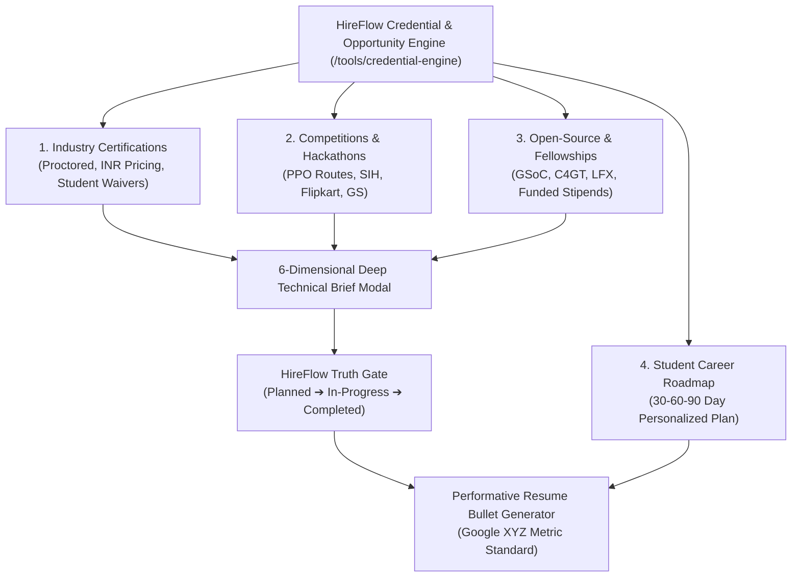
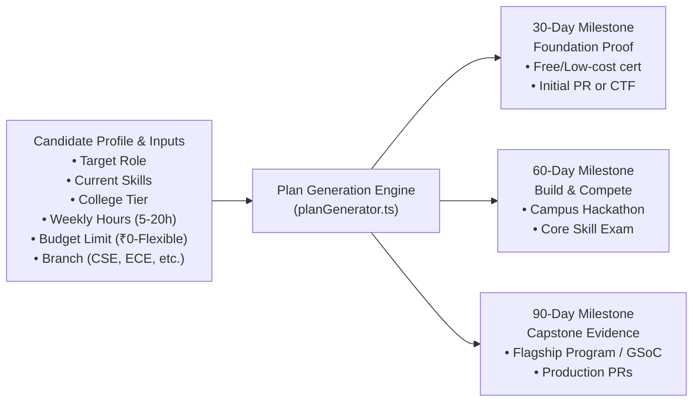

# HireFlow — Credential & Opportunity Engine
## Complete Master Architecture, Subsection Content Guide & LinkedIn Promotional Playbook

---

## 1. Executive Summary: What is the Opportunities Engine?

The **Credential & Opportunity Engine** (`/tools/credential-engine`) is HireFlow's evidence-first discovery, evaluation, and roadmap platform designed to bridge the gap between candidate resumes and enterprise hiring bars.

### The Problem It Solves
1. **The "Certificate Mill" Trap**: Millions of engineering students and early-career developers waste hundreds of hours and thousands of rupees collecting generic completion certificates (Udemy, Coursera, YouTube playlists) that recruiters and ATS scanners disregard as zero-evidence fluff.
2. **The "Tier-3 College" Bottleneck**: Candidates outside premier institutions (IITs/NITs/BITS) struggle to get shortlist callbacks through traditional job boards. They don't know that premier tech giants run **meritocratic campus hackathons and fellowships** (Flipkart GRiD, Smart India Hackathon, Goldman Sachs ECHP, TCS CodeVita, GSoC) with direct PPO (Pre-Placement Offer) interview pipelines.
3. **The Currency & Student Aid Blindspot**: International certification exams (AWS, GCP, Linux Foundation) are listed in USD ($100–$375). Students don't know that Indian student fee waivers, regional pricing, and subsidized vouchers (AWS Educate, GitHub Student Pack, Microsoft Learn Ambassadors) can slash costs to **₹0 or a fraction of the cost**.
4. **The Resume Verification Gap**: Most candidates don't know how to articulate credentials or hackathon projects into recruiter-grade, Google-standard **XYZ bullet points** (`Accomplished [X] as measured by [Y], by doing [Z]`), leading to immediate ATS rejection.

### The HireFlow Solution
HireFlow catalogs **100 verified opportunities** (100% enriched with deep Schema 2.0 technical briefs) across 3 pillars:
- **Industry Certifications**: Proctored, recruiter-recognized benchmarks with official Indian regional pricing and student discount playbooks.
- **Competitions & Hackathons**: Direct hiring route pipelines with ₹10L+ prize pools and SDE-1 / Internship shortlist opportunities.
- **Open-Source Fellowships**: High-prestige programs (GSoC, C4GT, LFX, Outreachy) providing public commit proof and ₹1.65L–₹2.5L living stipends.

Every single entry is evaluated through the **HireFlow Truth Gate**—ensuring candidates maintain mathematical integrity and never fabricate achievements.

---

## 2. Platform Architecture: The 4 Core Subsections



---

### Subsection 1: Industry Certifications Tab (`CertificationsTab`)

#### What is in this section?
A filterable, searchable directory of proctored cloud, systems, security, and developer credentials that pass enterprise screening filters.

#### Key Features & Technical Details:
- **Live Regional INR Pricing**: Automatically converts USD to INR at the official reference rate (`1 USD ≈ ₹88.75 INR`) while explicitly displaying official Indian regional prices (e.g. AWS Foundation at ₹8,875 vs Associate at ₹13,300).
- **Verified Student Fee Waivers**: Flags programs eligible for 50% to 100% student discounts via **GitHub Student Developer Pack**, **AWS Educate**, **Microsoft Learn Student Ambassadors**, and **Oracle Race to Certification**.
- **Evidence vs Resume Value Impact**: Each certification is rated on 3 dimensions:
  - `Resume Value` (HR / ATS keyword presence)
  - `Evidence Value` (Technical proof of competence)
  - `Portfolio Value` (Deployable artifacts produced)
- **Granular Filters**:
  - **Category**: Cloud & DevOps, Software Development, AI/ML, Cybersecurity, Data & Analytics, Quality Engineering.
  - **Level**: Foundation, Associate, Professional, Specialty.
  - **Budget**: Free (₹0), Under ₹5,000, ₹5,000–₹15,000, Above ₹15,000.
  - **Prep Time**: < 40 hours, 40–100 hours, > 100 hours.
  - **Engineering Branch Suitability**: Tailored filters for CSE, IT, ECE, EEE, MECH, CIVIL.
  - **Trust Level**: `verified_official`, `verified_multi_source`, `reported_single_source`.

#### Top Flagship Certifications Featured:
1. **AWS Certified Cloud Practitioner & Solutions Architect Associate**: The global standard for cloud infrastructure.
2. **CompTIA Security+**: Gateway credential for cybersecurity, defense, and SOC analyst roles.
3. **CKA (Certified Kubernetes Administrator)**: Gold standard for DevOps and platform engineering.
4. **Meta Front-End Developer Professional Certificate**: Practical React/JavaScript portfolio builder.
5. **HashiCorp Certified Terraform Associate**: Infrastructure-as-Code evidence.

---

### Subsection 2: Competitions & Hackathons Tab (`EventsTab`)

#### What is in this section?
Premier national and global tech challenges specifically tracked for their **direct corporate recruitment channels (PPOs, interview fast-tracks, and pre-placement intern offers)**.

#### The 6 Event Archetypes Explained:
| Event Type | Focus | Best For Proving |
| :--- | :--- | :--- |
| **Hackathon** | 24–48h sprint to build an MVP from scratch | Rapid full-stack delivery, API integration, resilience under pressure |
| **Codathon** | Timed competitive programming & data structures | Algorithmic speed, time/space complexity optimization for Tier S OAs |
| **Ideathon** | Problem discovery, architecture design & business case | System design framing, product understanding, domain feasibility |
| **Datathon** | Feature engineering & modeling on messy datasets | Leak-free cross-validation, metric optimization, data pipelines |
| **Cybersecurity CTF** | Reverse engineering, cryptography, web exploitation | Hands-on OWASP defense, packet analysis, real security exploits |
| **AI Challenge** | Applied LLMs, fine-tuning, computer vision | Model evaluation, inference latency optimization, agentic workflows |

#### Key Features & Technical Details:
- **Direct PPO Pipeline Filter**: 1-click toggle to isolate only events with proven hiring pipelines (e.g. SDE-1 interview calls, summer internship interviews).
- **Eligibility by Graduation Batch**: Pre-calibrated for BTech cohorts (2025, 2026, 2027, 2028).
- **Indian Flagship Highlights**:
  - **Smart India Hackathon (SIH)**: World's largest open innovation hackathon by Govt. of India. Tracks internal college rounds, 6-member team composition rules (mandatory female member representation), and central ministry problem statements.
  - **Flipkart GRiD (Campus Tech Challenge)**: Direct SDE-1 / Internship hiring route for top finalists with ₹3,00,000+ prize pool.
  - **TCS CodeVita**: Guinness World Record coding contest with Tier 1/Tier 2 corporate offers.
  - **TCS HackQuest**: Dedicated ethical hacking and cybersecurity campus challenge.
  - **Goldman Sachs Engineering Campus Hiring Program (ECHP)**: Direct analyst internship route.
  - **Walmart Sparkathon & CodeHers**: Premier women-in-tech and campus innovation tracks offering ₹25,000/mo summer internships and full-time PPOs.
  - **JPMorgan Chase Code for Good (CFG)**: 24-hour social good hackathon serving as JPMC's primary software engineer internship pipeline.
  - **Amazon ML Challenge**: Applied machine learning competition for Indian students.

---

### Subsection 3: Open-Source Programs & Fellowships Tab (`OpenSourceTab`)

#### What is in this section?
Structured, funded open-source engineering programs where candidates work directly under the mentorship of veteran software architects.

#### Why Open Source is the Ultimate Career Cheat Code:
- Unlike closed internships that cannot be publicly verified, **open-source contributions live forever on GitHub with public commit hashes, pull requests, and code reviews**.
- Recruiters can independently inspect code quality, architecture choices, test coverage, and communication skills.

#### Key Features & Technical Details:
- **Stipend Models (India Purchasing Power Parity)**:
  - **Google Summer of Code (GSoC)**: ₹1,65,000 to ₹2,50,000 INR stipend for 12–22 week production sprints.
  - **Code for GovTech (C4GT) India**: Dedicated fellowship building India's Digital Public Infrastructure (DPI) with ₹1,00,000 INR stipend.
  - **LFX Mentorship (Linux Foundation)**: Mentorship across Kubernetes, Envoy, OpenTelemetry, and Hyperledger with monthly stipends.
  - **Outreachy**: Paid remote diversity internships ($7,000 USD stipend).
  - **IIT Summer Research Fellowships (IITB, IITD, IITM, IITK SURGE)**: Research credentials under top faculty.
  - **MLH Fellowship**: 12-week remote software engineering internship alternative.
- **Operable Contribution Playbooks**:
  - Step-by-step guidance on navigating massive foreign codebases (100k+ lines of code).
  - How to communicate in IRC/Slack/Discord without spamming maintainers.
  - How to write accepted RFC proposals and pass midterm milestone evaluations.

---

### Subsection 4: Student Career Roadmap & 30-60-90 Day Plan (`OpportunityPlanTab`)

#### What is in this section?
An algorithmic recommendation engine that generates a personalized, highly structured preparation plan based on the candidate's exact profile and constraints.

#### How the Roadmap Engine Works:


#### Key Capabilities:
- **Rule of 3–5 High-Yield Opportunities**: Unlike spammy course aggregators that overwhelm students with 50 recommendations, HireFlow restricts roadmaps to **only 3 to 5 highest-yield actions** to ensure completion.
- **Cross-Engine Integration**: Pulls candidate target role from **TalentLens**, detects missing ATS skills, and factors in candidate tier gaps (e.g. moving from a Tier 3 college to a Tier 1 product firm).
- **Interactive Checklist & Status Tracking**: Students can mark items as `Planned`, `In-Progress`, or `Completed`.
- **Calendar & ICS Export**: Generates `.ics` calendar files with registration deadlines, sprint dates, and submission reminders.

---

## 3. Inside the Deep Technical Brief (The 6 Modal Tabs)

When a user clicks on any opportunity across HireFlow, a comprehensive, 6-tab modal opens with deep, zero-fluff engineering guidance:

```
┌─────────────────────────────────────────────────────────────────────────────┐
│ OPPORTUNITY BRIEF: GOOGLE SUMMER OF CODE                                   │
├───────────┬──────────┬──────────┬──────────┬─────────────────┬──────────────┤
│ 1 Overview│2 Timeline│3 Fees/Aid│4 Syllabus│5 Resume Evidence│6 Pitfalls/Src│
└───────────┴──────────┴──────────┴──────────┴─────────────────┴──────────────┘
```

### Tab 1: Overview
- **What It Is**: Executive summary of the organization, program structure, and real-world scope.
- **Who Should Take It**: Exact persona targeting (e.g. "BTech 2nd/3rd year students with Git and core language proficiency").
- **What It Proves to Recruiters**: The psychological and technical signal sent to hiring managers (e.g. "Proves candidate can navigate 500k-line codebases, handle harsh code reviews, and ship test-backed code asynchronously").
- **Eligibility & Constraints**: Degree level, citizenship, batch year, team size.
- **Official Direct Portal**: Verified, canonical link to the program's official domain.

### Tab 2: Verified Timeline & Windows
- **Recurrence & Dates-Change Notice**: States whether dates are fixed, annual, or rolling.
- **Milestone Sprints**: Detailed phase-by-phase breakdown (Announcement phase ➔ Proposal drafting ➔ Coding sprint ➔ Midterm evaluation ➔ Final code submission).
- **Freshness Badge**: Transparent indicator of when this record was last verified by HireFlow engineering.

### Tab 3: Fees & Indian Student Aid
- **Currency Transparency**: Exact USD and calculated INR costs.
- **Purchasing Power Parity / Stipends**: Direct stipends disbursed to students.
- **Actionable Aid Playbook**: Bulleted steps on how to claim official fee waivers (e.g. "How to use your college `.edu` or `.ac.in` email to get free exam vouchers").

### Tab 4: Operable Syllabus & Week-by-Week Study Plan
- **Detailed Domain Breakdown**: Exact topics covered in the competition or certification exam.
- **Curated Learning Repositories**: Canonical open-source repositories and study guides.
- **Week-by-Week Sprint Schedule**: 4 to 12 week prep timeline balancing university exams with preparation.

### Tab 5: Verifiable Resume Evidence & Google XYZ Bullet Templates
This is HireFlow's crown jewel. It gives students 4 ready-to-copy resume representations:
1. **Google XYZ Bullet Point**: `Accomplished [X], as measured by [Y], by doing [Z]`.
   - *Example*: *"Selected as Google Summer of Code Contributor for Apache Arrow; engineered a distributed SIMD parser in C++, reducing query serialization latency by 34% across 10M record datasets."*
2. **Project Section Entry**: Complete title, tech stack badge list, and architecture description.
3. **Certification Line**: Formal credential title, issuing authority, and verification ID format.
4. **Summary Hook**: High-impact 1-liner for LinkedIn headline or resume summary.
5. **The HireFlow Truth Gate**: Prevents students from putting "Completed" credentials until they have actually completed them. Offers forward-looking, honest phrasing for `Planned` and `In-Progress` states.
6. **Technical Interview Talking Points**: Anticipated interviewer questions and architectural talking points.

### Tab 6: Common Pitfalls & Primary Source Citations
- **Why Candidates Fail**: 3 to 5 real rejection reasons (e.g. submitting AI-hallucinated proposals without contacting maintainers, poor git commit hygiene, vanishing mid-sprint).
- **Disqualification Red Flags**: Team composition violations, plagiarized code, missed deadlines.
- **Primary Source Citations**: Direct links to official `.gov.in`, `.org`, or corporate domains.

---

## 4. Why HireFlow Gives Users an Unfair Advantage

| Feature | Generic Course Portals / Job Boards | HireFlow Opportunities Engine |
| :--- | :--- | :--- |
| **Catalog Quality** | 10,000+ unverified affiliate courses | 100 deeply researched, high-yield credentials & hackathons |
| **Focus** | Watch videos, collect PDF certificates | Build verifiable, recruiter-tested proof of competence |
| **Hiring Connection** | No direct pipeline | Direct PPO, interview shortcut, and fellowship channels |
| **Pricing Transparency** | Hidden fees, vague currency conversion | Live INR rates, verified student waivers, PPP stipends |
| **Resume Integration** | None | Google XYZ metric bullet templates with Truth Gate validation |
| **Personalization** | Generic search | Role-aligned, college-tier calibrated 30-60-90 day roadmap |
| **Privacy** | Data sold to third-party ed-tech lead gen | 100% Client-side sandbox, zero tracking, zero data egress |

---

## 5. LinkedIn & Social Media Promotional Playbook

Use the following ready-to-publish posts, hooks, and carousel blueprints to promote HireFlow to engineering students, job seekers, and the tech community.

---

### LinkedIn Post 1: The Harsh Truth Hook (High Engagement)
**Target Audience**: BTech / BCA / MCA students, early-career devs, job hunters  
**Tone**: Direct, analytical, empowering

> **Stop collecting \$10 Udemy certificates. They are doing zero favors for your resume.**
>
> Over the last 6 months, we audited hundreds of tech resumes and talked to engineering hiring managers across India's top tech firms.
>
> Here is the brutal reality:
> ❌ A recruiter spending 6 seconds on your resume doesn't care that you completed a 40-hour course on Python.
> ❌ A generic completion certificate proves you had a browser open—it doesn't prove you can ship production code.
>
> What actually makes engineering managers stop scrolling? **Verifiable evidence.**
>
> 1️⃣ **Merit-Based Hackathon Finalist Proof**:
> Placing in Flipkart GRiD, Smart India Hackathon, or Goldman Sachs ECHP proves you can solve messy problems under pressure and beat thousands of candidates.
>
> 2️⃣ **Public Commit Proof via Fellowships**:
> Merging code in Google Summer of Code (GSoC), Code for GovTech (C4GT), or LFX Mentorship proves you can read foreign codebases, adhere to CI/CD pipelines, and survive rigorous code reviews.
>
> 3️⃣ **Proctored, Industry-Standard Cloud Benchmarks**:
> Proctored exams like AWS Solutions Architect or CKA that test real infrastructure design.
>
> **And here’s the kicker most students miss:**
> Almost every single high-value credential has an Indian student discount, fee waiver, or paid stipend attached. (GSoC pays ₹1.65L–₹2.5L; C4GT pays ₹1,00,000; AWS offers student credits).
>
> We got tired of watching students waste money on zero-evidence courses.
>
> So we built the **HireFlow Credential & Opportunity Engine**:
> 🔹 100 deeply verified opportunities (Certifications, Flagship Hackathons, Open-Source Fellowships)
> 🔹 Real INR regional pricing + student fee waiver playbooks
> 🔹 Direct PPO and interview fast-track indicators
> 🔹 Ready-to-copy Google XYZ resume bullet templates
> 🔹 100% free and client-side private.
>
> Stop building paper credentials. Start building verifiable proof.
>
> 👉 Explore the engine here: [hireflow.com/tools/credential-engine]
>
> #SoftwareEngineering #TechCareers #BTech #CareerAdvice #OpenSource #GSoC #Hackathons #HireFlow

---

### LinkedIn Post 2: The Tier-3 College Playbook (Inspirational & Tactical)
**Target Audience**: Students in non-IIT/NIT colleges looking for top-tier off-campus roles  
**Tone**: Tactical, empathetic, blueprint-oriented

> **How to crack Tier-1 product firms from a Tier-3 college (Without referrals or connections):**
>
> If you don’t have on-campus placement visits from top product companies, cold applying on job portals feels like shouting into a void.
>
> Your resume is competing against 5,000 applicants, and ATS keyword filters reject you before a human ever looks at your profile.
>
> But there is an open secret: **The Meritocratic Bypass.**
>
> Tech giants run annual flagship challenges that bypass traditional resume screening completely:
>
> 1. **Flipkart GRiD**: Direct SDE-1 and Internship interview fast-tracks for finalists.
> 2. **Smart India Hackathon (SIH)**: National recognition solving central government problem statements.
> 3. **TCS CodeVita**: Direct corporate offers purely based on competitive programming rank.
> 4. **Walmart CodeHers & Sparkathon**: Direct summer internships (₹25k/mo) + full-time PPOs.
> 5. **JPMorgan Chase Code for Good**: Primary campus hiring pipeline for software engineers.
> 6. **Google Summer of Code (GSoC)**: Global open-source mentorship with up to ₹2.5 Lakh stipend.
>
> When you put *"Flipkart GRiD National Finalist"* or *"GSoC Contributor @ Linux Foundation"* on your resume, your college tier ceases to matter. You have mathematical proof of excellence.
>
> Inside **HireFlow**, we mapped out every single one of these flagship routes:
> - Eligibility criteria by batch (2025 to 2028)
> - Team composition requirements
> - Past problem statements & study plans
> - Exactly how to format the achievement into a Google XYZ metric bullet on your resume
>
> Your pedigree doesn't define your ceiling. Your evidence does.
>
> Link in comments to explore the entire roadmap. 👇
>
> #CollegePlacements #OffCampus #CodingLife #Developer #TechJobs #HireFlow

---

### LinkedIn Post 3: The Currency & Student Aid Angle (High Value Shareable)
**Target Audience**: College students conscious of exam costs  
**Tone**: Informative, resource-sharing, "bookmark this"

> **PSA for Indian Engineering Students: NEVER pay full price for tech certifications.** 💡
>
> Most certification portals list exam fees in USD:
> - AWS Cloud Practitioner: \$100 (~₹8,875)
> - CompTIA Security+: \$392 (~₹34,800)
> - Azure Fundamentals (AZ-900): \$99
> - Linux Foundation CKA: \$395
>
> For a college student, these prices are exorbitant.
>
> But hundreds of students don't know that **student discounts, fee waiver vouchers, and regional subsidies exist**:
>
> 🔹 **GitHub Student Developer Pack**: Grants free access to domains, developer tools, and discounted exam prep.
> 🔹 **Microsoft Learn Student Ambassadors**: Access to 50% to 100% discount vouchers for Microsoft fundamentals exams.
> 🔹 **AWS Educate**: Free cloud lab credits and student-tier certification discount challenges.
> 🔹 **Coursera Financial Aid**: Up to 100% waiver on professional certificates (Meta, Google, IBM) with a 2-week application review.
> 🔹 **Google Summer of Code / C4GT**: They don't charge you—they PAY YOU ₹1,00,000 to ₹2,50,000 INR to build open-source software.
>
> In our latest update to **HireFlow**, we built a dedicated **Fees & Student Aid** breakdown for every major certification in tech.
>
> We track:
> ✅ Live USD to INR conversions
> ✅ Official Indian regional exam pricing
> ✅ Exact step-by-step instructions to claim student fee waivers
>
> Before you swipe your card for an exam, check if you're eligible for a waiver on HireFlow first.
>
> Bookmark this post or check the live portal at [hireflow.com/tools/credential-engine]!
>
> #StudentDiscounts #AWS #GoogleCloud #Azure #Certifications #TechStudents #HireFlow

---

### LinkedIn Post 4: The Product Launch & Architecture Breakdown
**Target Audience**: Developers, recruiters, career coaches, tech leaders  
**Tone**: Visionary, product-led, authoritative

> **Today, we are unveiling the HireFlow Credential & Opportunity Engine.** 🚀
>
> When we set out to build HireFlow, we made one promise:
> **Zero AI slop. Zero hallucinated metrics. 100% deterministic evidence.**
>
> Over the past several months, we analyzed why candidates fail ATS screenings and why recruiters ignore junior resumes. The answer wasn't "they need more AI resume rewrites." The answer was: **they lack calibrated, verifiable evidence.**
>
> Here is what the new Opportunity Engine brings:
>
> 🎯 **100 Verified Opportunities**:
> Curated directory across 3 pillars: Industry Certifications, Corporate Campus Hackathons (Flipkart, SIH, Goldman Sachs), and Funded Fellowships (GSoC, C4GT, LFX).
>
> 🇮🇳 **Engineered for the Indian Tech Ecosystem**:
> Live INR pricing, official Indian student discount playbooks, branch-specific filters (CSE, ECE, Mech), and batch-level eligibility (2025–2028).
>
> ⚡ **The HireFlow Truth Gate**:
> Generates Google XYZ metric bullets (`Accomplished [X] measured by [Y] by doing [Z]`) while enforcing cryptographic truth. A planned credential is marked "Planned"; an earned credential produces verified production PR bullet points.
>
> 🗺️ **Algorithmic 30-60-90 Day Roadmap**:
> Dynamically calibrates a 3-to-5 step plan based on your target role, weekly availability, and budget.
>
> 🔒 **100% Client-Side Privacy**:
> Zero candidate tracking. Zero network data egress. Your career data never leaves your browser.
>
> Check it out live and let us know what you think:
> 👉 **[hireflow.com/tools/credential-engine]**
>
> #ProductLaunch #HireFlow #CareerIntelligence #ATS #EdTech #SoftwareEngineering

---

### LinkedIn 10-Slide Carousel Blueprint (PDF / Document Format)

**Title**: *The 2026 Student Evidence Playbook: How to Build a Resume That Recruiters Actually Read*

- **Slide 1 (Cover)**: 
  - Headline: *Why 90% of Tech Certifications Are Ignored by Recruiters (And What to Do Instead).*
  - Subhead: *The 2026 Student Evidence Playbook by HireFlow.*
- **Slide 2 (The Problem)**:
  - Text: *The "Certificate Mill" Trap. Watching 40 hours of tutorial videos and downloading a certificate doesn't prove engineering competence. Recruiters look for 3 things: Code quality, problem-solving under constraints, and public verification.*
- **Slide 3 (Pillar 1: Flagship Hackathons)**:
  - Text: *The Fast-Track Hiring Shortcut. Companies like Flipkart (GRiD), Goldman Sachs (ECHP), and TCS (CodeVita) use campus competitions as direct interview pipelines. Finalists bypass cold online portals.*
- **Slide 4 (Pillar 2: Open-Source Fellowships)**:
  - Text: *The Proof That Lives Forever on GitHub. Programs like Google Summer of Code (GSoC) and Code for GovTech (C4GT) give you 1:1 mentorship from veteran architects, merged production PRs, and ₹1L–₹2.5L stipends.*
- **Slide 5 (Pillar 3: High-Signal Certifications)**:
  - Text: *Proctored, Industry-Standard Cloud Benchmarks. AWS Solutions Architect, CKA, and CompTIA Security+. They validate actual architecture and command-line mastery.*
- **Slide 6 (The Student Aid Hack)**:
  - Text: *Never Pay Full Price in USD. Use GitHub Student Developer Pack, AWS Educate, and Microsoft Ambassador programs to claim 50% to 100% exam fee waivers.*
- **Slide 7 (The Google XYZ Formula)**:
  - Text: *How to Write Bullet Points That Pass ATS. "Accomplished [X], as measured by [Y], by doing [Z]". Bad: "Did a hackathon project." Good: "Built a distributed fraud detection API in Go, achieving <45ms p95 latency across 50,000 requests to win 2nd place in Flipkart GRiD."*
- **Slide 8 (The HireFlow 30-60-90 Day Framework)**:
  - Text: *Month 1: Foundation (Core cert / Initial open-source PR). Month 2: Build & Compete (National hackathon / Capstone project). Month 3: High-Impact Credential (Fellowship proposal / Proctored associate exam).*
- **Slide 9 (The HireFlow Engine)**:
  - Text: *100 verified opportunities, live INR regional pricing, student fee waiver guides, and Google XYZ resume templates. 100% free and client-side private.*
- **Slide 10 (Call to Action)**:
  - Text: *Start building verifiable evidence today at hireflow.com/tools/credential-engine. Save this post for your placement season!*

---

*Authored by the HireFlow Platform Engineering Team · Built with Zero-Hallucination Evidence Standards.*
