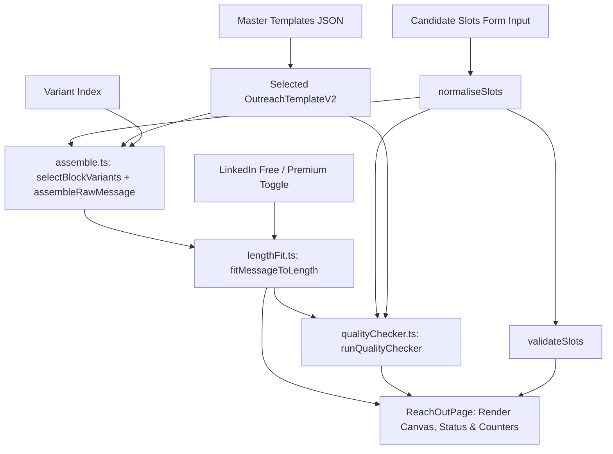

# Reach Out (Cold Outreach Generator) — Architecture & Data Flow

## 1. Overview
Reach Out is HireFlow's deterministic, client-side outreach assistant designed specifically for Indian engineering students, new graduates, and early-career software engineers. It replaces generic, sycophantic outreach templates with evidence-backed, calibrated messages structured around verified personal achievements.

### Core Architecture Invariants
- **Zero Runtime Network Egress (Hard Rule H1)**: 100% of slot validation, variant selection, text assembly, length fitting, quality checking, and formatting happens in the client browser. No external API, LLM, tracking beacon, or telemetry service is ever contacted.
- **Strict Determinism (Hard Rule H9)**: Given the same template, slots, and variant index, the engine produces byte-identical output across all platforms and execution environments. No `Math.random` or unparameterized dates.
- **Zero UI Arithmetic (Hard Rule H4)**: All character counts, word counts, limits, fitting statuses, overflow magnitudes, and quality issues are computed exclusively in pure engine functions and rendered by UI components without in-component math.
- **Ethical & Realistic Messaging (Evidence E1–E6)**: Enforces realistic boundaries: strangers are never asked for cold referrals (Evidence E5); follow-ups require new technical evidence (Evidence E6); and LinkedIn notes strictly respect the 200-character free tier limit (Evidence E1).

---

## 2. Directory Structure

```
src/
├── config/
│   └── outreach.ts                    # Channel profiles E1-E3, quality rules, and taxonomy matrix
├── data/
│   └── suite/
│       ├── outreach-templates.json    # Backward-compatible sync export
│       └── outreach/
│           └── templates.json         # Master 85-template library (Schema v2)
└── features/
    └── suite/
        └── outreach/
            ├── types.ts               # Core TypeScript definitions (V2 schema, slots, results)
            ├── validator.ts           # Hand-written zero-dependency template validator
            ├── ReachOutPage.tsx       # Accessible React UI conforming to Design Standard D5
            └── engine/                # Pure deterministic engine
                ├── normaliseSlots.ts  # Trimming, honorific stripping, phonetic articles (a/an)
                ├── validateSlots.ts   # Slot requirement, flattery rejection, proof checking
                ├── assemble.ts        # FNV-1a variant selection, block assembly, slot interpolation
                ├── lengthFit.ts       # Profile limits, progressive block dropping, overflow analysis
                ├── subjectBuilder.ts  # Scannable 3-8 word subject generator for email and InMail
                ├── qualityChecker.ts  # Pre-send heuristics (BLOCKERS and WARNINGS)
                └── followUpChaining.ts# Follow-up linking, spacing rules, and new-info validation
```

---

## 3. End-to-End Data Flow



---

## 4. Key Subsystems

### 4.1 Schema & Taxonomy Matrix (`validator.ts`, `config/outreach.ts`)
- **Schema v2**: Enforces mandatory fields: `id`, `name`, `channel`, `goal` (G1–G9), `recipientTypes`, `relationship`, `candidateStages`, `companyTypes`, `angle`, `askStrength`, `requiredSlots`, `optionalSlots`, `blocks` (`hook`, `proof`, `ask`, `close`), `optionalBlockPriority`, and `lengthProfile`.
- **Matrix Evaluation**: Evaluates 1,080 combinations across 5 channels, 9 goals, 6 recipient types, and 4 relationship states. Identifies 924 valid combinations and 156 invalid combinations across 6 structural violation classes.

### 4.2 Pure Engine (`src/features/suite/outreach/engine/`)
1. **`normaliseSlots.ts`**:
   - Strips honorifics from greeting names (`"Dr. Ramesh Sharma"` -> `"Ramesh"`).
   - Preserves Unicode diacritics and Indic characters.
   - Computes phonetic indefinite articles (`"an SDE"`, `"a UI engineer"`, `"an AWS specialist"`, `"a URL"`) based on acoustic phonetics.
2. **`validateSlots.ts`**:
   - Enforces slot presence.
   - Detects and rejects generic praise ("amazing work", "love your product", "great company") with actionable good/bad counter-examples.
   - Validates that proof points contain numeric metrics, benchmarking verbs, or project links.
3. **`assemble.ts`**:
   - Combines template ID, normalized slots, and variant index into a 32-bit FNV-1a hash.
   - Deterministically selects variants for hook, proof, ask, and close.
   - Interpolates slots cleanly, resolving phonetic articles.
4. **`lengthFit.ts`**:
   - Applies channel limits (LinkedIn Free: 200 chars; LinkedIn Premium: 300 chars; Cold Email: 50–100 words; Follow-Up: 30–70 words).
   - If over target, drops blocks in `optionalBlockPriority` order (typically `close` then `proof`) without truncating words.
   - Computes exact overflow amount and identifies the single longest slot causing the overflow.
5. **`qualityChecker.ts`**:
   - Audits draft for 3 blocking violations (`Q-BLK-FAMILIARITY`, `Q-BLK-COLD-REFERRAL`, `Q-BLK-FOLLOWUP-EMPTY`) and 7 warnings (`Q-WRN-GENERIC-OPENER`, `Q-WRN-CLICHE`, `Q-WRN-MULTI-ASK`, `Q-WRN-EXCLAMATION`, `Q-WRN-EMOJI`, `Q-WRN-SALARY`, `Q-WRN-PUSHY`).

---

## 5. Verification & Testing
The feature is gated by `npm run outreach:gate`, executing 9 stages in sequence:
1. `outreachTemplatesV2.test.ts` (validator test suite)
2. `lint-templates.ts` (authoring linter)
3. `engine.spec.ts` (105 pure unit tests)
4. `ui.spec.ts` (UI integration and accessibility tests)
5. `privacyAndStorage.spec.ts` (zero egress, storage quota, and corruption tests)
6. `goldenSnapshot.spec.ts` (425-output corpus verified against golden SHA-256 hash)
7. `check:claims` (claims and honesty linter)
8. `check:ui-math` (zero UI arithmetic scan)
9. Negative verification suite (verifies rejection of invalid matrix cells, overflows, stray braces, and duplicate openers)
