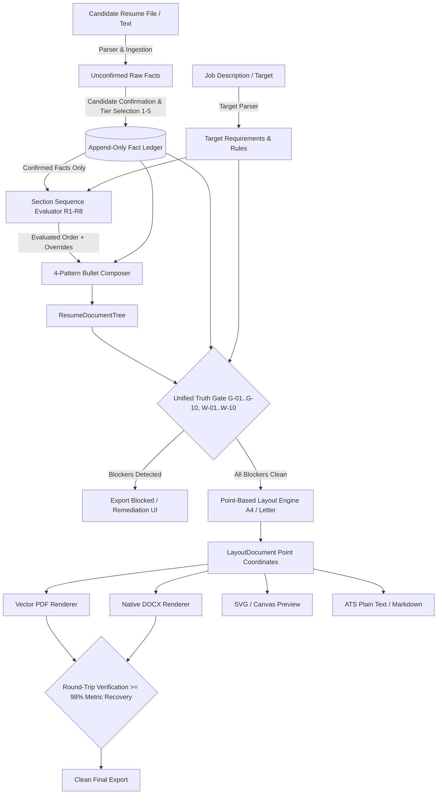

# HireFlow Resume Architecture — Tailor My Resume (v4.0.0 Rebuild)

## Executive Summary

"Tailor My Resume" is a 100% client-side, zero-runtime-network-egress resume tailoring and typesetting engine. It replaces template-based verb inflating with an append-only, verified **Fact Ledger**, a deterministic **Point-Based Layout Engine**, and a unified **Truth Gate**.

---

## Core Product Invariants

| ID | Invariant | Enforcement Mechanism |
|---|---|---|
| **P1** | **Confirmed Facts Only** | Imported/parsed facts start as unconfirmed (`confirmed: false`). Only explicitly confirmed facts can be selected or rendered into the resume document tree. |
| **P2** | **Zero Invention** | The engine ranks, orders, groups, and phrases existing confirmed facts. It never hallucinates skills, numbers, dates, titles, or employers. |
| **P3** | **Ownership Ladder** | Candidate declares an ownership tier (1 Supported, 2 Contributed, 3 Owned, 4 Led, 5 Set Direction). Verbs strictly adhere to the declared tier. Tier inflation is blocked. |
| **P4** | **Preserved Metrics & Real Evidence** | Metrics are optional; specific evidence is required. No template placeholders like `[X%]` can ever reach an export. |
| **P5** | **Unified Layout Engine** | One point-based layout engine (72 pt = 1 in = 96 px CSS) generates an exact `LayoutDocument` feeding vector PDF (`pdf-lib`), native DOCX (`docx`), SVG preview, and ATS text. |
| **P6** | **Round-Trip Verification** | Exported files are re-ingested by HireFlow's text extractor and compared against the original fact ledger. Metric loss triggers hard verification failure. |
| **P7** | **Situation-Driven Sequence** | Section sequence is computed dynamically from candidate situation (graduation recency, years of experience, campus cutoffs) with reasons explained. User overrides are remembered in localStorage. Education is never hardcoded at the end. |
| **P8** | **Two Readouts** | Replaces arbitrary score badges with two objective metrics: Target JD Coverage % (direct ATS match) and Quality Checklist (Blockers vs Warnings). |

---

## Architectural Data Flow

---

## System Components

### 1. Ledger & Ingestion (`src/lib/resume/ledger.ts`, `ingest.ts`, `confirm.ts`)
- Implements an immutable, append-only ledger indexing all candidate facts with synchronous FNV-1a content hashing.
- Disallows destruction of history. Edits produce new fact versions.
- Imported data starts unconfirmed and cannot render until confirmed with an ownership tier.

### 2. Sequence Planner (`src/lib/resume/planner/sequence.ts`, `readouts.ts`)
- Rules R1–R8 evaluate graduation recency (`asOf` injected), candidate archetype, and target requirements to place Education, Experience, Projects, and Skills.
- Provides "Why this order" explainability drawer.
- Stores user manual reordering in localStorage with corrupted JSON fallback.

### 3. Composer (`src/lib/resume/composer/`)
- Enforces the 5-tier claim-strength ladder (`verbs.ts`).
- Flags weak openers (`responsible for`, `assisted with`) for user review rather than silently inflating them.
- Formats accomplishments via 4 deterministic grammatical patterns (`bullet.ts`).
- Generates professional summaries from confirmed facts with zero buzzwords (`summary.ts`).

### 4. Unified Truth Gate (`src/lib/resume/gate/`)
- Evaluates 10 hard blockers (`G-01` to `G-10`) and 10 warnings (`W-01` to `W-10`).
- Halts export if any blocker exists (e.g. unconfirmed fact, placeholder `[X%]`, verb tier inflation).
- Computes deterministic Target JD Coverage %.

### 5. Point-Based Layout Engine & Renderers (`src/lib/resume/layout/`)
- Coordinates in absolute points (`72 pt = 1 inch`).
- Geometry: A4 ($595.28 \times 841.89$ pt) and Letter ($612.0 \times 792.0$ pt).
- Typography floor: $\ge 9.5$ pt across all 5 templates (`classic`, `modern`, `compact`, `campus`, `executive`).
- Identical layout coordinates feed vector PDF, DOCX, and SVG DOM preview.

### 6. Round-Trip Verification (`src/lib/resume/verify/roundTrip.ts`)
- Re-reads generated export files with HireFlow's text extractor.
- Verifies $\ge 98\%$ overall recovery and 100% metric preservation before allowing clean download status.
