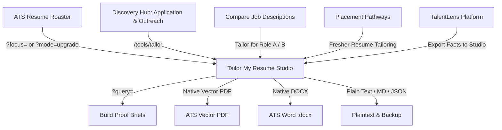
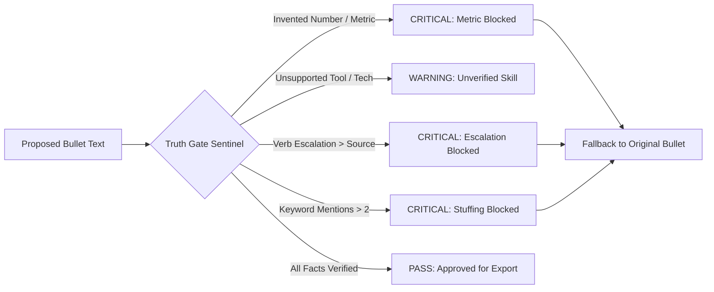

# Complete Contextual & Architectural Brief: Tailor My Resume
**System**: HireFlow v4.0.0 — Production ATS Resume Engine & Career Decision Suite  
**Module**: Tailor My Resume Studio (`/tools/tailor`)  
**Architecture**: 100% Client-Side Reactive SaaS Engine (Zero Runtime Network Egress)  
**Date of Extraction**: October 2026  

---

## Table of Contents
1. Executive Overview & Design Principles
2. Ecosystem Integration & Directed Navigation (Inbound & Outbound)
3. Application Arrangement & UI Workspace Layout
4. Core Data Models, Schemas & Fact Ledger Ingestion
5. Intelligence & Classification Engines
6. Truth Gate & Non-Fabrication Invariants
7. Candidate Actions & Complete Transformation Capabilities
8. Multi-Format Export Suite & Layout Quality Sentinels
9. Comprehensive Field & Method Reference Table

---

## 1. Executive Overview & Design Principles

**Tailor My Resume** (`/tools/tailor`) is HireFlow's dedicated resume tailoring and accomplishment elevation studio. It enables candidates to adapt their technical resumes to target job descriptions with mathematical precision while enforcing strict factual integrity.

### Core Architectural Principles
1. **Zero Runtime Network Egress**: The entire tailoring engine runs purely client-side in the user's browser. Parsing, keyword matching, truth checking, XYZ transformation, DOCX packaging, and vector PDF rendering occur without sending any candidate data to remote servers or third-party APIs.
2. **Strict Factual Non-Fabrication (Truth Gate)**: Unlike standard generative AI tools that hallucinate metrics, dates, and unverified competencies, HireFlow strictly prohibits inventing numbers or claiming unevidenced technologies. Every tailored bullet is cross-referenced against an immutable Candidate Fact Ledger.
3. **Google XYZ Accomplishment Standard**: Transforms passive task descriptions into executive-grade accomplishment statements following the formula:  
   $$\text{"Accomplished [X] measured by [Y] by doing [Z]"}$$
4. **ATS Parser Optimization**: Single-column tableless structure, standardized font hierarchies, explicit section headings, and semantic keyword integration designed for parsers like Workday, Greenhouse, Lever, and Taleo.
5. **Deterministic 1-Page Layout Sentinel**: Real-time height monitoring prevents awkward multi-page spills and automatically suggests typography adjustments (Compact, Modern, Tight Margins) to guarantee a 1-page fit.

---

## 2. Ecosystem Integration & Directed Navigation

Tailor My Resume acts as the central execution studio across HireFlow's Career Decision Suite.

### Inbound Connections & Deep-Link Parameters
- **ATS Resume Roaster (`FixTheseFirst.tsx`, `SkillsTab.tsx`)**:
  - *Missing Mandatory Requirement*: Directs to `/tools/tailor?focus=${encodeURIComponent(item.title)}`. Pre-filters the editor search bar and expands the relevant section.
  - *Weak Bullet Rewrite*: Directs to `/tools/tailor?mode=upgrade&bullet=${encodeURIComponent(item.title)}`. Pre-loads the specific bullet for Google XYZ elevation.
  - *Missing Skill Gap*: Directs to `/tools/tailor?skill=${encodeURIComponent(skill.canonical)}`. Opens the skills module focused on that canonical concept.
- **Tools Hub (`ToolsHubPage.tsx`)**:
  - Listed in **Group A: Application & Outreach** ("Audit your resume, tailor your bullets, and generate high-converting outreach").
  - Title: **Tailor My Resume** | Badge: **Truth-Checked Suggestions** | Tags: `['Truth Check', 'Diff Editor', 'Version History']`.
- **TalentLens Platform (`TalentLens.tsx`)**:
  - Shares parsed candidate profiles and target company requirements. Enables candidates to port evaluated qualifications directly into the editor.
- **Compare Job Descriptions (`HeadToHeadView.tsx`)**:
  - Contains dual action triggers: "Tailor for Role A" and "Tailor for Role B", allowing candidates to create role-specific branches from the same baseline resume.
- **Placement Pathways (`StudentPlacementPathway.tsx` & `plan.ts`)**:
  - Direct CTA from readiness diagnostics: "Single-Page Technical Fresher Resume Tailoring" task to close ATS parsing gaps.
- **Global Header & Navigation (`LocalhostNavigator.tsx` & `ProfileResumeChip.tsx`)**:
  - Unified candidate profile chip synchronizes resume text across ATS Roaster, JD Compare, and Tailor.

### Outbound Directed Handoffs
- **Build Proof Project Briefs (`/tools/build-briefs?query=<skill>`)**:
  - When a mandatory requirement is flagged as `MISSING` and cannot be claimed honestly on the resume, the system provides a 1-click handoff to generate a hands-on proof project brief to bridge the gap before applying.

---

## 3. Application Arrangement & UI Workspace Layout

The Tailor My Resume user interface is arranged in a split-screen workspace with Google XYZ elevation controls and real-time live preview.

### 3.1 Pinned Header (`DarkTailorHeader.tsx`)
- **Branding & Status**: Displays "Handmade Resume Editor" with a pulsing "Live Dynamic Sync" indicator and "Data Sources & Legal Shield" provenance modal.
- **Score Delta Badge**: Real-time display of baseline vs upgraded score ($$0 \to 100\%$$) computed from power verb coverage, metric density, and passive pattern elimination.
- **Preset Fixtures**: Fast switching between pre-configured archetypes:
  - *Fresher SDE*: Jeswanth Kumar (Full-stack fresher targeting Google/Amazon).
  - *Cybersecurity Specialist*: Alex Morgan CISSP (Infosec specialist targeting enterprise SOC).
- **Multi-Format Export Suite**:
  - `.DOCX`: Real Microsoft Word binary via `docx` library.
  - `.PDF`: Real vector PDF binary generated via `pdf-lib` + fallback print engine.
  - `.TXT`: Clean ASCII-formatted ATS plain text.
  - `.MD`: Formatted markdown document.
  - `.JSON`: Full reactive state backup.
- **Action Buttons**:
  - `Make It Better` (Magic wand): Automated full-resume Google XYZ transformation.
  - `Direct Input / Load JD`: Modal to paste custom resume and target job description.

### 3.2 Split-Screen Desktop Workspace (`TailorResumePage.tsx`)
- **Left Column (7 Cols): Handmade Resume Editor (`HandmadeResumeEditor.tsx`)**:
  - Filter Tabs: `All`, `Experience`, `Projects`, `Skills`, `Education`, `Summary`, `Requirements`, `Profile`.
  - Search & Highlight Bar: Filters sections in real time based on keywords or imported target focus.
  - 1-Page Auto-Fit Sentinel: One-click adjustment of font size, margins, and line spacing.
  - Seven Modular Section Cards (collapsible, reorderable, editable).
- **Right Column (5 Cols): Live Paper Canvas (`DarkPaperPreview.tsx`)**:
  - Sticky viewport simulating an authentic A4 / Letter paper sheet with real-time typography, section dividers, and margins.
  - Zoom controls (80%, 90%, 100%, 110%).
  - Page spill alert banner if content overflows 1056px height.
- **Mobile Responsive Switcher**:
  - Mobile view toggles cleanly between `Editor` tab and `Paper Canvas` tab.

---

## 4. Core Data Models, Schemas & Fact Ledger Ingestion

All tailoring operations are governed by immutable TypeScript interfaces (`src/lib/tailor/types.ts`).

### 4.1 Candidate Fact Ledger (`CandidateFact`)
Before any edit is permitted, the candidate's resume is decomposed into an immutable ledger:
- `factId`: Unique deterministic identifier.
- `sourceSection`: `'header' | 'summary' | 'experience' | 'education' | 'projects' | 'skills' | 'certifications'`.
- `rawText`: Exact unedited string from original resume.
- `normalizedConcepts`: Canonical skill IDs extracted via taxonomy tokenizer.
- `extractedMetrics`: Array of numeric metrics extracted via regex (percentages, throughput, latency, dollar values).
- `hash`: SHA-256 hash ensuring provenance.

### 4.2 Job Description Schema (`JobDescription` & `JobRequirement`)
- `seniority`: `'intern' | 'fresher' | 'junior' | 'mid' | 'senior' | 'lead' | 'staff' | 'principal' | 'executive'`.
- `requirements`: Array of `JobRequirement`:
  - `category`: `'skill' | 'responsibility' | 'education' | 'experience' | 'certification' | 'domain' | 'tool'`.
  - `priority`: `'MANDATORY' | 'PREFERRED'`.
  - `weight`: Numerical scoring weight ($$1.0 \to 3.0$$).
  - `normalizedConcept`: Canonical taxonomy token.

### 4.3 Tailored Section Schema (`TailoredSection`)
- `id`: Section key (e.g., `sec_experience`, `sec_projects`).
- `type`: Section type discriminator.
- `title`: User-visible title (e.g., "Professional Experience", "Technical Projects").
- `visible`: Boolean flag enabling instant exclusion without data loss.
- `content`:
  - `entries`: Array of roles, projects, or degrees (with title, subtitle, dates, location, bullets).
  - `skillsByCategory`: Key-value map of skill groupings.
  - `summaryText`: Narrative statement.

---

## 5. Intelligence & Classification Engines

### 5.1 Candidate Archetype Classification & Section Ordering (`strategyPlanner.ts`)
The strategy planner analyzes candidate seniority, education recency, and certifications to assign an archetype and optimize section order:

| Candidate Archetype | Recommended Section Sequence | Rationale |
| :--- | :--- | :--- |
| **student_fresher** | 1. Education 2. Technical Projects 3. Technical Skills 4. Experience & Internships 5. Certifications | Academic pedigree and hands-on proof projects lead for campus/entry roles lacking extensive corporate tenure. |
| **cybersecurity_specialist** | 1. Security Summary 2. Certifications (CISSP, CEH) 3. Experience 4. Security Toolstack 5. Labs & CTFs 6. Education | Trust signals, compliance clearance, and industry credentials take immediate priority in Infosec. |
| **academic_researcher** | 1. Education (Ph.D./M.S.) 2. Research & Publications 3. Industry Experience 4. Methodologies & Tools | Advanced academic degrees, peer-reviewed publications, and mathematical foundations precede tooling. |
| **experienced_executive** | 1. Executive Summary 2. Leadership Experience 3. Core Competencies 4. Education | Frames organizational scope, P&L responsibility, revenue growth, and team scaling. |
| **technical_specialist** | 1. Technical Skills 2. Work Experience 3. Key Projects 4. Education | Immediate keyword satisfaction for ATS parsers followed by production system impact. |

### 5.2 Evidence Matching & Semantic Transferability (`evidenceMatcher.ts`)
Each job requirement is assessed against candidate facts using a 4-tier status engine:
- **`DIRECT`**: Verbatim match or canonical skill alias verified in candidate history.
- **`TRANSFERABLE`**: Related capability mapped via HireFlow's directed knowledge graph (`transferability.ts`):
  - *Example*: Express.js $\to$ Fastify (weight 0.85); React $\to$ Vue (weight 0.80); AWS $\to$ GCP (weight 0.85).
- **`PARTIAL`**: Related terminology detected but insufficient evidence of production scope.
- **`MISSING`**: Zero factual overlap found in resume. Honest reporting without negative assumptions.
- **`UNCERTAIN` / `CONFLICTING`**: Ambiguous timeline or contradictory assertions requiring user confirmation.

### 5.3 "Make It Better" Elevation Engine (`makeItBetterEngine.ts`)
Transforms weak, passive bullet points into high-impact accomplishment statements.

#### Weak Opener Replacements
- `"Responsible for ..."` $\to$ `"Spearheaded ..."`
- `"Worked on ..."` $\to$ `"Engineered ..."`
- `"Helped with ..."` $\to$ `"Collaborated to architect ..."`
- `"Assisted with ..."` $\to$ `"Co-engineered ..."`
- `"Involved in ..."` $\to$ `"Orchestrated ..."`
- `"Handled ..."` $\to$ `"Streamlined ..."`
- `"Tested ..."` $\to$ `"Architected automated test suites for ..."`
- `"Wrote ..."` $\to$ `"Engineered high-performance ..."`

#### Context-Sensitive Executive Power Verbs
- Performance / Latency $\to$ **`Optimized`**
- Team Leadership $\to$ **`Spearheaded`**
- Security / Compliance $\to$ **`Fortified`**
- Cloud / CI/CD $\to$ **`Automated`**
- General Engineering $\to$ **`Architected`**, **`Engineered`**, **`Decoupled`**

#### Mathematical Scoring Policy (Zero Hardcoding)
Bullet scores are computed strictly from real syntactic signals:
$$\text{Score} = (\text{Power Verb Coverage} \times 40\%) + (\text{Metric Density} \times 40\%) + ((1 - \text{Passive Penalty}) \times 20\%)$$

---

## 6. Truth Gate & Non-Fabrication Invariants

HireFlow enforces a dual-sentinel truth gate ensuring zero fabricated credentials or metrics.

### Sentinel 1: Interactive SaaS Truth Gate (`src/lib/tailor/engine/truthGate.ts`)
- **Metric Verification**: Compares every number, percentage, latency figure, and currency value against original resume facts. If an unbracketed metric is detected that was not in the original resume, a `CRITICAL` blocking issue is raised.
- **Skill Hallucination Sentinel**: Scans every bullet against the candidate fact ledger. Any tool not evidenced in the original facts triggers an unverified skill warning unless explicitly confirmed by the candidate.

### Sentinel 2: Harsh Invariant Gate (`src/engine/tailor/truthGate.ts`)
- **Claim-Strength Ladder**: Enforces verb rank parity (`CLAIM_STRENGTH_LADDER`). A bullet that originally said "assisted" (Tier 1) cannot be escalated to "architected" (Tier 5) without explicit candidate evidence.
- **Keyword Mirroring Cap**: Limits any single target JD keyword to a maximum of **2 mentions** across all tailored bullets to prevent ATS spam penalties (`TAILOR_MIRRORING_LIMITS.maxKeywordMentionsPerTerm = 2`).
- **Deterministic Fallback**: If any fatal violation occurs, the system automatically falls back to the candidate's original phrasing, guaranteeing that quality never degrades below baseline.

---

## 7. Candidate Actions & Complete Transformation Capabilities

Candidates possess granular editing and transformation powers across all sections:

1. **Section Visibility & Ordering**:
   - Toggle visibility of any section (e.g., hide Certifications or Summary for dense technical roles).
   - Reorder sections up or down with automatic recalculation of layout tree.
2. **Interactive Bullet Elevation**:
   - Click "XYZ Elevate" on any individual bullet to rewrite it with an executive power verb.
   - Side-by-side Before / After diff view in `MakeItBetterModal`.
3. **Requirement-Aware Accomplishment Synthesis (`accomplishmentGenerator.ts`)**:
   - Generates tailored accomplishment suggestions across 7 categories:
     - Scale & Latency, Architecture & APIs, Frontend & UX, Data & DB, Cloud & DevOps, Security & Auth, Quality & Testing.
   - 1-click insertion into work experience or project entries.
4. **Metric Locking & Placeholder Injection**:
   - Preserves candidate's real numbers (`44% latency reduction`, `28,000 req/s`).
   - Inserts standardized placeholders (`[X%]`, `[N ms]`) for unquantified bullets, prompting candidate validation.
5. **Categorized Skill Taxonomy Tagging**:
   - Add or remove specific skill pills under 7 categories (Languages, Frameworks, Developer Tools, Cloud/DevOps, Databases, Core Concepts, Soft Skills).
6. **1-Page Auto-Fit Optimization**:
   - Dynamically reconfigures font size tokens (compact, standard, spacious), margins (tight 0.4in, standard 0.5in, relaxed 0.65in), and line heights to fit exactly onto one page.
7. **Version Snapshots & History**:
   - Auto-saves timestamped snapshots with rollback capability (`saveProjectSnapshot`).
   - Complete privacy wipe button (`wipeAllData`) that instantly purges LocalStorage and memory.

---

## 8. Multi-Format Export Suite & Layout Quality Sentinels

### 8.1 Multi-Format Export Engine
- **Native Vector PDF (`pdfExporter.ts`)**:
  - Uses `pdf-lib` to generate authentic binary vector PDF documents client-side.
  - Implements typography rules, line wrapping, margins, and character sanitization (strips unprintable glyphs and smart quotes).
- **Real Binary DOCX (`docxExporter.ts`)**:
  - Compiles structured paragraphs and runs using the official `docx` library.
  - Strict ATS tableless hierarchy with Calibri 16pt name header, 11pt section headings with bottom borders, 9.5pt contact lines, and standardized bullet indentation.
- **Plain Text (`.TXT`) & Markdown (`.MD`)**:
  - Generates clean ASCII-bordered text resumes ideal for pasting into web-form ATS text boxes.

### 8.2 Layout & Page Height Sentinel (`layoutSentinel.ts`)
- Letter page capacity: **1056px at 96 DPI**.
- Evaluates total vertical height by summing header, headings, summary words, skill categories, and bullet line counts.
- **Density Statuses**:
  - `optimal_single_page`: Fits with comfortable breathing room.
  - `tight_fit`: Fills single page boundary perfectly ($$\le 1056\text{px}$$).
  - `page_overflow`: Spill risk detected ($$1 \to 8$$ lines overflow onto page 2). Triggers alert to tighten margins or switch to compact template.
  - `multi_page_balanced`: Multi-page layout ($$\ge 2$$ full pages).

### 8.3 Pre-Export Formatting Checker (`formattingChecker.ts`)
Prior to generating files, runs an automated quality audit:
- **Broken Glyph Scanner**: Detects replacement characters (`\uFFFD`) or control characters that break ATS parsers.
- **Widow / Orphan Sentinel**: Detects bullets that leave only 1 or 2 stray words on the final line ($$\text{words} \pmod{15} \in \{1, 2\}$$) and advises trimming.
- **Missing Metadata Audit**: Checks for missing date ranges on experience entries.

---

## 9. Comprehensive Field & Method Reference Table

| Layer / File | Exported Symbols / Functions | Primary Responsibility |
| :--- | :--- | :--- |
| `src/lib/tailor/store/tailorStore.ts` | `useTailorStore`, `createDefaultProject` | Reactive Zustand store managing pipeline stage, active project, draft history, and auto-fit actions. |
| `src/lib/tailor/engine/makeItBetterEngine.ts` | `elevateBulletPoint`, `elevateResumeToBestStandard` | Google XYZ bullet transformer, weak verb replacer, and mathematical score evaluator. |
| `src/lib/tailor/engine/truthGate.ts` | `verifyFactualIntegrity` | Zero-tolerance hallucination sentinel detecting invented metrics and unverified skills. |
| `src/engine/tailor/truthGate.ts` | `evaluateTruthGate` | Claim-strength ladder sentinel, keyword mirroring limits, and automatic fallback engine. |
| `src/lib/tailor/engine/strategyPlanner.ts` | `planTailoringStrategy` | Candidate archetype classifier (5 archetypes) and dynamic section ordering engine. |
| `src/lib/tailor/matching/evidenceMatcher.ts` | `matchCandidateToJob` | 4-tier requirement assessment (Direct, Transferable, Partial, Missing) using taxonomy graph. |
| `src/lib/tailor/engine/accomplishmentGenerator.ts` | `generateUniqueAccomplishments` | Requirement-mapped accomplishment bullet synthesizer across 7 technical categories. |
| `src/lib/tailor/ledger/factLedger.ts` | `buildCandidateFactLedger`, `extractMetricsFromText` | Decomposes raw resume into immutable candidate facts and regex metrics. |
| `src/lib/tailor/export/pdfExporter.ts` | `generatePdfResume`, `downloadResumeAsPdf`, `triggerPrintToPdf` | Pure client-side vector PDF generation via `pdf-lib`. |
| `src/lib/tailor/export/docxExporter.ts` | `generateDocxBlob`, `downloadResumeAsDocx` | ATS-compliant Word document binary generator via `docx`. |
| `src/lib/tailor/export/layoutSentinel.ts` | `evaluateLayoutHeight` | 1056px page height calculator, spill risk detector, and density analyzer. |
| `src/lib/tailor/export/formattingChecker.ts` | `runPreExportFormattingChecks` | Pre-export scanner for broken glyphs, widow/orphan lines, and missing metadata. |
| `src/features/suite/tailor/TailorResumePage.tsx` | `TailorResumePage` | Top-level page coordinating header, editor, live paper canvas, and modals. |
| `src/features/suite/tailor/components/HandmadeResumeEditor.tsx` | `HandmadeResumeEditor` | 2-column subsection editor with filter tabs, search highlighting, and section controls. |
| `src/features/suite/tailor/components/DarkPaperPreview.tsx` | `DarkPaperPreview` | Live A4/Letter paper canvas with zoom, print styling, and real-time synchronization. |

---
*End of Complete Contextual Brief — HireFlow v4.0.0 Resume Tailoring Studio*
