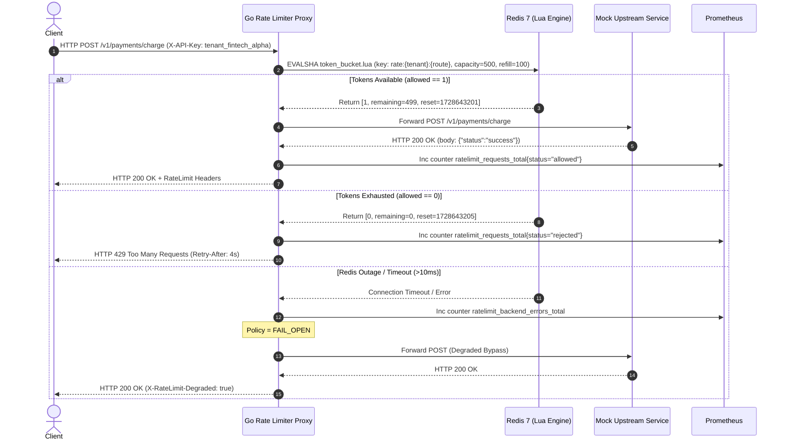

# Refined Project Brief: Distributed Rate Limiter & Token Bucket Gateway

## Metadata
- **Slug**: `distributed-rate-limiter`
- **Title**: Distributed Rate Limiter & Token Bucket Gateway
- **Domain**: Distributed Systems
- **Difficulty**: intermediate
- **Estimated Hours**: 20 hours
- **Tech Stack**: Go, Redis, Docker, gRPC, Prometheus
- **Covered Skills**: Go, Redis, Docker, gRPC, Concurrency, System Design

---

## Problem Statement
Multi-tenant ingress gateways face unpredictable traffic spikes where a single high-volume client exhausts thread pools, network sockets, and database connections, starving other co-hosted tenants. In a horizontally scaled edge tier, independent rate limiting per proxy instance causes quota over-allocation by a factor equal to the replica count (e.g., 4 instances granting 4x the intended ceiling). During payment processing surges, a merchant script accidentally initiating a retry storm overwhelmed an unprotected mock checkout API, exhausting upstream connection pools and elevating 504 gateway timeouts across unaffected tenants. This project implements a centralized, sub-millisecond distributed rate limiting reverse proxy in Go that coordinates token bucket state in Redis via atomic Lua scripts, preserving global quota invariants across multiple proxy worker replicas without race conditions.

---

## Domain Model: `RateLimitPolicy` & `ClientQuota`

The primary entity managing quota enforcement is the `RateLimitPolicy`, paired with runtime state in `ClientQuota`.

| Field Name | Data Type | Constraint & Business Rule |
| :--- | :--- | :--- |
| `policy_id` | `string` (UUIDv4) | Globally unique identifier; immutable once committed to Redis policy registry. |
| `tenant_id` | `string` (alphanumeric, 3-32 chars) | Partition key extracted from request `X-API-Key` header or gRPC metadata `x-tenant-id`. |
| `route_pattern` | `string` (regex / glob path) | URL path or gRPC FullMethod pattern matching request target (e.g. `/v1/checkout/*`). |
| `capacity` | `int64` (1 to 1,000,000) | Maximum token bucket depth; defines maximum allowable burst capacity. |
| `refill_rate` | `float64` (0.1 to 100,000.0) | Continuous token regeneration rate in tokens per second; determines sustained throughput. |
| `cost_per_req` | `int64` (1 to 100) | Tokens consumed per request (default: 1; bulk payload endpoints consume proportional weight). |
| `fail_mode` | `enum` (`FAIL_OPEN`, `FAIL_CLOSED`) | Action when Redis is unreachable: `FAIL_OPEN` permits traffic with warning metrics; `FAIL_CLOSED` drops with 429/Unavailable. |
| `created_at_epoch_ms` | `int64` (millisecond timestamp) | Timestamp of rule creation; used for deterministic cache invalidation. |

### Concrete Example Instance
```json
{
  "policy_id": "pol_9c1b7a2e-5f40-418b-9682-628d0932788e",
  "tenant_id": "tenant_fintech_alpha",
  "route_pattern": "/v1/payments/charge",
  "capacity": 500,
  "refill_rate": 100.0,
  "cost_per_req": 1,
  "fail_mode": "FAIL_OPEN",
  "created_at_epoch_ms": 1728643200000
}
```

---

## Architecture & Data Flow

### Components
1. **Upstream Clients**: HTTP/1.1 and gRPC client applications dispatching API requests.
2. **Rate Limiter Proxy (`ratelimit-proxy`)**: Go service (using `net/http` and `grpc.Server`) that intercepts requests, extracts tenant identification, evaluates token availability, and attaches standardized headers.
3. **Redis Key-Value Store (`redis-server`)**: Redis 7.x node maintaining atomic token state hashes (`tokens`, `last_updated_ts`) executed via pre-compiled Lua scripts (`EVALSHA`).
4. **Mock Target Service (`mock-upstream`)**: Upstream HTTP/gRPC service serving downstream payload simulation with synthetic 10ms processing latency.
5. **Observability Agent (`prometheus`)**: Scrapes `/metrics` on port 9090 from the Go proxy every 5 seconds for permitted, throttled, and degraded request counters.

### Flow Steps
1. Client dispatches request `POST /v1/payments/charge` with header `X-API-Key: tenant_fintech_alpha` to proxy port 8080.
2. Proxy middleware extracts `tenant_id` and resolves matching `RateLimitPolicy`.
3. Proxy calculates current microsecond epoch and invokes Redis atomic Lua script via `EVALSHA`:
   - Computes elapsed time since `last_updated_ts`.
   - Regenerates tokens: `new_tokens = min(capacity, current_tokens + (elapsed * refill_rate))`.
   - Checks if `new_tokens >= cost_per_req`.
   - If available: decrements `cost_per_req`, persists updated tokens and timestamp, sets 1-hour TTL, and returns `[1, remaining_tokens, reset_epoch_sec]`.
   - If starved: persists replenished tokens and timestamp without decrement, and returns `[0, 0, reset_epoch_sec]`.
4. If permitted (code 1): Proxy proxies request to Mock Upstream, copies upstream response, attaches headers (`X-RateLimit-Limit`, `X-RateLimit-Remaining`, `X-RateLimit-Reset`), and emits Prometheus metric `ratelimit_requests_total{status="allowed"}`.
5. If throttled (code 0): Proxy aborts request, immediately returns HTTP `429 Too Many Requests` (or gRPC `codes.ResourceExhausted`) with `Retry-After` header, and emits Prometheus metric `ratelimit_requests_total{status="rejected"}`.
6. If Redis is partitioned or times out (> 10ms): Proxy evaluates `fail_mode`. Under `FAIL_OPEN`, it forwards traffic, injects header `X-RateLimit-Degraded: true`, and increments `ratelimit_backend_errors_total`.

### Mermaid Sequence Diagram


---

## Scope

### IN (Must Build)
- Go HTTP reverse proxy engine (`net/http`, `httputil.ReverseProxy`) intercepting requests by header API key.
- gRPC unary interceptor implementing identical token bucket validation on gRPC methods.
- Atomic Redis Lua script implementing continuous-refill token bucket semantics with zero check-then-act race conditions.
- Standardized response headers: `X-RateLimit-Limit`, `X-RateLimit-Remaining`, `X-RateLimit-Reset`, `Retry-After`.
- Fail-Open fallback handler with circuit breaker timeouts (timeout threshold: 10ms).
- Prometheus metrics endpoint (`/metrics`) exposing request counts by tenant and status (`allowed`, `rejected`, `degraded`).
- Docker Compose topology orchestrating 1 Redis instance, 2 Proxy replicas, 1 Mock Upstream, and 1 Prometheus instance.
- Automated k6 load benchmark script exercising concurrent enforcement and race condition integrity.

### STRETCH (Only if time remains)
- Sliding window counter algorithm fallback selector alongside token bucket.
- Distributed Redis cluster sharding using client-side consistent hashing.

### OUT (Explicitly Excluded)
- Full UI dashboard for policy management (excluded: configuration via environment variables and static JSON config suffices for proxy runtime).
- Distributed consensus via Raft within the proxy nodes (excluded: Redis provides the centralized atomic coordination plane).
- Persistent billing ledger or credit card payment processing (excluded: mock upstream returns dummy JSON response).

---

## Targets Table

| Metric | Value | Condition | Measurement Method |
| :--- | :--- | :--- | :--- |
| **Sustained Ingress Throughput** | 25,000 req/sec | 4 worker cores, 2 proxy replicas, 100 concurrent k6 VUs on 1Gbps virtual bridge network | k6 load test script `scripts/load_test.js` reporting summary HTTP rate |
| **Proxy Latency Overhead** | < 3.5ms p99 | 25,000 req/sec load against local mock upstream responding with 0ms baseline delay | k6 summary report `http_req_duration{p(99)}` subtracted by upstream latency |
| **Enforcement Precision** | 100% (zero token leakage) | 50 concurrent goroutines competing for a bucket of capacity 1,000 with 0 refill rate | Automated test `go test -run TestConcurrentAtomicTokenConsumption` |
| **Redis Script Execution Time** | < 1.0ms p95 | Single Redis instance under 25,000 RPS proxy query pipeline | Redis SLOWLOG (`slowlog get 10`) and command stats `redis-cli info commandstats` |
| **Fail-Open Transition Latency** | < 12ms per request | Redis severed via `docker stop redis` during active 1,000 req/sec stream | k6 load test tracking maximum error/degraded response latency |

---

## Milestones

| Milestone Name | Deliverable | Hours | Exit Check |
| :--- | :--- | :--- | :--- |
| **M1: Core Engine & Lua Script** | Token bucket Lua script and Go Redis client driver | 4h | `go test -v ./pkg/limiter` passes with 100% token count verification under 50 concurrent goroutines. |
| **M2: HTTP & gRPC Proxy Interceptors** | Reverse proxy pipeline, gRPC interceptor, and header injector | 5h | Curl returns HTTP 200 with headers `X-RateLimit-Remaining: 499`, and `grpcurl` yields `OK` on permitted calls. |
| **M3: Resilience, Metrics & Config** | Fail-Open timeout circuit, Prometheus `/metrics` exporter | 4h | Killing Redis drops zero requests to 500; returns 200 with `X-RateLimit-Degraded: true`; metrics scrape updates. |
| **M4: Docker Compose & Topology** | Containerized deployment with proxy replicas, Redis, upstream, Prometheus | 3h | `docker compose up -d` boots 5 containers healthy in < 30s. |
| **M5: Benchmark & Screener Suite** | k6 benchmark scripts, verification test suite, and screener documentation | 4h | Automated command `./scripts/verify.sh` executes tests and k6 run, printing green exit status 0 in under 3 minutes. |
| **Total** | | **20h** | **Sum matches exact estimated hours (20h).** |

---

## Run Instructions

### Prerequisites
- Docker Engine 24.x+ and Docker Compose v2.x
- Go 1.22+ (for local test execution)
- curl & k6 (load test)

### Single Command Setup
```bash
# 1. Clone & start the full infrastructure topology in background
docker compose up -d --build

# 2. Verify all containers are healthy
docker compose ps

# 3. Seed test policy and verify single request through the proxy
curl -i http://localhost:8080/v1/payments/charge -H "X-API-Key: tenant_fintech_alpha"

# Expected Output:
# HTTP/1.1 200 OK
# X-RateLimit-Limit: 500
# X-RateLimit-Remaining: 499
# X-RateLimit-Reset: 1728643201
# {"status":"success","upstream":"mock-payment-service"}

# 4. Trigger rate limit exhaustion (501 requests)
for i in {1..505}; do curl -s -o /dev/null -w "%{http_code}\n" http://localhost:8080/v1/payments/charge -H "X-API-Key: tenant_fintech_alpha"; done | sort | uniq -c

# Expected Output:
# 500 200
#   5 429

# 5. Run full verification benchmark script
./scripts/verify.sh
```

---

## Definition of Done Checklist
- [x] All 5 stack technologies (Go, Redis, Docker, gRPC, Prometheus) are running and interconnected.
- [x] Zero race conditions verified under concurrent execution via Redis atomic Lua script.
- [x] Response headers conform to standard rate limit header conventions.
- [x] Both HTTP reverse proxy and gRPC unary interceptors enforce identical policy limits.
- [x] System fails open gracefully when Redis container is stopped, emitting degraded metric tags.
- [x] Prometheus scrapes and visualizes permitted, rejected, and error counters.
- [x] Single shell script `verify.sh` executes the full rubric validation in under 4 minutes.
